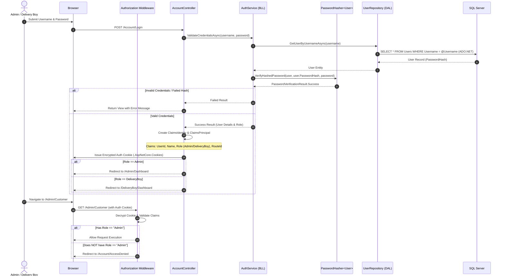
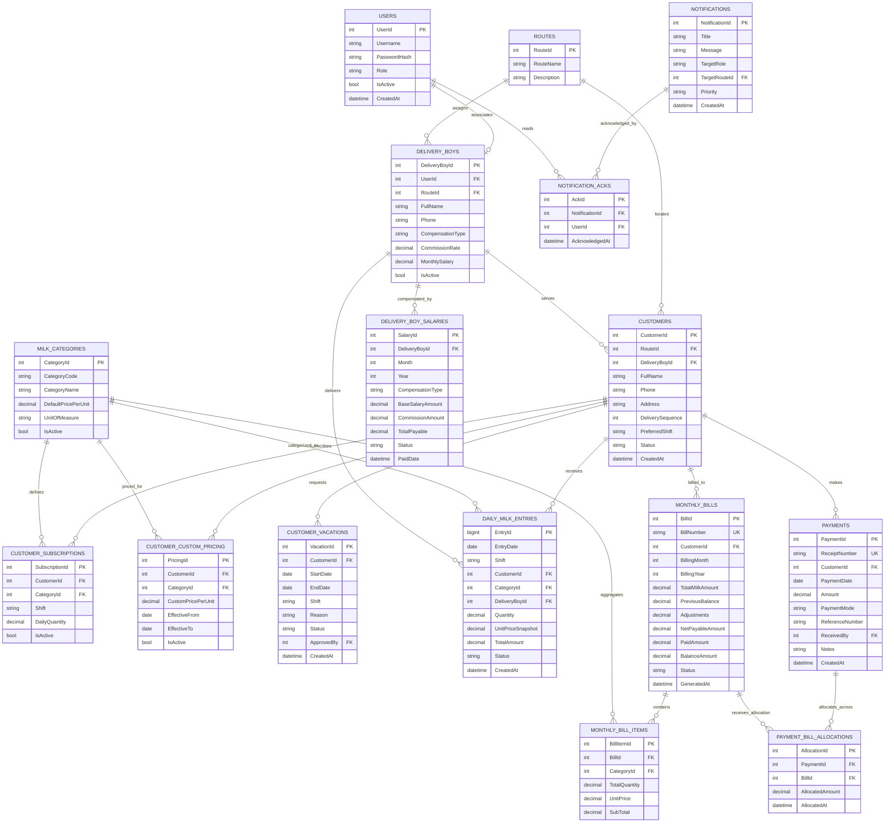
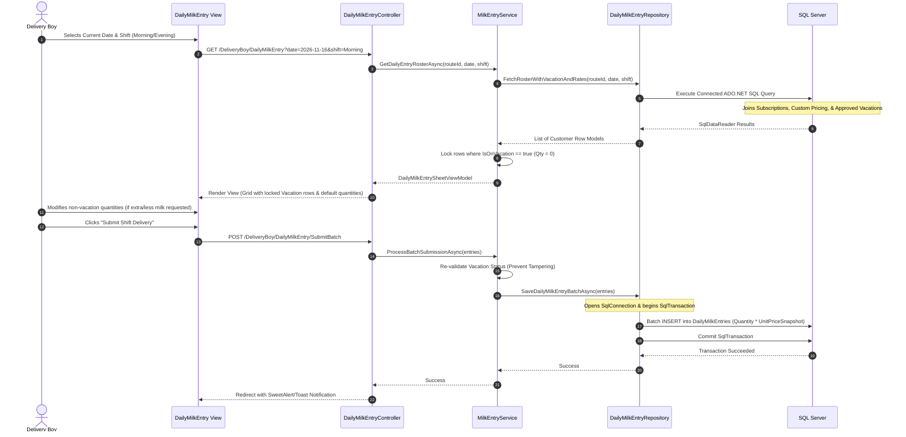
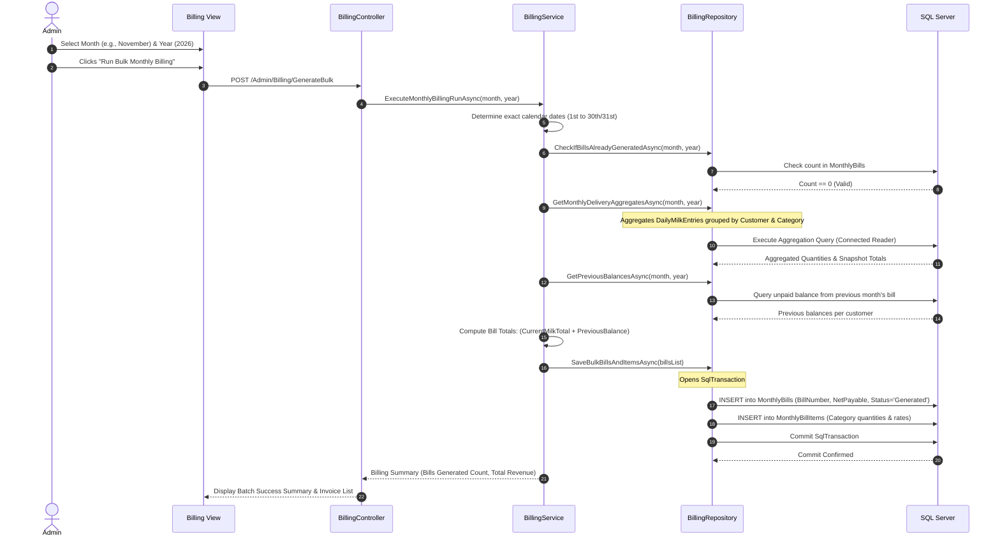
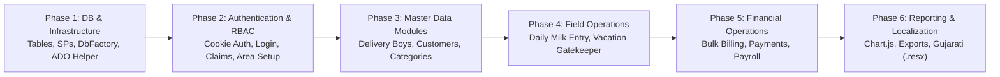

# Dairy Management System — Solution Architecture Document

**Document Version:** 1.0.0  
**Target Framework:** .NET 9.0 (C# 13)  
**Architectural Pattern:** Layered Enterprise Architecture (ASP.NET Core MVC + ADO.NET)  
**Database:** Microsoft SQL Server  
**Author:** Senior ASP.NET Core Solution Architect  
**Project Path:** `D:\MU\.Net_Code\Dairy_Management_System`  

---

## Table of Contents
1. [Executive Summary & Project Overview](#1-executive-summary--project-overview)
2. [Target Technology Stack & Syllabus Alignment](#2-target-technology-stack--syllabus-alignment)
3. [Architectural Principles & Layered Design](#3-architectural-principles--layered-design)
4. [Module & Submodule Decomposition](#4-module--submodule-decomposition)
5. [Proposed Folder Structure](#5-proposed-folder-structure)
6. [Data Access Architecture (ADO.NET Strategy)](#6-data-access-architecture-adonet-strategy)
7. [Authentication & Authorization Strategy](#7-authentication--authorization-strategy)
8. [Domain Model & Relational Database Design](#8-domain-model--relational-database-design)
9. [Module Interaction & Data Flow Workflows](#9-module-interaction--data-flow-workflows)
10. [Special Business Requirements Implementation](#10-special-business-requirements-implementation)
11. [Architectural Decisions & Trade-Offs](#11-architectural-decisions--trade-offs)
12. [Implementation Roadmap & Milestones](#12-implementation-roadmap--milestones)

---

## 1. Executive Summary & Project Overview

### 1.1 Business Context
The **Dairy Management System (DMS)** is an enterprise-grade operational management and billing platform designed for dairy distributors, milk vendors, and dairy cooperative centers. The business model involves daily recurring field operations:
- Managing multiple milk categories (e.g., Cow Milk, Buffalo Milk, Desi Cow A2, Full Cream) with variable unit pricing.
- Delivering milk in morning and evening shifts to hundreds of households and commercial customers across geographically partitioned routes.
- Tracking daily variations in quantity delivered, customer vacations, customer-specific pricing contracts, and field collection logistics.
- Monthly calendar billing, statement generation, payment allocation (Online and Offline), and delivery boy compensation (both fixed salary and commission-based).

### 1.2 Core Personas
1. **Admin (Dairy Owner / Operations Manager):**
   Full administrative authority over master configurations, customer subscriptions, delivery boy personnel, routes, pricing agreements, vacation approvals, calendar billing runs, payment ledgers, financial reports, and broadcast communications.
2. **Delivery Boy (Route Agent / Field Executive):**
   Mobile-friendly operational access to assigned routes and customer rosters. Performs daily milk entry per shift, views delivery quotas, monitors personal payout/commission, and receives route notifications.
3. **Customer (Indirect Stakeholder / Consumer Record):**
   Subject of daily subscription deliveries, custom rate cards, billing ledgers, vacation restrictions, and payment settlements.

### 1.3 Key Architectural Goals
- **High Performance & Low Latency:** Direct, un-abstracted SQL execution via ADO.NET with high-speed data readers.
- **Relational Integrity & Financial Accuracy:** Strict ACID compliance for billing cycles, pricing histories, and payment allocations.
- **Maintainability & Separation of Concerns:** Strict adherence to layered architecture separating presentation, controller orchestration, domain business rules, and ADO.NET data access.
- **Academic & Syllabus Alignment:** Comprehensive coverage of C# Object-Oriented Programming (OOP), ASP.NET Core MVC patterns, Razor Views, Dependency Injection, Middleware, Connected and Disconnected ADO.NET, and RESTful AJAX services.

---

## 2. Target Technology Stack & Syllabus Alignment

### 2.1 Core Stack Specifications
| Component | Technology | Version | Purpose |
| :--- | :--- | :--- | :--- |
| **Runtime & Framework** | .NET | 9.0 (`net9.0`) | High-performance managed execution platform |
| **Language** | C# | 13.0 | Modern OOP, pattern matching, record types, nullable reference types |
| **Web Framework** | ASP.NET Core MVC | 9.0 | Server-side MVC architecture, Tag Helpers, ViewComponents, Model Binding |
| **Data Access** | ADO.NET | System.Data.SqlClient / Microsoft.Data.SqlClient | Direct database connectivity via `SqlConnection`, `SqlCommand`, `SqlDataReader`, `SqlDataAdapter`, `DataSet`, `DataTable` |
| **Database** | Microsoft SQL Server | 2019 / 2022 | Relational schema, stored procedures, constraints, indexes, audit trails |
| **UI & Styling** | Bootstrap & Custom CSS | 5.3+ | Responsive admin and mobile-friendly delivery boy interfaces |
| **Client Scripting** | JavaScript (ES6+) | Modern Vanilla | DOM interactions, AJAX communication, form validations |
| **Data Visualization**| Chart.js | 4.x | Interactive sales, collection, milk consumption, and route performance analytics |
| **Localization** | ASP.NET Core Localization | Built-in | Multilingual support for English and Gujarati (`gu-IN`) |

### 2.2 Syllabus Integration Mapping

```
+----------------------------------------------------------------------------------------------------+
|                                    .NET TECHNOLOGIES SYLLABUS                                      |
+------------------------------------+---------------------------------------------------------------+
| Syllabus Topic                     | System Architecture Manifestation                             |
+------------------------------------+---------------------------------------------------------------+
| C# OOP Principles                  | Encapsulation in Data Models, Inheritance in Service bases,   |
|                                    | Polymorphism in compensation calculation (Salary vs Comm.),   |
|                                    | Interfaces for Services and Repositories (DIP).               |
+------------------------------------+---------------------------------------------------------------+
| ASP.NET Core MVC                   | Areas for Admin and DeliveryBoy, Controllers handling HTTP    |
|                                    | verbs, Model Binding, ModelState validation, ViewModels.      |
+------------------------------------+---------------------------------------------------------------+
| Razor Views & ViewComponents       | Strongly-typed Razor views, Tag Helpers, Reusable Partials,   |
|                                    | ViewComponents for dashboard summary widgets and alert panels.|
+------------------------------------+---------------------------------------------------------------+
| Routing Engine                     | Area-based attribute and conventional routing, constraint     |
|                                    | checks for shifts, month/year parameters.                     |
+------------------------------------+---------------------------------------------------------------+
| Dependency Injection (DI)          | Registration of `IDbConnectionFactory`, Repositories (Scoped),|
|                                    | Business Services (Scoped), and Utilities in `Program.cs`.    |
+------------------------------------+---------------------------------------------------------------+
| ASP.NET Core Middleware            | Custom Exception Handler Middleware, Culture/Localization    |
|                                    | Middleware, Authentication/Authorization Middleware.          |
+------------------------------------+---------------------------------------------------------------+
| ADO.NET Connected Architecture     | `SqlConnection`, `SqlCommand`, `SqlDataReader` for streaming  |
|                                    | large datasets, read-only listings, and live validation.      |
+------------------------------------+---------------------------------------------------------------+
| ADO.NET Disconnected Architecture  | `SqlDataAdapter`, `DataSet`, `DataTable` for offline data     |
|                                    | manipulation, batch reporting, Excel/CSV export engines.      |
+------------------------------------+---------------------------------------------------------------+
| ADO.NET Transactions               | Explicit `SqlTransaction` with Commit and Rollback for        |
|                                    | multi-step operations (Monthly Billing, Bulk Entry, Payment). |
+------------------------------------+---------------------------------------------------------------+
| REST API Concepts                  | Internal AJAX endpoints returning JSON for Chart.js analytics,|
|                                    | customer subscription lookups, dynamic rate card fetching.    |
+------------------------------------+---------------------------------------------------------------+
```

---

## 3. Architectural Principles & Layered Design

The system implements an enterprise **Clean Layered Architecture** adapted specifically for ASP.NET Core MVC with direct ADO.NET data access. The design enforces unidirectional dependencies from top to bottom.

### 3.1 Architectural Block Diagram

```mermaid
graph TD
    subgraph Presentation_Layer ["Presentation Layer (UI)"]
        RazorViews["Razor Views (.cshtml)"]
        TagHelpers["Tag Helpers & ViewComponents"]
        ClientAssets["Bootstrap 5 + Custom CSS"]
        Scripts["JavaScript (ES6+) + Chart.js"]
    end

    subgraph Controller_API_Layer ["Controller & Endpoint Layer"]
        AdminControllers["Admin Area Controllers"]
        DeliveryControllers["DeliveryBoy Area Controllers"]
        AccountControllers["Account & Authentication Controllers"]
        ApiControllers["Internal REST/AJAX API Controllers"]
    end

    subgraph Business_Logic_Layer ["Business Logic Layer (BLL / Services)"]
        BillingService["Billing & Calculation Engine"]
        MilkEntryService["Daily Milk Entry & Vacation Gatekeeper"]
        PayrollService["Compensation & Payroll Service (Fixed/Comm.)"]
        CustomerService["Customer & Subscription Pricing Service"]
        PaymentService["Payment Allocation & Ledger Service"]
        NotificationService["Notification & Acknowledgement Service"]
        ReportingService["Reporting & Analytical Aggregator"]
    end

    subgraph Data_Access_Layer ["Data Access Layer (DAL / Repositories)"]
        DbFactory["IDbConnectionFactory (SqlConnection Pool)"]
        SqlExecutor["SqlExecutor / ADO.NET Helper"]
        AdminRepos["Customer, DeliveryBoy, Master Repositories"]
        EntryRepos["MilkEntry & Vacation Repositories"]
        BillingRepos["Billing & Payment Repositories"]
    end

    subgraph Cross_Cutting ["Cross-Cutting Concerns"]
        AuthModule["Cookie Authentication & RBAC Claims"]
        Localization["Localization Engine (English / Gujarati)"]
        Logging["Structured Audit & Exception Logging"]
        ExportEngine["Export Engine (Excel/CSV via DataSets)"]
    end

    subgraph Database_Layer ["Database Layer (Microsoft SQL Server)"]
        Tables["Relational Schema & Constraints"]
        Indexes["Clustered / Non-Clustered Indexes"]
        StoredProcs["Optimized Stored Procedures"]
        Views["Analytical & Aggregation SQL Views"]
    end

    Presentation_Layer --> Controller_API_Layer
    Controller_API_Layer --> Business_Logic_Layer
    Business_Logic_Layer --> Data_Access_Layer
    Data_Access_Layer --> Database_Layer
    Cross_Cutting -.-> Controller_API_Layer
    Cross_Cutting -.-> Business_Logic_Layer
    Cross_Cutting -.-> Data_Access_Layer
```



### 3.2 Layer Responsibilities

#### 1. Presentation Layer
- **Razor Views:** Strongly-typed UI templates utilizing Model-View-ViewModel (MVVM) patterns for views.
- **ViewComponents:** Autonomous components for dashboard KPI counters, recent notifications dropdown, and route delivery progress bars.
- **Client Scripts:** Chart.js initialization, asynchronous AJAX form submissions, responsive shift-entry data grids, dynamic total calculations.
- **Localization Directives:** `@inject IViewLocalizer Localizer` to render UI in English or Gujarati seamlessly.

#### 2. Controller & API Layer
- **Controllers:** Handle HTTP requests (`GET`, `POST`), invoke Model Binding, validate `ModelState`, call Business Logic Services, and return `ViewResult`, `PartialViewResult`, or `RedirectToActionResult`.
- **REST API Endpoints:** Lightweight controllers or actions decorated with `[HttpGet]`, `[HttpPost]` that produce JSON (`JsonResult` / `IActionResult`) consumed by client-side JavaScript for Chart.js analytics and dynamic dropdown updates.
- **Security Attributes:** `[Authorize(Roles = "Admin")]` and `[Authorize(Roles = "DeliveryBoy")]` decorators enforcing RBAC.

#### 3. Business Logic Layer (BLL / Services)
- Enforces all domain invariants and calculations.
- **Billing Engine:** Implements calendar-month date range logic, sums daily milk deliveries, checks customer-specific historical unit prices, deducts approved vacation entries, and balances credits.
- **Vacation Rule Engine:** Evaluates pending and approved vacations, immediately locking out delivery entries for affected customers and shifts.
- **Compensation Engine:** Calculates delivery boy earnings based on their employment model: fixed monthly salary or per-litre commission (Eligible Confirmed Milk Litres × Individual Rate Per Litre across all categories). Fixed-salary employees receive no commission.
- **Payment Allocator:** Manages manual month-wise allocation of received payments (Online or Offline with optional reference) across one or more selected outstanding calendar-month bills using database transactions. Updating a bill never automatically marks it as paid; payment and billing concerns remain strictly decoupled.

#### 4. Data Access Layer (DAL / Repositories)
- Direct interface with Microsoft SQL Server using native **ADO.NET**.
- Encapsulates connection lifecycle using `IDbConnectionFactory`.
- Implements Repository classes (e.g., `CustomerRepository`, `DailyMilkEntryRepository`, `BillingRepository`).
- Executes both Connected (`SqlDataReader`) and Disconnected (`SqlDataAdapter`, `DataSet`, `DataTable`) operations.
- Manages transactional boundaries using `SqlTransaction`.

#### 5. Cross-Cutting Concerns
- **Security & RBAC:** Cookie authentication handler, claims generation, antiforgery token verification.
- **Localization:** `IStringLocalizer` utilizing `.resx` resource files for English (`en-US`) and Gujarati (`gu-IN`).
- **Export Services:** Transforms disconnected `DataTable` objects into formatted CSV and Excel-compatible XML streams without third-party heavy dependencies.
- **Audit Logging:** Logs administrative operations, price modifications, and payment receipts.

#### 6. Database Layer
- Tables equipped with Foreign Keys, `CHECK` constraints, default values, and soft-delete flags (`IsDeleted`).
- Composite unique indexes on `(CustomerId, EntryDate, Shift, CategoryId)` to prevent duplicate deliveries.
- Stored procedures for complex batch routines (e.g., Monthly Bill Batch Generation).

---

## 4. Module & Submodule Decomposition

```
+---------------------------------------------------------------------------------------------------+
|                                  DAIRY MANAGEMENT SYSTEM MODULES                                  |
+-------------------------------------------------+-------------------------------------------------+
| ADMIN PORTAL MODULES                            | DELIVERY BOY PORTAL MODULES                     |
+-------------------------------------------------+-------------------------------------------------+
| 1. Dashboard (Analytics & KPIs)                 | 1. Dashboard (Daily Quota & Shift Stats)        |
| 2. Delivery Boy Management                      | 2. My Customers (Roster & Subscriptions)        |
| 3. Customer Management                          | 3. Daily Milk Entry (Shift Delivery Grid)       |
| 4. Monthly Billing Management                   | 4. Notifications (Announcements & Alerts)       |
| 5. Reports & Business Intelligence              | 5. Settings (App & Language Preferences)        |
| 6. Export Management (CSV / Excel)              | 6. Help & Support (Issue Logging to Admin)      |
| 7. Notification Management                      | 7. Profile (Account Details & Salary Overview)  |
| 8. Settings & Configurations                    |                                                 |
| 9. Help & Support (Complaints / Inquiries)      |                                                 |
+-------------------------------------------------+-------------------------------------------------+
|                                     INTERNAL CORE SUBMODULES                                      |
+---------------------------------------------------------------------------------------------------+
| * Submodule A: Payment Management & Payment History (Online/Offline, Manual Allocation)           |
| * Submodule B: Commission Management (Individual Rates, Per-Liter / Per-Shift Calculation)        |
| * Submodule C: Salary Management (Fixed Monthly Salaries, Deductions, Slips)                      |
| * Submodule D: Vacation Management (Customer Requests, Approval Flow, Entry Lockout)             |
| * Submodule E: Milk Category Management (Categories, Standard Rates, Unit Metrics)               |
| * Submodule F: Customer Subscription & Pricing Management (Multi-Category, Custom Price History)  |
| * Submodule G: Monthly Bill Generation & Bulk Billing (Calendar Month Run, Itemized Line Items)   |
+---------------------------------------------------------------------------------------------------+
```

### 4.1 Admin Modules Breakdown

#### 1. Admin Dashboard
- **KPI Summary Cards:** Today's Morning & Evening Milk Distributed (Liters), Total Monthly Billing (₹), Outstanding Collections (₹), Active Customers, Active Delivery Boys.
- **Visual Analytics (Chart.js):**
  - 30-Day Milk Distribution Trend by Category (Line Chart).
  - Monthly Collection vs. Pending Dues (Bar Chart).
  - Shift-wise Distribution Ratio: Morning vs. Evening (Doughnut Chart).
- **Alerts & Action Items:** Pending vacation requests needing approval, customers with overdue bills exceeding 60 days, unacknowledged broadcast alerts.

#### 2. Delivery Boy Management
- **CRUD Operations:** Register, view, edit, and deactivate delivery personnel.
- **Route & Area Assignment:** Map delivery boys to specific geographic zones/routes.
- **Compensation Configuration:** Set remuneration model per individual:
  - Model A: Fixed Monthly Salary (e.g., ₹12,000/month; receives zero commission).
  - Model B: Commission-Based (individual per-litre rate, e.g., ₹1.50 per confirmed eligible litre, common across all milk categories).
- **Status & Performance Monitoring:** View delivery completion rates and punctuality logs.

#### 3. Customer Management
- **Customer Master:** Full contact details, primary route, delivery sequence number (for route optimization), and preferred shift (Morning, Evening, or Both).
- **Multi-Category Subscription Setup:** Assign multiple milk types per customer with daily required quantities (e.g., 1.5L Cow Milk + 0.5L Buffalo Milk in Morning).
- **Custom Price Matrix:** Define individual customer price overrides deviating from default base prices.
- **Status Management:** Active, Temporarily Suspended, or Inactive.

#### 4. Monthly Billing Management
- **Calendar-Month Billing Execution:** Automated batch run at month-end covering strictly the 1st to the final calendar day (28/29/30/31).
- **Billing Workspace:** View generated invoices, invoice statuses (`Generated`, `PartiallyPaid`, `Paid`, `Overdue`).
- **Manual Bill Adjustments:** Apply manual credits or debit adjustments with audit notes before finalizing bills.
- **Invoice Statement Preview:** Detailed breakdown showing daily milk entries, vacations taken, rate applied, previous outstanding balance, and final payable amount.
- **Decoupling from Payments:** Monthly billing generates or updates invoices based on consumption and pricing. Publishing, recalculating, or revising a bill must never automatically mark it as paid or change payment status.

#### 5. Reports & Business Intelligence
- **Daily Delivery Report:** Date-wise, route-wise, shift-wise, and category-wise milk dispatch logs.
- **Monthly Sales & Revenue Report:** Aggregated monthly milk sales volume and gross revenue.
- **Customer Ledger Report:** Running account balance of any selected customer over custom date ranges.
- **Collection & Dues Aging Report:** Outstanding balances grouped by 0-30 days, 31-60 days, and 60+ days.
- **Delivery Boy Performance & Commission Report:** Confirmed delivered litres per agent (`Completed` entries only), individual per-litre commission calculations, and payout summaries.

#### 6. Export Management
- Centralized utility converting disconnected ADO.NET `DataTable` objects into downloadable formats:
  - Formatted CSV.
  - Microsoft Excel-compliant XML / Spreadsheets.
  - Printable HTML billing statements optimized for physical thermal and A4 printers.

#### 7. Notification Management
- Broadcast creation: System-wide alerts, route-specific alerts, or delivery-boy specific alerts.
- Priority levels: Normal, Important, Critical.
- Tracking & Acknowledgment: Real-time dashboard showing which delivery boys have read and acknowledged the notification. Acknowledgement strictly signifies that the delivery boy has read/seen the notification; it does not indicate that customer payment has been received or collected.

#### 8. Settings & Configurations
- **Dairy Enterprise Profile:** Name, address, GST/FSSAI registration number, contact info, bill footer notes.
- **System Defaults:** Default billing cycle parameters, currency formatting, timezone settings.
- **Default Language:** Fallback UI language (English vs. Gujarati).

#### 9. Help & Support
- Ticket management for field issues reported by delivery boys (e.g., customer address changes, quantity disputes, damaged bottles/packets).
- Customer inquiry register.

---

### 4.2 Delivery Boy Modules Breakdown

#### 1. Delivery Boy Dashboard
- Today's assigned customer count and delivery status (Pending vs. Completed).
- Total milk quantity scheduled for today's current shift (broken down by category).
- Recent broadcast notifications from Admin.
- Quick shortcut to start the shift's Daily Milk Entry.

#### 2. My Customers
- Ordered delivery sequence list of customers assigned to the delivery boy's route.
- Customer card details: Name, localized address, landmark, phone number, default subscription quantities.
- Real-time indicator badges: `Active`, `On Approved Vacation (No Delivery)`, `Shift Preference`.

#### 3. Daily Milk Entry
- **Shift Selector:** Toggle between Morning and Evening entry sheets for the current date.
- **Pre-Populated Grid:** Automatically pre-fills customer subscription default quantities.
- **Vacation Lockout:** Customers on approved vacation have their inputs completely locked and visually grayed out with a "Vacation Active" indicator.
- **Inline Editing:** Delivery boy can adjust quantities if a customer requested extra milk or less milk on that specific day.
- **Batch Submission:** Single-click transactional submission of the entire route's entries using ADO.NET `SqlTransaction`.

#### 4. Notifications
- View personal and broadcast notifications from Admin.
- "Mark as Read / Acknowledge" button: Explicitly records that the delivery boy has read/seen the notification. Acknowledgement confirms message visibility only and does not signify that any payment has been received.

#### 5. Settings
- Language selection toggle: Switch interface instantly between English and Gujarati (`ગુજરાતી`).
- Display preferences (Compact vs. Comfortable list density).

#### 6. Help & Support
- Direct submission form to report field issues to Admin (e.g., customer absent without notice, route road blockage, payment handed to agent).

#### 7. Profile
- Personal profile view, assigned route, employment type (Fixed Salary vs. Commission).
- Summary of Completed milk litres delivered during the current month and earned commission estimate.
- Change password facility.

---

### 4.3 Internal Submodules Deep Dive

#### Submodule A: Payment Management & Payment History
- **Strict Payment Modes:** Exactly two payment modes are permitted:
  1. `Online`
  2. `Offline`
  - Sub-modes such as UPI, NetBanking, Card, QR, Cash, or Cheque are **not** defined as separate payment modes in the system.
  - An optional transaction reference (`ReferenceNumber`) may be stored for online payments.
  - Admin manually records and verifies all payments. No external payment gateway is included.
- **Manual Month-Wise Payment Allocation (No FIFO):**
  - FIFO allocation is completely removed from the system.
  - Admin manually selects the customer, views their outstanding calendar-month bills, selects one or more outstanding calendar months, and inputs the exact amount allocated to each selected month.
  - Multi-bill consistency is strictly enforced through atomic database transactions (`SqlTransaction`).
- **Separation of Billing and Payments:**
  - Monthly billing generates or updates invoices; payment management records actual received money.
  - Updating a bill must never automatically mark it as paid. A bill's payment status is updated solely through explicit, verified payment allocations.
- **Audit History:** Full ledger of receipts with timestamp, received-by user ID, mode (`Online` or `Offline`), optional online transaction reference, allocated month breakdown, and notes.

#### Submodule B: Commission Management
- **Commission Definition & Formula:**
  $$\text{Monthly Commission} = \text{Eligible Confirmed Milk Litres} \times \text{Delivery Boy's Individual Commission Rate Per Litre}$$
- **Rate Characteristics:** The commission rate per litre is individual to each delivery boy (stored on their profile), but is common and uniform across all milk categories.
- **Exact Daily Milk Entry Statuses:**
  - `Completed`: Milk was successfully delivered and confirmed.
  - `Pending`: Delivery entry is logged but awaiting confirmation.
  - `Not Delivered`: Customer was absent, order cancelled, or delivery could not be fulfilled.
- **Commission Eligibility:**
  - Include only `Completed` entries (`Status = 'Completed'`).
  - Exclude `Pending` entries (`Status = 'Pending'`).
  - Exclude `Not Delivered` entries (`Status = 'Not Delivered'`).
  - Exclude approved customer vacation days (which record zero delivered quantity).
- **Fixed-Salary Employees:** Delivery boys on a fixed salary receive **no commission** whatsoever ($\text{Commission} = 0$).

#### Submodule C: Salary Management
- **Fixed Salary Employees:** Monthly fixed remuneration registered in their employee record.
- **Pay Run Module:** Monthly payroll generator calculating base salary, recorded advances, approved deductions, and net payout.
- **Pay Slip Generation:** Disconnected ADO.NET dataset used to render printable monthly salary slips.

#### Submodule D: Vacation Management
- **Workflow:**
  1. Customer requests vacation (via phone/Admin or Delivery Boy logging it).
  2. Record created with `StartDate`, `EndDate`, affected shifts (`Morning`, `Evening`, `Both`), and reason.
  3. Status starts as `Pending`.
  4. Admin reviews and marks `Approved` (or `Rejected`).
- **Entry Lockout Rule:** When `DailyMilkEntryService` loads the entry roster for Date $D$ and Shift $S$:
  - It checks if any customer has an approved vacation where $D \ge \text{StartDate}$ and $D \le \text{EndDate}$ and $(\text{Shift} = S \lor \text{Shift} = \text{'Both'})$.
  - If true, delivery quantity is hardcoded to $0.00$, the input control is disabled in the UI, and the delivery status is marked as `Not Delivered` (Vacation).

#### Submodule E: Milk Category Management
- Master record of milk types: Cow Milk, Buffalo Milk, Desi Cow A2, Full Cream, etc.
- Attributes: `CategoryId`, `CategoryCode`, `CategoryName` (localized in English/Gujarati), `StandardPricePerLiter`, `UnitOfMeasure` (Liters/Packets), `IsActive`.

#### Submodule F: Customer Subscription & Pricing Management
- **Multiple Subscriptions per Customer:** Relational mapping table `CustomerSubscriptions` links a `CustomerId` to multiple `CategoryIds` with specific default quantities for Morning and Evening shifts.
- **Customer Custom Pricing:** Table `CustomerCustomPricing` records custom unit rates per customer per category:
  $$\text{Effective Price} = \text{CustomPrice (if exists and active)} \;\text{ELSE}\; \text{Category.StandardPrice}$$
- **Historical Price Preservation:** Price records have `EffectiveFrom` and `EffectiveTo` timestamps. When daily milk entries are recorded, the system **snapshots** the exact current unit price directly onto the `DailyMilkEntries.UnitPriceSnapshot` column. Future price updates never alter previously recorded entries or historical bills.

#### Submodule G: Monthly Bill Generation & Bulk Billing
- **Calendar-Month Boundaries:** Enforces billing for strict calendar months (e.g., April 1 to April 30, May 1 to May 31).
- **Bulk Execution Engine:**
  - Queries all active customers using an optimized ADO.NET reader.
  - Aggregates daily deliveries from `DailyMilkEntries` for that month.
  - Sums up $(\text{Quantity} \times \text{UnitPriceSnapshot})$.
  - Fetches uncollected balance from the previous month's bill.
  - Calculates Total Payable:
    $$\text{Net Payable} = \text{Current Month Milk Total} + \text{Previous Balance} - \text{Adjustments}$$
  - Inserts `MonthlyBills` and itemized `MonthlyBillItems` within an atomic `SqlTransaction`.
- **Payment & Billing Decoupling:**
  - Monthly billing is solely responsible for generating or revising invoices.
  - Bill publication, regeneration, or revision must not change payment status automatically. Actual money received is tracked exclusively by Payment Management.

---

## 5. Proposed Folder Structure

The proposed folder structure strictly respects the existing ASP.NET Core MVC single-project architecture (`Dairy_Management_System.csproj`) while introducing clean separation across layers using standard ASP.NET Core Areas for **Admin** and **DeliveryBoy**.

```
D:\MU\.Net_Code\Dairy_Management_System
│
├── Areas/                                      # ASP.NET Core MVC Areas for Role-Based Separation
│   ├── Admin/
│   │   ├── Controllers/
│   │   │   ├── DashboardController.cs          # Admin KPI & analytics endpoints
│   │   │   ├── DeliveryBoyController.cs        # Delivery Boy CRUD & commission config
│   │   │   ├── CustomerController.cs           # Customer master, subscriptions & pricing
│   │   │   ├── BillingController.cs            # Monthly billing & bulk generation
│   │   │   ├── PaymentController.cs            # Manual payment entry & allocation
│   │   │   ├── VacationController.cs           # Vacation review & approval
│   │   │   ├── MilkCategoryController.cs       # Category master & base prices
│   │   │   ├── ReportController.cs             # Sales, dues, delivery & ledger reports
│   │   │   ├── ExportController.cs             # CSV and Excel export endpoints
│   │   │   ├── NotificationController.cs       # Broadcast creation & tracking
│   │   │   ├── SettingsController.cs           # Enterprise configuration
│   │   │   └── HelpSupportController.cs        # Inquiry & issue management
│   │   └── Views/
│   │       ├── _ViewImports.cshtml             # Admin ViewImports
│   │       ├── _ViewStart.cshtml               # Sets Admin Layout
│   │       ├── Shared/
│   │       │   ├── _AdminLayout.cshtml         # Master Admin layout with sidebar & navbar
│   │       │   ├── _AdminNavbar.cshtml         # Top navigation bar
│   │       │   └── _AdminSidebar.cshtml        # Sidebar navigation menu
│   │       ├── Dashboard/
│   │       │   └── Index.cshtml                # Admin dashboard with Chart.js canvas
│   │       ├── DeliveryBoy/
│   │       │   ├── Index.cshtml                # Delivery boy listing & search
│   │       │   ├── Create.cshtml               # Add delivery boy modal/page
│   │       │   ├── Edit.cshtml                 # Edit delivery boy & compensation
│   │       │   └── Details.cshtml              # Delivery boy performance & history
│   │       ├── Customer/
│   │       │   ├── Index.cshtml                # Customer roster with route filters
│   │       │   ├── Create.cshtml               # Add customer with multi-category subscriptions
│   │       │   ├── Edit.cshtml                 # Edit profile & pricing matrix
│   │       │   └── Pricing.cshtml              # Custom price override management
│   │       ├── Billing/
│   │       │   ├── Index.cshtml                # Bill list, month selector & filters
│   │       │   ├── Generate.cshtml             # Bulk calendar-month bill generator
│   │       │   └── Invoice.cshtml              # Printable invoice statement
│   │       ├── Payment/
│   │       │   ├── Index.cshtml                # Payment ledger & history
│   │       │   └── Record.cshtml               # Manual payment allocation modal/view
│   │       ├── Vacation/
│   │       │   └── Index.cshtml                # Vacation requests & approval toggles
│   │       ├── MilkCategory/
│   │       │   └── Index.cshtml                # Milk category master & pricing
│   │       ├── Report/
│   │       │   ├── DailyDelivery.cshtml        # Daily route dispatch reports
│   │       │   ├── MonthlySales.cshtml         # Monthly revenue & volume
│   │       │   ├── CustomerLedger.cshtml       # Individual customer statement
│   │       │   └── DuesAging.cshtml            # Unpaid collections breakdown
│   │       ├── Notification/
│   │       │   ├── Index.cshtml                # Broadcast history & ack stats
│   │       │   └── Create.cshtml               # Compose new announcement
│   │       └── Settings/
│   │           └── Index.cshtml                # Dairy details & system parameters
│   │
│   └── DeliveryBoy/
│       ├── Controllers/
│       │   ├── DashboardController.cs          # Delivery boy home & today's summary
│       │   ├── MyCustomersController.cs        # Assigned route customer directory
│       │   ├── DailyMilkEntryController.cs     # Shift milk delivery entry sheet
│       │   ├── NotificationController.cs       # View & acknowledge alerts
│       │   ├── SettingsController.cs           # Language & interface options
│       │   ├── HelpSupportController.cs        # Report issues to admin
│       │   └── ProfileController.cs            # Account profile & payout summary
│       └── Views/
│           ├── _ViewImports.cshtml             # DeliveryBoy ViewImports
│           ├── _ViewStart.cshtml               # Sets DeliveryBoy Layout
│           ├── Shared/
│           │   ├── _DeliveryLayout.cshtml      # Mobile-first responsive layout
│           │   ├── _DeliveryNavbar.cshtml      # Clean mobile header
│           │   └── _DeliveryBottomNav.cshtml   # Mobile bottom navigation bar
│           ├── Dashboard/
│           │   └── Index.cshtml                # Shift overview & route status
│           ├── MyCustomers/
│           │   └── Index.cshtml                # Route-ordered customer list
│           ├── DailyMilkEntry/
│           │   └── Index.cshtml                # Shift-wise editable delivery grid
│           ├── Notification/
│           │   └── Index.cshtml                # Alert list with "Acknowledge" button
│           ├── Settings/
│           │   └── Index.cshtml                # Language switcher (EN / GU)
│           ├── HelpSupport/
│           │   └── Index.cshtml                # Submit issue form
│           └── Profile/
│               └── Index.cshtml                # Profile view & commission stats
│
├── Controllers/                                # Root / Shared Controllers
│   ├── HomeController.cs                       # Public landing page or redirection logic
│   ├── AccountController.cs                    # Login, Logout, AccessDenied
│   └── Api/                                    # Internal REST API Controllers (for AJAX / Chart.js)
│       ├── DashboardApiController.cs           # JSON feeds for charts & live counters
│       ├── CustomerApiController.cs            # Asynchronous customer & pricing lookups
│       └── MilkEntryApiController.cs           # AJAX validation & quick saves
│
├── Models/                                     # Domain Entities & ViewModels
│   ├── Entities/                               # Pure C# POCO classes mapping to DB tables
│   │   ├── User.cs                             # User account credentials & roles
│   │   ├── DeliveryBoy.cs                      # Delivery boy profile & compensation
│   │   ├── Customer.cs                         # Customer profile & route details
│   │   ├── MilkCategory.cs                     # Milk product categories
│   │   ├── CustomerSubscription.cs             # Multi-category subscription lines
│   │   ├── CustomerCustomPricing.cs            # Custom price override records
│   │   ├── DailyMilkEntry.cs                   # Daily delivery transactional record
│   │   ├── CustomerVacation.cs                 # Vacation request & approval status
│   │   ├── MonthlyBill.cs                      # Calendar month invoice header
│   │   ├── MonthlyBillItem.cs                  # Invoice itemized category line item
│   │   ├── Payment.cs                          # Payment allocation record
│   │   ├── DeliveryBoySalary.cs                # Salary & commission payout slips
│   │   ├── Notification.cs                     # System broadcasts
│   │   ├── NotificationAcknowledgement.cs      # User acknowledgment tracking
│   │   └── AuditLog.cs                         # System audit trails
│   │
│   ├── ViewModels/                             # Strongly-typed models for Razor Views
│   │   ├── Account/
│   │   │   └── LoginViewModel.cs               # Login credentials & return URL
│   │   ├── Admin/
│   │   │   ├── AdminDashboardViewModel.cs      # KPI counters & chart data containers
│   │   │   ├── CustomerFormViewModel.cs        # Create/Edit customer with dynamic categories
│   │   │   ├── MonthlyBillingViewModel.cs      # Month picker & bulk generator status
│   │   │   ├── PaymentEntryViewModel.cs        # Manual payment recording modal
│   │   │   └── ReportFilterViewModel.cs        # Date ranges & route filter criteria
│   │   ├── DeliveryBoy/
│   │   │   ├── DeliveryDashboardViewModel.cs   # Today's route & quota metrics
│   │   │   ├── DailyMilkEntrySheetViewModel.cs # Tabular shift delivery matrix
│   │   │   └── DailyMilkEntryRowViewModel.cs   # Single customer entry row with validation
│   │   └── Common/
│   │       ├── ChartDataViewModel.cs           # Chart.js dataset structure (labels, data)
│   │       └── ErrorViewModel.cs               # Standard error handling model
│   │
│   └── Enums/                                  # Domain Enumerations
│       ├── UserRole.cs                         # Admin, DeliveryBoy
│       ├── ShiftType.cs                        # Morning, Evening, Both
│       ├── CompensationType.cs                 # FixedSalary, CommissionBased
│       ├── PaymentMode.cs                      # Online, Offline (Exactly two permitted modes)
│       ├── BillStatus.cs                       # Generated, PartiallyPaid, Paid, Overdue
│       ├── VacationStatus.cs                   # Pending, Approved, Rejected
│       └── DeliveryStatus.cs                   # Completed, Pending, Not Delivered
│
├── Services/                                   # Business Logic Layer (BLL Interfaces & Impls)
│   ├── Interfaces/
│   │   ├── IAuthService.cs                     # Authentication & password hashing
│   │   ├── ICustomerService.cs                 # Customer & subscription management
│   │   ├── IDeliveryBoyService.cs              # Delivery personnel & route logic
│   │   ├── IMilkEntryService.cs                # Daily entries & vacation restrictions
│   │   ├── IBillingService.cs                  # Calendar month billing & bulk invoices
│   │   ├── IPaymentService.cs                  # Payment allocation & balances
│   │   ├── ICompensationService.cs             # Salary & commission calculations
│   │   ├── IVacationService.cs                 # Vacation workflows
│   │   ├── INotificationService.cs             # Broadcasts & acknowledgements
│   │   ├── IReportingService.cs                # Analytical aggregation & chart feeds
│   │   └── IExportService.cs                   # Disconnected DataSet -> CSV/Excel
│   └── Implementations/
│       ├── AuthService.cs
│       ├── CustomerService.cs
│       ├── DeliveryBoyService.cs
│       ├── MilkEntryService.cs
│       ├── BillingService.cs
│       ├── PaymentService.cs
│       ├── CompensationService.cs
│       ├── VacationService.cs
│       ├── NotificationService.cs
│       ├── ReportingService.cs
│       └── ExportService.cs
│
├── Data/                                       # Data Access Layer (DAL via ADO.NET)
│   ├── Connection/
│   │   ├── IDbConnectionFactory.cs             # Factory interface for SQL connections
│   │   └── DbConnectionFactory.cs              # Concrete SqlConnection factory
│   ├── Common/
│   │   ├── SqlHelper.cs                        # Parameter creation & command execution utility
│   │   └── DataRowMapper.cs                    # Generic mapping extensions from IDataReader / DataRow
│   └── Repositories/
│       ├── Interfaces/
│       │   ├── IUserRepository.cs
│       │   ├── IDeliveryBoyRepository.cs
│       │   ├── ICustomerRepository.cs
│       │   ├── IMilkCategoryRepository.cs
│       │   ├── IDailyMilkEntryRepository.cs
│       │   ├── IVacationRepository.cs
│       │   ├── IBillingRepository.cs
│       │   ├── IPaymentRepository.cs
│       │   ├── ICompensationRepository.cs
│       │   └── INotificationRepository.cs
│       └── Implementations/
│           ├── UserRepository.cs               # ADO.NET connected user queries
│           ├── DeliveryBoyRepository.cs        # ADO.NET queries for delivery staff
│           ├── CustomerRepository.cs           # ADO.NET queries for customers & custom rates
│           ├── MilkCategoryRepository.cs       # ADO.NET queries for categories
│           ├── DailyMilkEntryRepository.cs     # ADO.NET transactional batch entry writes
│           ├── VacationRepository.cs           # ADO.NET vacation checks & approvals
│           ├── BillingRepository.cs            # ADO.NET batch bill generator & queries
│           ├── PaymentRepository.cs            # ADO.NET manual month-wise payment allocations with SqlTransaction
│           ├── CompensationRepository.cs       # ADO.NET salary & commission aggregations
│           └── NotificationRepository.cs       # ADO.NET broadcast & acknowledgment queries
│
├── Infrastructure/                             # Cross-Cutting Infrastructure
│   ├── Security/
│   │   ├── PasswordHasher.cs                   # Built-in ASP.NET Core PasswordHasher<TUser> implementation
│   │   └── ClaimTypesExtended.cs               # Custom claim definitions
│   ├── Middleware/
│   │   ├── ExceptionHandlingMiddleware.cs      # Global error trapping & logging
│   │   └── CultureMiddleware.cs                # Gujarati / English culture switcher
│   ├── Filters/
│   │   ├── ValidateModelStateAttribute.cs      # Automatic model state validation
│   │   └── RouteAccessFilter.cs                # Restrict delivery boy to assigned route
│   └── Extensions/
│       ├── ServiceCollectionExtensions.cs      # Clean DI registration extension methods
│       └── DataTableExtensions.cs              # Conversion utilities for exports
│
├── Resources/                                  # Localization Resource Files (.resx)
│   ├── Views/
│   │   ├── Shared._AdminLayout.en.resx
│   │   ├── Shared._AdminLayout.gu.resx         # Gujarati localized layout strings
│   │   ├── DailyMilkEntry.Index.en.resx
│   │   └── DailyMilkEntry.Index.gu.resx        # Gujarati localized milk entry strings
│   └── SharedResource.en.resx
│   └── SharedResource.gu.resx                  # Shared messages, errors, and terms
│
├── wwwroot/                                    # Static Client-Side Assets
│   ├── css/
│   │   ├── admin.css                           # Admin dashboard styling
│   │   ├── delivery.css                        # Mobile-optimized delivery styling
│   │   └── gujarati-fonts.css                  # Gujarati typography & Noto Sans Gujarati
│   ├── js/
│   │   ├── admin-charts.js                     # Chart.js initialization & dynamic updates
│   │   ├── daily-milk-entry.js                 # Shift table auto-totals & validation
│   │   ├── bulk-billing.js                     # AJAX progress indicator for billing runs
│   │   └── site.js                             # Global utility functions
│   └── lib/                                    # Existing Bootstrap 5, jQuery, Chart.js
│
├── Views/                                      # Shared Root Views
│   ├── Account/
│   │   ├── Login.cshtml                        # Unified login screen (Admin & Delivery Boy)
│   │   └── AccessDenied.cshtml                 # 403 Forbidden screen
│   ├── Home/                                   # Default landing & privacy
│   ├── Shared/
│   │   ├── _Layout.cshtml                      # Default layout
│   │   ├── _ValidationScriptsPartial.cshtml
│   │   └── Error.cshtml
│   ├── _ViewImports.cshtml
│   └── _ViewStart.cshtml
│
├── docs/                                       # Project Documentation
│   └── architecture/
│       └── solution-architecture.md            # This Master Architecture Document
│
├── appsettings.json                            # Configuration (Connection strings, App settings)
├── appsettings.Development.json
├── Program.cs                                  # Application entry point & pipeline setup
└── Dairy_Management_System.csproj              # Project configuration (.NET 9)
```

---

## 6. Data Access Architecture (ADO.NET Strategy)

The architecture mandates **pure ADO.NET** as the primary data access technology to satisfy high-throughput performance requirements and syllabus objectives.

### 6.1 Core ADO.NET Components Matrix

| Component | Architecture Type | Primary Use Case in Dairy Management System |
| :--- | :--- | :--- |
| **`SqlConnection`** | Connected | Connection lifetime management via `IDbConnectionFactory`, pooled by SQL Server driver. Scoped in `using` blocks to prevent connection leaks. |
| **`SqlCommand`** | Connected | Executing parameterized T-SQL commands and Stored Procedures with typed parameters (`SqlParameter`). |
| **`SqlDataReader`** | Connected | High-performance forward-only, read-only streaming for reading customer rosters, today's entry grid, and streaming reports. |
| **`SqlDataAdapter`** | Disconnected | Bridge connecting SQL Server and disconnected in-memory structures (`DataSet`, `DataTable`). Used to fill datasets for export and batch updates. |
| **`DataSet`** | Disconnected | In-memory cache holding multiple interrelated relational tables (e.g., Monthly Bill Header + Bill Items + Customer Details for invoice generation). |
| **`DataTable`** | Disconnected | In-memory tabular representation used by reporting aggregators, grid data binding, and the CSV/Excel export engine. |
| **`SqlParameter`** | Security | 100% mandatory typed parameterization across all queries to prevent SQL Injection vulnerabilities. |
| **`SqlTransaction`** | ACID Compliance | Managing multi-statement atomic operations: Daily Milk Batch Entry, Calendar-Month Bulk Billing, and Payment Allocations. |

### 6.2 Connection Management & Factory Pattern

To adhere to Inversion of Control (IoC), database connections are managed via a centralized factory:

```csharp
// Data/Connection/IDbConnectionFactory.cs
public interface IDbConnectionFactory
{
    SqlConnection CreateConnection();
    Task<SqlConnection> CreateConnectionAsync(CancellationToken cancellationToken = default);
}

// Data/Connection/DbConnectionFactory.cs
public class DbConnectionFactory : IDbConnectionFactory
{
    private readonly string _connectionString;

    public DbConnectionFactory(IConfiguration configuration)
    {
        _connectionString = configuration.GetConnectionString("DefaultConnection") 
            ?? throw new InvalidOperationException("Connection string 'DefaultConnection' not configured.");
    }

    public SqlConnection CreateConnection() => new SqlConnection(_connectionString);

    public async Task<SqlConnection> CreateConnectionAsync(CancellationToken cancellationToken = default)
    {
        var connection = new SqlConnection(_connectionString);
        await connection.OpenAsync(cancellationToken);
        return connection;
    }
}
```

### 6.3 Connected Pattern: High-Speed Streaming with `SqlDataReader`

Used for latency-critical operations such as rendering the daily milk entry sheet for 500+ customers on a route:

```csharp
// Conceptual Implementation in DailyMilkEntryRepository.cs
public async Task<List<DailyMilkEntryRowViewModel>> GetShiftEntryRosterAsync(
    int routeId, DateTime entryDate, ShiftType shift)
{
    var roster = new List<DailyMilkEntryRowViewModel>();
    const string sql = @"
        SELECT 
            c.CustomerId, 
            c.FullName, 
            c.Address, 
            cs.CategoryId, 
            mc.CategoryName,
            cs.DailyQuantity AS DefaultQuantity,
            COALESCE(ccp.CustomPricePerUnit, mc.DefaultPricePerUnit) AS ApplicableUnitPrice,
            CASE 
                WHEN v.VacationId IS NOT NULL THEN 1 
                ELSE 0 
            END AS IsOnVacation
        FROM Customers c
        INNER JOIN CustomerSubscriptions cs ON c.CustomerId = cs.CustomerId AND cs.Shift = @Shift AND cs.IsActive = 1
        INNER JOIN MilkCategories mc ON cs.CategoryId = mc.CategoryId
        LEFT JOIN CustomerCustomPricing ccp ON c.CustomerId = ccp.CustomerId 
            AND cs.CategoryId = ccp.CategoryId 
            AND ccp.IsActive = 1
            AND @EntryDate BETWEEN ccp.EffectiveFrom AND COALESCE(ccp.EffectiveTo, '9999-12-31')
        LEFT JOIN CustomerVacations v ON c.CustomerId = v.CustomerId 
            AND v.Status = 'Approved' 
            AND @EntryDate BETWEEN v.StartDate AND v.EndDate
            AND (v.Shift = @Shift OR v.Shift = 'Both')
        WHERE c.RouteId = @RouteId AND c.Status = 'Active'
        ORDER BY c.DeliverySequence ASC, c.CustomerId ASC;";

    await using var conn = await _connectionFactory.CreateConnectionAsync();
    await using var cmd = new SqlCommand(sql, conn);
    cmd.Parameters.Add("@RouteId", SqlDbType.Int).Value = routeId;
    cmd.Parameters.Add("@EntryDate", SqlDbType.Date).Value = entryDate.Date;
    cmd.Parameters.Add("@Shift", SqlDbType.NVarChar, 20).Value = shift.ToString();

    await using var reader = await cmd.ExecuteReaderAsync(CommandBehavior.SequentialAccess);
    while (await reader.ReadAsync())
    {
        roster.Add(new DailyMilkEntryRowViewModel
        {
            CustomerId = reader.GetInt32(0),
            CustomerName = reader.GetString(1),
            Address = reader.IsDBNull(2) ? string.Empty : reader.GetString(2),
            CategoryId = reader.GetInt32(3),
            CategoryName = reader.GetString(4),
            DefaultQuantity = reader.GetDecimal(5),
            ApplicableUnitPrice = reader.GetDecimal(6),
            IsOnVacation = reader.GetInt32(7) == 1
        });
    }

    return roster;
}
```

### 6.4 Disconnected Pattern: Disconnected Data Processing with `SqlDataAdapter`, `DataSet`, and `DataTable`

Employed for analytical reporting and spreadsheet export routines where data must be manipulated in memory disconnected from the physical database connection:

```csharp
// Conceptual Implementation in ExportService.cs & ReportingRepository.cs
public DataTable GetMonthlyCustomerBillingTable(int month, int year)
{
    var dt = new DataTable("MonthlyBillingReport");
    const string sql = @"
        SELECT 
            mb.BillNumber AS [Invoice No],
            c.FullName AS [Customer Name],
            c.Phone AS [Phone],
            r.RouteName AS [Route],
            mb.TotalMilkAmount AS [Milk Total (Rs)],
            mb.PreviousBalance AS [Previous Dues (Rs)],
            mb.Adjustments AS [Adjustments (Rs)],
            mb.NetPayableAmount AS [Total Payable (Rs)],
            mb.PaidAmount AS [Paid (Rs)],
            mb.BalanceAmount AS [Outstanding Balance (Rs)],
            mb.Status AS [Status]
        FROM MonthlyBills mb
        INNER JOIN Customers c ON mb.CustomerId = c.CustomerId
        INNER JOIN Routes r ON c.RouteId = r.RouteId
        WHERE mb.BillingMonth = @Month AND mb.BillingYear = @Year
        ORDER BY r.RouteName, c.FullName;";

    using var conn = _connectionFactory.CreateConnection();
    using var cmd = new SqlCommand(sql, conn);
    cmd.Parameters.Add("@Month", SqlDbType.Int).Value = month;
    cmd.Parameters.Add("@Year", SqlDbType.Int).Value = year;

    using var adapter = new SqlDataAdapter(cmd);
    adapter.Fill(dt); // Connection automatically opened and closed by adapter

    return dt;
}
```

### 6.5 Transactional Integrity: `SqlTransaction` Pattern

Used during bulk actions (e.g., submitting an entire route's daily milk entries across 100+ customers). If a database crash or constraint failure occurs on record 99, all previous 98 entries roll back cleanly:

```csharp
// Conceptual Implementation in DailyMilkEntryRepository.cs
public async Task<bool> SaveDailyMilkEntryBatchAsync(List<DailyMilkEntry> entries)
{
    await using var conn = await _connectionFactory.CreateConnectionAsync();
    await using var transaction = conn.BeginTransaction(IsolationLevel.ReadCommitted);

    try
    {
        const string insertSql = @"
            INSERT INTO DailyMilkEntries 
            (EntryDate, Shift, CustomerId, CategoryId, DeliveryBoyId, Quantity, UnitPriceSnapshot, TotalAmount, Status, CreatedAt)
            VALUES 
            (@EntryDate, @Shift, @CustomerId, @CategoryId, @DeliveryBoyId, @Quantity, @UnitPriceSnapshot, @TotalAmount, @Status, @CreatedAt);";

        foreach (var entry in entries)
        {
            await using var cmd = new SqlCommand(insertSql, conn, transaction);
            cmd.Parameters.Add("@EntryDate", SqlDbType.Date).Value = entry.EntryDate;
            cmd.Parameters.Add("@Shift", SqlDbType.NVarChar, 20).Value = entry.Shift.ToString();
            cmd.Parameters.Add("@CustomerId", SqlDbType.Int).Value = entry.CustomerId;
            cmd.Parameters.Add("@CategoryId", SqlDbType.Int).Value = entry.CategoryId;
            cmd.Parameters.Add("@DeliveryBoyId", SqlDbType.Int).Value = entry.DeliveryBoyId;
            cmd.Parameters.Add("@Quantity", SqlDbType.Decimal).Value = entry.Quantity;
            cmd.Parameters.Add("@UnitPriceSnapshot", SqlDbType.Decimal).Value = entry.UnitPriceSnapshot;
            cmd.Parameters.Add("@TotalAmount", SqlDbType.Decimal).Value = entry.Quantity * entry.UnitPriceSnapshot;
            cmd.Parameters.Add("@Status", SqlDbType.NVarChar, 20).Value = entry.Status.ToString();
            cmd.Parameters.Add("@CreatedAt", SqlDbType.DateTime2).Value = DateTime.UtcNow;

            await cmd.ExecuteNonQueryAsync();
        }

        await transaction.CommitAsync();
        return true;
    }
    catch (Exception)
    {
        await transaction.RollbackAsync();
        throw;
    }
}
```

---

## 7. Authentication & Authorization Strategy

The system utilizes ASP.NET Core **Cookie Authentication** (`CookieAuthenticationDefaults.AuthenticationScheme`) paired with **Claims-Based Role-Based Access Control (RBAC)**. This avoids complex third-party identity overhead while providing robust enterprise security.

### 7.1 Security Architecture & Authentication Lifecycle



### 7.2 Secure Password Hashing & Verification via Built-in `PasswordHasher<TUser>`

Rather than writing custom, prone-to-vulnerability cryptographic PBKDF2 helper classes, the architecture mandates utilizing ASP.NET Core's built-in **`Microsoft.AspNetCore.Identity.PasswordHasher<TUser>`**. This service is part of the core ASP.NET Core framework and operates completely independently of Entity Framework Core or ASP.NET Identity UI packages.

#### 1. Why Built-in `PasswordHasher<TUser>`:
- **Standardized Cryptographic Implementation:** Employs RFC 2898 PBKDF2 with HMAC-SHA256/SHA512, 128-bit cryptographic salt generation, and 100,000 hash iterations (Identity V3 specification).
- **Timing-Attack Resilience:** Performs constant-time byte comparisons (`CryptographicOperations.FixedTimeEquals`) to eliminate side-channel timing attacks.
- **Embedded Metadata:** Each hash includes version flags, salt, iteration count, and hash payload in a single compact base64 string stored directly in `Users.PasswordHash`.
- **Automatic Re-hashing Support:** Built-in detection (`PasswordVerificationResult.SuccessRehashNeeded`) enables transparently updating older password hashes to newer algorithms when users log in.

#### 2. Service Registration & Usage Pattern:
```csharp
// Program.cs - Registered via Dependency Injection
builder.Services.AddScoped<IPasswordHasher<User>, PasswordHasher<User>>();

// Services/Implementations/AuthService.cs
public class AuthService : IAuthService
{
    private readonly IUserRepository _userRepository;
    private readonly IPasswordHasher<User> _passwordHasher;

    public AuthService(IUserRepository userRepository, IPasswordHasher<User> passwordHasher)
    {
        _userRepository = userRepository;
        _passwordHasher = passwordHasher;
    }

    public async Task<User?> ValidateCredentialsAsync(string username, string password)
    {
        var user = await _userRepository.GetUserByUsernameAsync(username);
        if (user == null || !user.IsActive) return null;

        var verificationResult = _passwordHasher.VerifyHashedPassword(user, user.PasswordHash, password);
        if (verificationResult == PasswordVerificationResult.Failed)
        {
            return null;
        }

        // Transparent rehash if iteration standards evolved
        if (verificationResult == PasswordVerificationResult.SuccessRehashNeeded)
        {
            user.PasswordHash = _passwordHasher.HashPassword(user, password);
            await _userRepository.UpdatePasswordHashAsync(user.UserId, user.PasswordHash);
        }

        return user;
    }
}
```

### 7.3 Role-Based Authorization & Claims-Based Identity

Authentication is configured in the ASP.NET Core middleware pipeline using cookie authentication:

```csharp
// Cookie Authentication Registration in Program.cs
builder.Services.AddAuthentication(CookieAuthenticationDefaults.AuthenticationScheme)
    .AddCookie(options =>
    {
        options.Cookie.Name = "DairyManagement.Auth";
        options.Cookie.HttpOnly = true;
        options.Cookie.SameSite = SameSiteMode.Lax;
        options.Cookie.SecurePolicy = CookieSecurePolicy.Always;
        options.ExpireTimeSpan = TimeSpan.FromHours(10);
        options.SlidingExpiration = true;
        options.LoginPath = "/Account/Login";
        options.AccessDeniedPath = "/Account/AccessDenied";
    });

builder.Services.AddAuthorization();
```

#### 1. Claims Composition
Upon successful password verification, an encrypted authentication ticket is constructed with strongly-typed claims:
1. `ClaimTypes.NameIdentifier`: Unique integer `UserId`.
2. `ClaimTypes.Name`: Login username.
3. `ClaimTypes.GivenName`: Display name / Full name of the user.
4. `ClaimTypes.Role`: `Admin` or `DeliveryBoy`.
5. `CustomClaimTypes.DeliveryBoyId`: Specific integer ID of the delivery boy profile (omitted for Admin).
6. `CustomClaimTypes.AssignedRouteId`: Route ID assigned to the delivery boy.

#### 2. Declarative Authorization Enforcement
Access control is enforced at the controller and action levels using standard ASP.NET Core authorization attributes:
- `[Authorize(Roles = "Admin")]`: Applied to the entire `Areas/Admin` base controller or individual controllers, guaranteeing that Delivery Boys or unauthenticated users cannot access administrative capabilities.
- `[Authorize(Roles = "DeliveryBoy")]`: Applied to `Areas/DeliveryBoy` controllers, ensuring field executives only see route-level operational tools.
- `[AllowAnonymous]`: Applied exclusively to login endpoints (`/Account/Login`).
- Unauthorized requests produce an HTTP 403 challenge, which the Cookie middleware automatically intercepts and redirects to `/Account/AccessDenied`.

### 7.4 Role Authorization Matrix

| Endpoint Area / Path | Permitted Roles | Unauthorized Action |
| :--- | :--- | :--- |
| `/Admin/*` | `Admin` | Redirect to `/Account/AccessDenied` (403) |
| `/DeliveryBoy/*` | `DeliveryBoy` | Redirect to `/Account/AccessDenied` (403) |
| `/Api/DashboardApi/*` | `Admin` | Return HTTP 403 Forbidden JSON |
| `/Api/MilkEntryApi/*` | `DeliveryBoy`, `Admin` | Return HTTP 403 Forbidden JSON |
| `/Account/Login` | Anonymous (`AllowAnonymous`) | Redirect to respective dashboard if already signed in |
| `/Account/Logout` | Authenticated users | Clears cookie and redirects to `/Account/Login` |

---

## 8. Domain Model & Relational Database Design

The database schema is strictly normalized (3NF) to guarantee transactional integrity, auditability, and historical immutability.

### 8.1 Entity Relationship Diagram (ERD)



### 8.2 Relational Integrity & Key Constraints

1. **Duplicate Prevention on Daily Entries:**
   ```sql
   ALTER TABLE DailyMilkEntries
   ADD CONSTRAINT UQ_DailyMilkEntry UNIQUE (CustomerId, EntryDate, Shift, CategoryId);
   ```
   Ensures that a customer cannot have two conflicting delivery quantities recorded for the same category on the same shift date.

2. **Calendar-Month Bill Uniqueness:**
   ```sql
   ALTER TABLE MonthlyBills
   ADD CONSTRAINT UQ_CustomerMonthlyBill UNIQUE (CustomerId, BillingMonth, BillingYear);
   ```
   Guarantees that bulk billing cannot create accidental duplicate invoices for the same customer in the same month.

3. **Payment Modes Constraint (Strictly Online and Offline):**
   ```sql
   ALTER TABLE Payments
   ADD CONSTRAINT CK_PaymentMode CHECK (PaymentMode IN ('Online', 'Offline'));
   ```
   Enforces strict compliance with the business requirement that exactly two payment modes are permitted (`Online` and `Offline`). The system does not recognize sub-modes (such as UPI, NetBanking, Card, QR, Cash, or Cheque) as separate payment modes. For `Online` payments, an optional transaction reference (`ReferenceNumber`) is permitted and verified manually by the Admin. No automated payment gateway is integrated.

4. **Bill Status Integrity (Decoupled from Bill Updates):**
   ```sql
   ALTER TABLE MonthlyBills
   ADD CONSTRAINT CK_BillStatus CHECK (Status IN ('Generated', 'PartiallyPaid', 'Paid', 'Overdue'));
   ```
   A bill's payment status transitions strictly when verified payments are allocated via `PaymentBillAllocations`. Merely revising, republishing, or updating bill line items or customer subscriptions never automatically marks a bill as paid.

5. **Daily Milk Entry Status Constraint:**
   ```sql
   ALTER TABLE DailyMilkEntries
   ADD CONSTRAINT CK_DailyMilkEntryStatus CHECK (Status IN ('Completed', 'Pending', 'Not Delivered'));
   ```
   Ensures that daily delivery entries strictly conform to the three exact domain statuses: `Completed`, `Pending`, and `Not Delivered`.

---

## 9. Module Interaction & Data Flow Workflows

### 9.1 Daily Milk Entry Workflow with Vacation Gatekeeper



### 9.2 Monthly Bulk Billing Generation Workflow



### 9.3 Manual Payment Allocation Workflow

```mermaid
sequenceDiagram
    autonumber
    actor Admin
    participant UI as Payment View
    participant Ctrl as PaymentController
    participant PaySvc as PaymentService
    participant PayRepo as PaymentRepository
    participant DB as SQL Server

    Admin->>UI: Selects Customer from Directory
    UI->>Ctrl: GET /Admin/Payment/GetCustomerOutstandingBills?customerId=101
    Ctrl->>PaySvc: GetCustomerOutstandingBillsAsync(customerId)
    PaySvc->>PayRepo: FetchBillsWithBalanceAsync(customerId)
    PayRepo->>DB: SELECT * FROM MonthlyBills WHERE CustomerId = @Id AND BalanceAmount > 0 ORDER BY BillingYear, BillingMonth ASC
    DB-->>PayRepo: Outstanding Calendar-Month Bills
    PayRepo-->>PaySvc: List of Outstanding Bills
    PaySvc-->>Ctrl: Outstanding Bills (Months, NetPayable, Paid, Balance)
    Ctrl-->>UI: Render Month Selection Grid with Allocation Inputs
    
    Admin->>UI: Selects 1+ Calendar Months & Inputs Exact Allocated Amount Per Month
    Admin->>UI: Selects Mode (Online / Offline), Inputs Optional Ref# & Total Amount
    Admin->>UI: Clicks "Record & Allocate Payment"
    UI->>Ctrl: POST /Admin/Payment/RecordManualAllocation (CustomerId, TotalAmount, Mode, Ref#, Allocations[])
    Ctrl->>PaySvc: ProcessManualAllocationAsync(model)
    Note over PaySvc: Validates sum(Allocations) == TotalAmount and Allocations <= Bill.BalanceAmount
    
    PaySvc->>PayRepo: ExecuteManualPaymentAllocationTransactionAsync(payment, allocations)
    Note over PayRepo: Opens SqlConnection & begins SqlTransaction
    PayRepo->>DB: INSERT into Payments (ReceiptNumber, CustomerId, Amount, PaymentMode, ReferenceNumber, ReceivedBy)
    loop For each selected calendar-month bill
        PayRepo->>DB: UPDATE MonthlyBills SET PaidAmount += @AllocAmount, BalanceAmount -= @AllocAmount, Status = (CASE WHEN BalanceAmount - @AllocAmount = 0 THEN 'Paid' ELSE 'PartiallyPaid' END) WHERE BillId = @BillId
        PayRepo->>DB: INSERT into PaymentBillAllocations (PaymentId, BillId, AllocatedAmount, AllocatedAt)
    end
    Note over PayRepo: Crucial: Updating a bill never automatically marks it as paid; only verified payments reducing Balance to 0 update status
    PayRepo->>DB: Commit SqlTransaction
    DB-->>PayRepo: Transaction Succeeded
    PayRepo-->>PaySvc: Allocation Success
    PaySvc-->>Ctrl: Payment Receipt & Updated Ledger Summary
    Ctrl-->>UI: Display Receipt Modal & Refresh Ledger
```

---

## 10. Special Business Requirements Implementation

### 10.1 Multiple Milk Categories Per Customer
- **Model Design:** Normalized `CustomerSubscriptions` table allows assigning $N$ milk categories to a single customer.
- **Shift Granularity:** Each subscription row is tagged with `Shift` (`Morning` or `Evening`) and `DailyQuantity`.
- **UI Experience:** Admin customer creation form uses dynamic JavaScript to add multiple milk categories with respective daily quotas.

### 10.2 Individual Category-Wise Custom Prices
- **Price Resolution Precedence:**
  1. Look up `CustomerCustomPricing` for the active `CustomerId` + `CategoryId` matching the current delivery date.
  2. If found, apply `CustomPricePerUnit`.
  3. If not found, fall back to `MilkCategories.DefaultPricePerUnit`.
- **Implementation in T-SQL:** Handled directly in SQL joins using `COALESCE(ccp.CustomPricePerUnit, mc.DefaultPricePerUnit) AS UnitPrice`.

### 10.3 Historical Price Preservation
- **Immutability Architecture:** Never calculate historical bills by joining against the current customer price table.
- **Physical Snapshotting:** The table `DailyMilkEntries` contains `UnitPriceSnapshot` and `TotalAmount`. Once saved, these values are immutable. If base prices increase from ₹60 to ₹65 on June 1st, all May entries remain locked at ₹60, preserving audit integrity.

### 10.4 Calendar-Month Billing Engine & Separation of Concerns
- **Boundary Precision:** Strict monthly boundary enforcement. For month $M$ and year $Y$:
  $$\text{StartDate} = \text{Date}(Y, M, 1)$$
  $$\text{EndDate} = \text{Date}(Y, M, \text{DateTime.DaysInMonth}(Y, M))$$
- Only deliveries with $\text{EntryDate} \ge \text{StartDate}$ and $\text{EntryDate} \le \text{EndDate}$ are eligible for inclusion in the monthly bill run.
- **Strict Separation of Billing and Payments:**
  - Monthly billing generates or updates invoices based on daily deliveries and applicable pricing.
  - Payment management is strictly responsible for recording actual received money.
  - Publishing, recalculating, or revising a bill must never change payment status automatically. Updating a bill never automatically marks it as paid.

### 10.5 Payment Modes and Manual Month-Wise Allocation
- **Strictly Two Payment Modes:**
  - Exactly two payment modes are permitted in the system:
    1. `Online`
    2. `Offline`
  - Sub-modes such as UPI, NetBanking, Card, QR, Cash, or Cheque are **not** defined as separate payment modes.
  - For `Online` payments, an optional transaction reference (`ReferenceNumber`) may be stored for verification.
  - Admin manually records and verifies all payments. No third-party payment gateway is integrated.
- **Manual Month-Wise Allocation (No FIFO):**
  - FIFO allocation is completely eliminated.
  - Admin manually selects the customer, inspects their outstanding calendar-month bills, selects one or more outstanding calendar months, and inputs the exact amount allocated to each selected month.
  - Database transactions (`SqlTransaction`) ensure that payment receipts and bill balance updates are committed atomically and consistently.
  - Updating a bill or its line items must never automatically mark it as paid. A bill transitions to `Paid` only when verified manual payments reduce its outstanding balance to zero.

### 10.6 Delivery Boy Compensation (Commission vs. Fixed Salary)
- **Commission Definition & Calculation:**
  $$\text{Commission} = \text{Eligible Confirmed Milk Litres} \times \text{Delivery Boy's Individual Rate Per Litre}$$
- **Rate Characteristics:**
  - The commission rate is configured individually for each delivery boy on their profile.
  - The individual rate is common and uniform across all milk categories.
- **Exact Daily Milk Entry Statuses:**
  - `Completed`: Delivery successfully fulfilled and confirmed.
  - `Pending`: Delivery entry is logged but awaiting confirmation.
  - `Not Delivered`: Customer absent, cancelled, or delivery could not be made.
- **Commission Eligibility:**
  - Include only `Completed` entries (`Status = 'Completed'`).
  - Exclude `Pending` entries (`Status = 'Pending'`).
  - Exclude `Not Delivered` entries (`Status = 'Not Delivered'`).
  - Exclude approved customer vacation days.
- **Fixed-Salary Employees:**
  - Delivery boys designated as fixed-salary employees receive their fixed monthly remuneration.
  - Fixed-salary employees receive **no commission** ($\text{Commission} = 0$).

### 10.7 Vacation Approval and Milk-Entry Lockout
- **Approval Gate:** Customers requesting vacations remain in `Pending` state until an Admin reviews and updates the status to `Approved`.
- **Delivery Lockout:** The Daily Milk Entry screen joins active approved vacations for the selected date and shift. If a customer is on approved vacation:
  1. The input box is rendered with `disabled` attribute and value `0.00`.
  2. A visual badge indicates `On Approved Vacation`.
  3. The server-side service re-verifies vacation status upon submission to prevent client-side DOM tampering.

### 10.8 Notification Acknowledgement
- Admin broadcasts messages to specific routes or all agents.
- Each notification allows the recipient to acknowledge receipt.
- When a delivery boy views the message, clicking "Acknowledge" records an entry in `NotificationAcknowledgements` with `UserId` and `AcknowledgedAt`.
- **Core Semantic Principle:** Acknowledgement strictly means that the delivery boy has read/seen the notification. It carries no financial connotation and does not mean payment has been received, collected, or settled.

### 10.9 Multilingual & Gujarati Language Support (`gu-IN`)
- **ASP.NET Core Localization Engine:**
  - Registered in `Program.cs` via `builder.Services.AddLocalization(options => options.ResourcesPath = "Resources")`.
  - Configured supported cultures: `en-US` (English) and `gu-IN` (Gujarati).
- **Culture Switching Mechanism:**
  - Cookie-based culture provider (`CookieRequestCultureProvider.DefaultCookieName`).
  - Settings page allows a delivery boy to switch to Gujarati with a single click.
- **Resource Architecture:**
  - Strongly-typed resource files (`.resx`) under `/Resources`.
  - Key terms translated:
    - *Milk Entry* -> *દૂધ નોંધણી*
    - *Morning Shift* -> *સવાર ની શિફ્ટ*
    - *Evening Shift* -> *સાંજ ની શિફ્ટ*
    - *Cow Milk* -> *ગાય નું દૂધ*
    - *Buffalo Milk* -> *ભેંસ નું દૂધ*
    - *Vacation* -> *રજા*
    - *Total Amount* -> *કુલ રકમ*

---

## 11. Architectural Decisions & Trade-Offs

### Decision 1: Pure ADO.NET vs. Entity Framework Core
- **Context:** Deciding the data access mechanism for the Dairy Management System.
- **Decision:** Pure ADO.NET (`Microsoft.Data.SqlClient`) using `SqlConnection`, `SqlCommand`, `SqlDataReader`, `SqlDataAdapter`, `DataSet`, and `DataTable`.
- **Justification:**
  1. Satisfies academic and syllabus requirements for mastering connected and disconnected database architectures.
  2. Eliminates ORM runtime overhead during intensive daily milk batch entries (saving 500+ records in a single database round-trip via `SqlTransaction`).
  3. Provides complete, transparent control over T-SQL query plans, indexing hints, and lock granularities.
  4. Disconnected `DataTable` objects provide direct, native integration with custom CSV/Excel export engines without requiring third-party libraries.

### Decision 2: ASP.NET Core Areas for Module Separation
- **Context:** Organizing Admin and Delivery Boy interfaces within a single MVC project.
- **Decision:** Utilize native ASP.NET Core **Areas** (`Areas/Admin` and `Areas/DeliveryBoy`).
- **Justification:**
  1. Enforces clean physical separation of Controllers, Views, and Models between Admin and Delivery Boy portals.
  2. Allows distinct UI layouts: `_AdminLayout.cshtml` (desktop sidebar, analytics-rich) vs. `_DeliveryLayout.cshtml` (mobile-first, touch-friendly bottom navigation).
  3. Supports area-specific route conventions: `/Admin/{controller}/{action}` and `/DeliveryBoy/{controller}/{action}`.

### Decision 3: Cookie Authentication & Built-in PasswordHasher vs. ASP.NET Core Identity
- **Context:** Selecting the security and authentication mechanism.
- **Decision:** Lightweight ASP.NET Core Cookie Authentication paired with ASP.NET Core's built-in `PasswordHasher<TUser>` (`Microsoft.AspNetCore.Identity.PasswordHasher<TUser>`) and Claims-Based RBAC.
- **Justification:**
  1. Full ASP.NET Core Identity introduces dozens of default tables, migrations, and complex EF Core dependencies that conflict with the pure ADO.NET architecture.
  2. Utilizing ASP.NET Core's built-in `PasswordHasher<TUser>` provides production-grade, hardened password hashing (PBKDF2 with HMAC-SHA512/SHA256, 128-bit cryptographic salt, 100,000 iterations, constant-time verification) without requiring custom cryptographic code or Identity database scaffolding.
  3. Custom Cookie Authentication gives the architect complete control over database schema (`Users` table), session lifetimes, and claim population.

### Decision 4: Chart.js Visualizations via RESTful AJAX Endpoints
- **Context:** Rendering interactive dashboard charts.
- **Decision:** Razor views host HTML5 `<canvas>` elements; JavaScript fetches dataset payloads asynchronously from internal API controllers (`/Api/DashboardApi/*`).
- **Justification:**
  1. Decouples presentation rendering from complex data aggregation queries.
  2. Enhances page load times: the initial HTML renders instantly, followed by smooth client-side chart animations.
  3. Demonstrates REST API integration within an MVC architecture.

---

## 12. Implementation Roadmap & Milestones

To maintain solution stability, implementation should proceed in disciplined sequential phases:



### Milestone Checklist:
- [ ] **Phase 1: Database Schema & Data Layer Foundation**
  - Execute DDL creation scripts in SQL Server.
  - Implement `IDbConnectionFactory` and `DbConnectionFactory`.
  - Build `SqlHelper` utility and base repository interfaces.
- [ ] **Phase 2: Authentication & Area Infrastructure**
  - Register Cookie Authentication, `PasswordHasher<User>`, and Authorization middleware in `Program.cs`.
  - Create `AccountController` and Login/Logout views.
  - Configure route conventions for `Admin` and `DeliveryBoy` areas.
- [ ] **Phase 3: Master Data Management (Admin Area)**
  - Implement Delivery Boy CRUD with compensation configuration (fixed salary vs per-litre commission).
  - Implement Customer Management with multi-category subscriptions and custom pricing.
  - Implement Milk Category master.
- [ ] **Phase 4: Daily Field Operations (Delivery Boy Area)**
  - Build `DailyMilkEntryController` with shift-wise pre-populated rosters.
  - Implement vacation lockout enforcement logic.
  - Implement atomic batch save using `SqlTransaction`.
- [ ] **Phase 5: Financial Settlement & Payroll**
  - Implement calendar-month bulk billing batch service (decoupled from payments).
  - Build manual payment allocation module (Online/Offline with optional reference) with manual month-wise allocation (no FIFO) using `SqlTransaction`.
  - Implement delivery boy commission (eligible Completed litres only × individual per-litre rate; zero for fixed salary) and salary calculations.
- [ ] **Phase 6: Analytics, Reporting & Multilingual Polish**
  - Integrate Chart.js with REST API endpoints for Admin dashboard.
  - Implement disconnected `DataTable` export engine for CSV and Excel.
  - Populate `.resx` resource files for English and Gujarati language support.
  - Conduct full end-to-end regression testing.

---

*End of Solution Architecture Document.*  
*Signed off by: Senior ASP.NET Core Solution Architect*
