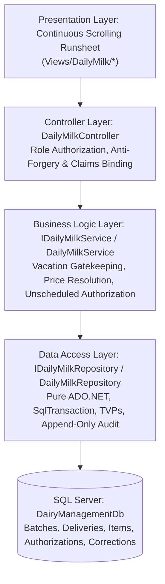
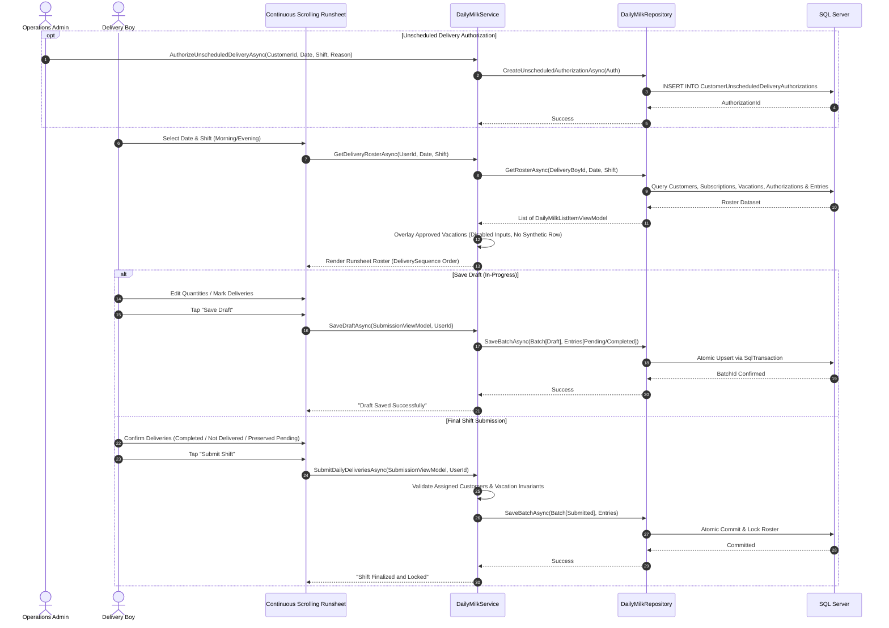

# Dairy Management System — Daily Milk Management
## Architecture, Business Logic, and Backend Contract Specification

**Document Version:** 1.3.0 (Technical Inconsistency Resolution: Normalized Multi-Shift Consumption, Effective-Dated Commission History, Explicit Vacation Billing Guard & Lexicographic Composite Cursor)
**Phase:** Day 4 Architecture & Backend Contract Baseline
**Lead Architect & Author:** Rachit (Lead Architect & Backend Developer)
**Collaborators:** Kevin (Database & ADO.NET Engineer), Viraj (Frontend Engineer)
**Target Framework:** .NET 9.0 (`net9.0`, C# 13)
**Data Access Technology:** Pure ADO.NET (`Microsoft.Data.SqlClient`)
**Database:** Microsoft SQL Server (`DairyManagementDb`)
**Status:** Approved Architectural Baseline for SQL & Backend Implementation

---

## Table of Contents
1. [Executive Summary & Architectural Context](#1-executive-summary--architectural-context)
2. [Finalized Business Rules & Core Invariants](#2-finalized-business-rules--core-invariants)
   - [2.1 The Three Strict Delivery Statuses](#21-the-three-strict-delivery-statuses)
   - [2.2 Vacation and Monthly Billing Integration](#22-vacation-and-monthly-billing-integration)
   - [2.3 Final Submission Rules & Preserving Pending Records](#23-final-submission-rules--preserving-pending-records)
   - [2.4 Admin Authorization for Unscheduled Deliveries & Normalized Multi-Shift Consumption](#24-admin-authorization-for-unscheduled-deliveries--normalized-multi-shift-consumption)
   - [2.5 Deterministic Historical Price Resolution Strategy](#25-deterministic-historical-price-resolution-strategy)
   - [2.6 Effective-Dated Commission Rate History & Fixed-Salary Exclusion](#26-effective-dated-commission-rate-history--fixed-salary-exclusion)
   - [2.7 Composite Cursor-Based Continuous Scrolling Standard](#27-composite-cursor-based-continuous-scrolling-standard)
3. [End-to-End Daily Delivery Lifecycle & Workflows](#3-end-to-end-daily-delivery-lifecycle--workflows)
4. [Edge Case Analysis & Resolution Matrix](#4-edge-case-analysis--resolution-matrix)
5. [Relational Database Contract (for Kevin's SQL Implementation)](#5-relational-database-contract-for-kevins-sql-implementation)
   - [5.1 Table: dbo.DailyDeliveryBatches](#51-table-dbodailydeliverybatches)
   - [5.2 Table: dbo.DailyMilkDeliveries (Augmentation)](#52-table-dbodailymilkdeliveries-augmentation)
   - [5.3 Table: dbo.DailyMilkDeliveryItems (Confirmed Existing)](#53-table-dbodailymilkdeliveryitems-confirmed-existing)
   - [5.4 Table: dbo.CustomerUnscheduledDeliveryAuthorizations & Consumptions](#54-table-dbocustomerunscheduleddeliveryauthorizations--consumptions-new-tables)
   - [5.5 Table: dbo.DailyMilkDeliveryCorrections (Append-Only Audit Ledger)](#55-table-dbodailymilkdeliverycorrections-append-only-audit-ledger)
   - [5.6 Table: dbo.DeliveryBoyCommissionRates (New Effective-Dated Table)](#56-table-dbodeliveryboycommissionrates-new-effective-dated-table)
   - [5.7 Table-Valued Parameters & Stored Procedure Contracts](#57-table-valued-parameters--stored-procedure-contracts)
6. [C# Backend Models & ViewModels Architecture](#6-c-backend-models--viewmodels-architecture)
7. [Repository & Service Interface Contracts](#7-repository--service-interface-contracts)
8. [Security, Authorization & Attack Surface Mitigation](#8-security-authorization--attack-surface-mitigation)
9. [Hand-off Plan for Kevin (Database) and Viraj (Frontend)](#9-hand-off-plan-for-kevin-database-and-viraj-frontend)

---

## 1. Executive Summary & Architectural Context

### 1.1 Business Purpose
The **Daily Milk Management** module manages the daily recurring distribution of milk and dairy products across Morning and Evening shifts. It coordinates field delivery logging by assigned Delivery Boys, enforces vacation lockouts, captures immutable historical price and commission snapshots, enables cursor-based continuous scrolling runsheets, and provides an audited administrative correction mechanism.

### 1.2 Architectural Boundaries & Clean Layering
The design strictly follows the enterprise clean layered architecture established in `docs/architecture/solution-architecture.md`:



---

## 2. Finalized Business Rules & Core Invariants

### 2.1 The Three Strict Delivery Statuses
Exactly **three** delivery statuses are permitted in `dbo.DailyMilkDeliveries.Status`:
1. `Completed`: Milk was physically delivered and confirmed.
2. `Pending`: Scheduled entry not yet confirmed or left unresolved.
3. `Not Delivered`: Customer was absent, door locked, order cancelled, or delivery refused.

> [!IMPORTANT]
> **Vacation is NOT a Delivery Status.**
> Under no circumstances is a new status invented. Vacation is an independent operational concept managed exclusively through `dbo.CustomerVacations`.

---

### 2.2 Vacation and Monthly Billing Integration
1. **Separate Entity Scope:** Vacations apply to the customer entity and are tracked strictly in `dbo.CustomerVacations`.
2. **Approved Vacation Blocks Delivery:** An approved vacation (`Status = 'Approved'`) covering Date $D$ and Shift $S$ blocks delivery entries for that customer on that shift.
3. **Pending Vacation Does Not Block Delivery:** A vacation request in `Status = 'Pending'` is rendered with an informational badge (`HasPendingVacation = true`), but does **not** block delivery. Field agents deliver normally until an Admin evaluates the request.
4. **No Misleading Synthetic Delivery Entries:**
   - When a customer is on an approved vacation, the system **does not create a synthetic or misleading delivery entry** simply to represent the vacation. `dbo.CustomerVacations` already represents the absence.
   - If an entry had already been drafted prior to vacation approval, the gatekeeper updates it to `Status = 'Not Delivered'`, links `VacationId`, and zeroes out quantities.
5. **Explicit Database Guard in Monthly Billing Calculations:**
   - The monthly billing engine **does not rely solely** on the operational assumption that an approved vacation prevented a `Completed` delivery from being recorded.
   - The database contract for billing aggregation explicitly enforces a `NOT EXISTS` guard to filter out any erroneously recorded delivery:
     ```sql
     SELECT
         ISNULL(SUM(items.SubTotal), 0.00) AS CurrentMonthMilkAmount,
         ISNULL(SUM(items.LiquidVolumeLitres), 0.000) AS TotalLiquidMilkVolumeLitres
     FROM dbo.DailyMilkDeliveries dmd
     JOIN dbo.DailyMilkDeliveryItems items ON dmd.DeliveryId = items.DeliveryId
     WHERE dmd.CustomerId = @CustomerId
       AND dmd.EntryDate BETWEEN @PeriodStartDate AND @PeriodEndDate
       AND dmd.Status = 'Completed'
       AND NOT EXISTS (
           -- Hard billing guard: Exclude any delivery overlapping an Approved Vacation
           SELECT 1
           FROM dbo.CustomerVacations v
           WHERE v.CustomerId = dmd.CustomerId
             AND v.Status = 'Approved'
             AND dmd.EntryDate BETWEEN v.StartDate AND v.EndDate
             AND (v.Shift = 'Both' OR v.Shift = dmd.Shift)
       );
     ```
   - This ensures that even if a delivery entry was logged as `Completed` in error during an approved vacation, it contributes ?0.00 to the bill and 0.000 L to liquid volume.
6. **Operational Discovery of Incorrectly Recorded Completed Delivery During Vacation:**
   - If an operational review or customer inquiry reveals that a delivery boy mistakenly logged a `Completed` delivery during an approved vacation:
     - **Before Bill Publication (`MonthlyBills.IsPublished = 0` or unbilled):** The Admin invokes `CorrectDeliveryAsync` via `dbo.usp_DailyMilk_CorrectDelivery`. The procedure updates `Status = 'Not Delivered'`, links `VacationId = @VacationId`, sets `NonDeliveryReason = 'Approved Vacation - Field Entry Corrected'`, zeroes out all volume and amount totals, and appends an immutable audit record in `dbo.DailyMilkDeliveryCorrections`.
     - **After Bill Publication (`MonthlyBills.IsPublished = 1`):** Direct modification of daily delivery records is permanently blocked (Error `50030`). The correction must proceed via the Monthly Bill Revision workflow.
7. **Correcting Published Bills via Monthly Bill Revision:**
   - When an erroneous charge or retroactive vacation affects a published bill:
     - The Admin initiates a revision via `POST /Billing/ReviseBill`.
     - System computes the exact credit adjustment: $\text{AdjustmentCredit} = \sum \text{Erroneously billed delivery amount}$.
     - Updates `MonthlyBills`:
       - `Adjustments = Adjustments - @AdjustmentCredit` (credit adjustment)
       - `CurrentMonthInvoiceAmount = CurrentMonthMilkAmount - Adjustments`
       - `TotalStatementAmount = PreviousBalanceSnapshot + CurrentMonthInvoiceAmount`
       - `BalanceAmount = TotalStatementAmount - PaidAmount`
       - `PaymentStatus = (recalculated)`
       - `Version = Version + 1`
       - `RevisionReason = 'Retroactive approved vacation credit adjustment for [Dates] ([Shift])'`
     - Appends an immutable audit snapshot in `dbo.MonthlyBillRevisions`.
8. **Distinguishing Absence of Delivery from Legitimate Vacation Days:**
   - On audits, runsheet reviews, and customer attendance statements, every scheduled date $D$ and shift $S$ is evaluated deterministically:
     ```sql
     CASE
         WHEN EXISTS (
             SELECT 1 FROM dbo.CustomerVacations v
             WHERE v.CustomerId = c.CustomerId
               AND v.Status = 'Approved'
               AND @Date BETWEEN v.StartDate AND v.EndDate
               AND (v.Shift = 'Both' OR v.Shift = @Shift)
         ) THEN 'Approved Customer Vacation'
         WHEN EXISTS (
             SELECT 1 FROM dbo.DailyMilkDeliveries d
             WHERE d.CustomerId = c.CustomerId
               AND d.EntryDate = @Date
               AND d.Shift = @Shift
               AND d.Status = 'Not Delivered'
         ) THEN 'Recorded Non-Delivery (' + ISNULL(d.NonDeliveryReason, 'Unspecified') + ')'
         WHEN EXISTS (
             SELECT 1 FROM dbo.DailyMilkDeliveries d
             WHERE d.CustomerId = c.CustomerId
               AND d.EntryDate = @Date
               AND d.Shift = @Shift
               AND d.Status = 'Pending'
         ) THEN 'Unresolved Pending Delivery'
         ELSE 'Unrecorded Delivery / Missed Shift Entry'
     END AS AttendanceClassification
     ```
   - Legitimate vacation days are clearly distinguished from unrecorded/missed shift entries.
9. **Overlapping Vacation Handling:**
   - Database trigger `trg_CustomerVacations_PreventOverlap` on `dbo.CustomerVacations` and repository checks strictly reject overlapping vacation intervals for the same customer and shift.
10. **Roster Visual Representation:**
   - The runsheet roster identifies approved vacations dynamically by joining `dbo.CustomerVacations`.
   - The customer row is visually rendered with an **"Approved Vacation"** badge.
   - Text explicitly displays the vacation interval (`VacationWindowText`, e.g., *"On Vacation: 18-Nov to 22-Nov (Morning)"*).
   - All delivery input controls are disabled. Delivery boys cannot override approved vacations.

---

### 2.3 Final Submission Rules & Preserving Pending Records
1. **Draft Saving vs. Final Submission Separation:**
   - **Save Draft (`IsFinalSubmission = false`):** Saves work-in-progress runsheets without locking the batch. `DailyDeliveryBatches.Status = 'Draft'`. Delivery boys can exit and resume logging later.
   - **Final Submission (`IsFinalSubmission = true`):** Finalizes the delivery boy's shift route. Updates `DailyDeliveryBatches.Status = 'Submitted'`, stamps `SubmittedAt` and `SubmittedBy`, and locks the batch against further field modifications.
2. **No Zero-Pending Restriction:**
   - A batch **may be submitted while preserving `Pending` records**. The system does **not** enforce a zero-`Pending` submission block, and does **not** convert `Pending` records automatically into `Not Delivered` or `Completed`.
3. **Implications of Submitting a Batch with `Pending` Entries:**
   - **Financial Invariant:** `Pending` entries contribute ?0.00 to monthly billing. They do not generate customer charges.
   - **Commission Invariant:** `Pending` entries contribute 0.000 eligible litres. They do not generate delivery boy commission.
   - **Batch Totals:** `DailyDeliveryBatches.PendingCount` records the exact count of unresolved entries. `CompletedCount`, `TotalLiquidVolumeLitres`, and `TotalAmount` strictly aggregate `Completed` entries only.
   - **Resolution Lifecycle:** Preserved `Pending` entries can subsequently be reviewed, confirmed, or marked `Not Delivered` by an **Admin** via the Admin Runsheet Console or correction workflow.

---

### 2.4 Admin Authorization for Unscheduled Deliveries & Normalized Multi-Shift Consumption
1. **Blocked by Default:** If a customer has no subscription scheduled for the target date's weekday (e.g. a Weekdays-only subscription on Sunday), unscheduled delivery is **blocked by default** in the field runsheet.
2. **Delivery Boy Cannot Authorize:** Delivery boys have zero authority to grant delivery exceptions to themselves.
3. **Admin Authorization Workflow:**
   - An Admin explicitly authorizes the exception prior to delivery submission via `POST /DailyMilk/AuthorizeUnscheduled`.
   - Stored in parent table: `dbo.CustomerUnscheduledDeliveryAuthorizations`.
   - Captures: `CustomerId`, `CategoryId` (null = all subscribed), `EntryDate`, `AuthorizedShift` (`'Morning'`, `'Evening'`, or `'Both'`), optional `MaxQuantity`, `Reason` (mandatory, min 5 chars), `AuthorizedBy` (Admin UserId), and `AuthorizedAt`.
4. **Normalized Both-Shift Consumption Model:**
   - To support both Morning and Evening deliveries independently without allowing unlimited reuse, consumption is normalized into child table `dbo.CustomerUnscheduledDeliveryAuthorizationConsumptions`.
   - **Consumption Rules:**
     - An authorization with `AuthorizedShift = 'Morning'` can be consumed **only** by a Morning delivery.
     - An authorization with `AuthorizedShift = 'Evening'` can be consumed **only** by an Evening delivery.
     - An authorization with `AuthorizedShift = 'Both'` can be consumed **independently** by Morning and Evening deliveries. Morning consumes the Morning slot; Evening consumes the Evening slot.
     - `CONSTRAINT UQ_UnscheduledAuth_Consumption_Shift UNIQUE (AuthorizationId, ConsumedShift)` strictly prevents duplicate consumption of the same authorization for the same shift.
     - `CONSTRAINT UQ_UnscheduledAuth_Delivery UNIQUE (DeliveryId)` ensures a delivery record links to at most one authorization consumption.
   - **Replay Protection:** Because the authorization row is bound to `CustomerId` and `EntryDate`, and consumption is constrained by `(AuthorizationId, ConsumedShift)`, it cannot be reused for another customer, another date, or the same shift twice.
5. **Revocation Before Consumption:**
   - An Admin can revoke an authorization prior to use (`IsRevoked = 1`, `RevokedBy`, `RevokedAt`, `RevokeReason`).
   - If an authorization for `'Both'` shifts was already consumed for Morning, setting `IsRevoked = 1` blocks the Evening delivery from consuming it, while preserving the valid Morning delivery and consumption record.
6. **Zero Trust in Browser Input:**
   - The delivery submission endpoint does **not** accept or trust an Admin UserId from the browser.
   - Stored procedure `dbo.usp_DailyMilk_SaveBatch` verifies the authorization server-side using `(UPDLOCK, HOLDLOCK)`:
     ```sql
     SELECT @AuthId = a.AuthorizationId, @AdminId = a.AuthorizedBy
     FROM dbo.CustomerUnscheduledDeliveryAuthorizations a
     WHERE a.CustomerId = @CustomerId
       AND a.EntryDate = @EntryDate
       AND (a.AuthorizedShift = @Shift OR a.AuthorizedShift = 'Both')
       AND a.IsRevoked = 0
       AND NOT EXISTS (
           SELECT 1
           FROM dbo.CustomerUnscheduledDeliveryAuthorizationConsumptions c
           WHERE c.AuthorizationId = a.AuthorizationId
             AND c.ConsumedShift = @Shift
       );
     ```
     If found, it inserts into `dbo.CustomerUnscheduledDeliveryAuthorizationConsumptions` and stamps `DailyMilkDeliveries.IsUnscheduledDelivery = 1`, `AuthorizationId = @AuthId`, and `AdminAuthorizedBy = @AdminId`.
7. **Pricing, Billing & Commission Qualification:**
   - **Pricing:** Resolves deterministically via the standard pricing hierarchy (CustomerCustomPricing $\rightarrow$ MilkCategories.DefaultPrice).
   - **Billing:** If `Status = 'Completed'`, the monetary charge (`TotalAmount`) is billed on the customer's monthly invoice.
   - **Commission:** If `Status = 'Completed'`, converted liquid litres qualify for delivery boy commission (`EligibleLitreQuantity = TotalLiquidVolumeLitres`).

---

### 2.5 Deterministic Historical Price Resolution Strategy
To eliminate rounding discrepancies, silent errors, or pricing drift:

```
Step 1: Check CustomerCustomPricing
        (CustomerId = @CustomerId AND CategoryId = @CategoryId AND IsActive = 1
         AND EffectiveFrom <= @Date AND (EffectiveTo IS NULL OR EffectiveTo >= @Date))
        --> Found? Use CustomPrice. Stamped as UnitPriceSnapshot.

Step 2: Fallback to MilkCategories.DefaultPrice
        (CategoryId = @CategoryId AND IsActive = 1)
        --> Found and DefaultPrice > 0.00? Use DefaultPrice. Stamped as UnitPriceSnapshot.

Step 3: Validation Failure (No Silent Fallback)
        --> If no active price exists or price <= 0.00:
            ABORT with validation error: "No valid unit price configured for Customer [Code] - Category [Name] on [Date]."
            Never silently assume 0.00 or guess.
```

- **Snapshot Immutability:** Once written to `dbo.DailyMilkDeliveryItems.UnitPriceSnapshot`, the rate is physically frozen. Future price updates or expired rate agreements have zero effect on historical daily entries or published invoices.

---

### 2.6 Effective-Dated Commission Rate History & Fixed-Salary Exclusion
1. **Elimination of Unsafe CurrentCommissionRate Fallback:**
   - In `dbo.DeliveryBoys`, the column `CurrentCommissionRate` reflects only the delivery boy's current rate. It cannot represent historical rate tiers.
   - **Strict Invariant:** Under NO circumstances may the system silently fall back to `CurrentCommissionRate` if a historical rate tier is missing for `EntryDate`.
   - Commission-based delivery boys must have an authorized, effective-dated commission rate row in `dbo.DeliveryBoyCommissionRates` covering `EntryDate` (`EffectiveFrom <= EntryDate AND (EffectiveTo IS NULL OR EffectiveTo >= EntryDate)`).
   - If no valid rate exists for `EntryDate`, final submission **must strictly fail** with an actionable validation error (Error `50035`).
2. **Dedicated Effective-Dated History Table (`dbo.DeliveryBoyCommissionRates`):**
   - Each rate tier has an inclusive start date (`EffectiveFrom DATE NOT NULL`) and an optional inclusive end date (`EffectiveTo DATE NULL`).
   - Active rate uniqueness is enforced by a filtered unique index:
     ```sql
     CREATE UNIQUE NONCLUSTERED INDEX [UQ_ActiveDeliveryBoyCommissionRate]
     ON [dbo].[DeliveryBoyCommissionRates]([DeliveryBoyId])
     WHERE [EffectiveTo] IS NULL;
     ```
   - Overlapping date intervals for the same delivery boy are strictly prevented at the database level by trigger `trg_DeliveryBoyCommissionRates_PreventOverlap` using parent serialization locks.
3. **Explicit Admin Rate Initialization (No Fabricated Rates):**
   - The system **never fabricates historical rate records** and **never automatically backfills historical rates using today's rate**.
   - Existing delivery boys without verified historical rate records must be initialized through an explicit Admin-controlled rate initialization workflow (`IDailyMilkService.InitializeCommissionRateAsync`).
   - The Administrator must supply a verified `EffectiveFrom` date representing the earliest authorized date for that rate.
   - **Behavior on Dates Preceding the Earliest EffectiveFrom Date:**
     - If an administrator or delivery boy attempts to finalize a delivery batch for date $D$ where $D < \text{Earliest EffectiveFrom}$:
     - The stored procedure / service queries `dbo.DeliveryBoyCommissionRates` and finds zero rows covering $D$.
     - Shift finalization is **immediately rejected**:
       $$\text{Error 50035}: \text{"Cannot finalize shift for delivery date } D \text{: Date precedes the earliest verified commission rate for delivery boy } B \text{ (EffectiveFrom: } E_0 \text{). An administrator must explicitly configure an effective-dated rate tier covering this date before finalizing this shift."}$$
     - The batch remains in `Draft` state; no commission rate snapshot is stamped; no delivery records are committed as final.
     - The Administrator must review historical employment agreements and explicitly configure an earlier rate tier covering date $D$.
4. **Snapshot Timing on Final Submission:**
   - Saving a draft runsheet (`IsFinalSubmission = false`) **does not** resolve or freeze commission rates.
   - When the batch is submitted (`IsFinalSubmission = true`), the stored procedure resolves the rate applicable to `EntryDate`:
     ```sql
     -- Step 1: Check compensation type
     IF (@CompensationType = 'Fixed Salary')
     BEGIN
         -- Fixed Salary employees receive strictly zero commission and require no commission rate record
         SET @EffectiveCommissionRate = 0.00;
     END
     ELSE
     BEGIN
         -- Step 2: Query effective-dated tier for EntryDate
         SELECT TOP 1 @EffectiveCommissionRate = CommissionRate
         FROM dbo.DeliveryBoyCommissionRates
         WHERE DeliveryBoyId = @DeliveryBoyId
           AND EffectiveFrom <= @EntryDate
           AND (EffectiveTo IS NULL OR EffectiveTo >= @EntryDate)
         ORDER BY EffectiveFrom DESC;

         -- Strict Enforcement: Zero silent fallback. If no verified rate exists, ABORT.
         IF (@EffectiveCommissionRate IS NULL)
         BEGIN
             RAISERROR('Cannot finalize shift: No verified commission rate configured for delivery boy ID %d covering EntryDate %s. An administrator must explicitly configure an effective-dated commission rate tier covering this date before finalizing this shift.', 16, 1, @DeliveryBoyId, @EntryDateStr);
             ROLLBACK TRANSACTION;
             RETURN;
         END
     END
     ```
   - The resolved rate is stamped onto `dbo.DailyMilkDeliveries.CommissionRateSnapshot`.
5. **Fixed-Salary Exclusion:**
   - When `DeliveryBoys.CompensationType == 'Fixed Salary'` (per CHECK constraint `CK_DeliveryBoys_Compensation`), the delivery boy is compensated on a fixed monthly base salary (`MonthlyBaseSalary`).
   - Their `CommissionRateSnapshot` on `dbo.DailyMilkDeliveries` is strictly stamped as **`0.00`**.
   - Salaried employees do not require a commission rate row in `dbo.DeliveryBoyCommissionRates`.
6. **Eligible Completed Liquid Litres:**
   $$\text{EligibleLitreQuantity} = \begin{cases} \text{TotalLiquidVolumeLitres}, & \text{if Status} = \text{'Completed' and customer not on approved vacation} \\ 0.000, & \text{if Status} \in \{\text{'Pending'}, \text{'Not Delivered'}\} \text{ or on approved vacation} \end{cases}$$
   Non-liquid products (Paneer, Curd, Ghee) have `LitreEquivalentSnapshot = 0.000` and generate zero eligible litres.
7. **Historical Snapshot Immutability:**
   - Once finalized, commission rate snapshots on past delivery headers remain permanently immutable.
   - Subsequent rate revisions in `dbo.DeliveryBoyCommissionRates` apply strictly to future delivery dates.
   - Administrative corrections to deliveries do not replace historical commission rate snapshots.

---

### 2.7 Composite Cursor-Based Continuous Scrolling Standard
1. **Elimination of Conventional Pagination:**
   - `PageNumber` and `PageSize` are completely removed from all public continuous scrolling contracts.
2. **Composite Cursor Definition:**
   - A single surrogate ID cursor (`CursorDeliveryId`) is mathematically insufficient when sorting by `EntryDate`, `Shift`, and `DeliveryId`.
   - The contract defines a composite cursor triple:
     $$(D_c, S_c, I_c) = (\text{CursorEntryDate}, \text{CursorShift}, \text{CursorDeliveryId})$$
   - Parameter `FetchLimit` (int, default 25) controls chunk size.
3. **Deterministic Sorting Order:**
   - Continuous scroll feeds are ordered strictly reverse-chronologically (newest first):
     1. `EntryDate DESC`
     2. `ShiftRank(Shift) DESC` where $\text{ShiftRank}(\text{'Evening'}) = 2$ and $\text{ShiftRank}(\text{'Morning'}) = 1$.
     3. `DeliveryId DESC`
4. **Lexicographic Continuation Predicate for Descending Order:**
   For a given cursor $(D_c, S_c, I_c)$, the continuation predicate is:
   $$(D < D_c) \lor \big(D = D_c \land \text{ShiftRank}(S) < \text{ShiftRank}(S_c)\big) \lor \big(D = D_c \land S = S_c \land I < I_c\big)$$

   In SQL:
   ```sql
   WHERE (
       @CursorEntryDate IS NULL
       OR (d.EntryDate < @CursorEntryDate)
       OR (d.EntryDate = @CursorEntryDate AND
           (CASE WHEN d.Shift = 'Evening' THEN 2 ELSE 1 END) < (CASE WHEN @CursorShift = 'Evening' THEN 2 ELSE 1 END))
       OR (d.EntryDate = @CursorEntryDate AND d.Shift = @CursorShift AND d.DeliveryId < @CursorDeliveryId)
   )
   ORDER BY
       d.EntryDate DESC,
       (CASE WHEN d.Shift = 'Evening' THEN 2 ELSE 1 END) DESC,
       d.DeliveryId DESC;
   ```
5. **Public Contract Envelope:**
   Envelope `DailyMilkContinuousScrollResult<T>` returns:
   - `Items`: `IReadOnlyList<T>` (chunk of records)
   - `TotalMatchingCount`: `int` (matching count for summary badges)
   - `HasMore`: `bool` (true if more rows exist)
   - `NextCursorEntryDate`: `DateOnly?` (EntryDate of the last record in chunk)
   - `NextCursorShift`: `string?` (Shift of the last record in chunk)
   - `NextCursorDeliveryId`: `long?` (DeliveryId of the last record in chunk)
   - `NextCursor`: `long?` (backward-compatible alias for `NextCursorDeliveryId`)

---

## 3. End-to-End Daily Delivery Lifecycle & Workflows



---

## 4. Edge Case Analysis & Resolution Matrix

| # | Operational Scenario | Architectural Rule & Invariant Enforcement |
|---|---|---|
| **1** | **Customer subscribed to multiple categories** | Single delivery header (`DailyMilkDeliveries`) with multiple child lines (`DailyMilkDeliveryItems`). Liquid volume (`LiquidVolumeLitres`) and physical packaging (`PackagingQuantity`) are separated. |
| **2** | **Customer has no delivery scheduled on date** | Checked against `CustomerSubscriptionDeliveryDays`. Excluded from delivery runsheet or rendered in collapsible "Not Scheduled Today" section. Blocked unless an Admin authorization exists. |
| **3** | **Unscheduled delivery attempt** | Blocked by default. Stored procedure verifies an active, unconsumed row in `dbo.CustomerUnscheduledDeliveryAuthorizations`. If valid, marks `IsUsed = 1`, links `AuthorizationId`, and records delivery. Browser-supplied Admin IDs are ignored. |
| **4** | **Unassigned customer (`DeliveryBoyId IS NULL`)** | Excluded from delivery boy rosters. Visible only to Admins on the Admin Runsheet Console. Delivery boys cannot view or submit entries for unassigned customers. |
| **5** | **Delivery boy reassigned mid-month** | Handled via effective dates in `CustomerDeliveryBoyAssignments`. Deliveries prior to date $E$ retain previous `DeliveryBoyId`. Deliveries on or after $E$ use new `DeliveryBoyId`. Commission aggregates by the header's historical `DeliveryBoyId`. |
| **6** | **Customer on approved vacation** | Hard lockout: Status must be `Not Delivered`, inputs disabled, ?0.00 / 0.000 L. **No synthetic delivery record is created simply to represent vacation.** Roster displays dynamic vacation overlay. |
| **7** | **Vacation covers Morning shift only** | Morning runsheet: Customer locked out as On Vacation. Evening runsheet: Customer receives normal scheduled deliveries; delivery boy logs delivery normally. |
| **8** | **Batch submitted with unresolved Pending entries** | Permitted. Preserves `Pending` entries as `Pending` without automatic conversion. `Pending` entries generate 0 charges and 0 commission. Admin can resolve later. |
| **9** | **Duplicate shift submission attempt** | Prevented by unique index `UQ_DailyDeliveryBatches_DeliveryBoy_Date_Shift`. If batch is already `Submitted`, rejected with `HTTP 409 Conflict`. |
| **10** | **Admin corrects already submitted delivery** | Permitted only if the month is unbilled or bill is unpublished. An immutable audit record is written to `DailyMilkDeliveryCorrections` capturing old vs. new values and mandatory explanation. |
| **11** | **Delivery belongs to published billing month** | Direct modification of daily delivery records is **strictly blocked**. Admin must use the Bill Revision Workflow (`dbo.MonthlyBillRevisions`). |
| **12** | **No valid unit price exists** | System halts and throws a validation error. Never silently defaults to ?0.00. Admin must configure a price before delivery recording is permitted. |

---

## 5. Relational Database Contract (for Kevin's SQL Implementation)

Kevin will implement the following production-grade SQL Server objects in `sql/07_DailyMilkManagement.sql`. All definitions align with existing tables and avoid duplicating existing structures.

### 5.1 Table: `dbo.DailyDeliveryBatches` (New)
**Purpose:** Represents a delivery runsheet session for a delivery boy on a specific date and shift. Controls Draft vs. Submitted state, aggregates shift statistics, and prevents double submissions.

| Column Name | SQL Server Data Type | Nullable | Constraints & Defaults | Description |
|---|---|---|---|---|
| `BatchId` | `BIGINT` | `NOT NULL` | `PRIMARY KEY IDENTITY(1,1)` | Surrogate primary key. |
| `DeliveryBoyId` | `INT` | `NOT NULL` | `FOREIGN KEY REFERENCES DeliveryBoys(DeliveryBoyId)` | Assigned delivery boy. |
| `RouteId` | `INT` | `NOT NULL` | `FOREIGN KEY REFERENCES Routes(RouteId)` | Assigned route. |
| `EntryDate` | `DATE` | `NOT NULL` | None | Calendar date of distribution. |
| `Shift` | `NVARCHAR(20)` | `NOT NULL` | `CHECK (Shift IN ('Morning', 'Evening'))` | Distribution shift. |
| `Status` | `NVARCHAR(20)` | `NOT NULL` | `DEFAULT ('Draft')`, `CHECK (Status IN ('Draft', 'Submitted'))` | Batch state. |
| `TotalAssignedCustomers` | `INT` | `NOT NULL` | `DEFAULT (0)`, `CHECK (TotalAssignedCustomers >= 0)` | Customer count on route. |
| `CompletedCount` | `INT` | `NOT NULL` | `DEFAULT (0)`, `CHECK (CompletedCount >= 0)` | Completed deliveries count. |
| `PendingCount` | `INT` | `NOT NULL` | `DEFAULT (0)`, `CHECK (PendingCount >= 0)` | Preserved pending count. |
| `NotDeliveredCount` | `INT` | `NOT NULL` | `DEFAULT (0)`, `CHECK (NotDeliveredCount >= 0)` | Non-deliveries count. |
| `TotalLiquidVolumeLitres` | `DECIMAL(18,3)` | `NOT NULL` | `DEFAULT (0.000)`, `CHECK (TotalLiquidVolumeLitres >= 0)` | Aggregate completed liquid litres. |
| `TotalAmount` | `DECIMAL(18,2)` | `NOT NULL` | `DEFAULT (0.00)`, `CHECK (TotalAmount >= 0)` | Aggregate completed monetary value. |
| `StartedAt` | `DATETIME2(7)` | `NOT NULL` | `DEFAULT (SYSUTCDATETIME())` | Batch start timestamp. |
| `SubmittedAt` | `DATETIME2(7)` | `NULL` | None | Final submission timestamp. |
| `SubmittedBy` | `INT` | `NULL` | `FOREIGN KEY REFERENCES Users(UserId)` | Submitting user ID. |
| `CreatedAt` | `DATETIME2(7)` | `NOT NULL` | `DEFAULT (SYSUTCDATETIME())` | Creation timestamp. |
| `CreatedBy` | `INT` | `NOT NULL` | `FOREIGN KEY REFERENCES Users(UserId)` | Creator user ID. |
| `UpdatedAt` | `DATETIME2(7)` | `NULL` | None | Update timestamp. |
| `UpdatedBy` | `INT` | `NULL` | `FOREIGN KEY REFERENCES Users(UserId)` | Modifier user ID. |

**Indexes on `DailyDeliveryBatches`:**
```sql
CREATE UNIQUE NONCLUSTERED INDEX [UQ_DailyDeliveryBatches_DeliveryBoy_Date_Shift]
ON [dbo].[DailyDeliveryBatches]([DeliveryBoyId], [EntryDate], [Shift]);

CREATE NONCLUSTERED INDEX [IX_DailyDeliveryBatches_Date_Shift_Status]
ON [dbo].[DailyDeliveryBatches]([EntryDate], [Shift], [Status])
INCLUDE ([RouteId], [TotalLiquidVolumeLitres], [TotalAmount]);
```

---

### 5.2 Table: `dbo.DailyMilkDeliveries` (Augmentation)
The existing table in `sql/03_CreateTables.sql` is augmented with the following columns:
```sql
ALTER TABLE [dbo].[DailyMilkDeliveries]
ADD [BatchId] BIGINT NULL CONSTRAINT [FK_DailyMilkDeliveries_BatchId] REFERENCES [dbo].[DailyDeliveryBatches]([BatchId]),
    [IsUnscheduledDelivery] BIT NOT NULL CONSTRAINT [DF_DailyMilkDeliveries_IsUnscheduled] DEFAULT (0),
    [AuthorizationId] BIGINT NULL,
    [AdminAuthorizedBy] INT NULL CONSTRAINT [FK_DailyMilkDeliveries_AdminAuth] REFERENCES [dbo].[Users]([UserId]),
    [IsCorrected] BIT NOT NULL CONSTRAINT [DF_DailyMilkDeliveries_IsCorrected] DEFAULT (0),
    [LastCorrectedAt] DATETIME2(7) NULL,
    [LastCorrectedBy] INT NULL CONSTRAINT [FK_DailyMilkDeliveries_LastCorrectedBy] REFERENCES [dbo].[Users]([UserId]);

ALTER TABLE [dbo].[DailyMilkDeliveries]
ADD CONSTRAINT [FK_DailyMilkDeliveries_AuthId] FOREIGN KEY ([AuthorizationId]) REFERENCES [dbo].[CustomerUnscheduledDeliveryAuthorizations]([AuthorizationId]);
```
- Existing `VacationId` FK is retained as a nullable reference.
- Unique index `UQ_DailyDelivery_Customer_Date_Shift` on `(CustomerId, EntryDate, Shift)` prevents duplicate entries.

---

### 5.3 Table: `dbo.DailyMilkDeliveryItems` (Confirmed Existing)
Existing table in `sql/03_CreateTables.sql` is verified and 100% compliant:
- Composition child with `ON DELETE CASCADE` from `DailyMilkDeliveries`.
- Stores `PackagingQuantity`, snapshots (`ProductTypeSnapshot`, `UnitOfMeasureSnapshot`, `PricingBasisSnapshot`, `BillingUnitEquivalentSnapshot`, `LitreEquivalentSnapshot`, `UnitPriceSnapshot`), `LiquidVolumeLitres`, and `SubTotal`.
- Unique constraint: `UQ_DailyItem_Delivery_Category UNIQUE (DeliveryId, CategoryId)`.

---

### 5.4 Table: `dbo.CustomerUnscheduledDeliveryAuthorizations` & Consumptions (New Tables)

#### 5.4.1 Table: `dbo.CustomerUnscheduledDeliveryAuthorizations` (Parent Grant)
**Purpose:** Stores explicit Administrator authorizations permitting delivery on unscheduled off-schedule dates for Morning, Evening, or Both shifts. Verified server-side inside stored procedures.

| Column Name | SQL Server Data Type | Nullable | Constraints & Defaults | Description |
|---|---|---|---|---|
| `AuthorizationId` | `BIGINT` | `NOT NULL` | `PRIMARY KEY IDENTITY(1,1)` | Surrogate primary key. |
| `CustomerId` | `INT` | `NOT NULL` | `FOREIGN KEY REFERENCES Customers(CustomerId)` | Target customer. |
| `CategoryId` | `INT` | `NULL` | `FOREIGN KEY REFERENCES MilkCategories(CategoryId)` | Authorized category (NULL = all subscribed). |
| `EntryDate` | `DATE` | `NOT NULL` | None | Authorized delivery date. |
| `AuthorizedShift` | `NVARCHAR(20)` | `NOT NULL` | `CHECK (AuthorizedShift IN ('Morning', 'Evening', 'Both'))` | Authorized shift scope. |
| `MaxQuantity` | `DECIMAL(18,3)` | `NULL` | `CHECK (MaxQuantity IS NULL OR MaxQuantity > 0)` | Optional volume cap. |
| `Reason` | `NVARCHAR(250)` | `NOT NULL` | None | Mandatory justification (min 5 chars). |
| `AuthorizedBy` | `INT` | `NOT NULL` | `FOREIGN KEY REFERENCES Users(UserId)` | Admin user authorizing exception. |
| `AuthorizedAt` | `DATETIME2(7)` | `NOT NULL` | `DEFAULT (SYSUTCDATETIME())` | Authorization timestamp. |
| `IsRevoked` | `BIT` | `NOT NULL` | `DEFAULT (0)` | Revocation flag. |
| `RevokedBy` | `INT` | `NULL` | `FOREIGN KEY REFERENCES Users(UserId)` | Admin who revoked exception. |
| `RevokedAt` | `DATETIME2(7)` | `NULL` | None | Revocation timestamp. |
| `RevokeReason` | `NVARCHAR(250)` | `NULL` | None | Revocation reason. |

#### 5.4.2 Table: `dbo.CustomerUnscheduledDeliveryAuthorizationConsumptions` (Normalized Child)
**Purpose:** Records shift-specific consumption of an unscheduled delivery authorization. Allows 'Both' authorizations to be consumed independently by Morning and Evening shifts without duplicate reuse.

| Column Name | SQL Server Data Type | Nullable | Constraints & Defaults | Description |
|---|---|---|---|---|
| `ConsumptionId` | `BIGINT` | `NOT NULL` | `PRIMARY KEY IDENTITY(1,1)` | Surrogate primary key. |
| `AuthorizationId` | `BIGINT` | `NOT NULL` | `FOREIGN KEY REFERENCES CustomerUnscheduledDeliveryAuthorizations(AuthorizationId)` | Parent authorization. |
| `DeliveryId` | `BIGINT` | `NOT NULL` | `FOREIGN KEY REFERENCES DailyMilkDeliveries(DeliveryId)` | Resulting delivery record. |
| `ConsumedShift` | `NVARCHAR(20)` | `NOT NULL` | `CHECK (ConsumedShift IN ('Morning', 'Evening'))` | Shift executed. |
| `ConsumedAt` | `DATETIME2(7)` | `NOT NULL` | `DEFAULT (SYSUTCDATETIME())` | Consumption timestamp. |

**Indexes on Unscheduled Authorizations & Consumptions:**
```sql
CREATE NONCLUSTERED INDEX [IX_UnscheduledAuth_Customer_Date]
ON [dbo].[CustomerUnscheduledDeliveryAuthorizations]([CustomerId], [EntryDate], [AuthorizedShift])
INCLUDE ([AuthorizedBy], [CategoryId], [MaxQuantity])
WHERE [IsRevoked] = 0;

-- Enforces at most one consumption per authorization per shift
CREATE UNIQUE NONCLUSTERED INDEX [UQ_UnscheduledAuth_Consumption_Shift]
ON [dbo].[CustomerUnscheduledDeliveryAuthorizationConsumptions]([AuthorizationId], [ConsumedShift]);

-- Enforces delivery header links to at most one consumption
CREATE UNIQUE NONCLUSTERED INDEX [UQ_UnscheduledAuth_Delivery]
ON [dbo].[CustomerUnscheduledDeliveryAuthorizationConsumptions]([DeliveryId]);
```

---

### 5.5 Table: `dbo.DailyMilkDeliveryCorrections` (Append-Only Audit Ledger)
**Purpose:** Append-only historical audit ledger tracking all administrative corrections to daily delivery records. Captures prior state, new state, modifying Admin, timestamp, line-item FK, and mandatory business justification.

| Column Name | SQL Server Data Type | Nullable | Constraints & Defaults | Description |
|---|---|---|---|---|
| `CorrectionId` | `BIGINT` | `NOT NULL` | `PRIMARY KEY IDENTITY(1,1)` | Surrogate primary key. |
| `CorrectionBatchGuid` | `UNIQUEIDENTIFIER` | `NOT NULL` | `DEFAULT (NEWID())` | Groups multi-item corrections in one Admin turn. |
| `DeliveryId` | `BIGINT` | `NOT NULL` | `FOREIGN KEY REFERENCES DailyMilkDeliveries(DeliveryId)` | Target delivery header. |
| `DeliveryItemId` | `BIGINT` | `NULL` | `FOREIGN KEY REFERENCES DailyMilkDeliveryItems(DeliveryItemId)` | Specific item FK (NULL for header status change). |
| `CustomerId` | `INT` | `NOT NULL` | `FOREIGN KEY REFERENCES Customers(CustomerId)` | Target customer. |
| `EntryDate` | `DATE` | `NOT NULL` | None | Delivery date. |
| `Shift` | `NVARCHAR(20)` | `NOT NULL` | None | Delivery shift. |
| `PriorStatus` | `NVARCHAR(20)` | `NOT NULL` | None | Status before correction. |
| `NewStatus` | `NVARCHAR(20)` | `NOT NULL` | None | Status after correction. |
| `CategoryId` | `INT` | `NULL` | `FOREIGN KEY REFERENCES MilkCategories(CategoryId)` | Category affected. |
| `PriorPackagingQuantity` | `DECIMAL(18,3)` | `NULL` | None | Packaging qty before correction. |
| `NewPackagingQuantity` | `DECIMAL(18,3)` | `NULL` | None | Packaging qty after correction. |
| `PriorLiquidVolumeLitres`| `DECIMAL(18,3)` | `NOT NULL` | None | Total liquid volume before correction. |
| `NewLiquidVolumeLitres`  | `DECIMAL(18,3)` | `NOT NULL` | None | Total liquid volume after correction. |
| `PriorUnitPrice`         | `DECIMAL(18,2)` | `NULL` | None | Unit price before correction. |
| `NewUnitPrice`           | `DECIMAL(18,2)` | `NULL` | None | Unit price after correction. |
| `PriorTotalAmount`       | `DECIMAL(18,2)` | `NOT NULL` | None | Total amount before correction. |
| `NewTotalAmount`         | `DECIMAL(18,2)` | `NOT NULL` | None | Total amount after correction. |
| `Reason`                 | `NVARCHAR(250)` | `NOT NULL` | None | Mandatory business explanation (min 5 chars). |
| `CorrectedBy`            | `INT` | `NOT NULL` | `FOREIGN KEY REFERENCES Users(UserId)` | Admin user authorizing correction. |
| `CorrectedAt`            | `DATETIME2(7)` | `NOT NULL` | `DEFAULT (SYSUTCDATETIME())` | Correction audit timestamp. |

**Audit Protection Policy:**
- `dbo.DailyMilkDeliveryCorrections` is strictly **append-only**.
- `db_dms_app` receives strictly `SELECT, INSERT` permissions.
- Trigger `trg_DailyMilkDeliveryCorrections_PreventModification` blocks `UPDATE` and `DELETE` operations.

---

### 5.6 Table: `dbo.DeliveryBoyCommissionRates` (New Effective-Dated Table)
**Purpose:** Stores historical and current effective-dated commission rates for Delivery Boys. Eliminates silent retroactive compensation changes and enables deterministic historical rate resolution.

| Column Name | SQL Server Data Type | Nullable | Constraints & Defaults | Description |
|---|---|---|---|---|
| `RateId` | `INT` | `NOT NULL` | `PRIMARY KEY IDENTITY(1,1)` | Surrogate primary key. |
| `DeliveryBoyId` | `INT` | `NOT NULL` | `FOREIGN KEY REFERENCES DeliveryBoys(DeliveryBoyId)` | Target delivery boy. |
| `CommissionRate` | `DECIMAL(18,2)` | `NOT NULL` | `CHECK (CommissionRate >= 0)` | Per-litre commission rate (?/L). |
| `EffectiveFrom` | `DATE` | `NOT NULL` | None | Inclusive start date. |
| `EffectiveTo` | `DATE` | `NULL` | None | Inclusive end date (NULL = open-ended active). |
| `Notes` | `NVARCHAR(250)` | `NULL` | None | Administrative reason for rate tier. |
| `CreatedAt` | `DATETIME2(7)` | `NOT NULL` | `DEFAULT (SYSUTCDATETIME())` | Creation timestamp. |
| `CreatedBy` | `INT` | `NOT NULL` | `FOREIGN KEY REFERENCES Users(UserId)` | Creator user ID. |

**Constraints & Indexes on `DeliveryBoyCommissionRates`:**
```sql
ALTER TABLE [dbo].[DeliveryBoyCommissionRates]
ADD CONSTRAINT [CK_DeliveryBoyCommissionRates_Dates] CHECK ([EffectiveTo] IS NULL OR [EffectiveTo] >= [EffectiveFrom]);

-- At most one active open-ended rate per delivery boy
CREATE UNIQUE NONCLUSTERED INDEX [UQ_ActiveDeliveryBoyCommissionRate]
ON [dbo].[DeliveryBoyCommissionRates]([DeliveryBoyId])
WHERE [EffectiveTo] IS NULL;

-- Fast index for as-of-date rate resolution
CREATE NONCLUSTERED INDEX [IX_DeliveryBoyCommissionRates_Resolution]
ON [dbo].[DeliveryBoyCommissionRates]([DeliveryBoyId], [EffectiveFrom], [EffectiveTo])
INCLUDE ([CommissionRate]);
```

**Primary Concurrency-Safe Transaction Ordering Architecture:**
All commission-rate creation and update operations must be executed through authorized database stored procedures (`dbo.usp_DeliveryBoy_CreateCommissionRate` and `dbo.usp_DeliveryBoy_UpdateCommissionRate`).

Because an `AFTER INSERT, UPDATE` trigger fires *after* the rate-table row/key locks have already been acquired, relying solely on an AFTER trigger cannot serialize parent-child lock hierarchy. To eliminate lock inversion and minimize deadlock risk, the stored procedure enforces strict transaction ordering **before any modification to the rate table occurs**:

```sql
CREATE OR ALTER PROCEDURE [dbo].[usp_DeliveryBoy_CreateCommissionRate]
    @DeliveryBoyId INT,
    @CommissionRate DECIMAL(18,2),
    @EffectiveFrom DATE,
    @EffectiveTo DATE = NULL,
    @Notes NVARCHAR(250) = NULL,
    @AdminUserId INT
AS
BEGIN
    SET NOCOUNT ON;
    SET XACT_ABORT ON;

    BEGIN TRANSACTION;

    -- 1. Identify all affected DeliveryBoyIds (for insert: @DeliveryBoyId; for update/reassignment: old and new)
    DECLARE @TargetDeliveryBoys TABLE (
        [DeliveryBoyId] INT NOT NULL PRIMARY KEY CLUSTERED
    );
    INSERT INTO @TargetDeliveryBoys ([DeliveryBoyId]) VALUES (@DeliveryBoyId);

    -- 2. Acquire UPDLOCK and HOLDLOCK on parent DeliveryBoys in deterministic ASCENDING order
    -- Acquired BEFORE modifying dbo.DeliveryBoyCommissionRates to guarantee consistent lock hierarchy.
    DECLARE @LockDeliveryBoyId INT;
    DECLARE @LockAcquired INT;
    DECLARE curProcLocks CURSOR LOCAL FAST_FORWARD FOR
        SELECT [DeliveryBoyId]
        FROM @TargetDeliveryBoys
        ORDER BY [DeliveryBoyId] ASC;

    OPEN curProcLocks;
    FETCH NEXT FROM curProcLocks INTO @LockDeliveryBoyId;

    WHILE @@FETCH_STATUS = 0
    BEGIN
        -- Valid SQL Server T-SQL: Assigning to a scalar variable acquires parent row UPDLOCK/HOLDLOCK
        -- without producing an unwanted tabular result set to ADO.NET.
        SELECT @LockAcquired = [DeliveryBoyId]
        FROM dbo.DeliveryBoys WITH (UPDLOCK, HOLDLOCK)
        WHERE [DeliveryBoyId] = @LockDeliveryBoyId;

        FETCH NEXT FROM curProcLocks INTO @LockDeliveryBoyId;
    END

    CLOSE curProcLocks;
    DEALLOCATE curProcLocks;

    -- 3. Perform Pre-Insert Overlap Validation against committed tiers
    IF EXISTS (
        SELECT 1
        FROM dbo.DeliveryBoyCommissionRates
        WHERE DeliveryBoyId = @DeliveryBoyId
          AND (@EffectiveTo IS NULL OR EffectiveFrom <= @EffectiveTo)
          AND (EffectiveTo IS NULL OR EffectiveTo >= @EffectiveFrom)
    )
    BEGIN
        -- If an existing open-ended tier exists and new rate is strictly newer, close the prior tier
        DECLARE @PriorOpenEndedRateId INT, @PriorEffectiveFrom DATE;
        SELECT @PriorOpenEndedRateId = RateId, @PriorEffectiveFrom = EffectiveFrom
        FROM dbo.DeliveryBoyCommissionRates
        WHERE DeliveryBoyId = @DeliveryBoyId AND EffectiveTo IS NULL;

        IF (@PriorOpenEndedRateId IS NOT NULL AND @EffectiveFrom > @PriorEffectiveFrom AND @EffectiveTo IS NULL)
        BEGIN
            UPDATE dbo.DeliveryBoyCommissionRates
            SET EffectiveTo = DATEADD(day, -1, @EffectiveFrom)
            WHERE RateId = @PriorOpenEndedRateId;
        END
        ELSE
        BEGIN
            RAISERROR('Cannot create commission rate tier: Effective date range overlaps with an existing rate tier for delivery boy ID %d.', 16, 1, @DeliveryBoyId);
            ROLLBACK TRANSACTION;
            RETURN;
        END
    END

    -- 4. Execute the INSERT only after parent locks are acquired and validation succeeds
    INSERT INTO dbo.DeliveryBoyCommissionRates (
        DeliveryBoyId, CommissionRate, EffectiveFrom, EffectiveTo, Notes, CreatedBy, CreatedAt
    )
    VALUES (
        @DeliveryBoyId, @CommissionRate, @EffectiveFrom, @EffectiveTo, @Notes, @AdminUserId, SYSUTCDATETIME()
    );

    COMMIT TRANSACTION;
END;
```

**Secondary Defensive Validation Layer (AFTER Trigger):**
An `AFTER INSERT, UPDATE` trigger is retained on `dbo.DeliveryBoyCommissionRates` as an independent defensive validation guard to catch rogue ad-hoc SQL, bulk imports, or manual maintenance operations:

```sql
CREATE OR ALTER TRIGGER [dbo].[trg_DeliveryBoyCommissionRates_PreventOverlap]
ON [dbo].[DeliveryBoyCommissionRates]
AFTER INSERT, UPDATE
AS
BEGIN
    SET NOCOUNT ON;

    -- 1. Identify all affected DeliveryBoyIds from both inserted and deleted (handles reassignments)
    DECLARE @TargetDeliveryBoys TABLE (
        [DeliveryBoyId] INT NOT NULL PRIMARY KEY CLUSTERED
    );

    INSERT INTO @TargetDeliveryBoys ([DeliveryBoyId])
    SELECT DISTINCT [DeliveryBoyId] FROM [inserted]
    UNION
    SELECT DISTINCT [DeliveryBoyId] FROM [deleted];

    -- If no rows affected (e.g. empty statement), exit cleanly
    IF NOT EXISTS (SELECT 1 FROM @TargetDeliveryBoys)
        RETURN;

    -- 2. Concurrency-Safe Serialization via Deterministic Lock Ordering:
    -- Acquires an update lock with HOLDLOCK (SERIALIZABLE semantics) on the parent DeliveryBoys row
    -- in strict ASCENDING order of DeliveryBoyId.
    DECLARE @LockDeliveryBoyId INT;
    DECLARE @LockAcquired INT;
    DECLARE curDeliveryBoyLocks CURSOR LOCAL FAST_FORWARD FOR
        SELECT [DeliveryBoyId]
        FROM @TargetDeliveryBoys
        ORDER BY [DeliveryBoyId] ASC;

    OPEN curDeliveryBoyLocks;
    FETCH NEXT FROM curDeliveryBoyLocks INTO @LockDeliveryBoyId;

    WHILE @@FETCH_STATUS = 0
    BEGIN
        -- Valid SQL Server T-SQL: Assigning to a scalar variable acquires parent row UPDLOCK/HOLDLOCK
        -- without producing an unwanted tabular result set to ADO.NET.
        SELECT @LockAcquired = [DeliveryBoyId]
        FROM dbo.DeliveryBoys WITH (UPDLOCK, HOLDLOCK)
        WHERE [DeliveryBoyId] = @LockDeliveryBoyId;

        FETCH NEXT FROM curDeliveryBoyLocks INTO @LockDeliveryBoyId;
    END

    CLOSE curDeliveryBoyLocks;
    DEALLOCATE curDeliveryBoyLocks;

    -- 3. Multi-Row Check 1: Detect collisions within the inserted batch itself (Intra-batch overlap)
    DECLARE @IntraOverlapBoyId INT;
    SELECT TOP 1 @IntraOverlapBoyId = i1.DeliveryBoyId
    FROM inserted i1
    JOIN inserted i2 ON i1.DeliveryBoyId = i2.DeliveryBoyId
    WHERE (i1.RateId < i2.RateId OR (i1.RateId = 0 AND i2.RateId = 0 AND i1.EffectiveFrom <> i2.EffectiveFrom))
      AND (i1.EffectiveTo IS NULL OR i2.EffectiveFrom <= i1.EffectiveTo)
      AND (i2.EffectiveTo IS NULL OR i2.EffectiveTo >= i1.EffectiveFrom);

    IF (@IntraOverlapBoyId IS NOT NULL)
    BEGIN
        RAISERROR('Cannot insert multiple overlapping commission rate tiers for delivery boy ID %d within a single batch.', 16, 1, @IntraOverlapBoyId);
        ROLLBACK TRANSACTION;
        RETURN;
    END

    -- 4. Multi-Row Check 2: Detect collisions between inserted/updated rows and existing committed tiers
    -- Syntactically valid RAISERROR: Assign ID to variable first; do not pass subquery directly.
    DECLARE @InterOverlapBoyId INT;
    SELECT TOP 1 @InterOverlapBoyId = i.DeliveryBoyId
    FROM dbo.DeliveryBoyCommissionRates r
    JOIN inserted i ON r.DeliveryBoyId = i.DeliveryBoyId
    WHERE r.RateId <> i.RateId -- Exclude self during UPDATE
      AND (i.EffectiveTo IS NULL OR r.EffectiveFrom <= i.EffectiveTo)
      AND (r.EffectiveTo IS NULL OR r.EffectiveTo >= i.EffectiveFrom);

    IF (@InterOverlapBoyId IS NOT NULL)
    BEGIN
        RAISERROR('Cannot insert or update commission rate tier: Effective date range overlaps with an existing rate tier for delivery boy ID %d.', 16, 1, @InterOverlapBoyId);
        ROLLBACK TRANSACTION;
        RETURN;
    END
END;
```

**How the Architecture Protects Against Concurrency & Mitigates Deadlocks:**
1. **Concurrent Inserts for the Same Delivery Boy:**
   - Both transactions call `dbo.usp_DeliveryBoy_CreateCommissionRate` for `DeliveryBoyId = 5`.
   - Transaction $T_1$ acquires `UPDLOCK, HOLDLOCK` on `DeliveryBoys WHERE DeliveryBoyId = 5` *before* inserting into the rate table.
   - Transaction $T_2$ attempts to acquire the parent lock and is placed in a wait state by the SQL Server lock manager.
   - $T_1$ validates, inserts, and commits.
   - $T_2$ unblocks, reads the newly committed state containing $T_1$'s tier, detects the date overlap, raises an error, and rolls back.
2. **Concurrent Updates for the Same Delivery Boy:**
   - Both transactions call `dbo.usp_DeliveryBoy_UpdateCommissionRate` for `DeliveryBoyId = 5`.
   - Parent lock is acquired before modifying date ranges, serializing access and forcing the second transaction to validate against committed ranges.
3. **Updates That Move a Rate Record Between Delivery Boys (Reassignment):**
   - An UPDATE changes `DeliveryBoyId` from 3 to 7 (or 7 to 3).
   - Stored procedure and trigger collect `UNION` of old and new IDs: `{3, 7}`.
   - Locks are acquired in **deterministic ascending order**: `3` first, then `7`.
   - If a concurrent transaction moves another rate row from 7 to 3, it **also** acquires lock `3` first, then lock `7`.
   - Because lock ordering is strictly monotonic ($\text{Lock}(3) \prec \text{Lock}(7)$), cyclic lock acquisition between the two parent rows is prevented.
4. **Multi-Row Updates Involving Multiple Delivery Boys:**
   - Multi-row operations sort all distinct affected IDs ascending (`2, 5, 9`).
   - Locks are acquired sequentially (2, then 5, then 9), eliminating lock-order inversion across multi-delivery boy batches.
5. **Realistic Deadlock Assessment:**
   - SQL Server can still detect deadlocks due to other lock interactions (such as non-clustered index maintenance, B-tree page splits, lock escalation, schema stability locks, or foreign key checks).
   - **Deadlocks are NOT claimed to be mathematically impossible.**
6. **Eventual ADO.NET Deadlock Handling Architecture:**
   - If SQL Server returns error `1205` (Deadlock Victim):
     - The database rolls back the transaction.
     - The ADO.NET repository/service catches `SqlException` where `ex.Number == 1205`.
     - Executes up to 3 retries with exponential backoff and randomized jitter ($50\text{ms} \pm 20\text{ms}$, $150\text{ms} \pm 40\text{ms}$, $350\text{ms} \pm 50\text{ms}$).
     - **Deadlock Retry Invariant:** Retrying re-executes the **entire stored procedure operation from the beginning**.
     - Locks are reacquired in ascending order.
     - Every business rule and validation check is completely repeated.
     - Deadlock retry **never bypasses or suppresses the trigger or overlap checks**.
     - If all 3 retries are exhausted, the operation aborts cleanly and returns `DailyMilkOperationResult.Failure("The operation could not be completed due to database concurrency contention. Please retry.")`.

---

### 5.7 Table-Valued Parameters & Stored Procedure Contracts

```sql
CREATE TYPE [dbo].[DailyMilkDeliveryItemInputType] AS TABLE (
    [CustomerId] INT NOT NULL,
    [CategoryId] INT NOT NULL,
    [PackagingQuantity] DECIMAL(18,3) NOT NULL
);

CREATE TYPE [dbo].[DailyMilkDeliveryHeaderInputType] AS TABLE (
    [CustomerId] INT NOT NULL,
    [Status] NVARCHAR(20) NOT NULL,
    [NonDeliveryReason] NVARCHAR(250) NULL,
    [IsUnscheduledDelivery] BIT NOT NULL DEFAULT (0)
);
```

#### Stored Procedure 1: `dbo.usp_DailyMilk_SaveBatch`
- Validates assigned customers for the delivery boy.
- Checks `dbo.CustomerUnscheduledDeliveryAuthorizations` for any customer where `IsUnscheduledDelivery = 1`. If valid, inserts consumption record into `dbo.CustomerUnscheduledDeliveryAuthorizationConsumptions` and stamps `AuthorizationId`. If missing, revoked, or already consumed for that shift, raises error `50025` ("Unscheduled delivery on off-schedule date is not authorized by an Administrator for this shift").
- Resolves effective commission rate strictly from `dbo.DeliveryBoyCommissionRates` as of `EntryDate`:
  - If `CompensationType == 'Fixed Salary'`: Stamps `CommissionRateSnapshot = 0.00`.
  - If `CompensationType == 'Commission'`: Queries `dbo.DeliveryBoyCommissionRates WHERE DeliveryBoyId = @DeliveryBoyId AND EffectiveFrom <= @EntryDate AND (EffectiveTo IS NULL OR EffectiveTo >= @EntryDate)`.
  - **Zero Silent Fallback:** If no rate tier exists for `EntryDate`, raises error `50035` ("Cannot finalize shift: No verified commission rate configured for delivery boy ID %d covering EntryDate %s. An administrator must explicitly configure an effective-dated commission rate tier covering this date before finalizing this shift.") and rolls back. Never falls back to `CurrentCommissionRate`.
- Upserts `dbo.DailyDeliveryBatches` and customer delivery headers and lines within an explicit transaction.
- Enforces that if `DailyDeliveryBatches.Status = 'Submitted'`, no further edits by delivery boys are permitted.
- Preserves `Pending` entries as `Pending` without automatic status mutation.
- Computes `TotalLiquidVolumeLitres`, `EligibleLitreQuantity`, and `TotalAmount` rollups.

#### Stored Procedure 2: `dbo.usp_DailyMilk_CorrectDelivery`
- Strictly checks that target date does not belong to a month where `dbo.MonthlyBills.IsPublished = 1`. If published, raises error `50030` ("Cannot modify daily delivery for a published billing month. Use Bill Revision.").
- Writes complete before-and-after state to `dbo.DailyMilkDeliveryCorrections` with `CorrectionBatchGuid` and specific `DeliveryItemId`.
- Updates `dbo.DailyMilkDeliveries` and `dbo.DailyMilkDeliveryItems`.
- Sets `IsCorrected = 1`, `LastCorrectedAt = SYSUTCDATETIME()`, `LastCorrectedBy = @AdminUserId`.

#### Database Billing Calculation Contract (for Kevin's Billing Implementation)
- In `dbo.usp_MonthlyBilling_GenerateCustomerBill`:
  ```sql
  SELECT
      ISNULL(SUM(items.SubTotal), 0.00) AS CurrentMonthMilkAmount,
      ISNULL(SUM(items.LiquidVolumeLitres), 0.000) AS TotalLiquidMilkVolumeLitres
  FROM dbo.DailyMilkDeliveries dmd
  JOIN dbo.DailyMilkDeliveryItems items ON dmd.DeliveryId = items.DeliveryId
  WHERE dmd.CustomerId = @CustomerId
    AND dmd.EntryDate BETWEEN @PeriodStartDate AND @PeriodEndDate
    AND dmd.Status = 'Completed'
    AND NOT EXISTS (
        SELECT 1
        FROM dbo.CustomerVacations v
        WHERE v.CustomerId = dmd.CustomerId
          AND v.Status = 'Approved'
          AND dmd.EntryDate BETWEEN v.StartDate AND v.EndDate
          AND (v.Shift = 'Both' OR v.Shift = dmd.Shift)
    );
  ```

---

## 6. C# Backend Models & ViewModels Architecture

All models created in [Models/DailyMilk/](file:///D:/MU/.Net_Code/Dairy_Management_System/Models/DailyMilk/):

| File Path | Core Responsibility |
|---|---|
| [DailyMilkEntry.cs](file:///D:/MU/.Net_Code/Dairy_Management_System/Models/DailyMilk/DailyMilkEntry.cs) | Domain entity for `dbo.DailyMilkDeliveries` header. Contains `IsUnscheduledDelivery`, `AuthorizationId`, and `AdminAuthorizedBy`. |
| [DailyMilkCategoryEntry.cs](file:///D:/MU/.Net_Code/Dairy_Management_System/Models/DailyMilk/DailyMilkCategoryEntry.cs) | Domain entity for `dbo.DailyMilkDeliveryItems`. Preserves historical rate & volume snapshots. |
| [DailyMilkBatch.cs](file:///D:/MU/.Net_Code/Dairy_Management_System/Models/DailyMilk/DailyMilkBatch.cs) | Domain entity for `dbo.DailyDeliveryBatches`. Manages Draft vs. Submitted states. |
| [UnscheduledDeliveryAuthorization.cs](file:///D:/MU/.Net_Code/Dairy_Management_System/Models/DailyMilk/UnscheduledDeliveryAuthorization.cs) | Domain entity for `dbo.CustomerUnscheduledDeliveryAuthorizations`, normalized shift consumptions `UnscheduledDeliveryAuthorizationConsumption`, and `CreateUnscheduledAuthorizationViewModel`. |
| [DeliveryBoyCommissionRate.cs](file:///D:/MU/.Net_Code/Dairy_Management_System/Models/DailyMilk/DeliveryBoyCommissionRate.cs) | Domain entity for `dbo.DeliveryBoyCommissionRates` and `CreateDeliveryBoyCommissionRateViewModel` managing effective-dated commission tiers. |
| [DailyMilkListItemViewModel.cs](file:///D:/MU/.Net_Code/Dairy_Management_System/Models/DailyMilk/DailyMilkListItemViewModel.cs) | Runsheet row ViewModel with `IsOnApprovedVacation`, `VacationWindowText`, `IsUnscheduledDelivery`, and category lines. |
| [DailyMilkEntryViewModel.cs](file:///D:/MU/.Net_Code/Dairy_Management_System/Models/DailyMilk/DailyMilkEntryViewModel.cs) | Detailed delivery inspection model with correction audit history. |
| [DailyMilkFilterCriteria.cs](file:///D:/MU/.Net_Code/Dairy_Management_System/Models/DailyMilk/DailyMilkFilterCriteria.cs) | Composite cursor filter criteria (`CursorEntryDate`, `CursorShift`, `CursorDeliveryId`, `FetchLimit`) and `DailyMilkContinuousScrollResult<T>` envelope. |
| [DailyMilkSubmissionViewModel.cs](file:///D:/MU/.Net_Code/Dairy_Management_System/Models/DailyMilk/DailyMilkSubmissionViewModel.cs) | Request payload for saving draft or submitting route entries. Preserves Pending entries. |
| [DailyMilkCorrectionViewModel.cs](file:///D:/MU/.Net_Code/Dairy_Management_System/Models/DailyMilk/DailyMilkCorrectionViewModel.cs) | Request payload for Admin corrections with mandatory `CorrectionReason`. |
| [DailyMilkOperationResult.cs](file:///D:/MU/.Net_Code/Dairy_Management_System/Models/DailyMilk/DailyMilkOperationResult.cs) | Standard result pattern with status, generated identifiers, and user error messages. |
| [DailyMilkRosterViewModel.cs](file:///D:/MU/.Net_Code/Dairy_Management_System/Models/DailyMilk/DailyMilkRosterViewModel.cs) | Full runsheet page model: header metadata, progress counters, and customer list. |
| [DailyMilkSummaryViewModel.cs](file:///D:/MU/.Net_Code/Dairy_Management_System/Models/DailyMilk/DailyMilkSummaryViewModel.cs) | Aggregate metrics model (litres, amounts, completion %) for shift widgets. |
| [DailyMilkCorrectionHistoryViewModel.cs](file:///D:/MU/.Net_Code/Dairy_Management_System/Models/DailyMilk/DailyMilkCorrectionHistoryViewModel.cs) | Audit trail record model mapping to `dbo.DailyMilkDeliveryCorrections` with `CorrectionBatchGuid`. |

---

## 7. Repository & Service Interface Contracts

### 7.1 Repository Contract: [IDailyMilkRepository.cs](file:///D:/MU/.Net_Code/Dairy_Management_System/Repositories/IDailyMilkRepository.cs)
```csharp
public interface IDailyMilkRepository
{
    // Runsheet & Continuous Scrolling Queries
    Task<IReadOnlyList<DailyMilkListItemViewModel>> GetRosterAsync(int deliveryBoyId, DateOnly entryDate, string shift, CancellationToken cancellationToken = default);
    Task<IReadOnlyList<DailyMilkListItemViewModel>> GetAdminRosterAsync(int? routeId, int? deliveryBoyId, DateOnly entryDate, string shift, CancellationToken cancellationToken = default);
    Task<DailyMilkEntry?> GetDeliveryByIdAsync(long deliveryId, CancellationToken cancellationToken = default);
    Task<DailyMilkEntry?> GetDeliveryByCustomerDateShiftAsync(int customerId, DateOnly entryDate, string shift, CancellationToken cancellationToken = default);
    Task<DailyMilkContinuousScrollResult<DailyMilkListItemViewModel>> GetDeliveriesContinuousAsync(DailyMilkFilterCriteria criteria, CancellationToken cancellationToken = default);

    // Batch & Runsheet Persistence
    Task<DailyMilkBatch?> GetBatchAsync(int deliveryBoyId, DateOnly entryDate, string shift, CancellationToken cancellationToken = default);
    Task<DailyMilkBatch?> GetBatchByIdAsync(long batchId, CancellationToken cancellationToken = default);
    Task<long> SaveBatchAsync(DailyMilkBatch batch, IReadOnlyList<DailyMilkEntry> entries, CancellationToken cancellationToken = default);
    Task<long> SaveDeliveryEntryAsync(DailyMilkEntry entry, CancellationToken cancellationToken = default);

    // Admin Corrections & Audit Trail
    Task CorrectDeliveryEntryAsync(long deliveryId, string newStatus, string? nonDeliveryReason, IReadOnlyList<DailyMilkCategoryEntry> updatedItems, string correctionReason, int adminUserId, CancellationToken cancellationToken = default);
    Task<IReadOnlyList<DailyMilkCorrectionRecord>> GetCorrectionHistoryAsync(long deliveryId, CancellationToken cancellationToken = default);
    Task<IReadOnlyList<DailyMilkCorrectionRecord>> GetRecentCorrectionsAsync(int count, CancellationToken cancellationToken = default);

    // Unscheduled Delivery Authorization Management (Normalized Multi-Shift Consumption)
    Task<long> CreateUnscheduledAuthorizationAsync(UnscheduledDeliveryAuthorization authorization, CancellationToken cancellationToken = default);
    Task<UnscheduledDeliveryAuthorization?> GetActiveUnscheduledAuthorizationAsync(int customerId, DateOnly entryDate, string shift, CancellationToken cancellationToken = default);
    Task RecordAuthorizationConsumptionAsync(long authorizationId, long deliveryId, string shift, CancellationToken cancellationToken = default);
    Task RevokeUnscheduledAuthorizationAsync(long authorizationId, string revokeReason, int adminUserId, CancellationToken cancellationToken = default);

    // Deterministic Pricing, Effective Commission & Guard Checks
    Task<decimal?> ResolveUnitPriceAsync(int customerId, int categoryId, DateOnly entryDate, CancellationToken cancellationToken = default);
    Task<decimal?> ResolveCommissionRateAsync(int deliveryBoyId, DateOnly entryDate, CancellationToken cancellationToken = default);
    Task<IReadOnlyList<DeliveryBoyCommissionRate>> GetCommissionRateHistoryAsync(int deliveryBoyId, CancellationToken cancellationToken = default);
    Task<int> CreateCommissionRateAsync(DeliveryBoyCommissionRate rate, CancellationToken cancellationToken = default);
    Task<bool> IsDeliveryDateBilledAndPublishedAsync(int customerId, DateOnly entryDate, CancellationToken cancellationToken = default);
    Task<DailyMilkSummaryViewModel> GetDailyShiftSummaryAsync(DateOnly entryDate, string shift, int? deliveryBoyId = null, CancellationToken cancellationToken = default);
    Task<decimal> GetMonthlyDeliveredLitresAsync(int deliveryBoyId, int month, int year, CancellationToken cancellationToken = default);
}
```

### 7.2 Service Contract: [IDailyMilkService.cs](file:///D:/MU/.Net_Code/Dairy_Management_System/Services/IDailyMilkService.cs)
```csharp
public interface IDailyMilkService
{
    // Runsheet & Continuous Scrolling Operations
    Task<DailyMilkRosterViewModel> GetDeliveryRosterAsync(int deliveryBoyUserId, DateOnly entryDate, string shift, CancellationToken cancellationToken = default);
    Task<DailyMilkRosterViewModel> GetAdminDeliveryRosterAsync(int? routeId, int? deliveryBoyId, DateOnly entryDate, string shift, CancellationToken cancellationToken = default);
    Task<DailyMilkEntryViewModel?> GetDeliveryDetailsAsync(long deliveryId, CancellationToken cancellationToken = default);
    Task<DailyMilkContinuousScrollResult<DailyMilkListItemViewModel>> GetDeliveriesContinuousAsync(DailyMilkFilterCriteria criteria, CancellationToken cancellationToken = default);

    // Draft & Shift Submission
    Task<DailyMilkOperationResult> SaveDraftAsync(DailyMilkSubmissionViewModel model, int deliveryBoyUserId, CancellationToken cancellationToken = default);
    Task<DailyMilkOperationResult> SubmitDailyDeliveriesAsync(DailyMilkSubmissionViewModel model, int deliveryBoyUserId, CancellationToken cancellationToken = default);

    // Administrative Corrections & Unscheduled Authorizations
    Task<DailyMilkOperationResult> CorrectDeliveryAsync(DailyMilkCorrectionViewModel model, int adminUserId, CancellationToken cancellationToken = default);
    Task<DailyMilkOperationResult> AuthorizeUnscheduledDeliveryAsync(CreateUnscheduledAuthorizationViewModel model, int adminUserId, CancellationToken cancellationToken = default);
    Task<DailyMilkOperationResult> RevokeUnscheduledAuthorizationAsync(long authorizationId, string revokeReason, int adminUserId, CancellationToken cancellationToken = default);
    Task<IReadOnlyList<DailyMilkCorrectionRecord>> GetCorrectionHistoryAsync(long deliveryId, CancellationToken cancellationToken = default);
    Task<IReadOnlyList<DailyMilkCorrectionRecord>> GetRecentCorrectionsAsync(int count = 50, CancellationToken cancellationToken = default);

    // Effective-Dated Commission Rate Management
    Task<IReadOnlyList<DeliveryBoyCommissionRate>> GetCommissionRateHistoryAsync(int deliveryBoyId, CancellationToken cancellationToken = default);
    Task<DailyMilkOperationResult> InitializeCommissionRateAsync(InitializeDeliveryBoyCommissionRateViewModel model, int adminUserId, CancellationToken cancellationToken = default);
    Task<DailyMilkOperationResult> AddCommissionRateAsync(CreateDeliveryBoyCommissionRateViewModel model, int adminUserId, CancellationToken cancellationToken = default);

    // Pricing, Commission & Summary Inquiries
    Task<decimal> GetEffectiveUnitPriceAsync(int customerId, int categoryId, DateOnly entryDate, CancellationToken cancellationToken = default);
    Task<DailyMilkSummaryViewModel> GetDailySummaryAsync(DateOnly entryDate, string shift, int? deliveryBoyId = null, CancellationToken cancellationToken = default);
}
```

---

## 8. Security, Authorization & Attack Surface Mitigation

1. **IDOR Defense on Delivery Boy Identity:** Server ignores client-submitted `DeliveryBoyId` in submission payloads; authentic `DeliveryBoyId` is resolved strictly from authenticated user claims (`ClaimTypes.NameIdentifier`).
2. **Customer Assignment Validation:** Server verifies that every submitted `CustomerId` is actively assigned to the delivery boy on `EntryDate` via `dbo.CustomerDeliveryBoyAssignments`.
3. **Zero Trust on Browser-Supplied Admin IDs:** Browser submissions cannot submit or fake `AdminAuthorizedBy`. The stored procedure independently validates the existence of an active row in `dbo.CustomerUnscheduledDeliveryAuthorizations`.
4. **Zero Client Trust on Pricing & Commission:** Clients submit only quantities and statuses. Prices and commission rates are resolved and snapshotted strictly on the server.
5. **Server-Side Vacation Enforcement:** Even if client-side disabled inputs are tampered with, server-side validation intercepts any attempt to mark an approved vacation customer as `Completed`.
6. **Privilege Isolation:** Admin correction and unscheduled authorization endpoints are restricted to `[Authorize(Roles = "Admin")]`. Delivery boys receive `HTTP 403 Forbidden`.
7. **Append-Only Audit Ledger:** `dbo.DailyMilkDeliveryCorrections` cannot be updated or deleted by the application user.

---

## 9. Hand-off Plan for Kevin (Database) and Viraj (Frontend)

### For Kevin (SQL Server & ADO.NET Implementation):
1. Create `dbo.DailyDeliveryBatches` table.
2. Alter `dbo.DailyMilkDeliveries` to add `BatchId`, `IsUnscheduledDelivery`, `AuthorizationId`, `AdminAuthorizedBy`, `IsCorrected`, `LastCorrectedAt`, `LastCorrectedBy`.
3. Create `dbo.CustomerUnscheduledDeliveryAuthorizations` and child `dbo.CustomerUnscheduledDeliveryAuthorizationConsumptions` tables.
4. Create `dbo.DailyMilkDeliveryCorrections` table (append-only permissions with trigger guard).
5. Create `dbo.DeliveryBoyCommissionRates` table with overlap prevention trigger.
6. Create TVPs `[dbo].[DailyMilkDeliveryHeaderInputType]` and `[dbo].[DailyMilkDeliveryItemInputType]`.
7. Implement stored procedures `dbo.usp_DailyMilk_SaveBatch` and `dbo.usp_DailyMilk_CorrectDelivery`.
8. Enforce explicit vacation `NOT EXISTS` guard in `dbo.usp_MonthlyBilling_GenerateCustomerBill`.
9. Implement `DailyMilkRepository` using `ISqlConnectionFactory` (`dms_app_user`).
10. Implement `DailyMilkService` orchestrating business rules.

### For Viraj (Frontend & MVC Implementation):
1. Build `DailyMilkController` with `[Authorize(Roles = "DeliveryBoy,Admin")]`.
2. Build mobile-first continuous scrolling runsheet view with CoreUI Free and Bootstrap 5, consuming the composite cursor envelope `DailyMilkContinuousScrollResult<DailyMilkListItemViewModel>`.
3. Render approved vacation overlay with disabled inputs and clear vacation window text (`VacationWindowText`).
4. Provide "Save Draft" and "Submit Shift" actions.
5. Build Admin shift monitoring console with continuous scrolling and correction modal.
