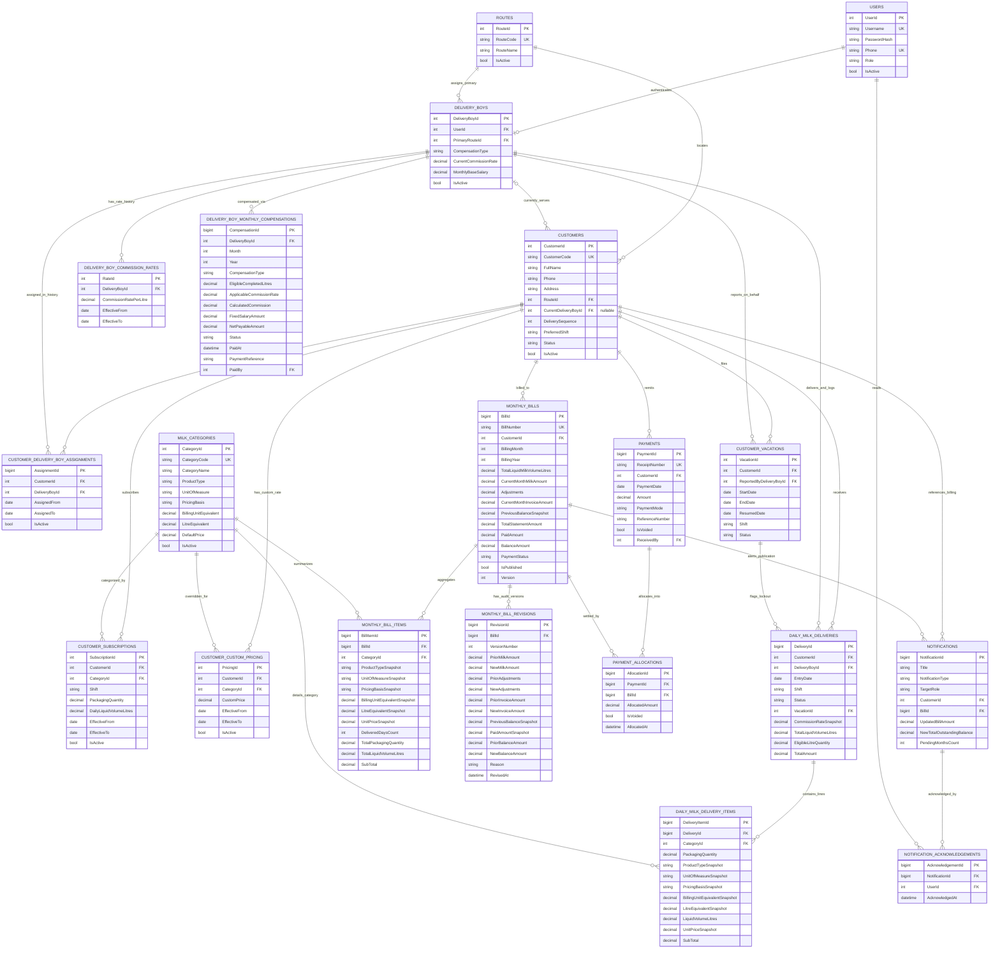

# Dairy Management System — Database Design Document

**Document Version:** 1.0.0
**Target RDBMS:** Microsoft SQL Server 2019 / 2022
**Data Access Technology:** ADO.NET (`Microsoft.Data.SqlClient`)
**Backend Framework:** ASP.NET Core MVC (.NET 9.0, C# 13)
**Author:** Senior SQL Server Database Architect
**Project Path:** `D:\MU\.Net_Code\Dairy_Management_System`
**Reference Document:** `docs/architecture/solution-architecture.md` (Authoritative Source)

---

## Table of Contents
1. [Purpose and Scope](#1-purpose-and-scope)
2. [Database Technology & Collation](#2-database-technology--collation)
3. [Database Design Principles](#3-database-design-principles)
4. [Entity Inventory](#4-entity-inventory)
5. [Detailed Table Specifications](#5-detailed-table-specifications)
   - [5.1 Authentication & Users](#51-authentication--users)
   - [5.2 Delivery Boy & Route Management](#52-delivery-boy--route-management)
   - [5.3 Customer Management](#53-customer-management)
   - [5.4 Milk Categories, Subscriptions & Pricing](#54-milk-categories-subscriptions--pricing)
   - [5.5 Customer Vacation Management](#55-customer-vacation-management)
   - [5.6 Daily Milk Entries](#56-daily-milk-entries)
   - [5.7 Monthly Billing & Invoicing](#57-monthly-billing--invoicing)
   - [5.8 Payment Management & Allocations](#58-payment-management--allocations)
   - [5.9 Commission & Salary Management](#59-commission--salary-management)
   - [5.10 Notifications & Acknowledgements](#510-notifications--acknowledgements)
   - [5.11 Application Settings & System Audit](#511-application-settings--system-audit)
6. [Entity Relationships and Cardinalities](#6-entity-relationships-and-cardinalities)
7. [Mermaid ER Diagram](#7-mermaid-er-diagram)
8. [Constraints and Indexing Strategy](#8-constraints-and-indexing-strategy)
9. [Historical Data and Audit Strategy](#9-historical-data-and-audit-strategy)
10. [Transaction and Data Integrity Strategy](#10-transaction-and-data-integrity-strategy)
11. [ADO.NET Data Access Mapping](#11-adonet-data-access-mapping)
12. [Security Considerations](#12-security-considerations)
13. [Open Design Decisions](#13-open-design-decisions)
14. [Final Design Summary](#14-final-design-summary)

---

## 1. Purpose and Scope

### 1.1 Purpose
This document provides the definitive physical and logical relational database specification for the **Dairy Management System (DMS)**. It translates the business rules, invariants, and operational workflows specified in the approved solution architecture (`docs/architecture/solution-architecture.md`) into production-grade Microsoft SQL Server table definitions, data types, constraints, indexes, transaction boundaries, and ADO.NET interaction strategies.

### 1.2 System Scope
The database supports:
- **Administrative Operations:** Customer lifecycle, multi-category subscription pricing, route partitioning, delivery boy compensation models, vacation approvals, calendar-month bulk billing runs, manual payment allocations (Online/Offline), reporting aggregations, and broadcast communications.
- **Delivery Boy Field Operations:** Route-ordered rosters, shift-based milk delivery logging, vacation lockout restrictions, personal notification acknowledgement, and commission/earnings tracking.
- **Out of Scope (Current Release):** Customer web portal or customer login accounts (customers are passive relational records managed solely by Admin), third-party automated payment gateway integrations, and AI predictive features.

---

## 2. Database Technology & Collation

| Dimension | Specification | Justification |
| :--- | :--- | :--- |
| **RDBMS Engine** | Microsoft SQL Server 2019 / 2022 | Enterprise ACID compliance, filtered indexes, computed columns, JSON support, memory-optimized table capabilities. |
| **Database Name** | `DairyManagementDb` | PascalCase standard enterprise convention. |
| **Server Collation** | `SQL_Latin1_General_CP1_CI_AS` | Standard collation for system metadata. |
| **Database Collation** | `Latin1_General_100_CI_AS_SC_UTF8` or `Indic_General_90_CI_AS` | Ensures native Unicode support. All Gujarati and multilingual customer names, addresses, and localized notes are stored in `NVARCHAR` columns to preserve linguistic fidelity without character corruption. |
| **Temporal Handling** | `DATETIME2(7)` & `DATE` | Storage efficiency: `DATE` (3 bytes) for calendar dates without time components; `DATETIME2(7)` (8 bytes) for high-precision UTC audit timestamps. |
| **Currency / Financial** | `DECIMAL(18,2)` | Strictly eliminates IEEE floating-point rounding errors across pricing, delivery extensions, billing, payments, and payroll. |

---

## 3. Database Design Principles

1. **Third Normal Form (3NF) Default:** The schema enforces 3NF across transactional and master tables to eliminate update anomalies, data redundancy, and state inconsistencies.
2. **Controlled Historical Snapshotting:** For financial and delivery immutability, transactional records physically store physical packaging quantities (`PackagingQuantity`), converted liquid milk volume (`LiquidVolumeLitres`), unit price snapshots (`UnitPriceSnapshot`), and commission rates (`CommissionRateSnapshot`) at the exact time of entry execution. Changing a customer's custom price card or base category price tomorrow never retroactively mutates past daily entries or finalized monthly invoices.
3. **Decoupling of Billing from Payment:**
   - **Monthly Billing:** Generates, recalculates, or revises consumption-based statements.
   - **Payment Management:** Manually records verified receipts of money and tracks manual month-wise allocations.
   - *Core Invariant:* Revising, regenerating, or publishing a bill must **never** automatically mark it as paid or generate dummy payment records.
4. **Relational Integrity and Deletion Policies:** All foreign key references strictly enforce referential integrity. Primary master entities and financial ledgers (`Customers`, `DeliveryBoys`, `Payments`, `PaymentAllocations`, `MonthlyBills`, `MilkCategories`, `Routes`) enforce `ON DELETE NO ACTION` (restrict) to permanently prevent accidental cascading data loss. Exactly three tightly-coupled child tables are explicitly permitted to use `ON DELETE CASCADE` for specific, documented lifecycle reasons:
   - `DailyMilkDeliveryItems` (child of `DailyMilkDeliveries`): Owned composition lines deleted during uncommitted daily shift entry drafting.
   - `MonthlyBillItems` (child of `MonthlyBills`): Owned composition lines deleted during draft invoice recalculation prior to publication.
   - `NotificationAcknowledgements` (child of `Notifications`): Ephemeral read receipts whose operational existence is wholly dependent on the parent broadcast notification; when an expired notification is deleted by Admin, its read receipts cascade delete without compromising financial or delivery ledgers.
   All other tables use soft-deletion (`IsActive = 0` or `IsVoided = 1`) or revision ledgers. Physical deletion of finalized transactional records is strictly prohibited.
5. **Soft-Delete vs. Active State Flagging:** Critical master entities (`Customers`, `DeliveryBoys`, `MilkCategories`, `Routes`) implement an `IsActive` (BIT) flag combined with filtered unique indexes, ensuring historical audit trails remain permanently intact.
6. **Pure ADO.NET Friendliness:** Schema keys utilize standard `INT` and `BIGINT` IDENTITY sequences, straightforward parameter data types matching `SqlDbType`, and avoid ORM-specific shadow state or discriminatory discriminator columns.
7. **Consistent Open-Item Billing & Account Balance Model:** Monthly bills operate on an isolated line-item basis where a monthly bill's `BalanceAmount` strictly tracks the unpaid balance of *that specific calendar month's charges* minus payments allocated directly to it. `PreviousBalanceSnapshot` is stored strictly as an informational snapshot displayed on customer statements at bill generation time, and is not aggregated into the active bill's own internal balance tracker. This strictly prevents artificial balance duplication when evaluating total customer dues across bills.

---

## 4. Entity Inventory

```
+------------------------------------+---------------------------------------------------------------+
| Table Name                         | Core Functional Responsibility                                |
+------------------------------------+---------------------------------------------------------------+
| 1. Users                           | System accounts & credentials for Admin & Delivery Boys       |
| 2. Routes                          | Geographic delivery sectors and route logistics              |
| 3. DeliveryBoys                    | Delivery personnel profiles, route link & compensation basis  |
| 4. DeliveryBoyCommissionRates      | Historical per-litre commission rates per Delivery Boy        |
| 5. Customers                       | Customer profiles, Gujarati text, contact & active route link |
| 6. CustomerDeliveryBoyAssignments  | Historical customer-to-delivery-boy route mapping             |
| 7. MilkCategories                  | Dynamic dairy catalog (liquid & non-liquid), pricing bases & base rates |
| 8. CustomerSubscriptions           | Multi-category daily subscription lines per customer & shift  |
| 9. CustomerCustomPricing           | Effective-dated customer-specific unit price overrides        |
| 10. CustomerVacations              | Vacation date windows, shifts, early resumptions & approvals  |
| 11. DailyMilkDeliveries            | Daily customer shift delivery header (Status, Liquid volume, Litres, Amount) |
| 12. DailyMilkDeliveryItems         | Category breakdown: packaging quantity, conversion/rate snapshots & subtotal |
| 13. MonthlyBills                   | Calendar-month invoices: liquid milk volume, financial totals & open-item dues |
| 14. MonthlyBillItems               | Distinct configuration lines: TotalPackagingQuantity, TotalLiquidVolumeLitres, rates & snapshots |
| 15. MonthlyBillRevisions           | Historical audit log of bill recalculations and adjustments   |
| 16. Payments                       | Receipts of verified funds received (Online/Offline, 0..N allocations) |
| 17. PaymentAllocations             | Manual month-wise allocation breakdown across monthly bills (0..N) |
| 18. DeliveryBoyMonthlyCompensations| Monthly payroll, earned commission & Admin payout tracking summaries |
| 19. Notifications                  | System broadcasts, bill publication alerts & targeted messages|
| 20. NotificationAcknowledgements   | User read/seen acknowledgement tracking (No payment meaning)  |
| 21. AppSettings                    | System runtime settings, dairy enterprise metadata & policies |
| 22. AuditLogs                      | Low-level administrative change capture & JSON state diffs    |
+------------------------------------+---------------------------------------------------------------+
```

---

## 5. Detailed Table Specifications

### 5.1 Authentication & Users

#### Table: `Users`
**Purpose:** Stores authentication credentials, identity, and role assignment for administrative staff and field delivery personnel. Enforces role-specific login flows: Admin authenticates via Username + Mobile Number + Password, while Delivery Boy authenticates via Mobile Number + Password. No customer accounts exist in this table.

| Column Name | SQL Server Data Type | Nullable | Constraints & Defaults | Description / Justification |
| :--- | :--- | :--- | :--- | :--- |
| `UserId` | `INT` | `NOT NULL` | `PRIMARY KEY IDENTITY(1,1)` | Unique internal surrogate identifier. |
| `Username` | `NVARCHAR(50)` | `NOT NULL` | `UNIQUE` | Case-insensitive handle (e.g., `admin`, `dboy_rajesh`). Alphanumeric, minimum 4 characters. |
| `PasswordHash` | `NVARCHAR(256)` | `NOT NULL` | None | RFC 2898 PBKDF2 hash formatted by ASP.NET Core built-in `PasswordHasher<TUser>`. |
| `Role` | `NVARCHAR(20)` | `NOT NULL` | `CHECK (Role IN ('Admin', 'DeliveryBoy'))` | Role-based authorization discriminator. |
| `FullName` | `NVARCHAR(100)` | `NOT NULL` | None | Full legal name of user (supports Unicode). |
| `Phone` | `VARCHAR(15)` | `NOT NULL` | `UNIQUE` | Primary mobile number. Strictly mandatory and unique across all staff accounts. Primary login key for Delivery Boys. |
| `IsActive` | `BIT` | `NOT NULL` | `DEFAULT (1)` | 1 = Active, 0 = Disabled/Deactivated. |
| `LastLoginAt` | `DATETIME2(7)` | `NULL` | None | Timestamp of most recent successful login (UTC). |
| `CreatedAt` | `DATETIME2(7)` | `NOT NULL` | `DEFAULT (SYSUTCDATETIME())` | Record creation timestamp (UTC). |
| `CreatedBy` | `INT` | `NULL` | `FOREIGN KEY REFERENCES Users(UserId)` | Creator user ID. |
| `UpdatedAt` | `DATETIME2(7)` | `NULL` | None | Last modification timestamp (UTC). |
| `UpdatedBy` | `INT` | `NULL` | `FOREIGN KEY REFERENCES Users(UserId)` | Modifier user ID. |

##### Staff Authentication & Credential Rules:
1. **Admin Authentication (Username + Mobile Number + Password):**
   - Admin login requires submitting `Username`, `Phone` (mobile number), and `Password`.
   - The query verifies identity matching `Username = @Username AND Phone = @Phone AND Role = 'Admin' AND IsActive = 1`.
   - The password hash is verified using ASP.NET Core built-in `PasswordHasher<TUser>.VerifyHashedPassword`.
2. **Delivery Boy Authentication (Mobile Number + Password):**
   - Delivery Boy field login is mobile-first: requires submitting `Phone` (mobile number) and `Password`.
   - The query verifies identity matching `Phone = @Phone AND Role = 'DeliveryBoy' AND IsActive = 1`.
   - The password hash is verified using ASP.NET Core built-in `PasswordHasher<TUser>.VerifyHashedPassword`.
3. **Mobile Number Uniqueness:** Enforced by unique constraint `UQ_Users_Phone` on `Users(Phone)`. Every staff member must possess a distinct, verified mobile number.
4. **Password Security:** Plaintext and two-way encrypted passwords are strictly forbidden. All password management conforms to ASP.NET Core identity security standards.

---

### 5.2 Delivery Boy & Route Management

#### Table: `Routes`
**Purpose:** Defines distinct delivery territories, streets, or societies to optimize daily distribution.

| Column Name | SQL Server Data Type | Nullable | Constraints & Defaults | Description / Justification |
| :--- | :--- | :--- | :--- | :--- |
| `RouteId` | `INT` | `NOT NULL` | `PRIMARY KEY IDENTITY(1,1)` | Unique surrogate route key. |
| `RouteCode` | `NVARCHAR(20)` | `NOT NULL` | `UNIQUE` | Business identifier (e.g., `RT-01`, `RT-KALAWAD`). |
| `RouteName` | `NVARCHAR(100)` | `NOT NULL` | None | Descriptive territory title (supports Gujarati). |
| `Description` | `NVARCHAR(250)` | `NULL` | None | Geographical boundaries or landmarks. |
| `IsActive` | `BIT` | `NOT NULL` | `DEFAULT (1)` | Soft deactivation flag. |
| `CreatedAt` | `DATETIME2(7)` | `NOT NULL` | `DEFAULT (SYSUTCDATETIME())` | Creation timestamp (UTC). |
| `CreatedBy` | `INT` | `NOT NULL` | `FOREIGN KEY REFERENCES Users(UserId)` | Admin user who registered route. |
| `UpdatedAt` | `DATETIME2(7)` | `NULL` | None | Modification timestamp (UTC). |
| `UpdatedBy` | `INT` | `NULL` | `FOREIGN KEY REFERENCES Users(UserId)` | Admin user who modified route. |

#### Table: `DeliveryBoys`
**Purpose:** Operational and compensation profile for delivery agents. Linked 1-to-1 with a `Users` login record.

| Column Name | SQL Server Data Type | Nullable | Constraints & Defaults | Description / Justification |
| :--- | :--- | :--- | :--- | :--- |
| `DeliveryBoyId` | `INT` | `NOT NULL` | `PRIMARY KEY IDENTITY(1,1)` | Unique delivery boy identifier. |
| `UserId` | `INT` | `NOT NULL` | `UNIQUE`, `FOREIGN KEY REFERENCES Users(UserId)` | Link to system authentication credentials. |
| `PrimaryRouteId` | `INT` | `NULL` | `FOREIGN KEY REFERENCES Routes(RouteId)` | Default territorial route assigned to agent. |
| `CompensationType` | `NVARCHAR(20)` | `NOT NULL` | `CHECK (CompensationType IN ('Fixed Salary', 'Commission'))` | Remuneration model. |
| `CurrentCommissionRate` | `DECIMAL(18,2)` | `NOT NULL` | `DEFAULT (0.00)`, `CHECK (CurrentCommissionRate >= 0)` | Current active per-litre commission rate (uniform across all categories). Set to 0.00 for Fixed Salary. |
| `MonthlyBaseSalary` | `DECIMAL(18,2)` | `NOT NULL` | `DEFAULT (0.00)`, `CHECK (MonthlyBaseSalary >= 0)` | Fixed remuneration per month. Set to 0.00 for Commission-only agents. |
| `VehicleNumber` | `NVARCHAR(30)` | `NULL` | None | Registered delivery vehicle plate number. |
| `IsActive` | `BIT` | `NOT NULL` | `DEFAULT (1)` | Operational employment status. |
| `CreatedAt` | `DATETIME2(7)` | `NOT NULL` | `DEFAULT (SYSUTCDATETIME())` | Creation timestamp (UTC). |
| `CreatedBy` | `INT` | `NOT NULL` | `FOREIGN KEY REFERENCES Users(UserId)` | Creator Admin. |
| `UpdatedAt` | `DATETIME2(7)` | `NULL` | None | Modification timestamp (UTC). |
| `UpdatedBy` | `INT` | `NULL` | `FOREIGN KEY REFERENCES Users(UserId)` | Modifier Admin. |

#### Table: `DeliveryBoyCommissionRates`
**Purpose:** Maintains complete historical audit logs of changes to a delivery boy's individual commission rate over time, supporting mid-month rate adjustments. Non-overlapping chronological validity is enforced through filtered unique indexing and transactional date-range validation.

| Column Name | SQL Server Data Type | Nullable | Constraints & Defaults | Description / Justification |
| :--- | :--- | :--- | :--- | :--- |
| `RateId` | `INT` | `NOT NULL` | `PRIMARY KEY IDENTITY(1,1)` | Surrogate rate history key. |
| `DeliveryBoyId` | `INT` | `NOT NULL` | `FOREIGN KEY REFERENCES DeliveryBoys(DeliveryBoyId)` | Target delivery agent. |
| `CommissionRatePerLitre` | `DECIMAL(18,2)` | `NOT NULL` | `CHECK (CommissionRatePerLitre >= 0)` | Agreed rate per confirmed eligible completed litre. |
| `EffectiveFrom` | `DATE` | `NOT NULL` | None | Effective start calendar date. |
| `EffectiveTo` | `DATE` | `NULL` | `CHECK (EffectiveTo IS NULL OR EffectiveTo >= EffectiveFrom)` | Effective end calendar date (`NULL` indicates current active rate). |
| `CreatedAt` | `DATETIME2(7)` | `NOT NULL` | `DEFAULT (SYSUTCDATETIME())` | Audit log timestamp. |
| `CreatedBy` | `INT` | `NOT NULL` | `FOREIGN KEY REFERENCES Users(UserId)` | Admin user executing rate adjustment. |

##### Commission Rate Historical Non-Overlap Rules:
1. **At Most One Active Open-Ended Rate:** Enforced by filtered unique index `UQ_ActiveDeliveryBoyCommissionRate` on `(DeliveryBoyId) WHERE EffectiveTo IS NULL`.
2. **Valid Re-Rating Dates:** When establishing a new commission rate effective from date $D$, the application transaction strictly validates that $D > \text{CurrentRate.EffectiveFrom}$. The prior active rate is terminated by setting `EffectiveTo = DATEADD(DAY, -1, @NewEffectiveFrom)`.
3. **Atomic Non-Overlap Rejection:** If any existing record for this delivery boy overlaps the new period ($S_{\text{existing}} \le \text{NewEndDate} \land \text{NewStartDate} \le E_{\text{existing}}$), the transaction aborts with an error.

#### Table: `CustomerDeliveryBoyAssignments`
**Purpose:** Preserves the complete historical audit log of customer-to-delivery-boy assignments over time. The database schema enforces *at most one* active assignment per customer via filtered unique index `UQ_ActiveCustomerAssignment`, while the atomic Customer Assignment Transaction in the application layer maintains *exactly one* active assignment for assigned customers, prevents overlapping historical periods, validates valid reassignment dates, and synchronizes `Customers.CurrentDeliveryBoyId`.

| Column Name | SQL Server Data Type | Nullable | Constraints & Defaults | Description / Justification |
| :--- | :--- | :--- | :--- | :--- |
| `AssignmentId` | `BIGINT` | `NOT NULL` | `PRIMARY KEY IDENTITY(1,1)` | Unique assignment log identifier. |
| `CustomerId` | `INT` | `NOT NULL` | `FOREIGN KEY REFERENCES Customers(CustomerId)` | Target customer. |
| `DeliveryBoyId` | `INT` | `NOT NULL` | `FOREIGN KEY REFERENCES DeliveryBoys(DeliveryBoyId)` | Assigned field delivery executive. |
| `AssignedFrom` | `DATE` | `NOT NULL` | None | Start date of route servicing. |
| `AssignedTo` | `DATE` | `NULL` | `CHECK (AssignedTo IS NULL OR AssignedTo >= AssignedFrom)` | End date of route servicing (`NULL` indicates currently active assignment). |
| `IsActive` | `BIT` | `NOT NULL` | `DEFAULT (1)` | Flag indicating active status. Only one row per customer can have `IsActive = 1 AND AssignedTo IS NULL`. |
| `Notes` | `NVARCHAR(250)` | `NULL` | None | Reason for assignment or route transfer. |
| `CreatedAt` | `DATETIME2(7)` | `NOT NULL` | `DEFAULT (SYSUTCDATETIME())` | Creation timestamp. |
| `CreatedBy` | `INT` | `NOT NULL` | `FOREIGN KEY REFERENCES Users(UserId)` | Admin user performing mapping. |
| `UpdatedAt` | `DATETIME2(7)` | `NULL` | None | Modification timestamp. |
| `UpdatedBy` | `INT` | `NULL` | `FOREIGN KEY REFERENCES Users(UserId)` | Admin user modifying assignment. |

##### Assignment Invariant & Transactional Consistency Rules:
1. **At Most One Active Assignment (Database Layer):** Enforced by filtered unique index `UQ_ActiveCustomerAssignment` on `(CustomerId) WHERE IsActive = 1 AND AssignedTo IS NULL`. This physically prevents any customer from having two concurrent open-ended active assignments.
2. **Valid Reassignment Date Boundary:** To prevent invalid historical intervals or closing an assignment before it starts, any reassignment effective on date $D$ strictly requires:
   $$D > \text{CurrentActiveAssignment.AssignedFrom}$$
   This ensures that the terminated assignment's closing date, calculated as $\text{AssignedTo} = D - 1\text{ day}$, satisfies `AssignedTo >= AssignedFrom`. If $D \le \text{AssignedFrom}$, the transaction is rejected immediately.
3. **Temporal Overlap Prevention & Gap Semantics:** Check constraint `AssignedTo >= AssignedFrom` and transaction locks prevent overlapping assignments. When reassigning an active customer directly from Agent A to Agent B, setting `AssignedTo = DATEADD(DAY, -1, @NewAssignedFrom)` ensures no gap between those two consecutive assignments. However, if a customer is temporarily unassigned (e.g., during onboarding, route reorganization, or prolonged account suspension), a legitimate unassigned gap may exist in the historical timeline before a subsequent assignment begins. Overlaps are strictly prohibited.
4. **Unassigned Customer Representation (Option B Policy):**
   - The foreign key column `Customers.CurrentDeliveryBoyId` is explicitly nullable (`INT NULL`).
   - An unassigned customer has `CurrentDeliveryBoyId = NULL` and zero active rows in `CustomerDeliveryBoyAssignments` (`WHERE IsActive = 1 AND AssignedTo IS NULL`).
   - **Field Roster Exclusion:** Field delivery boy rosters query `WHERE CurrentDeliveryBoyId = @DeliveryBoyId`, completely excluding unassigned customers from delivery boy field distribution sheets.
   - **Daily Delivery Submission Rejection:** Daily milk entry batch submissions strictly validate assignment and reject any entry for a customer who has no active assignment covering `EntryDate`.
5. **Lifecycle Operations & Pointer Synchronization (Application Transaction):** The application manages all assignment transitions inside an ACID `SqlTransaction` with pessimistic row locking (`SELECT CustomerId FROM Customers WITH (UPDLOCK, ROWLOCK) WHERE CustomerId = @CustomerId`):
   - **Initial Assignment or Reassignment from Unassigned State:** When assigning an unassigned customer (`CurrentDeliveryBoyId IS NULL`), inserts a new active assignment record:
     ```sql
     INSERT INTO CustomerDeliveryBoyAssignments (CustomerId, DeliveryBoyId, AssignedFrom, AssignedTo, IsActive, CreatedBy)
     VALUES (@CustomerId, @NewDeliveryBoyId, @EffectiveDate, NULL, 1, @AdminUserId);
     UPDATE Customers SET CurrentDeliveryBoyId = @NewDeliveryBoyId, UpdatedAt = SYSUTCDATETIME(), UpdatedBy = @AdminUserId WHERE CustomerId = @CustomerId;
     ```
   - **Direct Handover (Agent A to Agent B):** Terminates Agent A's assignment on day $D - 1$, creates Agent B's assignment on day $D$, and synchronizes `CurrentDeliveryBoyId`:
     ```sql
     UPDATE CustomerDeliveryBoyAssignments
     SET AssignedTo = DATEADD(DAY, -1, @NewEffectiveDate), IsActive = 0, UpdatedAt = SYSUTCDATETIME(), UpdatedBy = @AdminUserId
     WHERE CustomerId = @CustomerId AND IsActive = 1 AND AssignedTo IS NULL;
     INSERT INTO CustomerDeliveryBoyAssignments (CustomerId, DeliveryBoyId, AssignedFrom, AssignedTo, IsActive, CreatedBy)
     VALUES (@CustomerId, @NewDeliveryBoyId, @NewEffectiveDate, NULL, 1, @AdminUserId);
     UPDATE Customers SET CurrentDeliveryBoyId = @NewDeliveryBoyId, UpdatedAt = SYSUTCDATETIME(), UpdatedBy = @AdminUserId WHERE CustomerId = @CustomerId;
     ```
   - **Unassignment (Removing Assignment):** Terminates the active assignment on day $D - 1$ and clears the active pointer:
     ```sql
     UPDATE CustomerDeliveryBoyAssignments
     SET AssignedTo = DATEADD(DAY, -1, @UnassignDate), IsActive = 0, UpdatedAt = SYSUTCDATETIME(), UpdatedBy = @AdminUserId
     WHERE CustomerId = @CustomerId AND IsActive = 1 AND AssignedTo IS NULL;
     UPDATE Customers SET CurrentDeliveryBoyId = NULL, UpdatedAt = SYSUTCDATETIME(), UpdatedBy = @AdminUserId WHERE CustomerId = @CustomerId;
     ```

---

### 5.3 Customer Management

#### Table: `Customers`
**Purpose:** Master repository of customer profile, contact information, route location, delivery sequence, and active service status. Fully supports Gujarati script in name and address fields. Identifies customers via a stored, generated unique business code (`CustomerCode`).

| Column Name | SQL Server Data Type | Nullable | Constraints & Defaults | Description / Justification |
| :--- | :--- | :--- | :--- | :--- |
| `CustomerId` | `INT` | `NOT NULL` | `PRIMARY KEY IDENTITY(1,1)` | Primary customer surrogate key. |
| `CustomerCode` | `VARCHAR(20)` | `NOT NULL` | `UNIQUE` | **Stored Generated Code:** Formatted alphanumeric identifier (e.g., `CUST-00101`). Generated during customer onboarding and stored permanently as an indexed physical column. |
| `FullName` | `NVARCHAR(100)` | `NOT NULL` | None | Full customer name (native Gujarati Unicode support). |
| `Phone` | `VARCHAR(15)` | `NOT NULL` | None | Primary mobile contact number. |
| `AlternatePhone` | `VARCHAR(15)` | `NULL` | None | Secondary or emergency contact number. |
| `Address` | `NVARCHAR(250)` | `NOT NULL` | None | Delivery street address / flat details (Gujarati support). |
| `Landmark` | `NVARCHAR(100)` | `NULL` | None | Nearby navigation landmark. |
| `RouteId` | `INT` | `NOT NULL` | `FOREIGN KEY REFERENCES Routes(RouteId)` | Geographical delivery sector. |
| `CurrentDeliveryBoyId` | `INT` | `NULL` | `FOREIGN KEY REFERENCES DeliveryBoys(DeliveryBoyId)` | Denormalized current assigned delivery boy for rapid roster querying (`NULL` if customer is temporarily unassigned during onboarding or route reorganization). |
| `DeliverySequence` | `INT` | `NOT NULL` | `DEFAULT (0)` | Sequential stop order along the route for delivery optimization. |
| `PreferredShift` | `NVARCHAR(20)` | `NOT NULL` | `DEFAULT ('Both')`, `CHECK (PreferredShift IN ('Morning', 'Evening', 'Both'))` | Scheduled delivery shift preference. |
| `Status` | `NVARCHAR(20)` | `NOT NULL` | `DEFAULT ('Active')`, `CHECK (Status IN ('Active', 'Suspended', 'Inactive'))` | Service status. |
| `IsActive` | `BIT` | `NOT NULL` | `DEFAULT (1)` | Soft deletion / master active flag. |
| `CreatedAt` | `DATETIME2(7)` | `NOT NULL` | `DEFAULT (SYSUTCDATETIME())` | Onboarding timestamp (UTC). |
| `CreatedBy` | `INT` | `NOT NULL` | `FOREIGN KEY REFERENCES Users(UserId)` | Onboarding Admin user ID. |
| `UpdatedAt` | `DATETIME2(7)` | `NULL` | None | Last profile update timestamp. |
| `UpdatedBy` | `INT` | `NULL` | `FOREIGN KEY REFERENCES Users(UserId)` | Modifier Admin user ID. |

---

### 5.4 Milk Categories, Subscriptions & Pricing

#### Table: `MilkCategories`
**Purpose:** Dynamic master list of dairy products managed entirely by the Admin. Categories are never hardcoded and can be added, updated, or retired dynamically. Supports both liquid milk products (priced per litre) and non-liquid products (priced per kilogram or per unit). Strictly separates physical packaging units from liquid milk volume via `BillingUnitEquivalent` and `LitreEquivalent`, ensuring non-liquid products receive accurate monetary pricing while accruing zero liquid milk volume and zero delivery boy commission.

| Column Name | SQL Server Data Type | Nullable | Constraints & Defaults | Description / Justification |
| :--- | :--- | :--- | :--- | :--- |
| `CategoryId` | `INT` | `NOT NULL` | `PRIMARY KEY IDENTITY(1,1)` | Surrogate category key. |
| `CategoryCode` | `NVARCHAR(20)` | `NOT NULL` | `UNIQUE` | Unique identifier (e.g., `COW_500ML`, `BUFFALO_1L`, `PANEER_500G`, `GHEE_1KG`, `CURD_TUB`). |
| `CategoryName` | `NVARCHAR(100)` | `NOT NULL` | None | Localized display title (English & Gujarati, e.g., "Cow Milk 500ml", "Desi Ghee 1kg"). |
| `ProductType` | `NVARCHAR(20)` | `NOT NULL` | `DEFAULT ('Liquid')`, `CHECK (ProductType IN ('Liquid', 'Non-Liquid'))` | Product classification: `'Liquid'` represents liquid milk products; `'Non-Liquid'` represents solid/packaged dairy items (Ghee, Paneer, Curd, Butter, etc.). |
| `UnitOfMeasure` | `NVARCHAR(20)` | `NOT NULL` | `DEFAULT ('Litre')` | Physical unit description (`Litre`, `Pouch`, `Bottle`, `Kg`, `Pack`, `Tub`). |
| `PricingBasis` | `NVARCHAR(20)` | `NOT NULL` | `DEFAULT ('Per Litre')`, `CHECK (PricingBasis IN ('Per Litre', 'Per Kg', 'Per Unit'))` | **Unit Pricing Standard:** Determines monetary pricing formula: `'Per Litre'` (liquid volume basis), `'Per Kg'` (weight basis for non-liquid products), or `'Per Unit'` (fixed piece/packet basis). |
| `BillingUnitEquivalent` | `DECIMAL(18,3)` | `NOT NULL` | `DEFAULT (1.000)`, `CHECK (BillingUnitEquivalent >= 0)` | **Pricing Multiplier:** Conversion multiplier from physical packaging unit to the pricing unit. For `'Per Litre'`: Litres per packaging unit (1.000 for 1L, 0.500 for 500ml, 0.250 for 250ml). For `'Per Kg'`: Kilograms per packaging unit (1.000 for 1kg, 0.500 for 500g pack, 0.200 for 200g slab). For `'Per Unit'`: Exactly 1.000. |
| `LitreEquivalent` | `DECIMAL(18,3)` | `NOT NULL` | `DEFAULT (1.000)`, `CHECK (LitreEquivalent >= 0)` | **Liquid Milk Volume Multiplier:** Strictly used for liquid volume conversion and delivery boy commission. For `'Liquid'` products: Litres of liquid milk per packaging unit (1.000 for 1L; 0.500 for 500ml; 0.250 for 250ml). For `'Non-Liquid'` products: Strictly `0.000` (enforced: `ProductType = 'Non-Liquid' ==> LitreEquivalent = 0.000`). Zero liquid volume, zero delivery commission accrued. |
| `DefaultPrice` | `DECIMAL(18,2)` | `NOT NULL` | `CHECK (DefaultPrice > 0)` | Base dairy retail price corresponding to `PricingBasis` (per litre for `'Per Litre'`, per kg for `'Per Kg'`, or per unit for `'Per Unit'`). |
| `DisplayOrder` | `INT` | `NOT NULL` | `DEFAULT (0)` | Ordering in daily entry UI grids. |
| `IsActive` | `BIT` | `NOT NULL` | `DEFAULT (1)` | Active catalog state (Admin can activate/deactivate). |
| `CreatedAt` | `DATETIME2(7)` | `NOT NULL` | `DEFAULT (SYSUTCDATETIME())` | Catalog entry timestamp. |
| `CreatedBy` | `INT` | `NOT NULL` | `FOREIGN KEY REFERENCES Users(UserId)` | Creator Admin. |
| `UpdatedAt` | `DATETIME2(7)` | `NULL` | None | Update timestamp. |
| `UpdatedBy` | `INT` | `NULL` | `FOREIGN KEY REFERENCES Users(UserId)` | Modifier Admin. |

#### Table: `CustomerSubscriptions`
**Purpose:** Relational subscription matrix allowing a customer to subscribe to multiple dairy categories across morning, evening, or both shifts with distinct daily quotas. Explicitly separates expected daily physical packaging quantity (`PackagingQuantity`) from converted expected daily liquid milk volume (`DailyLiquidVolumeLitres`), ensuring category quotas and liquid totals remain transparent, while non-liquid items accrue zero liquid volume.

| Column Name | SQL Server Data Type | Nullable | Constraints & Defaults | Description / Justification |
| :--- | :--- | :--- | :--- | :--- |
| `SubscriptionId` | `INT` | `NOT NULL` | `PRIMARY KEY IDENTITY(1,1)` | Unique subscription record identifier. |
| `CustomerId` | `INT` | `NOT NULL` | `FOREIGN KEY REFERENCES Customers(CustomerId)` | Target customer. |
| `CategoryId` | `INT` | `NOT NULL` | `FOREIGN KEY REFERENCES MilkCategories(CategoryId)` | Subscribed dairy category. |
| `Shift` | `NVARCHAR(20)` | `NOT NULL` | `DEFAULT ('Both')`, `CHECK (Shift IN ('Morning', 'Evening', 'Both'))` | Applicable delivery shift. |
| `PackagingQuantity` | `DECIMAL(18,3)` | `NOT NULL` | `CHECK (PackagingQuantity > 0)` | Expected daily delivery volume in physical packaging units (e.g., `2.000` pouches, `1.000` bottle, `1.000` pack/tub). |
| `DailyLiquidVolumeLitres` | `DECIMAL(18,3)` | `NOT NULL` | `DEFAULT (0.000)`, `CHECK (DailyLiquidVolumeLitres >= 0)` | **Converted Liquid Milk Volume:** Converted expected daily liquid volume in litres = $\text{PackagingQuantity} \times \text{MilkCategories.LitreEquivalent}$. Strictly `0.000` for non-liquid products. |
| `EffectiveFrom` | `DATE` | `NOT NULL` | None | Date this subscription quota becomes active. |
| `EffectiveTo` | `DATE` | `NULL` | `CHECK (EffectiveTo IS NULL OR EffectiveTo >= EffectiveFrom)` | Date quota ends (`NULL` = currently active). |
| `IsActive` | `BIT` | `NOT NULL` | `DEFAULT (1)` | Active subscription flag. |
| `CreatedAt` | `DATETIME2(7)` | `NOT NULL` | `DEFAULT (SYSUTCDATETIME())` | Subscription initiation timestamp. |
| `CreatedBy` | `INT` | `NOT NULL` | `FOREIGN KEY REFERENCES Users(UserId)` | Creator Admin. |
| `UpdatedAt` | `DATETIME2(7)` | `NULL` | None | Update timestamp. |
| `UpdatedBy` | `INT` | `NULL` | `FOREIGN KEY REFERENCES Users(UserId)` | Modifier Admin. |

##### Subscription Shift Overlap & Effective-Date Rules:
1. **Shift Semantics & Mutual Exclusivity:**
   - A customer subscribing to category $K$ on shift `Both` is scheduled to receive deliveries during both morning and evening shifts.
   - Consequently, holding a subscription for `Both` is **mutually exclusive** with holding a discrete `Morning` or `Evening` subscription for that same category during overlapping effective dates.
   - Conversely, a customer may hold separate active subscriptions for `Morning` and `Evening` for the same category (e.g., 1.5L Morning and 0.5L Evening), as discrete shifts do not overlap.
2. **Non-Overlapping Effective Periods:** For any customer $C$ and category $K$:
   - Two subscription records overlap if:
     $$\text{Existing.EffectiveFrom} \le \text{ISNULL}(\text{New.EffectiveTo}, \text{'9999-12-31'}) \quad \land \quad \text{ISNULL}(\text{Existing.EffectiveTo}, \text{'9999-12-31'}) \ge \text{New.EffectiveFrom}$$
   - If the new subscription is `Both`, it cannot overlap **any** existing subscription (`Morning`, `Evening`, or `Both`) for that category.
   - If the new subscription is `Morning`, it cannot overlap an existing `Morning` or `Both` subscription.
   - If the new subscription is `Evening`, it cannot overlap an existing `Evening` or `Both` subscription.
3. **Atomic Rejection (Application Transaction):** The subscription management transaction acquires `UPDLOCK, HOLDLOCK` on `CustomerSubscriptions` for `(CustomerId, CategoryId)`. If an overlapping shift/date combination is detected, the transaction aborts with an error, preventing conflicting delivery schedules.
4. **Historical Continuity:** Modifying a subscription volume terminates the active record by setting `EffectiveTo = DATEADD(DAY, -1, @NewEffectiveFrom)` and inserts the new active record with `EffectiveTo = NULL`. Future changes never alter past delivery entries.
5. **Product Conversion-Factor Changes & Subscription Integrity:**
   - A customer subscription captures the agreed daily packaging quantity (`PackagingQuantity`) and the converted liquid volume (`DailyLiquidVolumeLitres = PackagingQuantity * LitreEquivalent`) for an effective date range.
   - If Admin updates a category's conversion factor (e.g. `BillingUnitEquivalent` or `LitreEquivalent`) or physical packaging specification in `MilkCategories`:
     - **Zero Retroactive Mutation:** The change NEVER silently recalculates past or active subscriptions, nor does it recalculate past daily delivery entries or finalized monthly bills.
     - **Subscription Migration Protocol:** An administrative transition date (`@TransitionDate`) is specified. Existing active subscriptions for that category are closed by setting `EffectiveTo = DATEADD(DAY, -1, @TransitionDate)` and `IsActive = 0`. New subscription records are inserted with `EffectiveFrom = @TransitionDate`, recalculating `DailyLiquidVolumeLitres = PackagingQuantity * @NewLitreEquivalent` from that date forward.
     - **Historical Delivery Immunity:** Past daily delivery entries retain their immutable `BillingUnitEquivalentSnapshot`, `LitreEquivalentSnapshot`, and `UnitPriceSnapshot` in `DailyMilkDeliveryItems`, guaranteeing that historical calculations can be reproduced with 100% mathematical fidelity.

#### Table: `CustomerCustomPricing`
**Purpose:** Stores customer-specific price overrides deviating from default category prices. Employs effective date boundaries (`EffectiveFrom` and `EffectiveTo`) to preserve historical pricing integrity and prevent retroactive changes. Custom price values align with the category's `PricingBasis`.

| Column Name | SQL Server Data Type | Nullable | Constraints & Defaults | Description / Justification |
| :--- | :--- | :--- | :--- | :--- |
| `PricingId` | `INT` | `NOT NULL` | `PRIMARY KEY IDENTITY(1,1)` | Surrogate custom pricing key. |
| `CustomerId` | `INT` | `NOT NULL` | `FOREIGN KEY REFERENCES Customers(CustomerId)` | Target customer. |
| `CategoryId` | `INT` | `NOT NULL` | `FOREIGN KEY REFERENCES MilkCategories(CategoryId)` | Target dairy category. |
| `CustomPrice` | `DECIMAL(18,2)` | `NOT NULL` | `CHECK (CustomPrice > 0)` | Agreed special contract price corresponding to the category's `PricingBasis` (per litre for `'Per Litre'`, per kg for `'Per Kg'`, or per unit for `'Per Unit'`). |
| `EffectiveFrom` | `DATE` | `NOT NULL` | None | Date custom rate card becomes valid. |
| `EffectiveTo` | `DATE` | `NULL` | `CHECK (EffectiveTo IS NULL OR EffectiveTo >= EffectiveFrom)` | Date custom rate card expires (`NULL` = indefinitely active). |
| `IsActive` | `BIT` | `NOT NULL` | `DEFAULT (1)` | Active status flag. |
| `CreatedAt` | `DATETIME2(7)` | `NOT NULL` | `DEFAULT (SYSUTCDATETIME())` | Record timestamp. |
| `CreatedBy` | `INT` | `NOT NULL` | `FOREIGN KEY REFERENCES Users(UserId)` | Creator Admin. |

##### Pricing Precedence & Temporal Rules:
1. **Custom Price Precedence Invariant:** For any delivery on date $D$ for customer $C$ and category $K$, the applicable price is:
   $$\text{Applicable Price} = \text{COALESCE}(P_{\text{custom}}, P_{\text{default}})$$
   Where $P_{\text{custom}}$ is queried from `CustomerCustomPricing` matching $C$, $K$, `IsActive = 1`, and $D \ge \text{EffectiveFrom} \text{ AND } (D \le \text{EffectiveTo} \lor \text{EffectiveTo IS NULL})$. If no active override exists, $P_{\text{default}} = \text{MilkCategories.DefaultPrice}$.
2. **Prevention of Overlapping Effective Periods:** Enforced by filtered unique index `UQ_ActiveCustomerCustomPricing` on `(CustomerId, CategoryId) WHERE IsActive = 1 AND EffectiveTo IS NULL` (ensuring at most one open-ended active rate) combined with an application-level update transaction that sets `EffectiveTo = DATEADD(DAY, -1, @NewEffectiveFrom)` on the preceding record before inserting the new rate.
3. **Atomic Non-Overlap Rejection:** Inside the transaction, query verification guarantees that no two records for `(CustomerId, CategoryId)` overlap:
   ```sql
   IF EXISTS (
       SELECT 1 FROM CustomerCustomPricing WITH (UPDLOCK, HOLDLOCK)
       WHERE CustomerId = @CustomerId AND CategoryId = @CategoryId AND IsActive = 1
         AND PricingId <> @PricingId
         AND @NewEffectiveFrom <= ISNULL(EffectiveTo, '9999-12-31')
         AND ISNULL(@NewEffectiveTo, '9999-12-31') >= EffectiveFrom
   )
   THROW 50012, 'Overlapping custom pricing periods are prohibited.', 1;
   ```
4. **Future vs. Historical Deliveries:** Changes to category base rates or customer custom rate cards apply strictly to future deliveries logged on or after the new `EffectiveFrom` date. Past entries in `DailyMilkDeliveryItems` retain their immutable `UnitPriceSnapshot`, `BillingUnitEquivalentSnapshot`, `LitreEquivalentSnapshot`, `PricingBasisSnapshot`, `ProductTypeSnapshot`, and `UnitOfMeasureSnapshot`, guaranteeing historical reporting and billing integrity.

---

### 5.5 Customer Vacation Management

#### Table: `CustomerVacations`
**Purpose:** Tracks customer non-delivery requests with full workflow support: Delivery Boy reporting, Admin direct entry, Admin approval/rejection, start/end dates, early resumption, and audit history. Protects closed billing periods from silent retrospective mutation.

| Column Name | SQL Server Data Type | Nullable | Constraints & Defaults | Description / Justification |
| :--- | :--- | :--- | :--- | :--- |
| `VacationId` | `INT` | `NOT NULL` | `PRIMARY KEY IDENTITY(1,1)` | Unique vacation record key. |
| `CustomerId` | `INT` | `NOT NULL` | `FOREIGN KEY REFERENCES Customers(CustomerId)` | Target customer. |
| `ReportedByDeliveryBoyId` | `INT` | `NULL` | `FOREIGN KEY REFERENCES DeliveryBoys(DeliveryBoyId)` | Set if filed from the field by Delivery Boy; `NULL` if direct Admin entry. |
| `StartDate` | `DATE` | `NOT NULL` | None | First day of non-delivery. |
| `EndDate` | `DATE` | `NOT NULL` | None | Scheduled last day of non-delivery (`EndDate >= StartDate`). |
| `ResumedDate` | `DATE` | `NULL` | None | Populated if customer resumes deliveries earlier than scheduled `EndDate`. |
| `Shift` | `NVARCHAR(20)` | `NOT NULL` | `DEFAULT ('Both')`, `CHECK (Shift IN ('Morning', 'Evening', 'Both'))` | Shifts affected by the vacation. |
| `Reason` | `NVARCHAR(250)` | `NULL` | None | Reason for absence (e.g., "Out of town", "Religious fast"). |
| `Status` | `NVARCHAR(20)` | `NOT NULL` | `DEFAULT ('Pending')`, `CHECK (Status IN ('Pending', 'Approved', 'Rejected', 'Cancelled'))` | Approval lifecycle state. |
| `ApprovedBy` | `INT` | `NULL` | `FOREIGN KEY REFERENCES Users(UserId)` | Admin user ID who evaluated request. |
| `ApprovedAt` | `DATETIME2(7)` | `NULL` | None | Evaluation timestamp (UTC). |
| `RejectionReason` | `NVARCHAR(250)` | `NULL` | None | Explanatory note if rejected by Admin. |
| `CreatedAt` | `DATETIME2(7)` | `NOT NULL` | `DEFAULT (SYSUTCDATETIME())` | Creation timestamp. |
| `CreatedBy` | `INT` | `NOT NULL` | `FOREIGN KEY REFERENCES Users(UserId)` | User who recorded entry. |
| `UpdatedAt` | `DATETIME2(7)` | `NULL` | None | Update timestamp. |
| `UpdatedBy` | `INT` | `NULL` | `FOREIGN KEY REFERENCES Users(UserId)` | Modifier user ID. |

##### Vacation Approval & Published Billing Protection:
1. **Unbilled / Unpublished Period Behavior:** When a vacation is approved for dates where billing has not yet been published (`MonthlyBills.IsPublished = 0` or bill not yet created), any prematurely logged deliveries within the vacation window are automatically updated to `Status = 'Not Delivered'`, `VacationId = @VacationId`, `TotalLiquidVolumeLitres = 0.000`, `EligibleLitreQuantity = 0.000`, `TotalAmount = 0.00`, and child items zeroed out (`PackagingQuantity = 0.000`, `LiquidVolumeLitres = 0.000`, `SubTotal = 0.00`).
2. **Protection of Published Periods (No Silent Overwrite):** If a customer requests a vacation retrospectively covering dates in a month whose bill is already published (`MonthlyBills.IsPublished = 1`):
   - The transaction **strictly prohibits** silently modifying past `DailyMilkDeliveries` or `DailyMilkDeliveryItems`. Original field delivery records remain intact for delivery audit history.
   - The vacation is approved with an explicit notation: `Reason = Reason + ' [Approved retrospectively after bill publication]'`.
   - The financial correction is handled via the Admin-controlled **Bill Revision Workflow** (Section 10.1, Transaction 7) by applying a credit in `MonthlyBills.Adjustments`, incrementing `MonthlyBills.Version`, logging into `MonthlyBillRevisions`, and issuing an updated statement (or crediting the subsequent month's bill).

---

### 5.6 Daily Milk Entries

#### Table: `DailyMilkDeliveries` (Delivery Header)
**Purpose:** Header entity representing the daily delivery transaction per customer, date, and shift. Maps directly to the customer-level completion checkbox in the UI, establishes total daily financial charges and converted liquid milk volume, tracks eligible milk litres for commission, links to approved vacations, snapshots the delivery boy's active commission rate, and enforces the three permitted statuses (`Completed`, `Pending`, `Not Delivered`). Physical packaging units are preserved strictly at the category line-item level to avoid combining incompatible units.

| Column Name | SQL Server Data Type | Nullable | Constraints & Defaults | Description / Justification |
| :--- | :--- | :--- | :--- | :--- |
| `DeliveryId` | `BIGINT` | `NOT NULL` | `PRIMARY KEY IDENTITY(1,1)` | Unique delivery transaction key. |
| `CustomerId` | `INT` | `NOT NULL` | `FOREIGN KEY REFERENCES Customers(CustomerId)` | Target customer. |
| `DeliveryBoyId` | `INT` | `NOT NULL` | `FOREIGN KEY REFERENCES DeliveryBoys(DeliveryBoyId)` | Agent executing/logging delivery. Must match active assignment for `EntryDate`. |
| `EntryDate` | `DATE` | `NOT NULL` | None | Calendar date of milk distribution. |
| `Shift` | `NVARCHAR(20)` | `NOT NULL` | `CHECK (Shift IN ('Morning', 'Evening'))` | Distribution shift. |
| `Status` | `NVARCHAR(20)` | `NOT NULL` | `DEFAULT ('Pending')`, `CHECK (Status IN ('Completed', 'Pending', 'Not Delivered'))` | **Strict Status Invariant:** Only permitted daily entry statuses. |
| `VacationId` | `INT` | `NULL` | `FOREIGN KEY REFERENCES CustomerVacations(VacationId)` | References active approved vacation if non-delivery is due to vacation. |
| `NonDeliveryReason` | `NVARCHAR(250)` | `NULL` | None | Explanatory reason when `Status = 'Not Delivered'` (e.g. "Customer Vacation", "Customer Absent", "Refused"). |
| `CommissionRateSnapshot` | `DECIMAL(18,2)` | `NOT NULL` | `DEFAULT (0.00)`, `CHECK (CommissionRateSnapshot >= 0)` | **Rate Snapshot:** Snapshots the delivery boy's active per-litre commission rate on `EntryDate`. Set to 0.00 for Fixed Salary agents. Guarantees accurate commission even if rates change mid-month. |
| `TotalLiquidVolumeLitres` | `DECIMAL(18,3)` | `NOT NULL` | `DEFAULT (0.000)`, `CHECK (TotalLiquidVolumeLitres >= 0)` | Daily aggregate converted liquid milk volume delivered in litres (must be 0.000 for `Not Delivered`). Strictly excludes non-liquid products. |
| `EligibleLitreQuantity` | `DECIMAL(18,3)` | `NOT NULL` | `DEFAULT (0.000)`, `CHECK (EligibleLitreQuantity >= 0)` | **Eligible Litre Volume:** Calculated as $\sum \text{DailyMilkDeliveryItems.LiquidVolumeLitres}$ where `Status = 'Completed'` and customer not on approved vacation. Strictly 0.000 for `Pending`, `Not Delivered`, or vacation entries. Used directly for commission calculation. |
| `TotalAmount` | `DECIMAL(18,2)` | `NOT NULL` | `DEFAULT (0.00)`, `CHECK (TotalAmount >= 0)` | Daily aggregate financial value = $\sum \text{DailyMilkDeliveryItems.SubTotal}$ (must be 0.00 for `Not Delivered` or Vacation). |
| `CreatedAt` | `DATETIME2(7)` | `NOT NULL` | `DEFAULT (SYSUTCDATETIME())` | Timestamp logged. |
| `CreatedBy` | `INT` | `NOT NULL` | `FOREIGN KEY REFERENCES Users(UserId)` | Delivery Boy or Admin user who logged entry. |
| `UpdatedAt` | `DATETIME2(7)` | `NULL` | None | Update timestamp. |
| `UpdatedBy` | `INT` | `NULL` | `FOREIGN KEY REFERENCES Users(UserId)` | Modifier user ID. |

#### Table: `DailyMilkDeliveryItems` (Delivery Detail Lines)
**Purpose:** Itemized category breakdown for a customer's daily delivery. Stores separate packaging quantities, product configuration snapshots (`ProductTypeSnapshot`, `UnitOfMeasureSnapshot`, `PricingBasisSnapshot`, `BillingUnitEquivalentSnapshot`, `LitreEquivalentSnapshot`), unit price snapshot, and subtotal. Owned child entity of `DailyMilkDeliveries`. All subtotal and liquid volume calculations use these immutable historical snapshots, ensuring past entries can never be silently corrupted if category configuration changes later.

| Column Name | SQL Server Data Type | Nullable | Constraints & Defaults | Description / Justification |
| :--- | :--- | :--- | :--- | :--- |
| `DeliveryItemId` | `BIGINT` | `NOT NULL` | `PRIMARY KEY IDENTITY(1,1)` | Unique line item identifier. |
| `DeliveryId` | `BIGINT` | `NOT NULL` | `FOREIGN KEY REFERENCES DailyMilkDeliveries(DeliveryId) ON DELETE CASCADE` | Parent delivery header. Cascade delete permitted strictly as an owned composition child during draft entry editing. |
| `CategoryId` | `INT` | `NOT NULL` | `FOREIGN KEY REFERENCES MilkCategories(CategoryId)` | Dairy category delivered. |
| `PackagingQuantity` | `DECIMAL(18,3)` | `NOT NULL` | `CHECK (PackagingQuantity >= 0)` | Physical packaging units delivered for this specific product (e.g., number of pouches, bottles, packs, or tubs; strictly 0.000 if `Status = 'Not Delivered'`). |
| `ProductTypeSnapshot` | `NVARCHAR(20)` | `NOT NULL` | `CHECK (ProductTypeSnapshot IN ('Liquid', 'Non-Liquid'))` | **Historical Snapshot:** Product classification captured from `MilkCategories.ProductType` at delivery entry time. |
| `UnitOfMeasureSnapshot` | `NVARCHAR(20)` | `NOT NULL` | None | **Historical Snapshot:** Physical packaging unit description captured at entry time (`Pouch`, `Bottle`, `Kg`, `Pack`, `Tub`, `Litre`). |
| `PricingBasisSnapshot` | `NVARCHAR(20)` | `NOT NULL` | `CHECK (PricingBasisSnapshot IN ('Per Litre', 'Per Kg', 'Per Unit'))` | **Historical Snapshot:** Unit pricing standard captured from `MilkCategories.PricingBasis` at entry time. |
| `BillingUnitEquivalentSnapshot` | `DECIMAL(18,3)` | `NOT NULL` | `CHECK (BillingUnitEquivalentSnapshot >= 0)` | **Historical Snapshot:** Conversion multiplier from packaging unit to pricing unit captured at entry time. |
| `LitreEquivalentSnapshot` | `DECIMAL(18,3)` | `NOT NULL` | `CHECK (LitreEquivalentSnapshot >= 0)` | **Historical Snapshot:** Liquid volume multiplier captured at entry time. Strictly `0.000` for `Non-Liquid` products. |
| `LiquidVolumeLitres` | `DECIMAL(18,3)` | `NOT NULL` | `DEFAULT (0.000)`, `CHECK (LiquidVolumeLitres >= 0)` | **Converted Liquid Milk Volume:** Converted liquid milk volume in litres = $\text{PackagingQuantity} \times \text{LitreEquivalentSnapshot}$ (strictly 0.000 for non-liquid products like Paneer, Ghee, Curd, or if `Status = 'Not Delivered'`). Calculated strictly from the line item's historical snapshot. |
| `UnitPriceSnapshot` | `DECIMAL(18,2)` | `NOT NULL` | `CHECK (UnitPriceSnapshot >= 0)` | **Immutable Price Snapshot:** Agreed unit price snapshot corresponding to `PricingBasisSnapshot` (per litre for `'Per Litre'`, per kg for `'Per Kg'`, or per unit for `'Per Unit'`) resolved at entry time from `COALESCE(CustomerCustomPricing.CustomPrice, MilkCategories.DefaultPrice)`. |
| `SubTotal` | `DECIMAL(18,2)` | `NOT NULL` | `CHECK (SubTotal >= 0)` | **Standardized Line Charge:** $\text{SubTotal} = \text{PackagingQuantity} \times \text{BillingUnitEquivalentSnapshot} \times \text{UnitPriceSnapshot}$ (strictly 0.00 for vacation or non-delivery). Calculated strictly from the line item's historical snapshots. |

##### Daily Milk Entry Integrity & Validation Rules:
1. **Status-Driven Header & Line Validation:**
   - **`Completed`:** Indicates dairy delivery was physically delivered and confirmed. Requires header `TotalAmount > 0.00` and `TotalLiquidVolumeLitres >= 0.000` (can be 0.000 if order is purely non-liquid items). At least one child line item must have `PackagingQuantity > 0.000` and `SubTotal > 0.00`. Header totals must strictly equal the sum of child items: `TotalLiquidVolumeLitres = SUM(Items.LiquidVolumeLitres)` and `TotalAmount = SUM(Items.SubTotal)`. Cannot be `Completed` if the customer is on an active approved vacation.
   - **`Pending`:** Pre-populated scheduled entry prior to delivery boy confirmation in the field. Line items contain expected subscription quantities. Does not qualify for billing or commission calculations until marked `Completed`.
   - **`Not Delivered`:** Customer was absent, order cancelled, or customer on approved vacation. When `Status = 'Not Delivered'`, the database and application enforce that header `TotalLiquidVolumeLitres = 0.000`, header `EligibleLitreQuantity = 0.000`, header `TotalAmount = 0.00`, and all child `DailyMilkDeliveryItems` have `PackagingQuantity = 0.000`, `LiquidVolumeLitres = 0.000`, and `SubTotal = 0.00`.
2. **Supported Pricing Bases & Unambiguous Subtotal Formulas:**
   - **General Formula:** For every category line item, the monetary charge and liquid volume are computed strictly using historical snapshots:
     $$\text{SubTotal} = \text{PackagingQuantity} \times \text{BillingUnitEquivalentSnapshot} \times \text{UnitPriceSnapshot}$$
     $$\text{LiquidVolumeLitres} = \text{PackagingQuantity} \times \text{LitreEquivalentSnapshot}$$
   - **Formula by Pricing Basis:**
     - **Liquid Milk Products (`PricingBasisSnapshot = 'Per Litre'`):**
       $$\text{SubTotal} = \text{PackagingQuantity} \times \text{BillingUnitEquivalentSnapshot} \times \text{UnitPriceSnapshot} = \text{LiquidVolumeLitres} \times \text{UnitPriceSnapshot}$$
       *Example 1 (1 Litre Bottle/Packet):* `PackagingQuantity = 1.000`, `BillingUnitEquivalentSnapshot = 1.000`, `LitreEquivalentSnapshot = 1.000`, `UnitPriceSnapshot = 80.00`:
       $$\text{SubTotal} = 1.000 \times 1.000 \times 80.00 = ₹80.00 \quad (\text{Liquid Volume: } 1.000\text{ L})$$
       *Example 2 (Two 500 ml Pouches):* `PackagingQuantity = 2.000`, `BillingUnitEquivalentSnapshot = 0.500`, `LitreEquivalentSnapshot = 0.500`, `UnitPriceSnapshot = 80.00`:
       $$\text{SubTotal} = 2.000 \times 0.500 \times 80.00 = ₹80.00 \quad (\text{Liquid Volume: } 1.000\text{ L})$$
       *Example 3 (One 500 ml Pouch):* `PackagingQuantity = 1.000`, `BillingUnitEquivalentSnapshot = 0.500`, `LitreEquivalentSnapshot = 0.500`, `UnitPriceSnapshot = 80.00`:
       $$\text{SubTotal} = 1.000 \times 0.500 \times 80.00 = ₹40.00 \quad (\text{Liquid Volume: } 0.500\text{ L})$$
       *Example 4 (Two 250 ml Pouches):* `PackagingQuantity = 2.000`, `BillingUnitEquivalentSnapshot = 0.250`, `LitreEquivalentSnapshot = 0.250`, `UnitPriceSnapshot = 80.00`:
       $$\text{SubTotal} = 2.000 \times 0.250 \times 80.00 = ₹40.00 \quad (\text{Liquid Volume: } 0.500\text{ L})$$
     - **Non-Liquid Products by Weight (`PricingBasisSnapshot = 'Per Kg'`):**
       $$\text{SubTotal} = \text{PackagingQuantity} \times \text{BillingUnitEquivalentSnapshot} \times \text{UnitPriceSnapshot}$$
       `LitreEquivalentSnapshot = 0.000`, therefore `LiquidVolumeLitres = 0.000`. Non-liquid products receive their full, accurate charges without being zeroed out.
       *Example 5 (500g Paneer Pack):* `PackagingQuantity = 1.000`, `BillingUnitEquivalentSnapshot = 0.500`, `LitreEquivalentSnapshot = 0.000`, `UnitPriceSnapshot = 400.00` per kg:
       $$\text{SubTotal} = 1.000 \times 0.500 \times 400.00 = ₹200.00 \quad (\text{Liquid Volume: } 0.000\text{ L})$$
       *Example 6 (Two 250g Curd Tubs):* `PackagingQuantity = 2.000`, `BillingUnitEquivalentSnapshot = 0.250`, `LitreEquivalentSnapshot = 0.000`, `UnitPriceSnapshot = 120.00` per kg:
       $$\text{SubTotal} = 2.000 \times 0.250 \times 120.00 = ₹60.00 \quad (\text{Liquid Volume: } 0.000\text{ L})$$
     - **Non-Liquid Products by Unit/Pack (`PricingBasisSnapshot = 'Per Unit'`):**
       $$\text{SubTotal} = \text{PackagingQuantity} \times \text{UnitPriceSnapshot}$$
       `BillingUnitEquivalentSnapshot = 1.000`, `LitreEquivalentSnapshot = 0.000`, therefore `LiquidVolumeLitres = 0.000`.
       *Example 7 (Three 200g Shrikhand Cups):* `PackagingQuantity = 3.000`, `BillingUnitEquivalentSnapshot = 1.000`, `LitreEquivalentSnapshot = 0.000`, `UnitPriceSnapshot = 50.00` per cup:
       $$\text{SubTotal} = 3.000 \times 50.00 = ₹150.00 \quad (\text{Liquid Volume: } 0.000\text{ L})$$
   - **Header Rollup Consistency:**
     $$\text{DailyMilkDeliveries.TotalAmount} = \sum \text{DailyMilkDeliveryItems.SubTotal}$$
     $$\text{DailyMilkDeliveries.TotalLiquidVolumeLitres} = \sum \text{DailyMilkDeliveryItems.LiquidVolumeLitres} \quad (\text{strictly excludes non-liquid products})$$
     $$\text{DailyMilkDeliveries.EligibleLitreQuantity} = \begin{cases} \text{DailyMilkDeliveries.TotalLiquidVolumeLitres}, & \text{if Status} = \text{'Completed' and customer not on vacation} \\ 0.000, & \text{if Status} \in \{\text{'Pending'}, \text{'Not Delivered'}\} \text{ or on vacation} \end{cases}$$
     - **No Heterogeneous Packaging Aggregation on Header:** The header record intentionally omits a packaging quantity total to avoid summing incompatible physical units (e.g. 2 pouches of milk + 1 kg of paneer + 3 tubs of curd $\ne$ 6 of any meaningful unit). Physical packaging units are preserved and reported strictly at the product line-item level (`DailyMilkDeliveryItems.PackagingQuantity`).
   - **Independent Commission Rule:** Delivery boy commission remains strictly independent from product pricing and non-liquid items. Non-liquid products generate zero eligible litres and zero delivery boy commission:
     $$\text{Commission} = \text{DailyMilkDeliveries.EligibleLitreQuantity} \times \text{DailyMilkDeliveries.CommissionRateSnapshot}$$
3. **Approved Vacation Zero-Charge Enforcement:** When an approved vacation covers `EntryDate` and `Shift`, the gatekeeper requires `Status = 'Not Delivered'`, `VacationId = @VacationId`, and `NonDeliveryReason = 'Approved Customer Vacation'`. Zero quantities, zero liquid volume, and zero charges are guaranteed.
4. **Delivery Boy Assignment Validation:** On `EntryDate`, the customer must have an active assignment. `DailyMilkDeliveries.DeliveryBoyId` must match the delivery boy assigned to that customer in `CustomerDeliveryBoyAssignments` where `EntryDate BETWEEN AssignedFrom AND COALESCE(AssignedTo, '9999-12-31')`. If the customer is unassigned (`Customers.CurrentDeliveryBoyId IS NULL`), daily delivery entry is rejected.
5. **Cascade-Delete Scope Clarification:** `DailyMilkDeliveryItems` specifies `ON DELETE CASCADE` solely because it is a dependent child component of `DailyMilkDeliveries` during uncommitted daily data entry. Once a calendar month is billed, daily deliveries are locked and physical deletion of headers is prohibited.

---

### 5.7 Monthly Billing & Invoicing

#### Table: `MonthlyBills`
**Purpose:** Represents the monthly calendar invoice (1st to last calendar day, `PeriodStartDate` to `PeriodEndDate`) per customer. Consolidates aggregate liquid milk volume, net invoice charges, informational arrears snapshot, and paid amounts. Employs an isolated open-item balance model to prevent duplicate arrears, tracks publication state, and cleanly isolates billing generation from payment recording. Physical packaging units are preserved at the itemized category level (`MonthlyBillItems`) rather than combined across heterogeneous units on the header.

| Column Name | SQL Server Data Type | Nullable | Constraints & Defaults | Description / Justification |
| :--- | :--- | :--- | :--- | :--- |
| `BillId` | `BIGINT` | `NOT NULL` | `PRIMARY KEY IDENTITY(1,1)` | Unique invoice surrogate key. |
| `BillNumber` | `NVARCHAR(30)` | `NOT NULL` | `UNIQUE` | Human-readable unique statement code (e.g., `BILL-202611-CUST1001`). |
| `CustomerId` | `INT` | `NOT NULL` | `FOREIGN KEY REFERENCES Customers(CustomerId)` | Billed customer. |
| `BillingMonth` | `TINYINT` | `NOT NULL` | `CHECK (BillingMonth BETWEEN 1 AND 12)` | Calendar billing month. |
| `BillingYear` | `SMALLINT` | `NOT NULL` | `CHECK (BillingYear BETWEEN 2000 AND 2100)` | Calendar billing year. |
| `PeriodStartDate` | `DATE` | `NOT NULL` | None | First calendar day of billing month (e.g., `2026-11-01`). |
| `PeriodEndDate` | `DATE` | `NOT NULL` | None | Last calendar day of billing month (e.g., `2026-11-30`). |
| `TotalLiquidMilkVolumeLitres` | `DECIMAL(18,3)` | `NOT NULL` | `DEFAULT (0.000)`, `CHECK (TotalLiquidMilkVolumeLitres >= 0)` | **Liquid Milk Volume:** Aggregate liquid milk volume in litres delivered across all `Completed` entries during the calendar month (`DECIMAL(18,3)`). Non-liquid products strictly contribute 0.000. |
| `CurrentMonthMilkAmount` | `DECIMAL(18,2)` | `NOT NULL` | `DEFAULT (0.00)`, `CHECK (CurrentMonthMilkAmount >= 0)` | Current calendar month gross product charges across all categories (liquid and non-liquid). |
| `Adjustments` | `DECIMAL(18,2)` | `NOT NULL` | `DEFAULT (0.00)` | Manual credits/debits applied by Admin (positive = discount/credit). |
| `CurrentMonthInvoiceAmount` | `DECIMAL(18,2)` | `NOT NULL` | None | Net billable charges for this month = `CurrentMonthMilkAmount - Adjustments`. |
| `PreviousBalanceSnapshot` | `DECIMAL(18,2)` | `NOT NULL` | `DEFAULT (0.00)` | **Informational Arrears Snapshot:** Unpaid balance from prior months at statement issuance time. Printed on customer bill for clarity; NOT added to this bill's internal balance tracker. |
| `TotalStatementAmount` | `DECIMAL(18,2)` | `NOT NULL` | None | Informational statement total = `CurrentMonthInvoiceAmount + PreviousBalanceSnapshot`. |
| `PaidAmount` | `DECIMAL(18,2)` | `NOT NULL` | `DEFAULT (0.00)`, `CHECK (PaidAmount >= 0)` | **Payment-Decoupled Counter:** Updated strictly through verified `PaymentAllocations` assigned directly to this `BillId`. |
| `BalanceAmount` | `DECIMAL(18,2)` | `NOT NULL` | None | Outstanding unpaid balance *specifically for this month's invoice* = `CurrentMonthInvoiceAmount - PaidAmount`. |
| `PaymentStatus` | `NVARCHAR(20)` | `NOT NULL` | `DEFAULT ('Unpaid')`, `CHECK (PaymentStatus IN ('Unpaid', 'Partially Paid', 'Paid', 'Overdue'))` | **Strict Overdue Determinism:** Default `'Unpaid'`. Automatically transitions to `'Overdue'` immediately when the Indian business date (`CONVERT(date, SYSUTCDATETIME() AT TIME ZONE 'UTC' AT TIME ZONE 'India Standard Time')`) exceeds `PeriodEndDate` if `BalanceAmount > 0.00`. Zero grace period. Fully paid bills (`BalanceAmount = 0.00`) are `'Paid'` and never become overdue. |
| `IsPublished` | `BIT` | `NOT NULL` | `DEFAULT (0)` | 0 = Draft, 1 = Published (visible to Delivery Boys/Reports). |
| `PublishedAt` | `DATETIME2(7)` | `NULL` | None | Publication timestamp. |
| `Version` | `INT` | `NOT NULL` | `DEFAULT (1)` | Revision counter (incremented upon recalculation). |
| `RevisionReason` | `NVARCHAR(250)` | `NULL` | None | Audit explanation for bill regeneration or adjustment. |
| `CreatedAt` | `DATETIME2(7)` | `NOT NULL` | `DEFAULT (SYSUTCDATETIME())` | Generation timestamp. |
| `CreatedBy` | `INT` | `NOT NULL` | `FOREIGN KEY REFERENCES Users(UserId)` | Admin user generating the bill. |
| `UpdatedAt` | `DATETIME2(7)` | `NULL` | None | Update timestamp. |
| `UpdatedBy` | `INT` | `NULL` | `FOREIGN KEY REFERENCES Users(UserId)` | Modifier user ID. |

#### Table: `MonthlyBillItems`
**Purpose:** Itemized category summary lines attached to each monthly bill, providing customer-facing transparency on delivered volumes, packaging units, and category charges. To prevent distortion when product packaging, pricing basis, conversion multipliers, or agreed prices change mid-month (e.g., 500ml pouch from 1–10 Nov and 1L bottle from 11–30 Nov, or a rate revision from ₹80 to ₹85), a separate invoice line item is generated for each distinct **Configuration Signature** (`CategoryId`, `ProductTypeSnapshot`, `UnitOfMeasureSnapshot`, `PricingBasisSnapshot`, `BillingUnitEquivalentSnapshot`, `LitreEquivalentSnapshot`, `UnitPriceSnapshot`). This preserves 100% mathematical reproducibility, liquid volume integrity, and customer-facing clarity without blended weighted-average distortions.

| Column Name | SQL Server Data Type | Nullable | Constraints & Defaults | Description / Justification |
| :--- | :--- | :--- | :--- | :--- |
| `BillItemId` | `BIGINT` | `NOT NULL` | `PRIMARY KEY IDENTITY(1,1)` | Line item surrogate key. |
| `BillId` | `BIGINT` | `NOT NULL` | `FOREIGN KEY REFERENCES MonthlyBills(BillId) ON DELETE CASCADE` | Parent monthly bill. Cascade delete allowed during draft generation. |
| `CategoryId` | `INT` | `NOT NULL` | `FOREIGN KEY REFERENCES MilkCategories(CategoryId)` | Subscribed dairy category. |
| `ProductTypeSnapshot` | `NVARCHAR(20)` | `NOT NULL` | `CHECK (ProductTypeSnapshot IN ('Liquid', 'Non-Liquid'))` | **Historical Snapshot:** Product classification preserved from daily delivery records. |
| `UnitOfMeasureSnapshot` | `NVARCHAR(20)` | `NOT NULL` | None | **Historical Snapshot:** Physical packaging unit description preserved from daily records (`Pouch`, `Bottle`, `Kg`, `Pack`, `Tub`). |
| `PricingBasisSnapshot` | `NVARCHAR(20)` | `NOT NULL` | `CHECK (PricingBasisSnapshot IN ('Per Litre', 'Per Kg', 'Per Unit'))` | **Historical Snapshot:** Pricing standard preserved from daily delivery records. |
| `BillingUnitEquivalentSnapshot` | `DECIMAL(18,3)` | `NOT NULL` | `CHECK (BillingUnitEquivalentSnapshot >= 0)` | **Historical Snapshot:** Packaging-to-pricing conversion multiplier preserved from daily records. |
| `LitreEquivalentSnapshot` | `DECIMAL(18,3)` | `NOT NULL` | `CHECK (LitreEquivalentSnapshot >= 0)` | **Historical Snapshot:** Liquid volume multiplier preserved from daily records (strictly `0.000` for `Non-Liquid` products). |
| `UnitPriceSnapshot` | `DECIMAL(18,2)` | `NOT NULL` | `CHECK (UnitPriceSnapshot >= 0)` | **Historical Snapshot:** Unit price snapshot applied to this exact configuration. Eliminates distorted weighted averages. |
| `DeliveredDaysCount` | `INT` | `NOT NULL` | `CHECK (DeliveredDaysCount >= 0)` | Number of days this exact configuration was successfully delivered (`Completed`). |
| `TotalPackagingQuantity` | `DECIMAL(18,3)` | `NOT NULL` | `CHECK (TotalPackagingQuantity >= 0)` | Total physical packaging units delivered under this exact configuration in the month (`DECIMAL(18,3)`). |
| `TotalLiquidVolumeLitres` | `DECIMAL(18,3)` | `NOT NULL` | `DEFAULT (0.000)`, `CHECK (TotalLiquidVolumeLitres >= 0)` | Total liquid milk volume delivered under this configuration in litres = $\text{TotalPackagingQuantity} \times \text{LitreEquivalentSnapshot}$ (strictly `0.000` for non-liquid products). |
| `SubTotal` | `DECIMAL(18,2)` | `NOT NULL` | `CHECK (SubTotal >= 0)` | Financial subtotal for this configuration = $\text{TotalPackagingQuantity} \times \text{BillingUnitEquivalentSnapshot} \times \text{UnitPriceSnapshot} = \sum_{\text{Signature}} \text{DailyMilkDeliveryItems.SubTotal}$. |

#### Table: `MonthlyBillRevisions`
**Purpose:** Immutable historical audit ledger tracking all manual revisions, recalculations, or credit adjustments made to published bills. Mirrors the financial columns of `MonthlyBills` with explicit before-and-after values. Bill revisions never alter, create, or void payment records.

| Column Name | SQL Server Data Type | Nullable | Constraints & Defaults | Description / Justification |
| :--- | :--- | :--- | :--- | :--- |
| `RevisionId` | `BIGINT` | `NOT NULL` | `PRIMARY KEY IDENTITY(1,1)` | Unique revision log identifier. |
| `BillId` | `BIGINT` | `NOT NULL` | `FOREIGN KEY REFERENCES MonthlyBills(BillId)` | Target invoice. |
| `VersionNumber` | `INT` | `NOT NULL` | None | Invoice version number prior to change (e.g., Version 1). |
| `PriorMilkAmount` | `DECIMAL(18,2)` | `NOT NULL` | None | Gross milk charges prior to revision. |
| `NewMilkAmount` | `DECIMAL(18,2)` | `NOT NULL` | None | Recalculated gross milk charges. |
| `PriorAdjustments` | `DECIMAL(18,2)` | `NOT NULL` | None | Manual credit/debit adjustments prior to revision. |
| `NewAdjustments` | `DECIMAL(18,2)` | `NOT NULL` | None | Recalculated credit/debit adjustments. |
| `PriorInvoiceAmount` | `DECIMAL(18,2)` | `NOT NULL` | None | Net billable charges prior to revision (`PriorMilkAmount - PriorAdjustments`). |
| `NewInvoiceAmount` | `DECIMAL(18,2)` | `NOT NULL` | None | Recalculated net billable charges (`NewMilkAmount - NewAdjustments`). |
| `PreviousBalanceSnapshot` | `DECIMAL(18,2)` | `NOT NULL` | None | Informational previous arrears snapshot captured at issuance (immutable). |
| `PaidAmountSnapshot` | `DECIMAL(18,2)` | `NOT NULL` | None | Verified payments allocated to this bill at revision time (never modified by revision). |
| `PriorBalanceAmount` | `DECIMAL(18,2)` | `NOT NULL` | None | Outstanding unpaid balance prior to revision (`PriorInvoiceAmount - PaidAmountSnapshot`). |
| `NewBalanceAmount` | `DECIMAL(18,2)` | `NOT NULL` | None | Outstanding unpaid balance after revision (`NewInvoiceAmount - PaidAmountSnapshot`). |
| `Reason` | `NVARCHAR(250)` | `NOT NULL` | None | Mandatory business justification (e.g., "Disputed delivery adjustment", "Retrospective vacation credit"). |
| `RevisedBy` | `INT` | `NOT NULL` | `FOREIGN KEY REFERENCES Users(UserId)` | Admin user executing revision. |
| `RevisedAt` | `DATETIME2(7)` | `NOT NULL` | `DEFAULT (SYSUTCDATETIME())` | Revision timestamp. |

##### The Consistent Open-Item Outstanding Balance Model:
1. **Elimination of Balance Duplication:** Under this open-item billing model, each monthly bill's `BalanceAmount` represents strictly the unpaid balance of *that specific month's invoice*:
   $$\text{MonthlyBills.BalanceAmount} = \text{CurrentMonthInvoiceAmount} - \text{PaidAmount}$$
   `PreviousBalanceSnapshot` is captured strictly as an informational reference at statement generation time for printing on the customer's physical bill (`TotalStatementAmount = CurrentMonthInvoiceAmount + PreviousBalanceSnapshot`). It is **never** added into the active bill's own `BalanceAmount`.
2. **Customer Total Balance Derivation:** The customer's true total outstanding balance across their account is cleanly derived without double-counting:
   $$\text{Customer Total Balance} = \sum_{\text{All Bills}} \text{MonthlyBills.BalanceAmount}$$
3. **Homogeneous Multi-Line Product Configuration Model (Zero Weighted-Average Distortion):**
   - When a category experiences a mid-month price change, packaging redesign, or conversion factor update (e.g., 500ml pouch from 1–10 Nov and 1L pouch from 11–30 Nov, or a rate revision from ₹80 to ₹85 per litre), the monthly bill does **not** average or merge them into a distorted composite line.
   - Instead, the monthly billing generation workflow groups `DailyMilkDeliveryItems` by the complete **Configuration Signature**:
     $$\text{Configuration Signature} = (\text{CategoryId}, \text{ProductTypeSnapshot}, \text{UnitOfMeasureSnapshot}, \text{PricingBasisSnapshot}, \text{BillingUnitEquivalentSnapshot}, \text{LitreEquivalentSnapshot}, \text{UnitPriceSnapshot})$$
   - For each distinct signature, a separate, homogeneous `MonthlyBillItems` line is created on the invoice.
   - For each line:
     $$\text{TotalLiquidVolumeLitres} = \text{TotalPackagingQuantity} \times \text{LitreEquivalentSnapshot} \quad (\text{strictly } 0.000 \text{ for non-liquid})$$
     $$\text{SubTotal} = \text{TotalPackagingQuantity} \times \text{BillingUnitEquivalentSnapshot} \times \text{UnitPriceSnapshot} = \sum_{\text{Signature}} \text{DailyMilkDeliveryItems.SubTotal}$$
   - **Customer-Facing Transparency:** Customers receive an invoice displaying exact packaging quantities and the exact price applied for each distinct period of the month, without misleading blended rates.
   - **Invoice Aggregation Integrity:** The invoice header totals strictly match:
     $$\text{MonthlyBills.CurrentMonthMilkAmount} = \sum \text{MonthlyBillItems.SubTotal}$$
     $$\text{MonthlyBills.TotalLiquidMilkVolumeLitres} = \sum \text{MonthlyBillItems.TotalLiquidVolumeLitres}$$
4. **Billing & Payment Isolation Invariant:** Bill publication, recalculation, or revision adjusts only billing totals and bill balance. It **never** alters, creates, or voids payment receipts or `PaymentAllocations`.
5. **Deterministic Payment & Overdue Lifecycle (Indian Business Date & Zero Grace Period):**
   - The monthly billing period runs strictly from `PeriodStartDate` (1st calendar day) through `PeriodEndDate` (last calendar day).
   - Date comparisons for payment and overdue lifecycle strictly utilize the **authoritative Indian business date**:
     $$\text{IndianBusinessDate} = \text{CONVERT(date, SYSUTCDATETIME() AT TIME ZONE 'UTC' AT TIME ZONE 'India Standard Time')}$$
   - A bill with an outstanding balance (`BalanceAmount > 0.00`) becomes **Overdue immediately at the end of its billing month** ($\text{IndianBusinessDate} > \text{PeriodEndDate}$).
   - There is no additional grace period (zero grace days).
   - A fully paid bill (`BalanceAmount = 0.00`) has `PaymentStatus = 'Paid'` and never transitions to `'Overdue'`.
   - A partially paid or unpaid bill transitions to `'Overdue'` automatically at month-end if a balance remains:
     $$\text{PaymentStatus} = \begin{cases} \text{'Paid'}, & \text{if } \text{BalanceAmount} = 0.00 \\ \text{'Overdue'}, & \text{if } \text{BalanceAmount} > 0.00 \text{ AND } \text{IndianBusinessDate} > \text{PeriodEndDate} \\ \text{'Partially Paid'}, & \text{if } \text{BalanceAmount} > 0.00 \text{ AND } \text{PaidAmount} > 0.00 \text{ AND } \text{IndianBusinessDate} \le \text{PeriodEndDate} \\ \text{'Unpaid'}, & \text{if } \text{BalanceAmount} > 0.00 \text{ AND } \text{PaidAmount} = 0.00 \text{ AND } \text{IndianBusinessDate} \le \text{PeriodEndDate} \end{cases}$$
   - Overdue status is reflected consistently in payment status calculations, Admin dashboards, customer outstanding ledgers, and overdue reports.
   - `AppSettings` contains no grace-period configuration setting.

---

### 5.8 Payment Management & Allocations

#### Table: `Payments`
**Purpose:** Records actual financial money received from customers. Enforces strictly two payment modes (`Online` and `Offline`). Payments are managed exclusively by the Admin; Delivery Boys cannot record or collect payments. A payment receipt is recorded upon money receipt and exists independently with **zero or more allocations** (`Payments -> PaymentAllocations = 1 : 0..N`). Erroneous payments are never hard deleted; they are soft-voided via `IsVoided` and atomically reversed across related bills.

| Column Name | SQL Server Data Type | Nullable | Constraints & Defaults | Description / Justification |
| :--- | :--- | :--- | :--- | :--- |
| `PaymentId` | `BIGINT` | `NOT NULL` | `PRIMARY KEY IDENTITY(1,1)` | Primary financial receipt key. |
| `ReceiptNumber` | `NVARCHAR(30)` | `NOT NULL` | `UNIQUE` | Unique serial receipt code (e.g., `RCPT-202611-0089`). |
| `CustomerId` | `INT` | `NOT NULL` | `FOREIGN KEY REFERENCES Customers(CustomerId)` | Paying customer. |
| `PaymentDate` | `DATE` | `NOT NULL` | None | Actual date money was received. |
| `Amount` | `DECIMAL(18,2)` | `NOT NULL` | `CHECK (Amount > 0)` | Total currency amount received. |
| `PaymentMode` | `NVARCHAR(20)` | `NOT NULL` | `CHECK (PaymentMode IN ('Online', 'Offline'))` | **Strict Payment Modes Invariant:** Exactly two modes permitted. No Cash, UPI, Card, or Cheque sub-modes. |
| `ReferenceNumber` | `NVARCHAR(50)` | `NULL` | None | Optional transaction identifier for `Online` payments. |
| `Notes` | `NVARCHAR(250)` | `NULL` | None | Administrative remarks or ledger details. |
| `IsVoided` | `BIT` | `NOT NULL` | `DEFAULT (0)` | Soft-void status flag (0 = Active, 1 = Voided/Reversed). |
| `VoidedAt` | `DATETIME2(7)` | `NULL` | None | Timestamp when Admin voided this receipt. |
| `VoidedBy` | `INT` | `NULL` | `FOREIGN KEY REFERENCES Users(UserId)` | Admin user executing void action. |
| `VoidReason` | `NVARCHAR(250)` | `NULL` | None | Mandatory administrative justification for voiding receipt. |
| `ReceivedBy` | `INT` | `NOT NULL` | `FOREIGN KEY REFERENCES Users(UserId)` | Admin user who verified and logged payment. |
| `CreatedAt` | `DATETIME2(7)` | `NOT NULL` | `DEFAULT (SYSUTCDATETIME())` | System entry timestamp. |

#### Table: `PaymentAllocations`
**Purpose:** Stores the manual month-wise allocation of received payments across one or more selected outstanding calendar-month bills. Represents the optional many-side of the `Payments -> PaymentAllocations = 1 : 0..N` relationship, permitting unallocated payment receipts. Strictly replaces FIFO with manual Admin allocation. Tracks void status to preserve auditability during payment reversals.

| Column Name | SQL Server Data Type | Nullable | Constraints & Defaults | Description / Justification |
| :--- | :--- | :--- | :--- | :--- |
| `AllocationId` | `BIGINT` | `NOT NULL` | `PRIMARY KEY IDENTITY(1,1)` | Unique allocation line identifier. |
| `PaymentId` | `BIGINT` | `NOT NULL` | `FOREIGN KEY REFERENCES Payments(PaymentId)` | Parent receipt record. |
| `BillId` | `BIGINT` | `NOT NULL` | `FOREIGN KEY REFERENCES MonthlyBills(BillId)` | Outstanding calendar-month bill being settled. |
| `AllocatedAmount` | `DECIMAL(18,2)` | `NOT NULL` | `CHECK (AllocatedAmount > 0)` | Explicit amount assigned to this specific month. |
| `IsVoided` | `BIT` | `NOT NULL` | `DEFAULT (0)` | Soft-void flag (0 = Active, 1 = Voided via payment reversal). Excluded from active balances. |
| `AllocatedAt` | `DATETIME2(7)` | `NOT NULL` | `DEFAULT (SYSUTCDATETIME())` | Allocation execution timestamp. |
| `AllocatedBy` | `INT` | `NOT NULL` | `FOREIGN KEY REFERENCES Users(UserId)` | Admin user executing allocation. |

##### Concurrency-Safe Payment Allocation & Reversal Rules
1. **Receipt Creation & Unallocated State (1 : 0..N Cardinality):** When a payment is recorded, a `Payments` row is inserted. At creation time, it may have zero (0) associated `PaymentAllocations`. An unallocated advance credit is derived dynamically as:
   $$\text{UnallocatedAmount} = \text{Payments.Amount} - \sum_{\text{PaymentAllocations.IsVoided}=0} \text{AllocatedAmount}$$
   The Admin may subsequently allocate funds across one or more selected bills.
2. **Lock Payments Receipt Row:** Inside a `SqlTransaction` with `READ COMMITTED`, the allocation transaction first acquires an update and hold lock on the parent payment:
   ```sql
   SELECT PaymentId, CustomerId, Amount, IsVoided
   FROM Payments WITH (UPDLOCK, HOLDLOCK, ROWLOCK)
   WHERE PaymentId = @PaymentId;
   ```
3. **Prevent Allocation to Voided Receipts:** If `IsVoided = 1`, the transaction immediately aborts:
   `THROW 50002, 'Cannot allocate a voided payment receipt.', 1;`
4. **Validate Existing Active Allocations Inside the Same Transaction:** Queries the sum of active allocations already linked to this receipt under the hold lock:
   ```sql
   DECLARE @AlreadyAllocated DECIMAL(18,2) = ISNULL(
       (SELECT SUM(AllocatedAmount) FROM PaymentAllocations WITH (UPDLOCK, HOLDLOCK)
        WHERE PaymentId = @PaymentId AND IsVoided = 0), 0.00);

   IF (@AlreadyAllocated + @TotalNewAllocation > @PaymentAmount)
       THROW 50003, 'Total active allocations exceed payment receipt amount.', 1;
   ```
5. **Deterministic Sequential Bill Locking (Physical Lock Acquisition Order & Deadlock Risk Reduction):**
   - **Why Set-Based `ORDER BY` Is Insufficient:** In SQL Server, appending `ORDER BY b.BillId ASC` to a multi-row `SELECT ... WITH (UPDLOCK, HOLDLOCK)` query dictates only the order in which rows are returned to the client; it does **not** guarantee the engine's physical row-lock acquisition sequence. The query optimizer may choose index scans, parallel operators, or hash joins that acquire locks in storage allocation order or leaf-page order before the sort operator executes. If two concurrent transactions touch the same set of bills in different physical execution paths, a deadlock can occur.
   - **Sequential Lock Acquisition Protocol:** To enforce consistent ascending lock acquisition, the transaction accepts allocations via Table-Valued Parameter (`@Allocations dbo.PaymentAllocationItemType READONLY`), sorts them into a strict ascending sequence, and acquires individual update locks **sequentially one bill at a time**:
     ```sql
     -- Explicit cursor iterating in strict ascending BillId order
     DECLARE @CurrentBillId BIGINT;
     DECLARE @CurrentAllocAmount DECIMAL(18,2);
     DECLARE @CurrentCustomerId INT;
     DECLARE @CurrentBalance DECIMAL(18,2);
     DECLARE @CurrentPaid DECIMAL(18,2);
     DECLARE @CurrentPeriodEnd DATE;

     DECLARE bill_lock_cursor CURSOR LOCAL FAST_FORWARD FOR
         SELECT BillId, AllocatedAmount
         FROM @Allocations
         ORDER BY BillId ASC;

     OPEN bill_lock_cursor;
     FETCH NEXT FROM bill_lock_cursor INTO @CurrentBillId, @CurrentAllocAmount;

     WHILE @@FETCH_STATUS = 0
     BEGIN
         -- Individual single-row lock acquisition in explicit ascending primary key order
         SELECT
             @CurrentCustomerId = CustomerId,
             @CurrentBalance = BalanceAmount,
             @CurrentPaid = PaidAmount,
             @CurrentPeriodEnd = PeriodEndDate
         FROM MonthlyBills WITH (UPDLOCK, HOLDLOCK, ROWLOCK)
         WHERE BillId = @CurrentBillId;

         -- Validate bill existence
         IF @@ROWCOUNT = 0
         BEGIN
             CLOSE bill_lock_cursor; DEALLOCATE bill_lock_cursor;
             THROW 50005, 'Target monthly bill does not exist.', 1;
         END

         -- Validate customer ownership (cross-customer allocation prohibited)
         IF (@CurrentCustomerId <> @CustomerId)
         BEGIN
             CLOSE bill_lock_cursor; DEALLOCATE bill_lock_cursor;
             THROW 50001, 'Cross-customer allocation prohibited. Bill does not belong to paying customer.', 1;
         END

         -- Validate individual bill balance upper bound
         IF (@CurrentAllocAmount > @CurrentBalance)
         BEGIN
             CLOSE bill_lock_cursor; DEALLOCATE bill_lock_cursor;
             THROW 50004, 'Allocated amount exceeds bill outstanding balance.', 1;
         END

         FETCH NEXT FROM bill_lock_cursor INTO @CurrentBillId, @CurrentAllocAmount;
     END

     CLOSE bill_lock_cursor;
     DEALLOCATE bill_lock_cursor;
     ```
   - **Deadlock Risk Reduction & Concurrency Semantics:**
     - *Risk Reduction:* By locking `Payments` first and acquiring update locks on `MonthlyBills` in strictly identical ascending primary key order (`BillId ASC`), concurrent transactions targeting overlapping sets of bills are serialized along the same key hierarchy, significantly reducing circular-wait deadlock probabilities.
     - *Locking Hint Semantics:* The `ROWLOCK` hint expresses intent for fine-grained row-level locking, but SQL Server's lock manager treats it as a hint rather than an absolute guarantee; lock escalation or page-level locks may still occur under severe lock pressure, memory constraints, or internal engine heuristics.
     - *Residual Deadlock Potential:* Ascending `BillId` lock ordering reduces deadlock risk but does not guarantee zero deadlocks. SQL Server can still encounter deadlocks involving other concurrent transactions, non-clustered index maintenance, system metadata locks, lock escalation, or background checkpoint/cleaner processes. Deadlock recovery is strictly an application-layer responsibility.
     - *Complete Deadlock Recovery Procedure (Error 1205):* When SQL Server selects an allocation transaction as a deadlock victim, it terminates the batch and returns Error `1205`. The application layer must execute this exact 9-step recovery procedure:
       1. **Detect Error 1205:** Catch `SqlException` and verify `ex.Number == 1205` (deadlock victim).
       2. **Roll Back Failed Transaction:** Execute `transaction.Rollback()` within a guarded `try/catch` block. (Although SQL Server automatically aborts and rolls back doomed deadlock transactions internally, explicit application-level rollback or disposal finalizes client-side transaction state cleanly).
       3. **Dispose Failed Resources:** Safely dispose of the failed `SqlTransaction` and command objects.
       4. **Start Completely New Transaction:** Initiate a fresh `SqlTransaction` on the open connection (`connection.BeginTransaction(IsolationLevel.ReadCommitted)`).
       5. **Re-execute Entire Operation:** Restart the payment allocation workflow from the very beginning. Never attempt to retry an individual statement inside the failed transaction.
       6. **Reacquire Payment Receipt Lock:** Re-lock the target `Payments` row with `WITH (UPDLOCK, HOLDLOCK, ROWLOCK)`.
       7. **Revalidate All Preconditions:** Re-read and revalidate receipt active state, remaining unallocated capacity, customer ownership, and current outstanding bill balances (as concurrent transactions may have modified balances or consumed capacities while the first attempt was resolving).
       8. **Reacquire Bill Locks Sequentially:** Re-execute the ascending `BillId` cursor loop, acquiring `UPDLOCK, HOLDLOCK, ROWLOCK` sequentially per bill.
       9. **Commit Only on Full Success:** Commit the new transaction only after all validations, allocation inserts, and bill updates succeed across the entire batch.
     - *Retry Policy & Constraints:*
       - **Retry Limit:** Maximum three (3) retries after the initial attempt (four total execution attempts).
       - **Backoff Strategy:** Exponential backoff with random jitter between retry attempts (e.g., attempt 1: 50ms + jitter; attempt 2: 100ms + jitter; attempt 3: 200ms + jitter; jitter range 0–25ms) to prevent retry stampedes and convoy phenomena.
       - **Strict Retry Filter:** Retry is applied **strictly and exclusively** to transient SQL Server deadlock victim error `1205`.
       - **Non-Retryable Failures:** Business validation errors, authorization failures, invalid inputs, missing bills, insufficient bill balances, payment capacity overdrafts, and voided receipts are non-retryable and must fail immediately without blind retry.
       - **Transaction Atomicity:** Every retry begins with a completely fresh transaction and repeats all validations from scratch. Never retry an individual statement inside a doomed transaction.
       - **Exhaustion Behavior:** If all 3 retries fail, return a controlled failure to the application layer and log the deadlock event; financial consistency is permanently preserved, with zero partial allocations or partial balance updates.
6. **Customer Ownership & Eligibility Validation:**
   - Validated atomically inside the sequential locking loop. Any cross-customer reference or missing bill aborts the transaction immediately before any data mutation occurs.
7. **Bill Balance Upper Bound:** For every selected bill, verifies:
   $$\text{AllocatedAmount} \le \text{MonthlyBills.BalanceAmount}$$
8. **Rollback Behavior:** If any check fails, or a deadlock/timeout occurs, the cursor is closed and deallocated and the entire transaction rolls back completely. Neither the receipt allocations nor the bill balances are altered. Never allow partially committed allocations or partially updated bill balances.
9. **Payment Reversal & Voided Allocation Treatment:**
   - When a receipt is voided (`Payments.IsVoided = 1`), all associated `PaymentAllocations` are updated to `IsVoided = 1`.
   - In all future billing calculations, customer account balance queries, and financial reports, allocations are strictly filtered: `WHERE IsVoided = 0`.
   - The reversal transaction atomically restores each affected bill:
     $$\text{PaidAmount} = \text{PaidAmount} - \text{AllocatedAmount}$$
     $$\text{BalanceAmount} = \text{BalanceAmount} + \text{AllocatedAmount}$$
   - The bill's `PaymentStatus` is recalculated deterministically using the Indian business date:
     ```sql
     DECLARE @TodayIST DATE = CONVERT(date, SYSUTCDATETIME() AT TIME ZONE 'UTC' AT TIME ZONE 'India Standard Time');
     ```
     - `'Paid'` IF $\text{BalanceAmount} = 0.00$.
     - `'Overdue'` IF $\text{BalanceAmount} > 0.00$ AND `@TodayIST > PeriodEndDate`.
     - `'Partially Paid'` IF $\text{BalanceAmount} > 0.00$ AND $\text{PaidAmount} > 0.00$ AND `@TodayIST <= PeriodEndDate`.
     - `'Unpaid'` IF $\text{BalanceAmount} > 0.00$ AND $\text{PaidAmount} = 0.00$ AND `@TodayIST <= PeriodEndDate`.
   - The audit trail is permanently preserved with before/after state logged to `AuditLogs`.

---

### 5.9 Commission & Salary Management

#### Table: `DeliveryBoyMonthlyCompensations`
**Purpose:** Stores monthly remuneration calculations for Delivery Boys. Accommodates both Fixed Salary and Commission models for monthly calendar periods. Tracks actual salary/commission payouts managed and recorded by Admin (`PaidAt`, `PaymentReference`, `PaidBy`). Enforces the strict rule that commission equals eligible `Completed` milk litres (converted from physical packaging via `LitreEquivalentSnapshot`) multiplied by the effective commission rate for each delivery date, while fixed-salary employees receive zero commission.

| Column Name | SQL Server Data Type | Nullable | Constraints & Defaults | Description / Justification |
| :--- | :--- | :--- | :--- | :--- |
| `CompensationId` | `BIGINT` | `NOT NULL` | `PRIMARY KEY IDENTITY(1,1)` | Unique payroll record key. |
| `DeliveryBoyId` | `INT` | `NOT NULL` | `FOREIGN KEY REFERENCES DeliveryBoys(DeliveryBoyId)` | Compensated delivery agent. |
| `Month` | `TINYINT` | `NOT NULL` | `CHECK (Month BETWEEN 1 AND 12)` | Calendar compensation month. |
| `Year` | `SMALLINT` | `NOT NULL` | `CHECK (Year BETWEEN 2000 AND 2100)` | Calendar compensation year. |
| `CompensationType` | `NVARCHAR(20)` | `NOT NULL` | `CHECK (CompensationType IN ('Fixed Salary', 'Commission'))` | Employment model applied for this pay period. |
| `EligibleCompletedLitres` | `DECIMAL(18,3)` | `NOT NULL` | `DEFAULT (0.000)`, `CHECK (EligibleCompletedLitres >= 0)` | **Strict Litre Metric:** Sum of `EligibleLitreQuantity` from `DailyMilkDeliveries` where `Status = 'Completed'` (millilitre resolution: `DECIMAL(18,3)`). |
| `ApplicableCommissionRate` | `DECIMAL(18,2)` | `NOT NULL` | `DEFAULT (0.00)`, `CHECK (ApplicableCommissionRate >= 0)` | Effective weighted average rate per litre (`CalculatedCommission / EligibleCompletedLitres`; 0.00 for Fixed Salary). |
| `CalculatedCommission` | `DECIMAL(18,2)` | `NOT NULL` | `DEFAULT (0.00)`, `CHECK (CalculatedCommission >= 0)` | Sum of daily commission snapshots: $\sum (\text{EligibleLitreQuantity} \times \text{CommissionRateSnapshot})$ where `Status = 'Completed'` (0.00 for Fixed Salary). |
| `FixedSalaryAmount` | `DECIMAL(18,2)` | `NOT NULL` | `DEFAULT (0.00)`, `CHECK (FixedSalaryAmount >= 0)` | Base salary for the month (0.00 for Commission). |
| `Adjustments` | `DECIMAL(18,2)` | `NOT NULL` | `DEFAULT (0.00)` | Administrative bonuses or advance deductions. |
| `NetPayableAmount` | `DECIMAL(18,2)` | `NOT NULL` | `CHECK (NetPayableAmount >= 0)` | Total earned payout. |
| `Status` | `NVARCHAR(20)` | `NOT NULL` | `DEFAULT ('Draft')`, `CHECK (Status IN ('Draft', 'Finalized', 'Paid'))` | Payroll lifecycle state. |
| `FinalizedAt` | `DATETIME2(7)` | `NULL` | None | Timestamp when Admin locked payroll run. |
| `FinalizedBy` | `INT` | `NULL` | `FOREIGN KEY REFERENCES Users(UserId)` | Admin user approving payroll. |
| `PaidAt` | `DATETIME2(7)` | `NULL` | None | Actual disbursement timestamp recorded by Admin upon payment release. |
| `PaymentReference` | `NVARCHAR(50)` | `NULL` | None | Optional payout transaction reference, bank advice, or cheque number. |
| `PaidBy` | `INT` | `NULL` | `FOREIGN KEY REFERENCES Users(UserId)` | Admin user recording the payout. |
| `Notes` | `NVARCHAR(250)` | `NULL` | None | Administrative remarks or adjustment reasons. |
| `CreatedAt` | `DATETIME2(7)` | `NOT NULL` | `DEFAULT (SYSUTCDATETIME())` | Generation timestamp. |
| `CreatedBy` | `INT` | `NOT NULL` | `FOREIGN KEY REFERENCES Users(UserId)` | Admin user generating the payroll summary. |
| `UpdatedAt` | `DATETIME2(7)` | `NULL` | None | Update timestamp. |
| `UpdatedBy` | `INT` | `NULL` | `FOREIGN KEY REFERENCES Users(UserId)` | Modifier user ID. |

##### Commission Unit Reconciliation & Exact Rounding Rules
1. **Commission Unit Rule:** Commission is calculated strictly on liquid milk volume in litres. For each delivery item, eligible litres are converted via `DailyMilkDeliveryItems.LitreEquivalentSnapshot`:
   $$\text{DailyMilkDeliveries.EligibleLitreQuantity} = \sum (\text{DailyMilkDeliveryItems.PackagingQuantity} \times \text{DailyMilkDeliveryItems.LitreEquivalentSnapshot}) = \sum \text{DailyMilkDeliveryItems.LiquidVolumeLitres}$$
   - 1 Litre bottle/packet (`LitreEquivalentSnapshot = 1.000`) = 1.000 litre.
   - 500ml pouch (`LitreEquivalentSnapshot = 0.500`) = 0.500 litre.
   - Non-liquid products measured in Kg (e.g., Ghee, Paneer, Curd with `LitreEquivalentSnapshot = 0.000`) accrue zero milk litres.
2. **Commission Calculation Formula:** For commission-based delivery boys, commission is computed across completed entries:
   $$\text{CalculatedCommission} = \sum_{d \in \text{Completed Entries}} (\text{DailyMilkDeliveries.EligibleLitreQuantity}_d \times \text{DailyMilkDeliveries.CommissionRateSnapshot}_d)$$
3. **Exact Rounding Policy (SQL Server & C# Alignment):**
   - *Technical Specification:* In SQL Server, `ROUND(numeric_expression, 2, 0)` executes standard **symmetric arithmetic rounding (round half away from zero)**; it does *not* perform Banker's rounding.
   - *Consistency Policy:* Intermediate aggregations maintain full precision `DECIMAL(18,4)`. When persisting the final monthly commission in `DeliveryBoyMonthlyCompensations.CalculatedCommission`, standard arithmetic rounding to 2 decimal places is enforced across both layers:
     - SQL Server: `ROUND(CalculatedCommission, 2, 0)`.
     - C# (.NET): `Math.Round(calculatedCommission, 2, MidpointRounding.AwayFromZero)`.
4. **Fixed-Salary Employees:** For employees with `CompensationType = 'Fixed Salary'`, commission calculations are bypassed entirely:
   $$\text{CalculatedCommission} = 0.00, \quad \text{ApplicableCommissionRate} = 0.00$$
   $$\text{NetPayableAmount} = \text{FixedSalaryAmount} + \text{Adjustments}$$
5. **Exclusions:** Daily entries with `Status = 'Pending'`, `Status = 'Not Delivered'`, or entries flagged on approved vacation days strictly accrue zero eligible litres and zero commission.
6. **Monthly Salary Period & Payout Management:**
   - The compensation period aligns strictly with the monthly calendar period (1st through final calendar day of `Month`/`Year`).
   - Calculation of net payable remuneration is reviewed and locked by Admin (`Status = 'Finalized'`).
   - The actual payout date is managed and recorded by the Admin when compensation is disbursed (`PaidAt`, `PaymentReference`, `PaidBy`, and `Status = 'Paid'`).
   - Fixed-salary employees earn zero commission. Commission-based employees earn compensation strictly from confirmed completed liquid milk litres.

---

### 5.10 Notifications & Acknowledgements

#### Table: `Notifications`
**Purpose:** Broadcast and event-driven communication repository. Stores bill publication alerts, revision notices, route announcements, and operational notices with explicit billing parameters.

| Column Name | SQL Server Data Type | Nullable | Constraints & Defaults | Description / Justification |
| :--- | :--- | :--- | :--- | :--- |
| `NotificationId` | `BIGINT` | `NOT NULL` | `PRIMARY KEY IDENTITY(1,1)` | Unique notification key. |
| `Title` | `NVARCHAR(100)` | `NOT NULL` | None | Alert headline. |
| `Message` | `NVARCHAR(1000)` | `NOT NULL` | None | Detailed notification body. |
| `NotificationType` | `NVARCHAR(30)` | `NOT NULL` | `CHECK (NotificationType IN ('BillPublished', 'BillUpdated', 'GeneralAnnouncement', 'VacationUpdate'))` | Alert classification. |
| `TargetRole` | `NVARCHAR(20)` | `NOT NULL` | `CHECK (TargetRole IN ('All', 'DeliveryBoy', 'Admin'))` | Target recipient audience. |
| `TargetRouteId` | `INT` | `NULL` | `FOREIGN KEY REFERENCES Routes(RouteId)` | Territory filter (`NULL` = all routes). |
| `TargetDeliveryBoyId` | `INT` | `NULL` | `FOREIGN KEY REFERENCES DeliveryBoys(DeliveryBoyId)` | Targeted delivery agent (`NULL` = broadcast). |
| `CustomerId` | `INT` | `NULL` | `FOREIGN KEY REFERENCES Customers(CustomerId)` | Customer subject (for bill notifications). |
| `BillId` | `BIGINT` | `NULL` | `FOREIGN KEY REFERENCES MonthlyBills(BillId)` | Associated invoice (for bill notifications). |
| `CustomerNameSnapshot` | `NVARCHAR(100)` | `NULL` | None | Pre-rendered customer name for notification card. |
| `UpdatedBillAmount` | `DECIMAL(18,2)` | `NULL` | None | Statement amount for bill notification. |
| `NewTotalOutstandingBalance` | `DECIMAL(18,2)` | `NULL` | None | Aggregate customer balance including arrears. |
| `BillingMonthYear` | `VARCHAR(10)` | `NULL` | None | Billing cycle string (e.g., `11-2026`). |
| `PendingMonthsCount` | `INT` | `NULL` | None | Count of outstanding unpaid invoices for customer. |
| `CreatedAt` | `DATETIME2(7)` | `NOT NULL` | `DEFAULT (SYSUTCDATETIME())` | Broadcast timestamp. |
| `CreatedBy` | `INT` | `NOT NULL` | `FOREIGN KEY REFERENCES Users(UserId)` | Emitting Admin or System User ID. |

#### Table: `NotificationAcknowledgements`
**Purpose:** Tracks delivery boy message receipt. Enforces the strict rule that acknowledgement signifies only that the delivery boy has read/seen the notification, carrying zero financial or payment collection meaning.

| Column Name | SQL Server Data Type | Nullable | Constraints & Defaults | Description / Justification |
| :--- | :--- | :--- | :--- | :--- |
| `AcknowledgementId` | `BIGINT` | `NOT NULL` | `PRIMARY KEY IDENTITY(1,1)` | Surrogate acknowledgement key. |
| `NotificationId` | `BIGINT` | `NOT NULL` | `FOREIGN KEY REFERENCES Notifications(NotificationId) ON DELETE CASCADE` | Viewed notification. |
| `UserId` | `INT` | `NOT NULL` | `FOREIGN KEY REFERENCES Users(UserId)` | Acknowledging Delivery Boy user. |
| `AcknowledgedAt` | `DATETIME2(7)` | `NOT NULL` | `DEFAULT (SYSUTCDATETIME())` | Exact timestamp user viewed message. |

---

### 5.11 Application Settings & System Audit

#### Table: `AppSettings`
**Purpose:** Global key-value operational configuration, dairy business profile, and UI language defaults.

| Column Name | SQL Server Data Type | Nullable | Constraints & Defaults | Description / Justification |
| :--- | :--- | :--- | :--- | :--- |
| `SettingId` | `INT` | `NOT NULL` | `PRIMARY KEY IDENTITY(1,1)` | Surrogate setting key. |
| `SettingKey` | `VARCHAR(50)` | `NOT NULL` | `UNIQUE` | Unique parameter code (e.g., `DairyName`, `DefaultLanguage`). |
| `SettingValue` | `NVARCHAR(500)` | `NOT NULL` | None | Configured parameter value. |
| `DataType` | `VARCHAR(20)` | `NOT NULL` | `DEFAULT ('String')` | Type validator (`String`, `Integer`, `Decimal`, `Boolean`). |
| `Description` | `NVARCHAR(250)` | `NULL` | None | Administrative description of setting. |
| `UpdatedAt` | `DATETIME2(7)` | `NOT NULL` | `DEFAULT (SYSUTCDATETIME())` | Last modified timestamp. |
| `UpdatedBy` | `INT` | `NOT NULL` | `FOREIGN KEY REFERENCES Users(UserId)` | Admin user who modified setting. |

#### Table: `AuditLogs`
**Purpose:** System-wide audit trail capturing administrative modifications, price adjustments, vacation approvals, bill recalculations, and payment entries with JSON before/after snapshots.

| Column Name | SQL Server Data Type | Nullable | Constraints & Defaults | Description / Justification |
| :--- | :--- | :--- | :--- | :--- |
| `AuditLogId` | `BIGINT` | `NOT NULL` | `PRIMARY KEY IDENTITY(1,1)` | Unique audit record identifier. |
| `UserId` | `INT` | `NULL` | `FOREIGN KEY REFERENCES Users(UserId)` | User who performed the action. |
| `Action` | `VARCHAR(50)` | `NOT NULL` | None | Action verb (`INSERT`, `UPDATE`, `DELETE`, `BILL_GENERATE`, `PAYMENT_ALLOCATE`). |
| `TableName` | `VARCHAR(100)` | `NOT NULL` | None | Target database table name. |
| `RecordId` | `VARCHAR(50)` | `NOT NULL` | None | Primary key value of modified entity. |
| `OldValuesJson` | `NVARCHAR(MAX)` | `NULL` | None | Serialized JSON snapshot of prior state. |
| `NewValuesJson` | `NVARCHAR(MAX)` | `NULL` | None | Serialized JSON snapshot of updated state. |
| `IpAddress` | `VARCHAR(45)` | `NULL` | None | Originating IPv4 or IPv6 client address. |
| `Timestamp` | `DATETIME2(7)` | `NOT NULL` | `DEFAULT (SYSUTCDATETIME())` | Event occurrence timestamp (UTC). |

---

## 6. Entity Relationships and Cardinalities

```
+-----------------------------------+---------------+-----------------------------------+--------------------------------------------------------------+
| Primary Entity (1)                | Cardinality   | Related Entity (N)                | Business Meaning & Invariant                                 |
+-----------------------------------+---------------+-----------------------------------+--------------------------------------------------------------+
| Users                             | 1 : 0..1      | DeliveryBoys                      | A user may optionally be a delivery boy; a delivery boy has  |
|                                   |               |                                   | exactly one login user account.                              |
| Routes                            | 1 : 0..N      | Customers                         | A route locates many customers; a customer belongs to one.   |
| Routes                            | 1 : 0..N      | DeliveryBoys                      | A route is assigned to primary delivery executives.          |
| DeliveryBoys                      | 0..1 : 0..N    | Customers                         | A delivery boy currently serves many customers; a customer optionally has one current delivery boy (NULL if unassigned). |
| Customers                         | 1 : 0..N      | CustomerDeliveryBoyAssignments    | A customer has an immutable log of historical route agents.  |
| Customers                         | 1 : 0..N      | CustomerSubscriptions             | A customer subscribes to 1 or more milk categories.          |
| MilkCategories                    | 1 : 0..N      | CustomerSubscriptions             | A category is subscribed to by multiple customers.           |
| Customers                         | 1 : 0..N      | CustomerCustomPricing             | A customer can have custom price overrides across categories.|
| MilkCategories                    | 1 : 0..N      | CustomerCustomPricing             | A category has custom pricing records for specific customers.|
| Customers                         | 1 : 0..N      | CustomerVacations                 | A customer files multiple historical vacation requests.      |
| Customers                         | 1 : 0..N      | DailyMilkDeliveries               | A customer receives daily deliveries per shift.              |
| DailyMilkDeliveries               | 1 : 1..N      | DailyMilkDeliveryItems            | A delivery header contains 1 or more category item lines.    |
| Customers                         | 1 : 0..N      | MonthlyBills                      | A customer is billed once per calendar month.                |
| MonthlyBills                      | 1 : 1..N      | MonthlyBillItems                  | A bill aggregates deliveries across subscribed categories.   |
| MonthlyBills                      | 1 : 0..N      | MonthlyBillRevisions              | A bill retains revision logs if adjusted after generation.   |
| Customers                         | 1 : 0..N      | Payments                          | A customer makes multiple payments over time.                |
| Payments                          | 1 : 0..N      | PaymentAllocations                | A payment receipt may exist before allocation (0 allocations) and subsequently allocates across 0 or more bills. |
| MonthlyBills                      | 1 : 0..N      | PaymentAllocations                | A monthly bill receives allocations from 1 or more receipts. |
| DeliveryBoys                      | 1 : 0..N      | DeliveryBoyMonthlyCompensations   | A delivery boy has one compensation summary per month.       |
| Notifications                     | 1 : 0..N      | NotificationAcknowledgements      | A broadcast notification is acknowledged by multiple users.  |
+-----------------------------------+---------------+-----------------------------------+--------------------------------------------------------------+
```

---

## 7. Mermaid ER Diagram



---

## 8. Constraints and Indexing Strategy

### 8.1 Primary & Unique Key Constraints
1. **User Identity:** `UQ_Users_Username` on `Users(Username)`.
2. **User Phone Uniqueness (Mandatory Staff Contact / Delivery Boy Login):**
   ```sql
   CREATE UNIQUE NONCLUSTERED INDEX UQ_Users_Phone
   ON Users(Phone);
   ```
3. **Delivery Boy 1-to-1:** `UQ_DeliveryBoys_UserId` on `DeliveryBoys(UserId)`.
4. **Route Identification:** `UQ_Routes_RouteCode` on `Routes(RouteCode)`.
5. **Customer Identification:** `UQ_Customers_CustomerCode` on `Customers(CustomerCode)`.
6. **Milk Category Identification:** `UQ_MilkCategories_CategoryCode` on `MilkCategories(CategoryCode)`.
7. **Active Assignment Uniqueness (At Most One Active Delivery Boy per Customer):**
   ```sql
   CREATE UNIQUE NONCLUSTERED INDEX UQ_ActiveCustomerAssignment
   ON CustomerDeliveryBoyAssignments(CustomerId)
   WHERE IsActive = 1 AND AssignedTo IS NULL;
   ```
   *Storage Invariant vs. Business Rule:* This filtered index guarantees at most one active delivery boy assignment exists per customer at the storage level. The atomic *Customer Assignment Application Transaction* (Section 10.1, Transaction 5) guarantees *at least one* (and therefore *exactly one*) active assignment for assigned customers by atomically closing the prior active assignment and inserting the new one while synchronizing `Customers.CurrentDeliveryBoyId`.
8. **Active Commission Rate Uniqueness (At Most One Open-Ended Rate per Delivery Boy):**
   ```sql
   CREATE UNIQUE NONCLUSTERED INDEX UQ_ActiveDeliveryBoyCommissionRate
   ON DeliveryBoyCommissionRates(DeliveryBoyId)
   WHERE EffectiveTo IS NULL;
   ```
9. **Active Customer Subscription Line Uniqueness:**
   ```sql
   CREATE UNIQUE NONCLUSTERED INDEX UQ_ActiveCustomerSubscription
   ON CustomerSubscriptions(CustomerId, CategoryId, Shift)
   WHERE IsActive = 1 AND EffectiveTo IS NULL;
   ```
10. **Active Customer Custom Pricing Uniqueness:**
    ```sql
    CREATE UNIQUE NONCLUSTERED INDEX UQ_ActiveCustomerCustomPricing
    ON CustomerCustomPricing(CustomerId, CategoryId)
    WHERE IsActive = 1 AND EffectiveTo IS NULL;
    ```
11. **Daily Entry Uniqueness (Duplicate Prevention):**
    ```sql
    CREATE UNIQUE NONCLUSTERED INDEX UQ_DailyDelivery_Customer_Date_Shift
    ON DailyMilkDeliveries(CustomerId, EntryDate, Shift);
    ```
12. **Daily Line Item Uniqueness:**
    ```sql
    CREATE UNIQUE NONCLUSTERED INDEX UQ_DailyItem_Delivery_Category
    ON DailyMilkDeliveryItems(DeliveryId, CategoryId);
    ```
13. **Calendar-Month Bill Uniqueness:**
    ```sql
    CREATE UNIQUE NONCLUSTERED INDEX UQ_Customer_MonthlyBill
    ON MonthlyBills(CustomerId, BillingMonth, BillingYear);
    ```
14. **Bill Line Item Configuration Uniqueness (Preventing Duplicate Lines per Configuration):**
    ```sql
    CREATE UNIQUE NONCLUSTERED INDEX UQ_BillItem_Bill_ConfigSignature
    ON MonthlyBillItems(
        BillId,
        CategoryId,
        ProductTypeSnapshot,
        UnitOfMeasureSnapshot,
        PricingBasisSnapshot,
        BillingUnitEquivalentSnapshot,
        LitreEquivalentSnapshot,
        UnitPriceSnapshot
    );
    ```
    *Homogeneous Configuration Integrity:* Guarantees that at most one summary line exists per unique product configuration signature within an invoice, while fully permitting distinct lines when packaging dimensions, pricing bases, conversion factors, or unit prices change mid-month.
15. **Receipt Uniqueness:** `UQ_Payments_ReceiptNumber` on `Payments(ReceiptNumber)`.
16. **Payment Allocation Uniqueness:**
    ```sql
    CREATE UNIQUE NONCLUSTERED INDEX UQ_Payment_Bill_Allocation
    ON PaymentAllocations(PaymentId, BillId);
    ```
17. **Monthly Compensation Uniqueness:**
    ```sql
    CREATE UNIQUE NONCLUSTERED INDEX UQ_DeliveryBoy_Month_Compensation
    ON DeliveryBoyMonthlyCompensations(DeliveryBoyId, Month, Year);
    ```
18. **Notification Acknowledgement Uniqueness:**
    ```sql
    CREATE UNIQUE NONCLUSTERED INDEX UQ_Notification_User_Ack
    ON NotificationAcknowledgements(NotificationId, UserId);
    ```

### 8.2 Check Constraints
- `CK_Users_Role`: `Role IN ('Admin', 'DeliveryBoy')`
- `CK_DeliveryBoys_Compensation`: `CompensationType IN ('Fixed Salary', 'Commission')`
- `CK_Customers_PreferredShift`: `PreferredShift IN ('Morning', 'Evening', 'Both')`
- `CK_Customers_Status`: `Status IN ('Active', 'Suspended', 'Inactive')`
- `CK_CustomerSubscriptions_Shift`: `Shift IN ('Morning', 'Evening', 'Both')`
- `CK_MilkCategories_ProductType`: `ProductType IN ('Liquid', 'Non-Liquid')`
- `CK_MilkCategories_PricingBasis`: `PricingBasis IN ('Per Litre', 'Per Kg', 'Per Unit')`
- `CK_MilkCategories_BillingUnitEq`: `BillingUnitEquivalent >= 0`
- `CK_MilkCategories_LitreEquivalent`: `LitreEquivalent >= 0`
- `CK_MilkCategories_NonLiquid_LitreEq`: `(ProductType = 'Non-Liquid' AND LitreEquivalent = 0.000) OR (ProductType = 'Liquid' AND LitreEquivalent > 0.000)`
- `CK_DailyMilkDeliveries_Status`: `Status IN ('Completed', 'Pending', 'Not Delivered')`
- `CK_DailyDeliveryItems_ProductType`: `ProductTypeSnapshot IN ('Liquid', 'Non-Liquid')`
- `CK_DailyDeliveryItems_PricingBasis`: `PricingBasisSnapshot IN ('Per Litre', 'Per Kg', 'Per Unit')`
- `CK_DailyDeliveryItems_BillingUnitEq`: `BillingUnitEquivalentSnapshot >= 0`
- `CK_DailyDeliveryItems_LitreEq`: `LitreEquivalentSnapshot >= 0`
- `CK_DailyDeliveryItems_NonLiquid_LitreEq`: `(ProductTypeSnapshot = 'Non-Liquid' AND LitreEquivalentSnapshot = 0.000) OR (ProductTypeSnapshot = 'Liquid' AND LitreEquivalentSnapshot > 0.000)`
- `CK_MonthlyBillItems_ProductType`: `ProductTypeSnapshot IN ('Liquid', 'Non-Liquid')`
- `CK_MonthlyBillItems_PricingBasis`: `PricingBasisSnapshot IN ('Per Litre', 'Per Kg', 'Per Unit')`
- `CK_MonthlyBillItems_BillingUnitEq`: `BillingUnitEquivalentSnapshot >= 0`
- `CK_MonthlyBillItems_LitreEq`: `LitreEquivalentSnapshot >= 0`
- `CK_MonthlyBillItems_NonLiquid_LitreEq`: `(ProductTypeSnapshot = 'Non-Liquid' AND LitreEquivalentSnapshot = 0.000) OR (ProductTypeSnapshot = 'Liquid' AND LitreEquivalentSnapshot > 0.000)`
- `CK_MonthlyBillItems_UnitPrice`: `UnitPriceSnapshot >= 0`
- `CK_MonthlyBillItems_TotalPackagingQuantity`: `TotalPackagingQuantity >= 0`
- `CK_MonthlyBillItems_TotalLiquidVolume`: `TotalLiquidVolumeLitres >= 0`
- `CK_MonthlyBillItems_SubTotal`: `SubTotal >= 0`
- `CK_MonthlyBillItems_DeliveredDays`: `DeliveredDaysCount >= 0`
- `CK_CustomerVacations_Status`: `Status IN ('Pending', 'Approved', 'Rejected', 'Cancelled')`
- `CK_CustomerVacations_Dates`: `EndDate >= StartDate`
- `CK_CustomerDeliveryBoyAssignments_Dates`: `AssignedTo IS NULL OR AssignedTo >= AssignedFrom`
- `CK_CustomerCustomPricing_Dates`: `EffectiveTo IS NULL OR EffectiveTo >= EffectiveFrom`
- `CK_CustomerSubscriptions_Dates`: `EffectiveTo IS NULL OR EffectiveTo >= EffectiveFrom`
- `CK_DeliveryBoyCommissionRates_Dates`: `EffectiveTo IS NULL OR EffectiveTo >= EffectiveFrom`
- `CK_MonthlyBills_PaymentStatus`: `PaymentStatus IN ('Unpaid', 'Partially Paid', 'Paid', 'Overdue')`
- `CK_Payments_PaymentMode`: `PaymentMode IN ('Online', 'Offline')`
- `CK_DeliveryBoyMonthlyCompensations_Type`: `CompensationType IN ('Fixed Salary', 'Commission')`
- `CK_DeliveryBoyMonthlyCompensations_Status`: `Status IN ('Draft', 'Finalized', 'Paid')`

### 8.3 User-Defined Table Types (UDTT)

To support secure, strongly-typed multi-row parameters without dynamic SQL or string manipulation, the database specifies user-defined table types for Table-Valued Parameters (TVPs):

```sql
-- 1. Generic BigInt ID List (Used for batch operations, batch status evaluations, route assignments)
CREATE TYPE dbo.BigIntIdList AS TABLE (
    Id BIGINT NOT NULL PRIMARY KEY CLUSTERED
);

-- 2. Payment Allocation Batch Type (Used for atomic multi-bill payment distribution)
CREATE TYPE dbo.PaymentAllocationItemType AS TABLE (
    BillId BIGINT NOT NULL PRIMARY KEY CLUSTERED,
    AllocatedAmount DECIMAL(18,2) NOT NULL CHECK (AllocatedAmount > 0)
);
```

### 8.4 Performance Indexing Recommendations (Non-Clustered)

```sql
-- 1. Daily Entry Roster Generation Index (Speeding up shift entry sheets)
CREATE NONCLUSTERED INDEX IX_DailyDeliveries_Date_Shift_Route
ON DailyMilkDeliveries(EntryDate, Shift, DeliveryBoyId)
INCLUDE (CustomerId, Status, TotalLiquidVolumeLitres, TotalAmount, EligibleLitreQuantity);

-- 2. Customer Route Sequence Index
CREATE NONCLUSTERED INDEX IX_Customers_Route_Sequence
ON Customers(RouteId, DeliverySequence)
INCLUDE (CustomerId, FullName, Address, PreferredShift, Status)
WHERE IsActive = 1;

-- 3. Vacation Gatekeeper Index (Live check during entry roster generation)
CREATE NONCLUSTERED INDEX IX_CustomerVacations_ActiveLookup
ON CustomerVacations(CustomerId, StartDate, EndDate, Status)
INCLUDE (Shift, ResumedDate)
WHERE Status = 'Approved';

-- 4. Customer Pricing Effective-Date Lookup Index
CREATE NONCLUSTERED INDEX IX_CustomerCustomPricing_Effective
ON CustomerCustomPricing(CustomerId, CategoryId, EffectiveFrom, EffectiveTo)
INCLUDE (CustomPrice)
WHERE IsActive = 1;

-- 5. Outstanding Bills Lookup Index (For Manual Payment Allocation Modal)
CREATE NONCLUSTERED INDEX IX_MonthlyBills_Outstanding
ON MonthlyBills(CustomerId, BalanceAmount)
INCLUDE (BillNumber, BillingMonth, BillingYear, CurrentMonthInvoiceAmount, PaidAmount, PaymentStatus)
WHERE BalanceAmount > 0;

-- 6. Commission Litres & Rate Snapshot Aggregation Index (For Monthly Payroll Runs)
CREATE NONCLUSTERED INDEX IX_DailyDeliveries_CommissionAggregation
ON DailyMilkDeliveries(DeliveryBoyId, EntryDate, Status)
INCLUDE (EligibleLitreQuantity, CommissionRateSnapshot)
WHERE Status = 'Completed';

-- 7. Unread Notification Query Index (For Delivery Boy Topbar/Panel)
CREATE NONCLUSTERED INDEX IX_Notifications_Target
ON Notifications(TargetRole, TargetDeliveryBoyId, TargetRouteId, CreatedAt)
INCLUDE (Title, Message, NotificationType);
```

---

## 9. Historical Data and Audit Strategy

### 9.1 Price and Rate Immutability
1. **Effective-Dated Master Tables:** Tables `CustomerCustomPricing`, `CustomerSubscriptions`, and `DeliveryBoyCommissionRates` utilize `EffectiveFrom` and `EffectiveTo` ranges. A rate adjustment or subscription volume shift terminates the preceding record by populating `EffectiveTo` and inserts a new active record with `EffectiveTo = NULL`.
2. **Transaction-Time Physical Snapshotting:**
   - In `DailyMilkDeliveryItems`, the line item physically captures all product configuration snapshots at delivery time: `ProductTypeSnapshot`, `UnitOfMeasureSnapshot`, `PricingBasisSnapshot`, `BillingUnitEquivalentSnapshot`, `LitreEquivalentSnapshot`, `PackagingQuantity`, `LiquidVolumeLitres` ($= \text{PackagingQuantity} \times \text{LitreEquivalentSnapshot}$), `UnitPriceSnapshot`, and `SubTotal` ($= \text{PackagingQuantity} \times \text{BillingUnitEquivalentSnapshot} \times \text{UnitPriceSnapshot}$).
   - In `DailyMilkDeliveries`, `CommissionRateSnapshot` physically captures the delivery boy's active commission rate per litre for that date.
   - In `DailyMilkDeliveries`, `TotalLiquidVolumeLitres` stores the converted liquid volume in litres (strictly liquid products), `EligibleLitreQuantity` physically stores the confirmed liquid milk volume qualifying for delivery commission, and `TotalAmount` captures the calculated product charges. Heterogeneous packaging counts are never combined on the header.
   - In `MonthlyBillItems`, the invoice line item preserves distinct historical product configurations without blended weighted averages. Each record captures: `ProductTypeSnapshot`, `UnitOfMeasureSnapshot`, `PricingBasisSnapshot`, `BillingUnitEquivalentSnapshot`, `LitreEquivalentSnapshot`, `DeliveredDaysCount`, `TotalPackagingQuantity`, `TotalLiquidVolumeLitres` ($= \text{TotalPackagingQuantity} \times \text{LitreEquivalentSnapshot}$), `UnitPriceSnapshot`, and `SubTotal` ($= \text{TotalPackagingQuantity} \times \text{BillingUnitEquivalentSnapshot} \times \text{UnitPriceSnapshot}$). When mid-month changes occur (such as a customer switching packaging sizes or a price adjustment), the month-end billing engine groups daily items by the complete configuration signature `(CategoryId, ProductTypeSnapshot, UnitOfMeasureSnapshot, PricingBasisSnapshot, BillingUnitEquivalentSnapshot, LitreEquivalentSnapshot, UnitPriceSnapshot)`, producing separate, homogeneous monthly invoice lines.
   - **Historical Reproducibility:** Future updates in `MilkCategories` (e.g. price revisions, packaging size changes, or conversion factor modifications) or custom price changes in `CustomerCustomPricing` **never** touch past entries. Historical calculations can be reproduced with 100% mathematical precision from self-contained row snapshots.
   - In `DeliveryBoyMonthlyCompensations`, `ApplicableCommissionRate` snapshots the effective weighted average per-litre rate at the time of payroll calculation.
3. **Non-Overlapping Effective-Date Enforcement:**
   - For `CustomerSubscriptions`: Enforces mutual exclusivity between `Both` and discrete shifts (`Morning`/`Evening`) and non-overlapping date intervals via `UQ_ActiveCustomerSubscription` and application transaction locks (`UPDLOCK, HOLDLOCK`).
   - For `CustomerCustomPricing`: Enforces non-overlapping custom rates per customer and category via `UQ_ActiveCustomerCustomPricing` and atomic date validation.
   - For `DeliveryBoyCommissionRates`: Enforces non-overlapping commission rates per agent via `UQ_ActiveDeliveryBoyCommissionRate` and atomic date validation.
   - *Interval Transition Invariant:* When scheduling any new rate or subscription effective on date $D$, the transaction validates $D > \text{CurrentRecord.EffectiveFrom}$, updates the current record's `EffectiveTo = DATEADD(DAY, -1, @NewEffectiveFrom)`, and verifies that no future-dated record overlaps the new interval.
4. **Subscription Conversion Protection:** Modifying a product's conversion factor in `MilkCategories` triggers an explicit subscription transition protocol (closing active subscriptions as of $D-1$ and establishing new subscriptions effective $D$). Historical subscriptions and deliveries are completely insulated and immune to recalculation.

### 9.2 Bill Revisions and Historical Invoicing
1. **Never Overwrite Without History:** When Admin modifies a customer's monthly bill (e.g., applying an administrative credit adjustment, resolving a disputed delivery, or processing retrospective vacation credits after publication), the system:
   - Increments `MonthlyBills.Version`.
   - Records an immutable snapshot of prior values, new values, adjustments, reason, and admin user in `MonthlyBillRevisions`.
   - Leaves payment receipts and `PaymentAllocations` completely untouched.
2. **Bill Publication Boundary:** Once published (`IsPublished = 1`), financial figures are locked. Field delivery logs for that month are immutable. Any post-publication adjustment requires a documented bill revision.

### 9.3 System Audit Trail
The `AuditLogs` table operates as an append-only system journal. Sensitive administrative operations—such as manual payment recording, payment allocation modifications, payment voiding, customer route transfers, and rate updates—emit structured JSON diffs capturing both prior and new state attributes.

---

## 10. Transaction and Data Integrity Strategy

The database relies on ACID transactions managed via ADO.NET `SqlTransaction` with an isolation level of `READ COMMITTED` (or `SNAPSHOT` where high concurrency is required).

### 10.1 Key Transactional Boundaries

#### 1. Daily Milk Entry Batch Submission
- **Scope:** Delivery Boy submits the shift delivery sheet for 100+ customers.
- **Operations within Transaction:**
  1. **Customer Assignment Validation:** Verifies that each customer has an active delivery boy assignment on `EntryDate` (`AssignedFrom <= @EntryDate AND (AssignedTo IS NULL OR AssignedTo >= @EntryDate)`). If a customer is unassigned (`Customers.CurrentDeliveryBoyId IS NULL` or has no active assignment record), daily delivery entry is rejected. Unassigned customers are strictly excluded from field delivery rosters. Verifies the submitting delivery boy matches the assigned agent.
  2. **Vacation Gatekeeper Check:** Validates that no customer marked `Completed` is on an active approved vacation (`CustomerVacations.Status = 'Approved'` covering `EntryDate` and `Shift`). Any customer on approved vacation must have `Status = 'Not Delivered'`, `VacationId = @VacationId`, `TotalLiquidVolumeLitres = 0.000`, `EligibleLitreQuantity = 0.000`, and `TotalAmount = 0.00`.
  3. **Capture Commission Rate Snapshot:** Queries the Delivery Boy's active commission rate for `EntryDate` from `DeliveryBoyCommissionRates` (or 0.00 if `CompensationType = 'Fixed Salary'`).
  4. **Capture Product Configuration & Rate Snapshots:** Queries `MilkCategories` for current product parameters: `ProductType`, `UnitOfMeasure`, `PricingBasis`, `BillingUnitEquivalent`, `LitreEquivalent`. Resolves agreed unit price:
     $$\text{UnitPriceSnapshot} = \text{COALESCE}(\text{CustomerCustomPricing.CustomPrice}, \text{MilkCategories.DefaultPrice})$$
  5. **Standardized Subtotal & Detail Line Recording (Self-Contained Row Snapshots):** Computes monetary line charge and liquid volume strictly using row-level snapshots:
     $$\text{SubTotal} = \text{PackagingQuantity} \times \text{BillingUnitEquivalentSnapshot} \times \text{UnitPriceSnapshot}$$
     $$\text{LiquidVolumeLitres} = \text{PackagingQuantity} \times \text{LitreEquivalentSnapshot} \quad (\text{strictly } 0.000 \text{ for non-liquid products})$$
     Inserts/Updates child items in `DailyMilkDeliveryItems` (`PackagingQuantity`, `ProductTypeSnapshot`, `UnitOfMeasureSnapshot`, `PricingBasisSnapshot`, `BillingUnitEquivalentSnapshot`, `LitreEquivalentSnapshot`, `LiquidVolumeLitres`, `UnitPriceSnapshot`, `SubTotal`).
  6. **Compute Header Aggregates:**
     - $\text{TotalLiquidVolumeLitres} = \sum \text{DailyMilkDeliveryItems.LiquidVolumeLitres} \quad (\text{DECIMAL}(18,3); \text{strictly excludes non-liquid products})$
     - $\text{TotalAmount} = \sum \text{DailyMilkDeliveryItems.SubTotal} \quad (\text{DECIMAL}(18,2))$
     - $\text{EligibleLitreQuantity} = \begin{cases} \text{TotalLiquidVolumeLitres}, & \text{if Status} = \text{'Completed' and customer not on vacation} \\ 0.000, & \text{if Status} \in \{\text{'Pending'}, \text{'Not Delivered'}\} \text{ or on vacation} \end{cases}$
     - *(Heterogeneous packaging quantities are intentionally not aggregated on the header to avoid summing incompatible physical units; packaging is maintained strictly at line-item level).*
  7. **Header Persistence:** Inserts/Updates `DailyMilkDeliveries` header with `CommissionRateSnapshot`, `TotalLiquidVolumeLitres`, `EligibleLitreQuantity`, and `TotalAmount`.
  8. **Strict Status Invariant Validation:**
     - `Completed`: `TotalAmount > 0.00`, child items present with positive packaging quantities matching header totals.
     - `Pending`: pre-populated draft state; excluded from billing and commission aggregations.
     - `Not Delivered`: strictly forces `TotalLiquidVolumeLitres = 0.000`, `EligibleLitreQuantity = 0.000`, `TotalAmount = 0.00`, and zero quantities/subtotals in child items.
- **Integrity Rule:** If any record in the batch violates a check constraint or foreign key, the entire shift submission rolls back completely.

#### 2. Monthly Calendar Bulk Billing Generation
- **Scope:** Month-end batch run for all active customers or selected routes.
- **Operations within Transaction:**
  1. Verifies that `MonthlyBills` does not already exist for `(CustomerId, BillingMonth, BillingYear)` (enforced by `UQ_Customer_MonthlyBill`).
  2. Aggregates all `Completed` daily milk entries between the 1st and final calendar day:
     - `TotalLiquidMilkVolumeLitres = SUM(DailyMilkDeliveries.TotalLiquidVolumeLitres)` (`DECIMAL(18,3)`; liquid milk volume only)
     - `CurrentMonthMilkAmount = SUM(DailyMilkDeliveries.TotalAmount)` (`DECIMAL(18,2)`; gross charges for liquid and non-liquid products)
  3. Calculates itemized invoice lines across the month by grouping daily delivery items by their distinct product configuration signature:
     - Preserves distinct packaging conversions, pricing bases, units of measure, and prices without weighted averaging:
     ```sql
     SELECT
         d.CategoryId,
         d.ProductTypeSnapshot,
         d.UnitOfMeasureSnapshot,
         d.PricingBasisSnapshot,
         d.BillingUnitEquivalentSnapshot,
         d.LitreEquivalentSnapshot,
         d.UnitPriceSnapshot,
         COUNT(DISTINCT h.EntryDate) AS DeliveredDaysCount,
         SUM(d.PackagingQuantity) AS TotalPackagingQuantity,
         SUM(d.LiquidVolumeLitres) AS TotalLiquidVolumeLitres,
         SUM(d.SubTotal) AS SubTotal
     FROM DailyMilkDeliveryItems d
     INNER JOIN DailyMilkDeliveries h ON h.DeliveryId = d.DeliveryId
     WHERE h.CustomerId = @CustomerId
       AND h.EntryDate >= @PeriodStartDate
       AND h.EntryDate <= @PeriodEndDate
       AND h.Status = 'Completed'
     GROUP BY
         d.CategoryId,
         d.ProductTypeSnapshot,
         d.UnitOfMeasureSnapshot,
         d.PricingBasisSnapshot,
         d.BillingUnitEquivalentSnapshot,
         d.LitreEquivalentSnapshot,
         d.UnitPriceSnapshot;
     ```
     - Guarantees arithmetic self-consistency for every invoice line item:
       - Line SubTotal: $\text{TotalPackagingQuantity} \times \text{BillingUnitEquivalentSnapshot} \times \text{UnitPriceSnapshot} = \sum_{\text{Signature}} \text{DailyMilkDeliveryItems.SubTotal}$
       - Line Liquid Volume: $\text{TotalPackagingQuantity} \times \text{LitreEquivalentSnapshot}$ (strictly $0.000$ for non-liquid products)
       - Header Aggregation Consistency: $\sum \text{MonthlyBillItems.SubTotal} = \text{MonthlyBills.CurrentMonthMilkAmount}$ and $\sum \text{MonthlyBillItems.TotalLiquidVolumeLitres} = \text{MonthlyBills.TotalLiquidMilkVolumeLitres}$.
  4. Queries `PreviousBalanceSnapshot = ISNULL(SUM(BalanceAmount), 0.00)` from prior unpaid/partially paid bills for that customer (open-item model; does not roll into `BalanceAmount`!).
  5. Computes:
     - `CurrentMonthInvoiceAmount = CurrentMonthMilkAmount - ISNULL(@Adjustments, 0.00)`
     - `TotalStatementAmount = CurrentMonthInvoiceAmount + PreviousBalanceSnapshot`
     - `PaidAmount = 0.00`
     - `BalanceAmount = CurrentMonthInvoiceAmount`
     - `PaymentStatus`:
       - If `CurrentMonthInvoiceAmount = 0.00`: `'Paid'`
       - If `CurrentMonthInvoiceAmount > 0.00` AND `CONVERT(date, SYSUTCDATETIME() AT TIME ZONE 'UTC' AT TIME ZONE 'India Standard Time') > PeriodEndDate`: `'Overdue'` (immediately overdue if generated retrospectively after billing month end)
       - If `CurrentMonthInvoiceAmount > 0.00` AND `CONVERT(date, SYSUTCDATETIME() AT TIME ZONE 'UTC' AT TIME ZONE 'India Standard Time') <= PeriodEndDate`: `'Unpaid'`
  6. Inserts `MonthlyBills` invoice header.
  7. Inserts itemized `MonthlyBillItems`.
- **Decoupling Rule:** Under no circumstances does bill generation alter payment tables or set `PaidAmount > 0`. Updating a bill never automatically marks it as paid.

#### 3. Concurrency-Safe Manual Payment Allocation
- **Scope:** Admin receives a payment and manually allocates funds across specific outstanding calendar-month bills. Represents the `1 : 0..N` relationship where an existing receipt with 0 or more active allocations receives new allocations. Strictly replaces FIFO with manual allocation.
- **Dedicated Table-Valued Parameter:** The workflow consistently utilizes `dbo.PaymentAllocationItemType` (`BillId BIGINT`, `AllocatedAmount DECIMAL(18,2)`) to pass the allocation batch.
- **Operations within Transaction (Sequential Locking Protocol):**
  1. **Start SQL Transaction:** Explicit `SqlTransaction` initiated with `READ COMMITTED` isolation.
  2. **Lock Parent Payment Receipt Row:** Acquires update and hold locks on the parent receipt:
     ```sql
     SELECT PaymentId, CustomerId, Amount, IsVoided
     FROM Payments WITH (UPDLOCK, HOLDLOCK, ROWLOCK)
     WHERE PaymentId = @PaymentId;
     ```
  3. **Verify Receipt Is Not Voided:**
     ```sql
     IF (@IsVoided = 1)
         THROW 50002, 'Cannot allocate a voided payment receipt.', 1;
     ```
  4. **Validate Total Active Allocations Against Receipt Amount:** Under the hold lock, verifies that unallocated capacity is sufficient:
     ```sql
     DECLARE @AlreadyAllocated DECIMAL(18,2) = ISNULL(
         (SELECT SUM(AllocatedAmount) FROM PaymentAllocations WITH (UPDLOCK, HOLDLOCK)
          WHERE PaymentId = @PaymentId AND IsVoided = 0), 0.00);

     IF (@AlreadyAllocated + @TotalNewAllocation > @PaymentAmount)
         THROW 50003, 'Total active allocations exceed payment receipt amount.', 1;
     ```
  5. **Read Allocation TVP in Ascending BillId Order:** An explicit FAST_FORWARD cursor enumerates allocations sorted strictly by `BillId ASC`:
     ```sql
     DECLARE @CurrentBillId BIGINT;
     DECLARE @CurrentAllocAmount DECIMAL(18,2);
     DECLARE @CurrentCustomerId INT;
     DECLARE @CurrentBalance DECIMAL(18,2);
     DECLARE @CurrentPaid DECIMAL(18,2);
     DECLARE @CurrentPeriodEnd DATE;

     DECLARE bill_alloc_cursor CURSOR LOCAL FAST_FORWARD FOR
         SELECT BillId, AllocatedAmount
         FROM @Allocations
         ORDER BY BillId ASC;

     OPEN bill_alloc_cursor;
     FETCH NEXT FROM bill_alloc_cursor INTO @CurrentBillId, @CurrentAllocAmount;

     WHILE @@FETCH_STATUS = 0
     BEGIN
     ```
  6. **Acquire Individual Bill Update Locks Sequentially:**
  7. **Use UPDLOCK and HOLDLOCK on the Individual Bill Lookup:** For each bill in the ascending sequence, acquires single-row update locks:
     ```sql
         SELECT
             @CurrentCustomerId = CustomerId,
             @CurrentBalance = BalanceAmount,
             @CurrentPaid = PaidAmount,
             @CurrentPeriodEnd = PeriodEndDate
         FROM MonthlyBills WITH (UPDLOCK, HOLDLOCK, ROWLOCK)
         WHERE BillId = @CurrentBillId;
     ```
  8. **Validate Bill Existence:**
     ```sql
         IF @@ROWCOUNT = 0
         BEGIN
             CLOSE bill_alloc_cursor; DEALLOCATE bill_alloc_cursor;
             THROW 50005, 'Target monthly bill does not exist.', 1;
         END
     ```
  9. **Validate Customer Ownership:** Verifies the bill strictly belongs to the paying customer:
     ```sql
         IF (@CurrentCustomerId <> @CustomerId)
         BEGIN
             CLOSE bill_alloc_cursor; DEALLOCATE bill_alloc_cursor;
             THROW 50001, 'Cross-customer allocation prohibited. Bill does not belong to paying customer.', 1;
         END
     ```
  10. **Validate Outstanding Balance:** Verifies the allocated amount does not exceed the bill's current unpaid balance:
      ```sql
         IF (@CurrentAllocAmount > @CurrentBalance)
         BEGIN
             CLOSE bill_alloc_cursor; DEALLOCATE bill_alloc_cursor;
             THROW 50004, 'Allocated amount exceeds bill outstanding balance.', 1;
         END
      ```
  11. **Insert Payment Allocation Records:**
      ```sql
         INSERT INTO PaymentAllocations (PaymentId, BillId, AllocatedAmount, IsVoided, AllocatedAt, AllocatedBy)
         VALUES (@PaymentId, @CurrentBillId, @CurrentAllocAmount, 0, SYSUTCDATETIME(), @AdminUserId);
      ```
  12. **Update Bill Balances & Payment Statuses (Indian Business Date & Zero Grace Period):**
      ```sql
         UPDATE MonthlyBills
         SET
             PaidAmount = PaidAmount + @CurrentAllocAmount,
             BalanceAmount = BalanceAmount - @CurrentAllocAmount,
             PaymentStatus = CASE
                 WHEN (BalanceAmount - @CurrentAllocAmount) = 0.00 THEN 'Paid'
                 WHEN (BalanceAmount - @CurrentAllocAmount) > 0.00
                      AND CONVERT(date, SYSUTCDATETIME() AT TIME ZONE 'UTC' AT TIME ZONE 'India Standard Time') > PeriodEndDate THEN 'Overdue'
                 WHEN (PaidAmount + @CurrentAllocAmount) > 0.00
                      AND (BalanceAmount - @CurrentAllocAmount) > 0.00
                      AND CONVERT(date, SYSUTCDATETIME() AT TIME ZONE 'UTC' AT TIME ZONE 'India Standard Time') <= PeriodEndDate THEN 'Partially Paid'
                 ELSE 'Unpaid'
             END,
             UpdatedAt = SYSUTCDATETIME()
         WHERE BillId = @CurrentBillId;

         FETCH NEXT FROM bill_alloc_cursor INTO @CurrentBillId, @CurrentAllocAmount;
     END

     CLOSE bill_alloc_cursor;
     DEALLOCATE bill_alloc_cursor;
      ```
  13. **Commit Transaction:** Commits the `SqlTransaction` only after all validations, allocation inserts, and bill balance updates across the entire batch complete successfully.
- **Rollback Behavior:** If any validation check fails (unauthorized customer bill, nonexistent bill ID, allocation exceeding receipt capacity or bill balance), or an unhandled exception occurs, the cursor is closed and deallocated and the entire transaction rolls back completely. Neither receipt capacity nor bill balances are altered. Never allow partially committed allocations or partially updated bill balances.
- **Deadlock Risk Reduction & Concurrency Semantics:**
  - *Risk Reduction:* Enforcing identical ascending primary key order (`BillId ASC`) across transactions significantly reduces circular-wait deadlock probabilities when concurrent payments target overlapping sets of bills.
  - *Locking Hint Semantics:* The `ROWLOCK` hint expresses intent for fine-grained row-level locking, but SQL Server's lock manager treats it as a hint rather than an absolute guarantee; lock escalation or page-level locks may still occur under severe lock pressure, memory constraints, or internal engine heuristics.
  - *Residual Deadlock Potential:* Ascending `BillId` lock ordering reduces deadlock risk but does not guarantee zero deadlocks. SQL Server can still encounter deadlocks involving other concurrent transactions, non-clustered index maintenance, system metadata locks, lock escalation, or background checkpoint/cleaner processes. Deadlock recovery is strictly an application-layer responsibility.
  - *Complete Deadlock Recovery Procedure (Error 1205):* When SQL Server selects an allocation transaction as a deadlock victim, it terminates the batch and returns Error `1205`. The application layer must execute this exact 9-step recovery procedure:
    1. **Detect Error 1205:** Catch `SqlException` where `ex.Number == 1205` (deadlock victim).
    2. **Roll Back Failed Transaction:** Call `transaction.Rollback()` within a guarded `try/catch` block. (Although SQL Server automatically aborts and marks doomed deadlock transactions internally, explicit application-level rollback or disposal finalizes client-side transaction state cleanly).
    3. **Dispose Failed Resources:** Safely dispose of the doomed `SqlTransaction` and command objects.
    4. **Start Completely New Transaction:** Initiate a fresh `SqlTransaction` on the open connection (`connection.BeginTransaction(IsolationLevel.ReadCommitted)`).
    5. **Re-execute Entire Operation:** Restart the payment allocation workflow from the very beginning. Never attempt to retry an individual statement inside the failed transaction.
    6. **Reacquire Payment Receipt Lock:** Re-lock the target `Payments` row with `WITH (UPDLOCK, HOLDLOCK, ROWLOCK)`.
    7. **Revalidate All Preconditions:** Re-read and revalidate receipt active state, remaining unallocated capacity, customer ownership, and current outstanding bill balances (as concurrent transactions may have modified balances or consumed capacities while the first attempt was resolving).
    8. **Reacquire Bill Locks Sequentially:** Re-execute the ascending `BillId` cursor loop, acquiring `UPDLOCK, HOLDLOCK, ROWLOCK` sequentially per bill.
    9. **Commit Only on Full Success:** Commit the new transaction only after all validations, allocation inserts, and bill updates succeed across the entire batch.
  - *Retry Policy & Constraints:*
    - **Retry Limit:** Maximum three (3) retries after the initial attempt (four total execution attempts).
    - **Backoff Strategy:** Exponential backoff with random jitter between retry attempts (e.g., attempt 1: 50ms + jitter; attempt 2: 100ms + jitter; attempt 3: 200ms + jitter; jitter range 0–25ms) to prevent retry stampedes and convoy phenomena.
    - **Strict Retry Filter:** Retry is applied **strictly and exclusively** to transient SQL Server deadlock victim error `1205`.
    - **Non-Retryable Failures:** Business validation errors, authorization failures, invalid inputs, missing bills, insufficient bill balances, payment capacity overdrafts, and voided receipts are non-retryable and must fail immediately without blind retry.
    - **Transaction Atomicity:** Every retry begins with a completely fresh transaction and repeats all validations from scratch. Never retry an individual statement inside a doomed transaction.
    - **Exhaustion Behavior:** If all 3 retries fail, return a controlled failure to the application layer and log the deadlock event; financial consistency is permanently preserved, with zero partial allocations or partial balance updates.
- **ADO.NET TVP Parameter Binding:**
  ```csharp
  var allocTable = new DataTable();
  allocTable.Columns.Add("BillId", typeof(long));
  allocTable.Columns.Add("AllocatedAmount", typeof(decimal));
  foreach (var alloc in allocations.OrderBy(x => x.BillId))
  {
      allocTable.Rows.Add(alloc.BillId, alloc.AllocatedAmount);
  }

  var tvpParam = cmd.Parameters.AddWithValue("@Allocations", allocTable);
  tvpParam.SqlDbType = SqlDbType.Structured;
  tvpParam.TypeName = "dbo.PaymentAllocationItemType";
  ```

#### 4. Customer Vacation Approval & Published Billing Protection
- **Scope:** Admin marks a vacation request as `Approved`.
- **Operations within Transaction:**
  1. Updates `CustomerVacations.Status = 'Approved'`.
  2. Checks if any vacation dates fall within a calendar month where `MonthlyBills.IsPublished = 1` for that customer:
     - **If Published:** Past `DailyMilkDeliveries` and `DailyMilkDeliveryItems` are **not** altered. The vacation record is annotated with a notice: `Reason = Reason + ' [Approved retrospectively after bill publication]'`. The Admin subsequently issues a financial credit via the Admin-Controlled Bill Revision Workflow (Transaction 7).
     - **If Unbilled / Unpublished:** Prematurely logged daily entries within the vacation window are automatically updated:
       - Sets `Status = 'Not Delivered'`
       - Sets `VacationId = @VacationId`
       - Sets `EligibleLitreQuantity = 0.000`, `TotalLiquidVolumeLitres = 0.000`, `TotalAmount = 0.00`
       - Zeroes out related `DailyMilkDeliveryItems` (`PackagingQuantity = 0.000`, `LiquidVolumeLitres = 0.000`, `SubTotal = 0.00`).
  3. Commits `SqlTransaction`.

#### 5. Customer Delivery Boy Assignment & Reassignment Lifecycle (Option B)
- **Scope:** Admin establishes, transfers, or removes a customer's delivery boy assignment.
- **Operations within Transaction:**
  1. **Scenario A: Initial Assignment or Assignment from Unassigned State (`CurrentDeliveryBoyId IS NULL`):**
     - Locks customer row: `SELECT CustomerId FROM Customers WITH (UPDLOCK, ROWLOCK) WHERE CustomerId = @CustomerId;`
     - Inserts new active assignment starting on `@EffectiveDate`:
       ```sql
       INSERT INTO CustomerDeliveryBoyAssignments (CustomerId, DeliveryBoyId, AssignedFrom, AssignedTo, IsActive, CreatedAt, CreatedBy)
       VALUES (@CustomerId, @NewDeliveryBoyId, @EffectiveDate, NULL, 1, SYSUTCDATETIME(), @AdminUserId);
       ```
     - Synchronizes denormalized active pointer:
       ```sql
       UPDATE Customers
       SET CurrentDeliveryBoyId = @NewDeliveryBoyId, UpdatedAt = SYSUTCDATETIME(), UpdatedBy = @AdminUserId
       WHERE CustomerId = @CustomerId;
       ```
  2. **Scenario B: Direct Reassignment (Handover from Agent A to Agent B):**
     - Validates that `@NewEffectiveDate > CurrentActiveAssignment.AssignedFrom`. If `@NewEffectiveDate <= CurrentActiveAssignment.AssignedFrom`, throws: `Reassignment date must be strictly after the start date of the current assignment`.
     - Closes current active assignment on day $D - 1$:
       ```sql
       UPDATE CustomerDeliveryBoyAssignments
       SET AssignedTo = DATEADD(DAY, -1, @NewEffectiveDate),
           IsActive = 0,
           UpdatedAt = SYSUTCDATETIME(),
           UpdatedBy = @AdminUserId
       WHERE CustomerId = @CustomerId AND IsActive = 1 AND AssignedTo IS NULL;
       ```
     - Inserts new active assignment for Agent B starting on `@NewEffectiveDate`:
       ```sql
       INSERT INTO CustomerDeliveryBoyAssignments (CustomerId, DeliveryBoyId, AssignedFrom, AssignedTo, IsActive, CreatedAt, CreatedBy)
       VALUES (@CustomerId, @NewDeliveryBoyId, @NewEffectiveDate, NULL, 1, SYSUTCDATETIME(), @AdminUserId);
       ```
     - Synchronizes cached denormalized pointer:
       ```sql
       UPDATE Customers
       SET CurrentDeliveryBoyId = @NewDeliveryBoyId, UpdatedAt = SYSUTCDATETIME(), UpdatedBy = @AdminUserId
       WHERE CustomerId = @CustomerId;
       ```
  3. **Scenario C: Customer Unassignment (Removing Active Assignment):**
     - Validates that customer currently has an active assignment and `@UnassignDate > CurrentActiveAssignment.AssignedFrom`.
     - Closes current active assignment on day $D - 1$:
       ```sql
       UPDATE CustomerDeliveryBoyAssignments
       SET AssignedTo = DATEADD(DAY, -1, @UnassignDate),
           IsActive = 0,
           UpdatedAt = SYSUTCDATETIME(),
           UpdatedBy = @AdminUserId
       WHERE CustomerId = @CustomerId AND IsActive = 1 AND AssignedTo IS NULL;
       ```
     - Clears denormalized pointer to reflect unassigned status:
       ```sql
       UPDATE Customers
       SET CurrentDeliveryBoyId = NULL, UpdatedAt = SYSUTCDATETIME(), UpdatedBy = @AdminUserId
       WHERE CustomerId = @CustomerId;
       ```
  4. Commits `SqlTransaction`.
- **Integrity Guarantees:**
  - Guarantees zero temporal overlap between consecutive assignments.
  - Maintains unbroken historical audit log in `CustomerDeliveryBoyAssignments`.
  - Satisfies database constraint `UQ_ActiveCustomerAssignment` (`WHERE IsActive = 1 AND AssignedTo IS NULL`).
  - Ensures `Customers.CurrentDeliveryBoyId` strictly matches the active assignment record (or `NULL` if unassigned).
  - Unassigned customers are completely excluded from delivery boy field rosters (`WHERE CurrentDeliveryBoyId = @DeliveryBoyId`). Daily delivery submissions for unassigned customers are strictly rejected.

#### 6. Payment Reversal & Soft-Voiding
- **Scope:** Admin voids an erroneous payment receipt (e.g., wrong customer selected, duplicate entry, offline remittance reversal).
- **Operations within Transaction:**
  1. Locks target `Payments` row and its applied `MonthlyBills` rows with `WITH (UPDLOCK, HOLDLOCK)`.
  2. Verifies payment is active and not already voided (`IsVoided = 0`).
  3. For each related record in `PaymentAllocations`:
     - Updates `PaymentAllocations.IsVoided = 1`.
     - Reverses allocation on `MonthlyBills`:
       - `PaidAmount = PaidAmount - AllocatedAmount`
       - `BalanceAmount = BalanceAmount + AllocatedAmount`
       - Recalculates `PaymentStatus`:
         - `'Paid'` IF `(BalanceAmount + AllocatedAmount) = 0.00`
         - `'Overdue'` IF `(BalanceAmount + AllocatedAmount) > 0.00` AND `CONVERT(date, SYSUTCDATETIME() AT TIME ZONE 'UTC' AT TIME ZONE 'India Standard Time') > PeriodEndDate`
         - `'Partially Paid'` IF `(PaidAmount - AllocatedAmount) > 0.00` AND `(BalanceAmount + AllocatedAmount) > 0.00` AND `CONVERT(date, SYSUTCDATETIME() AT TIME ZONE 'UTC' AT TIME ZONE 'India Standard Time') <= PeriodEndDate`
         - `'Unpaid'` IF `(PaidAmount - AllocatedAmount) = 0.00` AND `(BalanceAmount + AllocatedAmount) > 0.00` AND `CONVERT(date, SYSUTCDATETIME() AT TIME ZONE 'UTC' AT TIME ZONE 'India Standard Time') <= PeriodEndDate`
  4. Updates `Payments`:
     - Sets `IsVoided = 1`, `VoidedAt = SYSUTCDATETIME()`, `VoidedBy = @AdminUserId`, `VoidReason = @Reason`.
  5. In all future calculations and reports, allocations with `IsVoided = 1` are strictly excluded.
  6. Emits structured log entry into `AuditLogs` capturing void reason, reversed amounts, and affected bill IDs.
  7. Commits `SqlTransaction`.

#### 7. Admin-Controlled Monthly Bill Revision Workflow
- **Scope:** Admin amends a published monthly bill to correct verified customer disputes or apply retrospective vacation credits.
- **Operations within Transaction:**
  1. Locks target `MonthlyBills` row:
     ```sql
     SELECT BillId, CustomerId, CurrentMonthMilkAmount, Adjustments, CurrentMonthInvoiceAmount, PaidAmount, BalanceAmount, Version
     FROM MonthlyBills WITH (UPDLOCK, HOLDLOCK, ROWLOCK)
     WHERE BillId = @BillId AND IsPublished = 1;
     ```
  2. Captures pre-revision snapshot: `PriorMilkAmount`, `PriorAdjustments`, `PriorInvoiceAmount`, `PriorBalanceAmount`, `PaidAmountSnapshot = PaidAmount`.
  3. Applies approved adjustment (e.g., retrospective vacation discount) to `Adjustments` or corrects milk totals.
  4. Computes recalculated values:
     $$\text{NewInvoiceAmount} = \text{NewMilkAmount} - \text{NewAdjustments}$$
     $$\text{NewBalanceAmount} = \text{NewInvoiceAmount} - \text{PaidAmountSnapshot}$$
  5. Updates `MonthlyBills`:
     - Sets `Adjustments = @NewAdjustments`, `CurrentMonthInvoiceAmount = @NewInvoiceAmount`, `BalanceAmount = @NewBalanceAmount`.
     - Increments `Version = Version + 1`.
     - Sets `RevisionReason = @Reason`, `UpdatedAt = SYSUTCDATETIME()`.
     - Recalculates `PaymentStatus`:
       - `'Paid'` IF `NewBalanceAmount = 0.00`
       - `'Overdue'` IF `NewBalanceAmount > 0.00` AND `CONVERT(date, SYSUTCDATETIME() AT TIME ZONE 'UTC' AT TIME ZONE 'India Standard Time') > PeriodEndDate`
       - `'Partially Paid'` IF `PaidAmountSnapshot > 0.00` AND `NewBalanceAmount > 0.00` AND `CONVERT(date, SYSUTCDATETIME() AT TIME ZONE 'UTC' AT TIME ZONE 'India Standard Time') <= PeriodEndDate`
       - `'Unpaid'` IF `PaidAmountSnapshot = 0.00` AND `NewBalanceAmount > 0.00` AND `CONVERT(date, SYSUTCDATETIME() AT TIME ZONE 'UTC' AT TIME ZONE 'India Standard Time') <= PeriodEndDate`
  6. Inserts immutable audit record into `MonthlyBillRevisions` capturing full before-and-after breakdown.
  7. **Decoupling Rule:** Under no circumstances does this revision alter, create, or void payment receipts or `PaymentAllocations`. Existing payments remain unchanged.
  8. Commits `SqlTransaction`.

---

## 11. ADO.NET Data Access Mapping

The physical schema is designed specifically for direct consumption via native ADO.NET primitives without ORM interference.

```
+--------------------------+-----------------------+-----------------------------------------------------------------+
| Operation / Use Case     | Primary ADO.NET Type  | Execution Details & Data Handling                               |
+--------------------------+-----------------------+-----------------------------------------------------------------+
| Daily Milk Entry Roster  | SqlDataReader         | Fast forward-only streaming reader populating responsive UI grid|
| Dropdown Master Lookups  | SqlDataReader         | Lightweight streaming of MilkCategories, Routes, DeliveryBoys  |
| Customer Ledger Details  | SqlDataReader         | Sequential streaming of daily delivery log and payment receipts |
| Single Record Fetches    | SqlCommand            | Direct parameterized query returning single entity or scalar    |
| Password Validation      | SqlCommand (Scalar)   | Fetches PasswordHash for username via parameterized query       |
| Monthly Billing Export   | SqlDataAdapter        | Fills in-memory disconnected DataTable for Excel / CSV export   |
| Customer Statement Print | DataSet               | Fills multi-table DataSet (Bill Header + Items + Receipts)      |
| Batch Entry Submission   | SqlTransaction        | Manages atomic loop of parameterized INSERTs across route       |
| Bulk Bill Run            | SqlTransaction        | Atomic execution of bill creation across all active customers   |
| Manual Payment Allocation| SqlTransaction / TVP  | Atomic creation of PaymentAllocations & update of multiple MonthlyBills via dbo.PaymentAllocationItemType |
+--------------------------+-----------------------+-----------------------------------------------------------------+
```

### 11.1 Query Guidelines for Developers
1. **Mandatory Typed Parameters & Unicode Specification:** All dynamic queries must use explicit typed parameterization matching the target column's physical data type to eliminate SQL injection and enable SQL Server plan cache reuse:
   - Use `SqlDbType.NVarChar` for all Unicode multilingual and Gujarati text (such as `FullName`, `Address`, `RouteName`, `CategoryName`, `Notes`, `Reason`, `Username`):
     ```csharp
     cmd.Parameters.Add("@FullName", SqlDbType.NVarChar, 100).Value = customer.FullName;
     cmd.Parameters.Add("@Address", SqlDbType.NVarChar, 250).Value = customer.Address;
     cmd.Parameters.Add("@Notes", SqlDbType.NVarChar, 250).Value = (object?)notes ?? DBNull.Value;
     ```
   - Use `SqlDbType.VarChar` strictly for fixed ASCII codes, numbers, and system enumerations (such as `Phone`, `CustomerCode`, `PaymentMode`, `Role`):
     ```csharp
     cmd.Parameters.Add("@Phone", SqlDbType.VarChar, 15).Value = user.Phone;
     cmd.Parameters.Add("@CustomerCode", SqlDbType.VarChar, 20).Value = customer.CustomerCode;
     ```
   - Use `SqlDbType.Decimal` with explicit precision and scale for currency and volume metrics:
     ```csharp
     var amountParam = cmd.Parameters.Add("@Amount", SqlDbType.Decimal);
     amountParam.Precision = 18;
     amountParam.Scale = 2;
     amountParam.Value = payment.Amount;
     ```
2. **Table-Valued Parameters (TVP) for Multi-ID and Batch Operations:**
   - Multi-record identifiers or allocation payloads MUST be passed using SQL Server Table-Valued Parameters (TVP) rather than dynamic string concatenation or `IN (@csv)` workarounds.
   - Use `SqlDbType.Structured` and provide the exact schema-qualified `TypeName`:
     ```csharp
     var billIdTable = new DataTable();
     billIdTable.Columns.Add("Id", typeof(long));
     foreach (var billId in selectedBillIds.OrderBy(id => id))
     {
         billIdTable.Rows.Add(billId);
     }

     var tvpParam = cmd.Parameters.AddWithValue("@SelectedBills", billIdTable);
     tvpParam.SqlDbType = SqlDbType.Structured;
     tvpParam.TypeName = "dbo.BigIntIdList";
     ```
   - For batch allocation items with amounts, use `dbo.PaymentAllocationItemType` (`BillId`, `AllocatedAmount`):
     ```csharp
     var allocationTable = new DataTable();
     allocationTable.Columns.Add("BillId", typeof(long));
     allocationTable.Columns.Add("AllocatedAmount", typeof(decimal));
     foreach (var item in allocations.OrderBy(x => x.BillId))
     {
         allocationTable.Rows.Add(item.BillId, item.AllocatedAmount);
     }

     var allocParam = cmd.Parameters.AddWithValue("@Allocations", allocationTable);
     allocParam.SqlDbType = SqlDbType.Structured;
     allocParam.TypeName = "dbo.PaymentAllocationItemType";
     ```
   - *Physical Lock Ordering & Complete Deadlock Recovery (Error 1205) Guideline:*
     - *Sequential Lock Order:* While ordering elements in C# before TVP population ensures sorted transport, set-based queries in SQL Server do not guarantee physical lock acquisition order. Application transactions performing multi-row updates across bills must iterate through the TVP using an explicit sequential cursor or loop, locking one row at a time with `WITH (UPDLOCK, HOLDLOCK, ROWLOCK)` in strict ascending primary key sequence to significantly reduce deadlock probabilities.
     - *No Absolute Zero-Deadlock Guarantee:* `ROWLOCK` is a locking hint, not an absolute guarantee. SQL Server may escalate locks, or concurrent external operations (index maintenance, concurrent customer updates, background cleanup) may still create transient deadlock cycles. Deadlock recovery is strictly an application-layer responsibility.
     - *Application Deadlock Recovery Implementation (9-Step Protocol):* When executing payment allocations in ADO.NET, callers must implement the complete 9-step recovery protocol:
       ```csharp
       const int maxRetries = 3; // Maximum 3 retries (4 total attempts)
       int attempt = 0;
       var random = new Random();

       while (true)
       {
           attempt++;
           await using var connection = new SqlConnection(connectionString);
           await connection.OpenAsync();
           await using var transaction = (SqlTransaction)await connection.BeginTransactionAsync(IsolationLevel.ReadCommitted);

           try
           {
               // Steps 5-8: Re-execute entire operation from beginning under fresh transaction
               await using var command = new SqlCommand("dbo.usp_AllocatePayment", connection, transaction);
               command.CommandType = CommandType.StoredProcedure;
               // ... bind @PaymentId, @CustomerId, @Allocations TVP ...

               await command.ExecuteNonQueryAsync();

               // Step 9: Commit only after all validations and updates succeed
               await transaction.CommitAsync();
               break; // Success
           }
           catch (SqlException ex) when (ex.Number == 1205) // Step 1: Detect Deadlock Victim
           {
               // Step 2 & 3: Rollback and dispose failed transaction
               try { await transaction.RollbackAsync(); } catch { /* Already aborted by SQL Server */ }

               if (attempt > maxRetries)
               {
                   // Exhaustion: Return controlled failure, log event, maintain 100% financial integrity
                   throw new InvalidOperationException($"Payment allocation failed after {attempt} attempts due to concurrency deadlocks.", ex);
               }

               // Retry Policy: Exponential backoff with jitter (e.g., 50ms, 100ms, 200ms + random 0-25ms)
               int delayMs = (int)(Math.Pow(2, attempt - 1) * 50) + random.Next(0, 25);
               await Task.Delay(delayMs);

               // Steps 4-8: Next iteration starts completely new transaction and repeats all validations
           }
           catch (Exception)
           {
               // Non-retryable: validation errors, invalid amounts, cross-customer bills, voided receipts
               try { await transaction.RollbackAsync(); } catch { }
               throw; // Immediate fail-fast without retry
           }
       }
       ```
     - *Strict Policy Rules:*
       - **Retry Filter:** Retry strictly and exclusively on SQL Server Error `1205`. Never retry business validation failures, authorization errors, invalid inputs, missing bills, or balance overdrafts.
       - **Fresh Transaction Requirement:** Never attempt to retry an individual SQL statement inside a failed/doomed transaction. Every retry attempt must dispose of the failed transaction, start a new transaction, reacquire the payment lock, revalidate all balances and capacities, and reacquire bill locks sequentially.
       - **Atomicity:** Partial commits and partial balance updates are strictly prohibited.
3. **Deterministic Column Enumeration:** Prohibit `SELECT *`. Every query must explicitly specify needed columns to leverage covering non-clustered indexes.
4. **Disposal Pattern:** All `SqlConnection`, `SqlCommand`, `SqlDataReader`, and `SqlDataAdapter` instances must be wrapped in C# `using` or `await using` blocks to ensure physical connections return to the connection pool immediately.

---

## 12. Security Considerations

### 12.1 Authentication & Password Storage
- **Password Hashing:** Passwords are never stored in plaintext or reversible encryption. Storage uses `NVARCHAR(256)` containing the RFC 2898 standard PBKDF2 representation generated by ASP.NET Core's built-in `PasswordHasher<TUser>`.
- **Admin Login Flow:** Admin accounts authenticate via **Username + Mobile Number + Password**. The application validates `Username`, `Phone`, and verifies the password hash using `PasswordHasher<TUser>.VerifyHashedPassword`.
- **Delivery Boy Login Flow:** Delivery Boy field accounts authenticate via **Mobile Number + Password**. The application validates `Phone` and verifies the password hash using `PasswordHasher<TUser>.VerifyHashedPassword`.
- **Mandatory Mobile Number Uniqueness:** The table-level unique constraint `UQ_Users_Phone` on `Users(Phone)` guarantees that every staff member possesses a unique mobile number across the system.
- **Username Specification:** Mandatory unique alphanumeric handle, minimum 4 characters, case-insensitive, enforced via `UQ_Users_Username`.

### 12.2 Role-Based Segregation at the Schema Level
- **Admin Privileges:** Exclusive write and modification access to `Payments`, `PaymentAllocations`, `MonthlyBills`, `MonthlyBillRevisions`, `DeliveryBoyMonthlyCompensations`, `AppSettings`, and vacation approval workflow. Exclusive authority to execute manual payment allocations, bill revisions, and payment voiding.
- **Delivery Boy Restrictions:**
  - Strictly read-only access to assigned customer rosters (`Customers` where `CurrentDeliveryBoyId = @AgentId`).
  - Write access restricted solely to `DailyMilkDeliveries` and `DailyMilkDeliveryItems` for today's date on assigned routes.
  - Can create `CustomerVacations` in `Pending` state only; cannot approve or reject.
  - Write access to `NotificationAcknowledgements` to record personal read confirmations.
  - Completely restricted from querying, creating, modifying, or voiding `Payments`, `PaymentAllocations`, or `MonthlyBills`.

### 12.3 Data Integrity & Anti-Tampering Rules
- Database `CHECK` constraints prevent negative quantities, negative prices, invalid shifts, or unauthorized status strings.
- Unique constraints prevent duplicate delivery entries for the same customer, date, and shift.
- Soft-delete flags (`IsActive = 0`) prevent orphaned foreign-key exceptions while preserving complete relational history.

---

## 13. Open Design Decisions

The approved solution architecture establishes core business rules. However, several operational and implementation policies were not explicitly defined. The following section highlights these open design decisions, analyzes their architectural impact, and establishes definitive database standards.

---

### Decision 1: Morning/Evening Shift Handling in Subscriptions & Daily Entries
- **Context:** The system supports morning and evening deliveries.
- **Architectural Impact:** Should daily entries be recorded as two separate records per customer per day (one for Morning, one for Evening), or as a single combined daily record with shift columns?
- **Proposed Option (Recommended):** Store shift explicitly in `DailyMilkDeliveries(EntryDate, Shift)`. A customer receiving both shifts has two header records per date. This enables Delivery Boys to record the morning delivery at 6:00 AM and the evening delivery at 5:30 PM independently.
- **Status:** *Formally Adopted Architecture Decision.*

---

### Decision 2: Route Scheduling & Customer Sequence
- **Context:** Delivery Boys deliver along physical streets.
- **Architectural Impact:** Delivery sequence can be static or shift-dependent.
- **Proposed Option (Recommended):** Utilize `Customers.DeliverySequence` as an integer order within each route. For the current scope, the sequence is common across shifts. Dynamic drag-and-drop route re-sequencing in the UI will update this integer.
- **Status:** *Formally Adopted Architecture Decision.*

---

### Decision 3: Customer Code / ID Generation Policy
- **Context:** Customers require an identifier for billing, route sheets, and customer service.
- **Architectural Choice:** Stored Generated `CustomerCode` vs Computed Column.
- **Adopted Policy:** The system standardizes on **Stored Generated `CustomerCode` (`VARCHAR(20) NOT NULL UNIQUE`)**. Generated upon customer onboarding using a standardized sequence (e.g., `CUST-` followed by zero-padded integer, such as `CUST-00001`). Stored as a physical column with a non-clustered unique index (`UQ_Customers_CustomerCode`). Eliminates computed column indexing overhead, guarantees optimal B-tree seek performance, and supports clean parameterized queries.
- **Status:** *Formally Adopted Architecture Decision.*

---

### Decision 4: Volume Precision, Product Configuration Snapshotting and Non-Heterogeneous Aggregates
- **Context:** Dairy product lines include both liquid milk (sold in litres and pouches: 250ml, 500ml) and non-liquid products (Ghee, Paneer, Curd sold by kg or pack). Delivery Boy commission applies strictly to confirmed eligible liquid milk litres.
- **Physical Packaging vs. Liquid Volume Separation:** All volume and packaging metrics are standardized on `DECIMAL(18,3)` (millilitre/gram resolution). Physical packaging quantity is captured strictly at the item level (`DailyMilkDeliveryItems.PackagingQuantity`, `MonthlyBillItems.TotalPackagingQuantity`) and is never combined into heterogeneous grand totals on header tables. Headers (`DailyMilkDeliveries`, `MonthlyBills`) retain only true liquid milk volume metrics (`TotalLiquidVolumeLitres`, `TotalLiquidMilkVolumeLitres`, `EligibleLitreQuantity`).
- **Product Configuration Row Snapshots:** To guarantee 100% historical reproducibility, each delivery line item physically snapshots `ProductTypeSnapshot`, `UnitOfMeasureSnapshot`, `PricingBasisSnapshot`, `BillingUnitEquivalentSnapshot`, `LitreEquivalentSnapshot`, and `UnitPriceSnapshot`. Future alterations to `MilkCategories` or `CustomerCustomPricing` never alter historical daily records or monthly invoices.
- **Supported Pricing Bases & Formulas:** Supports `'Per Litre'` (liquid milk volume basis), `'Per Kg'` (weight basis for non-liquid products), and `'Per Unit'` (fixed piece/packet basis). Monetary subtotals and liquid volumes are calculated strictly from row snapshots without weighted-average blending:
  - *In Daily Delivery Line Items (`DailyMilkDeliveryItems`):*
    $$\text{SubTotal} = \text{PackagingQuantity} \times \text{BillingUnitEquivalentSnapshot} \times \text{UnitPriceSnapshot}$$
    $$\text{LiquidVolumeLitres} = \text{PackagingQuantity} \times \text{LitreEquivalentSnapshot} \quad (\text{strictly } 0.000 \text{ for non-liquid})$$
  - *In Monthly Invoice Line Items (`MonthlyBillItems`):*
    $$\text{SubTotal} = \text{TotalPackagingQuantity} \times \text{BillingUnitEquivalentSnapshot} \times \text{UnitPriceSnapshot}$$
    $$\text{TotalLiquidVolumeLitres} = \text{TotalPackagingQuantity} \times \text{LitreEquivalentSnapshot} \quad (\text{strictly } 0.000 \text{ for non-liquid})$$
  - *Invoice Header Aggregation Invariant:*
    $$\text{MonthlyBills.CurrentMonthMilkAmount} = \sum \text{MonthlyBillItems.SubTotal}$$
    $$\text{MonthlyBills.TotalLiquidMilkVolumeLitres} = \sum \text{MonthlyBillItems.TotalLiquidVolumeLitres}$$
- **Financial Precision & Rounding Policy:** All monetary and currency fields remain `DECIMAL(18,2)`. Intermediate commission calculations retain full decimal precision (`DECIMAL(18,4)`). In SQL Server, `ROUND(val, 2, 0)` executes standard symmetric arithmetic rounding (round half away from zero), matching C#'s `Math.Round(val, 2, MidpointRounding.AwayFromZero)`. Final stored commission is persisted at `DECIMAL(18,2)`. Non-liquid products strictly enforce `LitreEquivalentSnapshot = 0.000` and never accrue liquid milk volume or delivery boy commission.
- **Status:** *Formally Adopted Architecture Decision.*

---

### Decision 5: Salary Period & Admin Payout Management Policy
- **Context:** Fixed-salary and commission-based Delivery Boys receive monthly compensation.
- **Adopted Policy (Approved):**
  - **Salary Period:** Aligned strictly with the monthly calendar period (1st through final calendar day of the compensation month).
  - **Admin Payout Management:** Actual payment disbursement dates and transaction details are managed and recorded directly by the Admin (`PaidAt`, `PaymentReference`, `PaidBy`, and `Status = 'Paid'`).
  - **Fixed-Salary Employees:** Receive no commission (`CalculatedCommission = 0.00`, `ApplicableCommissionRate = 0.00`). Total compensation equals `FixedSalaryAmount + Adjustments`.
  - **Commission-Based Employees:** Earn commission calculated strictly as $\sum (\text{DailyMilkDeliveries.EligibleLitreQuantity} \times \text{DailyMilkDeliveries.CommissionRateSnapshot})$ across `Completed` entries. Fixed salary is 0.00.
  - **Adjustments:** Admin records bonuses, salary advances, or deductions via `Adjustments`.
- **Status:** *Formally Adopted Architecture Decision.*

---

### Decision 6: Overdue Calculation and Zero-Grace-Period Policy
- **Context:** Billing period runs strictly according to the calendar month (1st through last calendar day, `PeriodStartDate` to `PeriodEndDate`).
- **Adopted Policy (Approved):**
  - **Zero Grace Period:** There is no additional grace period (no 15-day grace window). A bill with an outstanding balance becomes **Overdue immediately at the end of its billing month** (when $\text{CurrentDate} > \text{PeriodEndDate}$).
  - **Authoritative Business Date:** $\text{CurrentDate}$ is evaluated strictly as `CONVERT(date, SYSUTCDATETIME() AT TIME ZONE 'UTC' AT TIME ZONE 'India Standard Time')`.
  - **Payment Status Determinism:**
    - If `BalanceAmount = 0.00`: `PaymentStatus = 'Paid'`. A fully paid bill never transitions to `Overdue`.
    - If `BalanceAmount > 0.00` AND `CurrentDate <= PeriodEndDate`: `PaymentStatus` is `'Unpaid'` (if `PaidAmount = 0.00`) or `'Partially Paid'` (if `PaidAmount > 0.00`).
    - If `BalanceAmount > 0.00` AND `CurrentDate > PeriodEndDate`: `PaymentStatus = 'Overdue'`.
  - **System-Wide Consistency:** Overdue status is evaluated consistently in daily automated payment status evaluations, Admin dashboards, customer account balance ledgers, and overdue billing reports.
  - **No Configuration Setting:** `AppSettings` must not contain any configurable grace-period parameter (no `BillPaymentGraceDays`).
- **Status:** *Formally Adopted Architecture Decision.*

---

### Decision 7: Bill Publication Cutoff and Entry Lockout
- **Context:** Once a monthly bill is generated and published, field delivery data for that month should be immutable.
- **Architectural Impact:** Modifying daily entries for a closed month would cause discrepancies between billing totals and delivery aggregates.
- **Proposed Option (Recommended):** Enforce an application-level rule: whenever `DailyMilkDeliveries.EntryDate` falls within a calendar month where `MonthlyBills` for that customer is marked `IsPublished = 1`, the entry is locked for editing by Delivery Boys. Any adjustment requires Admin intervention via a documented bill revision.
- **Status:** *Formally Adopted Architecture Decision.*

---

### Decision 8: Time Zone and Date Handling
- **Context:** The system operates locally in Gujarat, India (Indian Standard Time, UTC+05:30).
- **Architectural Impact:** Inconsistent date conversions can lead to milk deliveries being attributed to the wrong day if server time is UTC. Specifically, between 00:00:00 and 05:29:59 IST, UTC is on the previous calendar date. Evaluating date-sensitive logic (such as billing overdue status) using `CAST(SYSUTCDATETIME() AS DATE)` yields yesterday's calendar date for 5.5 hours every morning, leading to incorrect payment status transitions.
- **Proposed Option (Recommended):**
  - **Authoritative Indian Business Date Expression:** All SQL Server queries, constraints, stored procedures, and triggers requiring the current operational business date must use:
    ```sql
    CONVERT(date, SYSUTCDATETIME() AT TIME ZONE 'UTC' AT TIME ZONE 'India Standard Time')
    ```
    This expression correctly shifts UTC to UTC+05:30 before casting to `DATE`, guaranteeing date alignment 24 hours a day across bill generation, payment allocation, payment reversal, bill revisions, and overdue status checks.
  - All calendar date columns (`EntryDate`, `StartDate`, `EndDate`, `PaymentDate`, `PeriodStartDate`, `PeriodEndDate`) use the SQL `DATE` data type, strictly representing the local business day in India.
  - Audit columns (`CreatedAt`, `UpdatedAt`, `AcknowledgedAt`, `Timestamp`) use `DATETIME2(7)` storing UTC (`SYSUTCDATETIME()`), converted to IST during UI presentation.
- **Status:** *Formally Adopted Architecture Decision.*

---

### Decision 9: Soft Deletion vs. Permanent Deletion Policy
- **Context:** Preventing accidental data destruction.
- **Architectural Impact:** Hard deletes (`DELETE FROM Customers`) break relational integrity and historical reports.
- **Adopted Policy:** All master entities (`Customers`, `DeliveryBoys`, `MilkCategories`, `Routes`) enforce soft deletion via `IsActive = 0`. Hard `DELETE` operations are strictly forbidden on master and transactional tables. Physical cascade deletions are explicitly permitted only for owned child items (`DailyMilkDeliveryItems`, `MonthlyBillItems`, `NotificationAcknowledgements`).
- **Status:** *Formally Adopted Architecture Decision.*

---

### Decision 10: Daily Entry Revisions After Monthly Billing
- **Context:** A customer disputes a past delivery after receiving their monthly bill.
- **Architectural Impact:** Should the database allow updating `DailyMilkDeliveries` for past months?
- **Adopted Policy:** Past daily entries remain locked once a bill is published. If a dispute or retrospective vacation is approved, the Admin applies a credit/debit adjustment via `MonthlyBills.Adjustments` and logs the justification in `MonthlyBillRevisions`, leaving original daily delivery rows intact for audit purposes.
- **Status:** *Formally Adopted Architecture Decision.*

---

### Decision 11: Multiple Milk Categories per Customer per Shift Entry
- **Context:** In the UI, a delivery boy sees a customer row with their subscribed categories.
- **Architectural Impact:** The completion state represents the customer's delivery.
- **Proposed Option (Recommended):** Implemented via the `DailyMilkDeliveries` (header) and `DailyMilkDeliveryItems` (details) model. Checking the customer completion box marks the header `Completed` and saves line items for each subscribed category in a single transaction.
- **Status:** *Formally Adopted Architecture Decision.*

---

### Decision 12: Payment Reversal and Voiding Governance Policy
- **Context:** An Admin may inadvertently record a payment against the wrong customer account, enter an incorrect amount, or handle a bounced offline remittance.
- **Adopted Policy:** The database implements soft-voiding (`Payments.IsVoided = 1`, `PaymentAllocations.IsVoided = 1`). When voided, an atomic transaction (Section 10.1, Transaction 6) de-allocates the receipt from all linked `MonthlyBills`, restores their respective `BalanceAmount`, recalculates `PaymentStatus`, and records the operation in `AuditLogs`. All future billing calculations and reports filter `WHERE IsVoided = 0`. Payment receipts and allocation logs remain immutable for auditability. A corrected receipt is entered as a new record.
- **Status:** *Formally Adopted Architecture Decision.*

---

## 14. Final Design Summary

The revised database design delivers a robust, scalable, and audit-compliant foundation for the **Dairy Management System**:
1. **Total Structural Alignment:** Fully adheres to the approved solution architecture (`docs/architecture/solution-architecture.md`) without introducing conflicting business rules.
2. **Concurrency-Safe Financial Integrity:** Decouples monthly billing from payment recording; employs strict pessimistic row-locking (`UPDLOCK, HOLDLOCK, ROWLOCK`) in explicit ascending primary key sequence using a sequential cursor/loop across the dedicated Table-Valued Parameter (`dbo.PaymentAllocationItemType`) to significantly reduce deadlock risk and prevent concurrent over-allocation; handles transient SQL Error 1205 deadlocks via an explicit 9-step recovery procedure (maximum 3 retries / 4 total attempts with exponential backoff and jitter, disposing the doomed transaction and restarting from scratch with full revalidation) while non-retryable business validation rules enforce immediate fail-fast rollback; soft-voids reversed payments (`IsVoided = 1`) with complete audit trails.
3. **Standardized Multi-Basis Pricing, Snapshots & Homogeneous Multi-Line Invoicing:** Accurately supports liquid milk (priced per litre) and non-liquid products (priced per kg or per unit) with unambiguous subtotal calculations ($\text{SubTotal} = \text{PackagingQuantity} \times \text{BillingUnitEquivalentSnapshot} \times \text{UnitPriceSnapshot}$ for daily delivery items, and $\text{SubTotal} = \text{TotalPackagingQuantity} \times \text{BillingUnitEquivalentSnapshot} \times \text{UnitPriceSnapshot}$ for monthly invoice items). Guarantees 100% historical reproducibility via row-level product configuration snapshots (`BillingUnitEquivalentSnapshot`, `LitreEquivalentSnapshot`, `UnitPriceSnapshot`, etc.) in `DailyMilkDeliveryItems` and `MonthlyBillItems`. Preserves distinct mid-month packaging or price variations as separate, homogeneous monthly invoice lines (`TotalPackagingQuantity`, `TotalLiquidVolumeLitres`, `SubTotal`) grouped by complete configuration signature without weighted-average distortion. Eliminates misleading heterogeneous packaging aggregates on headers while preserving packaging counts strictly at category line-item level. Non-liquid products never inflate liquid milk volume and strictly accrue zero delivery boy commission.
4. **Operational Robustness & Finalized Business Rules:** Pre-entry vacation lockout preventing milk charges on approved vacation days; protects closed billing periods from retrospective mutation via Admin bill revisions. Finalizes approved salary rules (monthly calendar period, Admin-recorded payout timestamps, no commission for fixed salary) and overdue rules (zero grace period, bill becomes overdue immediately at month-end if balance remains, no grace settings in `AppSettings`, calculated strictly against the authoritative Indian business date `CONVERT(date, SYSUTCDATETIME() AT TIME ZONE 'UTC' AT TIME ZONE 'India Standard Time')`).
5. **Subscription, Assignment & Payment Allocation Integrity:** Enforces mutual exclusivity between `Both` and discrete shifts (`Morning`/`Evening`), guarantees non-overlapping effective dates across master tables, protects subscriptions from silent recalculation when category conversion factors change, represents unassigned customers cleanly via `Customers.CurrentDeliveryBoyId INT NULL` (excluding them from delivery boy field rosters), and standardizes `Payments -> PaymentAllocations = 1 : 0..N` to support unallocated payment receipts and partial allocations.
6. **Role-Specific Authentication:** Accommodates Admin login via Username + Mobile Number + Password and Delivery Boy login via Mobile Number + Password, secured by ASP.NET Core built-in `PasswordHasher<TUser>`.
7. **Performance & ADO.NET Ready:** Optimized with covering non-clustered indexes, filtered uniqueness constraints, User-Defined Table Types (`dbo.BigIntIdList`, `dbo.PaymentAllocationItemType`), and clean Unicode parameter typing (`SqlDbType.NVarChar`, `SqlDbType.Structured`) tailored for high-speed ADO.NET streaming and transactional batch processing.

---
*End of Database Design Document.*
*Signed off by: Senior SQL Server Database Architect*
