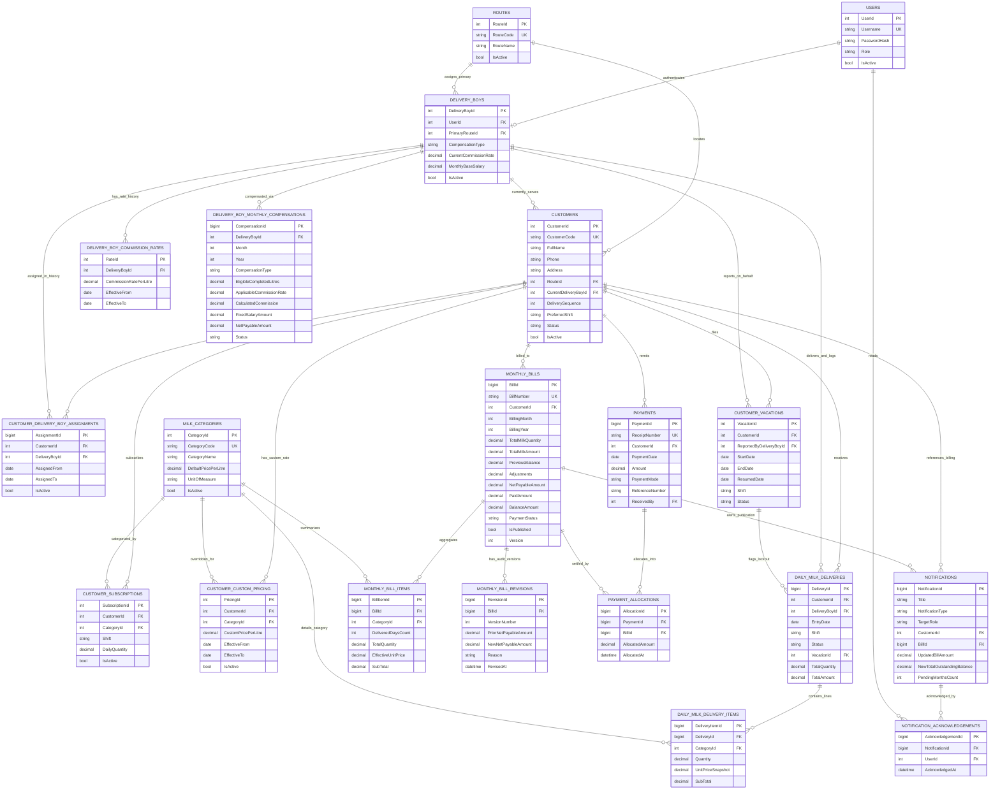

# Dairy Management System — Database Design Document

**Document Version:** 1.0.0
**Target RDBMS:** Microsoft SQL Server 2019 / 2022
**Data Access Technology:** ADO.NET (`Microsoft.Data.SqlClient`)
**Backend Framework:** ASP.NET Core MVC (.NET 9.0, C# 13)
**Author:** Senior SQL Server Database Architect
**Project Path:** `D:\MU\.Net_Code\Dairy_Management_System`
**Reference Document:** `docs/architecture/solution-architecture.md` (Authoritative Source)

---

## Table of Contents
1. [Purpose and Scope](#1-purpose-and-scope)
2. [Database Technology & Collation](#2-database-technology--collation)
3. [Database Design Principles](#3-database-design-principles)
4. [Entity Inventory](#4-entity-inventory)
5. [Detailed Table Specifications](#5-detailed-table-specifications)
   - [5.1 Authentication & Users](#51-authentication--users)
   - [5.2 Delivery Boy & Route Management](#52-delivery-boy--route-management)
   - [5.3 Customer Management](#53-customer-management)
   - [5.4 Milk Categories, Subscriptions & Pricing](#54-milk-categories-subscriptions--pricing)
   - [5.5 Customer Vacation Management](#55-customer-vacation-management)
   - [5.6 Daily Milk Entries](#56-daily-milk-entries)
   - [5.7 Monthly Billing & Invoicing](#57-monthly-billing--invoicing)
   - [5.8 Payment Management & Allocations](#58-payment-management--allocations)
   - [5.9 Commission & Salary Management](#59-commission--salary-management)
   - [5.10 Notifications & Acknowledgements](#510-notifications--acknowledgements)
   - [5.11 Application Settings & System Audit](#511-application-settings--system-audit)
6. [Entity Relationships and Cardinalities](#6-entity-relationships-and-cardinalities)
7. [Mermaid ER Diagram](#7-mermaid-er-diagram)
8. [Constraints and Indexing Strategy](#8-constraints-and-indexing-strategy)
9. [Historical Data and Audit Strategy](#9-historical-data-and-audit-strategy)
10. [Transaction and Data Integrity Strategy](#10-transaction-and-data-integrity-strategy)
11. [ADO.NET Data Access Mapping](#11-adonet-data-access-mapping)
12. [Security Considerations](#12-security-considerations)
13. [Open Design Decisions](#13-open-design-decisions)
14. [Final Design Summary](#14-final-design-summary)

---

## 1. Purpose and Scope

### 1.1 Purpose
This document provides the definitive physical and logical relational database specification for the **Dairy Management System (DMS)**. It translates the business rules, invariants, and operational workflows specified in the approved solution architecture (`docs/architecture/solution-architecture.md`) into production-grade Microsoft SQL Server table definitions, data types, constraints, indexes, transaction boundaries, and ADO.NET interaction strategies.

### 1.2 System Scope
The database supports:
- **Administrative Operations:** Customer lifecycle, multi-category subscription pricing, route partitioning, delivery boy compensation models, vacation approvals, calendar-month bulk billing runs, manual payment allocations (Online/Offline), reporting aggregations, and broadcast communications.
- **Delivery Boy Field Operations:** Route-ordered rosters, shift-based milk delivery logging, vacation lockout restrictions, personal notification acknowledgement, and commission/earnings tracking.
- **Out of Scope (Current Release):** Customer web portal or customer login accounts (customers are passive relational records managed solely by Admin), third-party automated payment gateway integrations, and AI predictive features.

---

## 2. Database Technology & Collation

| Dimension | Specification | Justification |
| :--- | :--- | :--- |
| **RDBMS Engine** | Microsoft SQL Server 2019 / 2022 | Enterprise ACID compliance, filtered indexes, computed columns, JSON support, memory-optimized table capabilities. |
| **Database Name** | `DairyManagementDb` | PascalCase standard enterprise convention. |
| **Server Collation** | `SQL_Latin1_General_CP1_CI_AS` | Standard collation for system metadata. |
| **Database Collation** | `Latin1_General_100_CI_AS_SC_UTF8` or `Indic_General_90_CI_AS` | Ensures native Unicode support. All Gujarati and multilingual customer names, addresses, and localized notes are stored in `NVARCHAR` columns to preserve linguistic fidelity without character corruption. |
| **Temporal Handling** | `DATETIME2(7)` & `DATE` | Storage efficiency: `DATE` (3 bytes) for calendar dates without time components; `DATETIME2(7)` (8 bytes) for high-precision UTC audit timestamps. |
| **Currency / Financial** | `DECIMAL(18,2)` | Strictly eliminates IEEE floating-point rounding errors across pricing, delivery extensions, billing, payments, and payroll. |

---

## 3. Database Design Principles

1. **Third Normal Form (3NF) Default:** The schema enforces 3NF across transactional and master tables to eliminate update anomalies, data redundancy, and state inconsistencies.
2. **Controlled Historical Snapshotting:** For financial and delivery immutability, transactional records physically store unit price snapshots (`UnitPriceSnapshot`) and commission rates at the exact time of entry execution. Changing a customer's custom price card or base category price tomorrow never retroactively mutates past daily entries or finalized monthly invoices.
3. **Decoupling of Billing from Payment:**
   - **Monthly Billing:** Generates, recalculates, or revises consumption-based statements.
   - **Payment Management:** Manually records verified receipts of money and tracks manual month-wise allocations.
   - *Core Invariant:* Revising, regenerating, or publishing a bill must **never** automatically mark it as paid or generate dummy payment records.
4. **Relational Integrity via Hard Foreign Keys:** All parent-child dependencies are guarded by database-level foreign key constraints. Cascade deletes are strictly disabled on core financial and transactional tables (`ON DELETE NO ACTION`) to prevent accidental cascading data loss.
5. **Soft-Delete vs. Active State Flagging:** Critical master entities (`Customers`, `DeliveryBoys`, `MilkCategories`, `Routes`) implement an `IsActive` (BIT) flag combined with filtered unique indexes, ensuring historical audit trails remain permanently intact.
6. **Pure ADO.NET Friendliness:** Schema keys utilize standard `INT` and `BIGINT` IDENTITY sequences, straightforward parameter data types matching `SqlDbType`, and avoid ORM-specific shadow state or discriminatory discriminator columns.

---

## 4. Entity Inventory

```
+------------------------------------+---------------------------------------------------------------+
| Table Name                         | Core Functional Responsibility                                |
+------------------------------------+---------------------------------------------------------------+
| 1. Users                           | System accounts & credentials for Admin & Delivery Boys       |
| 2. Routes                          | Geographic delivery sectors and route logistics              |
| 3. DeliveryBoys                    | Delivery personnel profiles, route link & compensation basis  |
| 4. DeliveryBoyCommissionRates      | Historical per-litre commission rates per Delivery Boy        |
| 5. Customers                       | Customer profiles, Gujarati text, contact & active route link |
| 6. CustomerDeliveryBoyAssignments  | Historical customer-to-delivery-boy route mapping             |
| 7. MilkCategories                  | Dynamic milk products, units of measure & base rates          |
| 8. CustomerSubscriptions           | Multi-category daily subscription lines per customer & shift  |
| 9. CustomerCustomPricing           | Effective-dated customer-specific unit price overrides        |
| 10. CustomerVacations              | Vacation date windows, shifts, early resumptions & approvals  |
| 11. DailyMilkDeliveries            | Daily customer shift delivery header (Status, Totals, Reason) |
| 12. DailyMilkDeliveryItems         | Category-level breakdown, quantity, snapshot price & subtotal |
| 13. MonthlyBills                   | Calendar-month invoices, totals, previous balance & dues      |
| 14. MonthlyBillItems               | Itemized category monthly summaries per invoice               |
| 15. MonthlyBillRevisions           | Historical audit log of bill recalculations and adjustments   |
| 16. Payments                       | Receipts of verified funds received (Online / Offline only)   |
| 17. PaymentAllocations             | Manual month-wise allocation breakdown across monthly bills   |
| 18. DeliveryBoyMonthlyCompensations| Monthly payroll & earned commission calculation summaries     |
| 19. Notifications                  | System broadcasts, bill publication alerts & targeted messages|
| 20. NotificationAcknowledgements   | User read/seen acknowledgement tracking (No payment meaning)  |
| 21. AppSettings                    | System runtime settings, dairy enterprise metadata & policies |
| 22. AuditLogs                      | Low-level administrative change capture & JSON state diffs    |
+------------------------------------+---------------------------------------------------------------+
```

---

## 5. Detailed Table Specifications

### 5.1 Authentication & Users

#### Table: `Users`
**Purpose:** Stores authentication credentials, identity, and role assignment for administrative staff and field delivery personnel. No customer accounts exist in this table.

| Column Name | SQL Server Data Type | Nullable | Constraints & Defaults | Description / Justification |
| :--- | :--- | :--- | :--- | :--- |
| `UserId` | `INT` | `NOT NULL` | `PRIMARY KEY IDENTITY(1,1)` | Unique internal surrogate identifier. |
| `Username` | `NVARCHAR(50)` | `NOT NULL` | `UNIQUE` | Case-insensitive login handle. |
| `PasswordHash` | `NVARCHAR(256)` | `NOT NULL` | None | RFC 2898 PBKDF2 hash formatted by ASP.NET Core `PasswordHasher<TUser>`. |
| `Role` | `NVARCHAR(20)` | `NOT NULL` | `CHECK (Role IN ('Admin', 'DeliveryBoy'))` | Role-based authorization discriminator. |
| `FullName` | `NVARCHAR(100)` | `NOT NULL` | None | Full legal name of user (supports Unicode). |
| `Phone` | `VARCHAR(15)` | `NULL` | None | Contact phone number. |
| `IsActive` | `BIT` | `NOT NULL` | `DEFAULT (1)` | 1 = Active, 0 = Disabled/Deactivated. |
| `LastLoginAt` | `DATETIME2(7)` | `NULL` | None | Timestamp of most recent successful login (UTC). |
| `CreatedAt` | `DATETIME2(7)` | `NOT NULL` | `DEFAULT (SYSUTCDATETIME())` | Record creation timestamp (UTC). |
| `CreatedBy` | `INT` | `NULL` | `FOREIGN KEY REFERENCES Users(UserId)` | Creator user ID. |
| `UpdatedAt` | `DATETIME2(7)` | `NULL` | None | Last modification timestamp (UTC). |
| `UpdatedBy` | `INT` | `NULL` | `FOREIGN KEY REFERENCES Users(UserId)` | Modifier user ID. |

---

### 5.2 Delivery Boy & Route Management

#### Table: `Routes`
**Purpose:** Defines distinct delivery territories, streets, or societies to optimize daily distribution.

| Column Name | SQL Server Data Type | Nullable | Constraints & Defaults | Description / Justification |
| :--- | :--- | :--- | :--- | :--- |
| `RouteId` | `INT` | `NOT NULL` | `PRIMARY KEY IDENTITY(1,1)` | Unique surrogate route key. |
| `RouteCode` | `NVARCHAR(20)` | `NOT NULL` | `UNIQUE` | Business identifier (e.g., `RT-01`, `RT-KALAWAD`). |
| `RouteName` | `NVARCHAR(100)` | `NOT NULL` | None | Descriptive territory title (supports Gujarati). |
| `Description` | `NVARCHAR(250)` | `NULL` | None | Geographical boundaries or landmarks. |
| `IsActive` | `BIT` | `NOT NULL` | `DEFAULT (1)` | Soft deactivation flag. |
| `CreatedAt` | `DATETIME2(7)` | `NOT NULL` | `DEFAULT (SYSUTCDATETIME())` | Creation timestamp (UTC). |
| `CreatedBy` | `INT` | `NOT NULL` | `FOREIGN KEY REFERENCES Users(UserId)` | Admin user who registered route. |
| `UpdatedAt` | `DATETIME2(7)` | `NULL` | None | Modification timestamp (UTC). |
| `UpdatedBy` | `INT` | `NULL` | `FOREIGN KEY REFERENCES Users(UserId)` | Admin user who modified route. |

#### Table: `DeliveryBoys`
**Purpose:** Operational and compensation profile for delivery agents. Linked 1-to-1 with a `Users` login record.

| Column Name | SQL Server Data Type | Nullable | Constraints & Defaults | Description / Justification |
| :--- | :--- | :--- | :--- | :--- |
| `DeliveryBoyId` | `INT` | `NOT NULL` | `PRIMARY KEY IDENTITY(1,1)` | Unique delivery boy identifier. |
| `UserId` | `INT` | `NOT NULL` | `UNIQUE`, `FOREIGN KEY REFERENCES Users(UserId)` | Link to system authentication credentials. |
| `PrimaryRouteId` | `INT` | `NULL` | `FOREIGN KEY REFERENCES Routes(RouteId)` | Default territorial route assigned to agent. |
| `CompensationType` | `NVARCHAR(20)` | `NOT NULL` | `CHECK (CompensationType IN ('Fixed Salary', 'Commission'))` | Remuneration model. |
| `CurrentCommissionRate` | `DECIMAL(18,2)` | `NOT NULL` | `DEFAULT (0.00)`, `CHECK (CurrentCommissionRate >= 0)` | Individual per-litre commission rate (uniform across all categories). Set to 0.00 for Fixed Salary. |
| `MonthlyBaseSalary` | `DECIMAL(18,2)` | `NOT NULL` | `DEFAULT (0.00)`, `CHECK (MonthlyBaseSalary >= 0)` | Fixed remuneration per month. Set to 0.00 for Commission-only agents. |
| `VehicleNumber` | `NVARCHAR(30)` | `NULL` | None | Registered delivery vehicle plate number. |
| `IsActive` | `BIT` | `NOT NULL` | `DEFAULT (1)` | Operational employment status. |
| `CreatedAt` | `DATETIME2(7)` | `NOT NULL` | `DEFAULT (SYSUTCDATETIME())` | Creation timestamp (UTC). |
| `CreatedBy` | `INT` | `NOT NULL` | `FOREIGN KEY REFERENCES Users(UserId)` | Creator Admin. |
| `UpdatedAt` | `DATETIME2(7)` | `NULL` | None | Modification timestamp (UTC). |
| `UpdatedBy` | `INT` | `NULL` | `FOREIGN KEY REFERENCES Users(UserId)` | Modifier Admin. |

#### Table: `DeliveryBoyCommissionRates`
**Purpose:** Maintains complete historical audit logs of changes to a delivery boy's individual commission rate over time.

| Column Name | SQL Server Data Type | Nullable | Constraints & Defaults | Description / Justification |
| :--- | :--- | :--- | :--- | :--- |
| `RateId` | `INT` | `NOT NULL` | `PRIMARY KEY IDENTITY(1,1)` | Surrogate rate history key. |
| `DeliveryBoyId` | `INT` | `NOT NULL` | `FOREIGN KEY REFERENCES DeliveryBoys(DeliveryBoyId)` | Target delivery agent. |
| `CommissionRatePerLitre` | `DECIMAL(18,2)` | `NOT NULL` | `CHECK (CommissionRatePerLitre >= 0)` | Agreed rate per confirmed eligible completed litre. |
| `EffectiveFrom` | `DATE` | `NOT NULL` | None | Effective start calendar date. |
| `EffectiveTo` | `DATE` | `NULL` | None | Effective end calendar date (`NULL` indicates current active rate). |
| `CreatedAt` | `DATETIME2(7)` | `NOT NULL` | `DEFAULT (SYSUTCDATETIME())` | Audit log timestamp. |
| `CreatedBy` | `INT` | `NOT NULL` | `FOREIGN KEY REFERENCES Users(UserId)` | Admin user executing rate adjustment. |

#### Table: `CustomerDeliveryBoyAssignments`
**Purpose:** Preserves the complete historical audit log of customer-to-delivery-boy assignments over time, guaranteeing that historical deliveries can be audited while enforcing *exactly one active delivery boy per customer at any given time*.

| Column Name | SQL Server Data Type | Nullable | Constraints & Defaults | Description / Justification |
| :--- | :--- | :--- | :--- | :--- |
| `AssignmentId` | `BIGINT` | `NOT NULL` | `PRIMARY KEY IDENTITY(1,1)` | Unique assignment log identifier. |
| `CustomerId` | `INT` | `NOT NULL` | `FOREIGN KEY REFERENCES Customers(CustomerId)` | Target customer. |
| `DeliveryBoyId` | `INT` | `NOT NULL` | `FOREIGN KEY REFERENCES DeliveryBoys(DeliveryBoyId)` | Assigned field delivery executive. |
| `AssignedFrom` | `DATE` | `NOT NULL` | None | Start date of route servicing. |
| `AssignedTo` | `DATE` | `NULL` | None | End date of route servicing (`NULL` means current). |
| `IsActive` | `BIT` | `NOT NULL` | `DEFAULT (1)` | Flag indicating if this is the active assignment. |
| `Notes` | `NVARCHAR(250)` | `NULL` | None | Reason for assignment or reassignment transfer. |
| `CreatedAt` | `DATETIME2(7)` | `NOT NULL` | `DEFAULT (SYSUTCDATETIME())` | Creation timestamp. |
| `CreatedBy` | `INT` | `NOT NULL` | `FOREIGN KEY REFERENCES Users(UserId)` | Admin user performing mapping. |

---

### 5.3 Customer Management

#### Table: `Customers`
**Purpose:** Master repository of customer profile, contact information, route location, delivery sequence, and active service status. Fully supports Gujarati script in name and address fields.

| Column Name | SQL Server Data Type | Nullable | Constraints & Defaults | Description / Justification |
| :--- | :--- | :--- | :--- | :--- |
| `CustomerId` | `INT` | `NOT NULL` | `PRIMARY KEY IDENTITY(1,1)` | Primary customer surrogate key. |
| `CustomerCode` | `NVARCHAR(20)` | `NOT NULL` | `UNIQUE` | Business identifier (e.g., `CUST-1001`). |
| `FullName` | `NVARCHAR(100)` | `NOT NULL` | None | Full customer name (native Gujarati Unicode support). |
| `Phone` | `VARCHAR(15)` | `NOT NULL` | None | Primary mobile contact number. |
| `AlternatePhone` | `VARCHAR(15)` | `NULL` | None | Secondary or emergency contact number. |
| `Address` | `NVARCHAR(250)` | `NOT NULL` | None | Delivery street address / flat details (Gujarati support). |
| `Landmark` | `NVARCHAR(100)` | `NULL` | None | Nearby navigation landmark. |
| `RouteId` | `INT` | `NOT NULL` | `FOREIGN KEY REFERENCES Routes(RouteId)` | Geographical delivery sector. |
| `CurrentDeliveryBoyId` | `INT` | `NOT NULL` | `FOREIGN KEY REFERENCES DeliveryBoys(DeliveryBoyId)` | Denormalized current assigned delivery boy for rapid querying. |
| `DeliverySequence` | `INT` | `NOT NULL` | `DEFAULT (0)` | Sequential stop order along the route for delivery optimization. |
| `PreferredShift` | `NVARCHAR(20)` | `NOT NULL` | `DEFAULT ('Both')`, `CHECK (PreferredShift IN ('Morning', 'Evening', 'Both'))` | Scheduled delivery shift preference. |
| `Status` | `NVARCHAR(20)` | `NOT NULL` | `DEFAULT ('Active')`, `CHECK (Status IN ('Active', 'Suspended', 'Inactive'))` | Service status. |
| `IsActive` | `BIT` | `NOT NULL` | `DEFAULT (1)` | Soft deletion / master active flag. |
| `CreatedAt` | `DATETIME2(7)` | `NOT NULL` | `DEFAULT (SYSUTCDATETIME())` | Onboarding timestamp (UTC). |
| `CreatedBy` | `INT` | `NOT NULL` | `FOREIGN KEY REFERENCES Users(UserId)` | Onboarding Admin user ID. |
| `UpdatedAt` | `DATETIME2(7)` | `NULL` | None | Last profile update timestamp. |
| `UpdatedBy` | `INT` | `NULL` | `FOREIGN KEY REFERENCES Users(UserId)` | Modifier Admin user ID. |

---

### 5.4 Milk Categories, Subscriptions & Pricing

#### Table: `MilkCategories`
**Purpose:** Dynamic master list of dairy products managed entirely by the Admin. Categories are never hardcoded and can be added, updated, or retired dynamically.

| Column Name | SQL Server Data Type | Nullable | Constraints & Defaults | Description / Justification |
| :--- | :--- | :--- | :--- | :--- |
| `CategoryId` | `INT` | `NOT NULL` | `PRIMARY KEY IDENTITY(1,1)` | Surrogate category key. |
| `CategoryCode` | `NVARCHAR(20)` | `NOT NULL` | `UNIQUE` | Unique identifier (e.g., `COW`, `BUFFALO`, `A2_COW`). |
| `CategoryName` | `NVARCHAR(100)` | `NOT NULL` | None | Localized display title (English & Gujarati). |
| `DefaultPricePerLitre` | `DECIMAL(18,2)` | `NOT NULL` | `CHECK (DefaultPricePerLitre > 0)` | Base dairy retail price per litre/unit. |
| `UnitOfMeasure` | `NVARCHAR(20)` | `NOT NULL` | `DEFAULT ('Litre')` | Unit description (`Litre`, `Pouch`, `Kg`). |
| `DisplayOrder` | `INT` | `NOT NULL` | `DEFAULT (0)` | Ordering in daily entry UI grids. |
| `IsActive` | `BIT` | `NOT NULL` | `DEFAULT (1)` | Active catalog state (Admin can activate/deactivate). |
| `CreatedAt` | `DATETIME2(7)` | `NOT NULL` | `DEFAULT (SYSUTCDATETIME())` | Catalog entry timestamp. |
| `CreatedBy` | `INT` | `NOT NULL` | `FOREIGN KEY REFERENCES Users(UserId)` | Creator Admin. |
| `UpdatedAt` | `DATETIME2(7)` | `NULL` | None | Update timestamp. |
| `UpdatedBy` | `INT` | `NULL` | `FOREIGN KEY REFERENCES Users(UserId)` | Modifier Admin. |

#### Table: `CustomerSubscriptions`
**Purpose:** Relational subscription matrix allowing a customer to subscribe to multiple milk categories across morning, evening, or both shifts with distinct daily quotas.

| Column Name | SQL Server Data Type | Nullable | Constraints & Defaults | Description / Justification |
| :--- | :--- | :--- | :--- | :--- |
| `SubscriptionId` | `INT` | `NOT NULL` | `PRIMARY KEY IDENTITY(1,1)` | Unique subscription record identifier. |
| `CustomerId` | `INT` | `NOT NULL` | `FOREIGN KEY REFERENCES Customers(CustomerId)` | Target customer. |
| `CategoryId` | `INT` | `NOT NULL` | `FOREIGN KEY REFERENCES MilkCategories(CategoryId)` | Subscribed milk category. |
| `Shift` | `NVARCHAR(20)` | `NOT NULL` | `DEFAULT ('Both')`, `CHECK (Shift IN ('Morning', 'Evening', 'Both'))` | Applicable delivery shift. |
| `DailyQuantity` | `DECIMAL(18,2)` | `NOT NULL` | `CHECK (DailyQuantity > 0)` | Expected daily delivery volume in units/litres. |
| `IsActive` | `BIT` | `NOT NULL` | `DEFAULT (1)` | Active subscription flag. |
| `CreatedAt` | `DATETIME2(7)` | `NOT NULL` | `DEFAULT (SYSUTCDATETIME())` | Subscription initiation timestamp. |
| `CreatedBy` | `INT` | `NOT NULL` | `FOREIGN KEY REFERENCES Users(UserId)` | Creator Admin. |
| `UpdatedAt` | `DATETIME2(7)` | `NULL` | None | Update timestamp. |
| `UpdatedBy` | `INT` | `NULL` | `FOREIGN KEY REFERENCES Users(UserId)` | Modifier Admin. |

#### Table: `CustomerCustomPricing`
**Purpose:** Stores customer-specific price overrides deviating from default category prices. Employs effective date boundaries (`EffectiveFrom` and `EffectiveTo`) to preserve historical pricing integrity.

| Column Name | SQL Server Data Type | Nullable | Constraints & Defaults | Description / Justification |
| :--- | :--- | :--- | :--- | :--- |
| `PricingId` | `INT` | `NOT NULL` | `PRIMARY KEY IDENTITY(1,1)` | Surrogate custom pricing key. |
| `CustomerId` | `INT` | `NOT NULL` | `FOREIGN KEY REFERENCES Customers(CustomerId)` | Target customer. |
| `CategoryId` | `INT` | `NOT NULL` | `FOREIGN KEY REFERENCES MilkCategories(CategoryId)` | Target milk category. |
| `CustomPricePerLitre` | `DECIMAL(18,2)` | `NOT NULL` | `CHECK (CustomPricePerLitre > 0)` | Agreed special contract price per litre/unit. |
| `EffectiveFrom` | `DATE` | `NOT NULL` | None | Date custom rate card becomes valid. |
| `EffectiveTo` | `DATE` | `NULL` | None | Date custom rate card expires (`NULL` = indefinitely active). |
| `IsActive` | `BIT` | `NOT NULL` | `DEFAULT (1)` | Active status flag. |
| `CreatedAt` | `DATETIME2(7)` | `NOT NULL` | `DEFAULT (SYSUTCDATETIME())` | Record timestamp. |
| `CreatedBy` | `INT` | `NOT NULL` | `FOREIGN KEY REFERENCES Users(UserId)` | Creator Admin. |

---

### 5.5 Customer Vacation Management

#### Table: `CustomerVacations`
**Purpose:** Tracks customer non-delivery requests with full workflow support: Delivery Boy reporting, Admin direct entry, Admin approval/rejection, start/end dates, early resumption, and audit history.

| Column Name | SQL Server Data Type | Nullable | Constraints & Defaults | Description / Justification |
| :--- | :--- | :--- | :--- | :--- |
| `VacationId` | `INT` | `NOT NULL` | `PRIMARY KEY IDENTITY(1,1)` | Unique vacation record key. |
| `CustomerId` | `INT` | `NOT NULL` | `FOREIGN KEY REFERENCES Customers(CustomerId)` | Target customer. |
| `ReportedByDeliveryBoyId` | `INT` | `NULL` | `FOREIGN KEY REFERENCES DeliveryBoys(DeliveryBoyId)` | Set if filed from the field by Delivery Boy; `NULL` if direct Admin entry. |
| `StartDate` | `DATE` | `NOT NULL` | None | First day of non-delivery. |
| `EndDate` | `DATE` | `NOT NULL` | None | Scheduled last day of non-delivery (`EndDate >= StartDate`). |
| `ResumedDate` | `DATE` | `NULL` | None | Populated if customer resumes deliveries earlier than scheduled `EndDate`. |
| `Shift` | `NVARCHAR(20)` | `NOT NULL` | `DEFAULT ('Both')`, `CHECK (Shift IN ('Morning', 'Evening', 'Both'))` | Shifts affected by the vacation. |
| `Reason` | `NVARCHAR(250)` | `NULL` | None | Reason for absence (e.g., "Out of town", "Religious fast"). |
| `Status` | `NVARCHAR(20)` | `NOT NULL` | `DEFAULT ('Pending')`, `CHECK (Status IN ('Pending', 'Approved', 'Rejected', 'Cancelled'))` | Approval lifecycle state. |
| `ApprovedBy` | `INT` | `NULL` | `FOREIGN KEY REFERENCES Users(UserId)` | Admin user ID who evaluated request. |
| `ApprovedAt` | `DATETIME2(7)` | `NULL` | None | Evaluation timestamp (UTC). |
| `RejectionReason` | `NVARCHAR(250)` | `NULL` | None | Explanatory note if rejected by Admin. |
| `CreatedAt` | `DATETIME2(7)` | `NOT NULL` | `DEFAULT (SYSUTCDATETIME())` | Creation timestamp. |
| `CreatedBy` | `INT` | `NOT NULL` | `FOREIGN KEY REFERENCES Users(UserId)` | User who recorded entry. |
| `UpdatedAt` | `DATETIME2(7)` | `NULL` | None | Update timestamp. |
| `UpdatedBy` | `INT` | `NULL` | `FOREIGN KEY REFERENCES Users(UserId)` | Modifier user ID. |

---

### 5.6 Daily Milk Entries

#### Table: `DailyMilkDeliveries` (Delivery Header)
**Purpose:** Header entity representing the daily delivery transaction per customer, date, and shift. Maps directly to the customer-level completion checkbox in the UI, establishes total daily aggregates, links to approved vacations, and enforces the three permitted statuses (`Completed`, `Pending`, `Not Delivered`).

| Column Name | SQL Server Data Type | Nullable | Constraints & Defaults | Description / Justification |
| :--- | :--- | :--- | :--- | :--- |
| `DeliveryId` | `BIGINT` | `NOT NULL` | `PRIMARY KEY IDENTITY(1,1)` | Unique delivery transaction key. |
| `CustomerId` | `INT` | `NOT NULL` | `FOREIGN KEY REFERENCES Customers(CustomerId)` | Target customer. |
| `DeliveryBoyId` | `INT` | `NOT NULL` | `FOREIGN KEY REFERENCES DeliveryBoys(DeliveryBoyId)` | Agent executing/logging delivery. |
| `EntryDate` | `DATE` | `NOT NULL` | None | Calendar date of milk distribution. |
| `Shift` | `NVARCHAR(20)` | `NOT NULL` | `CHECK (Shift IN ('Morning', 'Evening'))` | Distribution shift. |
| `Status` | `NVARCHAR(20)` | `NOT NULL` | `DEFAULT ('Pending')`, `CHECK (Status IN ('Completed', 'Pending', 'Not Delivered'))` | **Strict Status Invariant:** Only permitted daily entry statuses. |
| `VacationId` | `INT` | `NULL` | `FOREIGN KEY REFERENCES CustomerVacations(VacationId)` | References active approved vacation if non-delivery is due to vacation. |
| `NonDeliveryReason` | `NVARCHAR(250)` | `NULL` | None | Distinguishes vacation non-delivery from customer absent or bottle missing without introducing an unapproved 4th status. |
| `TotalQuantity` | `DECIMAL(18,2)` | `NOT NULL` | `DEFAULT (0.00)`, `CHECK (TotalQuantity >= 0)` | Daily aggregate volume delivered across all categories (0.00 for `Not Delivered`). |
| `TotalAmount` | `DECIMAL(18,2)` | `NOT NULL` | `DEFAULT (0.00)`, `CHECK (TotalAmount >= 0)` | Daily aggregate financial value (0.00 for `Not Delivered` or Vacation). |
| `CreatedAt` | `DATETIME2(7)` | `NOT NULL` | `DEFAULT (SYSUTCDATETIME())` | Timestamp logged. |
| `CreatedBy` | `INT` | `NOT NULL` | `FOREIGN KEY REFERENCES Users(UserId)` | Delivery Boy or Admin user who logged entry. |
| `UpdatedAt` | `DATETIME2(7)` | `NULL` | None | Update timestamp. |
| `UpdatedBy` | `INT` | `NULL` | `FOREIGN KEY REFERENCES Users(UserId)` | Modifier user ID. |

#### Table: `DailyMilkDeliveryItems` (Delivery Detail Lines)
**Purpose:** Itemized category breakdown for a customer's daily delivery. Stores separate quantities, applicable category prices, category-wise total calculations, and the exact unit price snapshot applied at transaction time.

| Column Name | SQL Server Data Type | Nullable | Constraints & Defaults | Description / Justification |
| :--- | :--- | :--- | :--- | :--- |
| `DeliveryItemId` | `BIGINT` | `NOT NULL` | `PRIMARY KEY IDENTITY(1,1)` | Unique line item identifier. |
| `DeliveryId` | `BIGINT` | `NOT NULL` | `FOREIGN KEY REFERENCES DailyMilkDeliveries(DeliveryId) ON DELETE CASCADE` | Parent delivery header. |
| `CategoryId` | `INT` | `NOT NULL` | `FOREIGN KEY REFERENCES MilkCategories(CategoryId)` | Milk category delivered. |
| `Quantity` | `DECIMAL(18,2)` | `NOT NULL` | `CHECK (Quantity >= 0)` | Volume delivered (0.00 if `Not Delivered`). |
| `UnitPriceSnapshot` | `DECIMAL(18,2)` | `NOT NULL` | `CHECK (UnitPriceSnapshot >= 0)` | **Immutable Price Snapshot:** Exact unit rate resolved at entry time from custom or base pricing. |
| `SubTotal` | `DECIMAL(18,2)` | `NOT NULL` | `CHECK (SubTotal >= 0)` | Line charge = `Quantity * UnitPriceSnapshot` (0.00 for vacation or non-delivery). |

---

### 5.7 Monthly Billing & Invoicing

#### Table: `MonthlyBills`
**Purpose:** Represents the monthly calendar invoice (1st to last calendar day) per customer. Consolidates total milk deliveries, factors in historical balances and manual adjustments, tracks publication state, and isolates billing generation from payment recording.

| Column Name | SQL Server Data Type | Nullable | Constraints & Defaults | Description / Justification |
| :--- | :--- | :--- | :--- | :--- |
| `BillId` | `BIGINT` | `NOT NULL` | `PRIMARY KEY IDENTITY(1,1)` | Unique invoice surrogate key. |
| `BillNumber` | `NVARCHAR(30)` | `NOT NULL` | `UNIQUE` | Human-readable unique statement code (e.g., `BILL-202611-CUST1001`). |
| `CustomerId` | `INT` | `NOT NULL` | `FOREIGN KEY REFERENCES Customers(CustomerId)` | Billed customer. |
| `BillingMonth` | `TINYINT` | `NOT NULL` | `CHECK (BillingMonth BETWEEN 1 AND 12)` | Calendar billing month. |
| `BillingYear` | `SMALLINT` | `NOT NULL` | `CHECK (BillingYear BETWEEN 2000 AND 2100)` | Calendar billing year. |
| `PeriodStartDate` | `DATE` | `NOT NULL` | None | First calendar day of billing month (e.g., `2026-11-01`). |
| `PeriodEndDate` | `DATE` | `NOT NULL` | None | Last calendar day of billing month (e.g., `2026-11-30`). |
| `TotalMilkQuantity` | `DECIMAL(18,2)` | `NOT NULL` | `DEFAULT (0.00)`, `CHECK (TotalMilkQuantity >= 0)` | Aggregate litres delivered in month. |
| `TotalMilkAmount` | `DECIMAL(18,2)` | `NOT NULL` | `DEFAULT (0.00)`, `CHECK (TotalMilkAmount >= 0)` | Current month gross milk charges. |
| `PreviousBalance` | `DECIMAL(18,2)` | `NOT NULL` | `DEFAULT (0.00)` | Unpaid arrears carried forward from preceding calendar month. |
| `Adjustments` | `DECIMAL(18,2)` | `NOT NULL` | `DEFAULT (0.00)` | Manual credits/debits applied by Admin (positive = credit/discount). |
| `NetPayableAmount` | `DECIMAL(18,2)` | `NOT NULL` | None | `TotalMilkAmount + PreviousBalance - Adjustments`. |
| `PaidAmount` | `DECIMAL(18,2)` | `NOT NULL` | `DEFAULT (0.00)`, `CHECK (PaidAmount >= 0)` | **Payment-Decoupled Counter:** Updated strictly through verified `PaymentAllocations`. |
| `BalanceAmount` | `DECIMAL(18,2)` | `NOT NULL` | None | Outstanding unpaid balance (`NetPayableAmount - PaidAmount`). |
| `PaymentStatus` | `NVARCHAR(20)` | `NOT NULL` | `DEFAULT ('Unpaid')`, `CHECK (PaymentStatus IN ('Unpaid', 'Partially Paid', 'Paid', 'Overdue'))` | Persisted billing status. |
| `IsPublished` | `BIT` | `NOT NULL` | `DEFAULT (0)` | 0 = Draft, 1 = Published (visible to Delivery Boys/Reports). |
| `PublishedAt` | `DATETIME2(7)` | `NULL` | None | Publication timestamp. |
| `Version` | `INT` | `NOT NULL` | `DEFAULT (1)` | Revision counter (incremented upon recalculation). |
| `RevisionReason` | `NVARCHAR(250)` | `NULL` | None | Audit explanation for bill regeneration or adjustment. |
| `CreatedAt` | `DATETIME2(7)` | `NOT NULL` | `DEFAULT (SYSUTCDATETIME())` | Generation timestamp. |
| `CreatedBy` | `INT` | `NOT NULL` | `FOREIGN KEY REFERENCES Users(UserId)` | Admin user generating the bill. |
| `UpdatedAt` | `DATETIME2(7)` | `NULL` | None | Update timestamp. |
| `UpdatedBy` | `INT` | `NULL` | `FOREIGN KEY REFERENCES Users(UserId)` | Modifier user ID. |

#### Table: `MonthlyBillItems`
**Purpose:** Itemized category summary lines attached to each monthly bill, providing customer-facing transparency on delivered volumes and average prices per milk category.

| Column Name | SQL Server Data Type | Nullable | Constraints & Defaults | Description / Justification |
| :--- | :--- | :--- | :--- | :--- |
| `BillItemId` | `BIGINT` | `NOT NULL` | `PRIMARY KEY IDENTITY(1,1)` | Line item surrogate key. |
| `BillId` | `BIGINT` | `NOT NULL` | `FOREIGN KEY REFERENCES MonthlyBills(BillId) ON DELETE CASCADE` | Parent monthly bill. |
| `CategoryId` | `INT` | `NOT NULL` | `FOREIGN KEY REFERENCES MilkCategories(CategoryId)` | Subscribed milk category. |
| `DeliveredDaysCount` | `INT` | `NOT NULL` | `CHECK (DeliveredDaysCount >= 0)` | Number of days milk was successfully delivered. |
| `TotalQuantity` | `DECIMAL(18,2)` | `NOT NULL` | `CHECK (TotalQuantity >= 0)` | Total volume delivered for this category in the month. |
| `EffectiveUnitPrice` | `DECIMAL(18,2)` | `NOT NULL` | `CHECK (EffectiveUnitPrice >= 0)` | Average or snapshot price per litre applied. |
| `SubTotal` | `DECIMAL(18,2)` | `NOT NULL` | `CHECK (SubTotal >= 0)` | Total category charge = `TotalQuantity * EffectiveUnitPrice`. |

#### Table: `MonthlyBillRevisions`
**Purpose:** Immutable historical audit ledger tracking all manual revisions, recalculations, or credit adjustments made to published bills.

| Column Name | SQL Server Data Type | Nullable | Constraints & Defaults | Description / Justification |
| :--- | :--- | :--- | :--- | :--- |
| `RevisionId` | `BIGINT` | `NOT NULL` | `PRIMARY KEY IDENTITY(1,1)` | Unique revision log identifier. |
| `BillId` | `BIGINT` | `NOT NULL` | `FOREIGN KEY REFERENCES MonthlyBills(BillId)` | Target invoice. |
| `VersionNumber` | `INT` | `NOT NULL` | None | Version number prior to change. |
| `PriorTotalMilkAmount` | `DECIMAL(18,2)` | `NOT NULL` | None | Milk amount prior to revision. |
| `PriorNetPayableAmount` | `DECIMAL(18,2)` | `NOT NULL` | None | Net payable prior to revision. |
| `NewTotalMilkAmount` | `DECIMAL(18,2)` | `NOT NULL` | None | Recalculated milk amount. |
| `NewNetPayableAmount` | `DECIMAL(18,2)` | `NOT NULL` | None | Recalculated net payable. |
| `Reason` | `NVARCHAR(250)` | `NOT NULL` | None | Mandatory business justification for revision. |
| `RevisedBy` | `INT` | `NOT NULL` | `FOREIGN KEY REFERENCES Users(UserId)` | Admin user executing revision. |
| `RevisedAt` | `DATETIME2(7)` | `NOT NULL` | `DEFAULT (SYSUTCDATETIME())` | Revision timestamp. |

---

### 5.8 Payment Management & Allocations

#### Table: `Payments`
**Purpose:** Records actual financial money received from customers. Enforces strictly two payment modes (`Online` and `Offline`). Payments are managed exclusively by the Admin; Delivery Boys cannot record or collect payments.

| Column Name | SQL Server Data Type | Nullable | Constraints & Defaults | Description / Justification |
| :--- | :--- | :--- | :--- | :--- |
| `PaymentId` | `BIGINT` | `NOT NULL` | `PRIMARY KEY IDENTITY(1,1)` | Primary financial receipt key. |
| `ReceiptNumber` | `NVARCHAR(30)` | `NOT NULL` | `UNIQUE` | Unique serial receipt code (e.g., `RCPT-202611-0089`). |
| `CustomerId` | `INT` | `NOT NULL` | `FOREIGN KEY REFERENCES Customers(CustomerId)` | Paying customer. |
| `PaymentDate` | `DATE` | `NOT NULL` | None | Actual date money was received. |
| `Amount` | `DECIMAL(18,2)` | `NOT NULL` | `CHECK (Amount > 0)` | Total currency amount received. |
| `PaymentMode` | `NVARCHAR(20)` | `NOT NULL` | `CHECK (PaymentMode IN ('Online', 'Offline'))` | **Strict Payment Modes Invariant:** Exactly two modes permitted. No Cash, UPI, Card, or Cheque sub-modes. |
| `ReferenceNumber` | `NVARCHAR(50)` | `NULL` | None | Optional transaction identifier for `Online` payments. |
| `Notes` | `NVARCHAR(250)` | `NULL` | None | Administrative remarks or ledger details. |
| `ReceivedBy` | `INT` | `NOT NULL` | `FOREIGN KEY REFERENCES Users(UserId)` | Admin user who verified and logged payment. |
| `CreatedAt` | `DATETIME2(7)` | `NOT NULL` | `DEFAULT (SYSUTCDATETIME())` | System entry timestamp. |

#### Table: `PaymentAllocations`
**Purpose:** Stores the manual month-wise allocation of received payments across one or more selected outstanding calendar-month bills. Strictly replaces FIFO with manual Admin allocation.

| Column Name | SQL Server Data Type | Nullable | Constraints & Defaults | Description / Justification |
| :--- | :--- | :--- | :--- | :--- |
| `AllocationId` | `BIGINT` | `NOT NULL` | `PRIMARY KEY IDENTITY(1,1)` | Unique allocation line identifier. |
| `PaymentId` | `BIGINT` | `NOT NULL` | `FOREIGN KEY REFERENCES Payments(PaymentId)` | Parent receipt record. |
| `BillId` | `BIGINT` | `NOT NULL` | `FOREIGN KEY REFERENCES MonthlyBills(BillId)` | Outstanding calendar-month bill being settled. |
| `AllocatedAmount` | `DECIMAL(18,2)` | `NOT NULL` | `CHECK (AllocatedAmount > 0)` | Explicit amount assigned to this specific month. |
| `AllocatedAt` | `DATETIME2(7)` | `NOT NULL` | `DEFAULT (SYSUTCDATETIME())` | Allocation execution timestamp. |
| `AllocatedBy` | `INT` | `NOT NULL` | `FOREIGN KEY REFERENCES Users(UserId)` | Admin user executing allocation. |

---

### 5.9 Commission & Salary Management

#### Table: `DeliveryBoyMonthlyCompensations`
**Purpose:** Stores monthly remuneration calculations for Delivery Boys. Accommodates both Fixed Salary and Commission models. Enforces the strict rule that commission equals eligible `Completed` litres multiplied by the individual per-litre rate (excluding `Pending`, `Not Delivered`, and vacation entries), while fixed-salary employees receive zero commission.

| Column Name | SQL Server Data Type | Nullable | Constraints & Defaults | Description / Justification |
| :--- | :--- | :--- | :--- | :--- |
| `CompensationId` | `BIGINT` | `NOT NULL` | `PRIMARY KEY IDENTITY(1,1)` | Unique payroll record key. |
| `DeliveryBoyId` | `INT` | `NOT NULL` | `FOREIGN KEY REFERENCES DeliveryBoys(DeliveryBoyId)` | Compensated delivery agent. |
| `Month` | `TINYINT` | `NOT NULL` | `CHECK (Month BETWEEN 1 AND 12)` | Calendar compensation month. |
| `Year` | `SMALLINT` | `NOT NULL` | `CHECK (Year BETWEEN 2000 AND 2100)` | Calendar compensation year. |
| `CompensationType` | `NVARCHAR(20)` | `NOT NULL` | `CHECK (CompensationType IN ('Fixed Salary', 'Commission'))` | Employment model applied for this pay period. |
| `EligibleCompletedLitres` | `DECIMAL(18,2)` | `NOT NULL` | `DEFAULT (0.00)`, `CHECK (EligibleCompletedLitres >= 0)` | **Strict Litre Metric:** Sum of volume from `DailyMilkDeliveries` where `Status = 'Completed'`. |
| `ApplicableCommissionRate` | `DECIMAL(18,2)` | `NOT NULL` | `DEFAULT (0.00)`, `CHECK (ApplicableCommissionRate >= 0)` | Snapshot per-litre rate (0.00 for Fixed Salary). |
| `CalculatedCommission` | `DECIMAL(18,2)` | `NOT NULL` | `DEFAULT (0.00)`, `CHECK (CalculatedCommission >= 0)` | `EligibleCompletedLitres * ApplicableCommissionRate` (0.00 for Fixed Salary). |
| `FixedSalaryAmount` | `DECIMAL(18,2)` | `NOT NULL` | `DEFAULT (0.00)`, `CHECK (FixedSalaryAmount >= 0)` | Base salary for the month (0.00 for Commission). |
| `Adjustments` | `DECIMAL(18,2)` | `NOT NULL` | `DEFAULT (0.00)` | Administrative bonuses or advance deductions. |
| `NetPayableAmount` | `DECIMAL(18,2)` | `NOT NULL` | `CHECK (NetPayableAmount >= 0)` | Total earned payout. |
| `Status` | `NVARCHAR(20)` | `NOT NULL` | `DEFAULT ('Draft')`, `CHECK (Status IN ('Draft', 'Finalized'))` | Payroll finalization state. |
| `FinalizedAt` | `DATETIME2(7)` | `NULL` | None | Timestamp when Admin locked payroll run. |
| `FinalizedBy` | `INT` | `NULL` | `FOREIGN KEY REFERENCES Users(UserId)` | Admin user approving payroll. |
| `Notes` | `NVARCHAR(250)` | `NULL` | None | Administrative remarks or adjustment reasons. |
| `CreatedAt` | `DATETIME2(7)` | `NOT NULL` | `DEFAULT (SYSUTCDATETIME())` | Generation timestamp. |
| `CreatedBy` | `INT` | `NOT NULL` | `FOREIGN KEY REFERENCES Users(UserId)` | Admin user generating the payroll summary. |
| `UpdatedAt` | `DATETIME2(7)` | `NULL` | None | Update timestamp. |
| `UpdatedBy` | `INT` | `NULL` | `FOREIGN KEY REFERENCES Users(UserId)` | Modifier user ID. |

---

### 5.10 Notifications & Acknowledgements

#### Table: `Notifications`
**Purpose:** Broadcast and event-driven communication repository. Stores bill publication alerts, revision notices, route announcements, and operational notices with explicit billing parameters.

| Column Name | SQL Server Data Type | Nullable | Constraints & Defaults | Description / Justification |
| :--- | :--- | :--- | :--- | :--- |
| `NotificationId` | `BIGINT` | `NOT NULL` | `PRIMARY KEY IDENTITY(1,1)` | Unique notification key. |
| `Title` | `NVARCHAR(100)` | `NOT NULL` | None | Alert headline. |
| `Message` | `NVARCHAR(1000)` | `NOT NULL` | None | Detailed notification body. |
| `NotificationType` | `NVARCHAR(30)` | `NOT NULL` | `CHECK (NotificationType IN ('BillPublished', 'BillUpdated', 'GeneralAnnouncement', 'VacationUpdate'))` | Alert classification. |
| `TargetRole` | `NVARCHAR(20)` | `NOT NULL` | `CHECK (TargetRole IN ('All', 'DeliveryBoy', 'Admin'))` | Target recipient audience. |
| `TargetRouteId` | `INT` | `NULL` | `FOREIGN KEY REFERENCES Routes(RouteId)` | Territory filter (`NULL` = all routes). |
| `TargetDeliveryBoyId` | `INT` | `NULL` | `FOREIGN KEY REFERENCES DeliveryBoys(DeliveryBoyId)` | Targeted delivery agent (`NULL` = broadcast). |
| `CustomerId` | `INT` | `NULL` | `FOREIGN KEY REFERENCES Customers(CustomerId)` | Customer subject (for bill notifications). |
| `BillId` | `BIGINT` | `NULL` | `FOREIGN KEY REFERENCES MonthlyBills(BillId)` | Associated invoice (for bill notifications). |
| `CustomerNameSnapshot` | `NVARCHAR(100)` | `NULL` | None | Pre-rendered customer name for notification card. |
| `UpdatedBillAmount` | `DECIMAL(18,2)` | `NULL` | None | Statement amount for bill notification. |
| `NewTotalOutstandingBalance` | `DECIMAL(18,2)` | `NULL` | None | Aggregate customer balance including arrears. |
| `BillingMonthYear` | `VARCHAR(10)` | `NULL` | None | Billing cycle string (e.g., `11-2026`). |
| `PendingMonthsCount` | `INT` | `NULL` | None | Count of outstanding unpaid invoices for customer. |
| `CreatedAt` | `DATETIME2(7)` | `NOT NULL` | `DEFAULT (SYSUTCDATETIME())` | Broadcast timestamp. |
| `CreatedBy` | `INT` | `NOT NULL` | `FOREIGN KEY REFERENCES Users(UserId)` | Emitting Admin or System User ID. |

#### Table: `NotificationAcknowledgements`
**Purpose:** Tracks delivery boy message receipt. Enforces the strict rule that acknowledgement signifies only that the delivery boy has read/seen the notification, carrying zero financial or payment collection meaning.

| Column Name | SQL Server Data Type | Nullable | Constraints & Defaults | Description / Justification |
| :--- | :--- | :--- | :--- | :--- |
| `AcknowledgementId` | `BIGINT` | `NOT NULL` | `PRIMARY KEY IDENTITY(1,1)` | Surrogate acknowledgement key. |
| `NotificationId` | `BIGINT` | `NOT NULL` | `FOREIGN KEY REFERENCES Notifications(NotificationId) ON DELETE CASCADE` | Viewed notification. |
| `UserId` | `INT` | `NOT NULL` | `FOREIGN KEY REFERENCES Users(UserId)` | Acknowledging Delivery Boy user. |
| `AcknowledgedAt` | `DATETIME2(7)` | `NOT NULL` | `DEFAULT (SYSUTCDATETIME())` | Exact timestamp user viewed message. |

---

### 5.11 Application Settings & System Audit

#### Table: `AppSettings`
**Purpose:** Global key-value operational configuration, dairy business profile, and UI language defaults.

| Column Name | SQL Server Data Type | Nullable | Constraints & Defaults | Description / Justification |
| :--- | :--- | :--- | :--- | :--- |
| `SettingId` | `INT` | `NOT NULL` | `PRIMARY KEY IDENTITY(1,1)` | Surrogate setting key. |
| `SettingKey` | `VARCHAR(50)` | `NOT NULL` | `UNIQUE` | Unique parameter code (e.g., `DairyName`, `DefaultLanguage`). |
| `SettingValue` | `NVARCHAR(500)` | `NOT NULL` | None | Configured parameter value. |
| `DataType` | `VARCHAR(20)` | `NOT NULL` | `DEFAULT ('String')` | Type validator (`String`, `Integer`, `Decimal`, `Boolean`). |
| `Description` | `NVARCHAR(250)` | `NULL` | None | Administrative description of setting. |
| `UpdatedAt` | `DATETIME2(7)` | `NOT NULL` | `DEFAULT (SYSUTCDATETIME())` | Last modified timestamp. |
| `UpdatedBy` | `INT` | `NOT NULL` | `FOREIGN KEY REFERENCES Users(UserId)` | Admin user who modified setting. |

#### Table: `AuditLogs`
**Purpose:** System-wide audit trail capturing administrative modifications, price adjustments, vacation approvals, bill recalculations, and payment entries with JSON before/after snapshots.

| Column Name | SQL Server Data Type | Nullable | Constraints & Defaults | Description / Justification |
| :--- | :--- | :--- | :--- | :--- |
| `AuditLogId` | `BIGINT` | `NOT NULL` | `PRIMARY KEY IDENTITY(1,1)` | Unique audit record identifier. |
| `UserId` | `INT` | `NULL` | `FOREIGN KEY REFERENCES Users(UserId)` | User who performed the action. |
| `Action` | `VARCHAR(50)` | `NOT NULL` | None | Action verb (`INSERT`, `UPDATE`, `DELETE`, `BILL_GENERATE`, `PAYMENT_ALLOCATE`). |
| `TableName` | `VARCHAR(100)` | `NOT NULL` | None | Target database table name. |
| `RecordId` | `VARCHAR(50)` | `NOT NULL` | None | Primary key value of modified entity. |
| `OldValuesJson` | `NVARCHAR(MAX)` | `NULL` | None | Serialized JSON snapshot of prior state. |
| `NewValuesJson` | `NVARCHAR(MAX)` | `NULL` | None | Serialized JSON snapshot of updated state. |
| `IpAddress` | `VARCHAR(45)` | `NULL` | None | Originating IPv4 or IPv6 client address. |
| `Timestamp` | `DATETIME2(7)` | `NOT NULL` | `DEFAULT (SYSUTCDATETIME())` | Event occurrence timestamp (UTC). |

---

## 6. Entity Relationships and Cardinalities

```
+-----------------------------------+---------------+-----------------------------------+--------------------------------------------------------------+
| Primary Entity (1)                | Cardinality   | Related Entity (N)                | Business Meaning & Invariant                                 |
+-----------------------------------+---------------+-----------------------------------+--------------------------------------------------------------+
| Users                             | 1 : 0..1      | DeliveryBoys                      | A user may optionally be a delivery boy; a delivery boy has  |
|                                   |               |                                   | exactly one login user account.                              |
| Routes                            | 1 : 0..N      | Customers                         | A route locates many customers; a customer belongs to one.   |
| Routes                            | 1 : 0..N      | DeliveryBoys                      | A route is assigned to primary delivery executives.          |
| DeliveryBoys                      | 1 : 0..N      | Customers                         | A delivery boy currently serves many customers.              |
| Customers                         | 1 : 0..N      | CustomerDeliveryBoyAssignments    | A customer has an immutable log of historical route agents.  |
| Customers                         | 1 : 0..N      | CustomerSubscriptions             | A customer subscribes to 1 or more milk categories.          |
| MilkCategories                    | 1 : 0..N      | CustomerSubscriptions             | A category is subscribed to by multiple customers.           |
| Customers                         | 1 : 0..N      | CustomerCustomPricing             | A customer can have custom price overrides across categories.|
| MilkCategories                    | 1 : 0..N      | CustomerCustomPricing             | A category has custom pricing records for specific customers.|
| Customers                         | 1 : 0..N      | CustomerVacations                 | A customer files multiple historical vacation requests.      |
| Customers                         | 1 : 0..N      | DailyMilkDeliveries               | A customer receives daily deliveries per shift.              |
| DailyMilkDeliveries               | 1 : 1..N      | DailyMilkDeliveryItems            | A delivery header contains 1 or more category item lines.    |
| Customers                         | 1 : 0..N      | MonthlyBills                      | A customer is billed once per calendar month.                |
| MonthlyBills                      | 1 : 1..N      | MonthlyBillItems                  | A bill aggregates deliveries across subscribed categories.   |
| MonthlyBills                      | 1 : 0..N      | MonthlyBillRevisions              | A bill retains revision logs if adjusted after generation.   |
| Customers                         | 1 : 0..N      | Payments                          | A customer makes multiple payments over time.                |
| Payments                          | 1 : 1..N      | PaymentAllocations                | A single payment receipt allocates across 1 or more bills.   |
| MonthlyBills                      | 1 : 0..N      | PaymentAllocations                | A monthly bill receives allocations from 1 or more receipts. |
| DeliveryBoys                      | 1 : 0..N      | DeliveryBoyMonthlyCompensations   | A delivery boy has one compensation summary per month.       |
| Notifications                     | 1 : 0..N      | NotificationAcknowledgements      | A broadcast notification is acknowledged by multiple users.  |
+-----------------------------------+---------------+-----------------------------------+--------------------------------------------------------------+
```

---

## 7. Mermaid ER Diagram



---

## 8. Constraints and Indexing Strategy

### 8.1 Primary & Unique Key Constraints
1. **User Identity:** `UQ_Users_Username` on `Users(Username)`.
2. **Delivery Boy 1-to-1:** `UQ_DeliveryBoys_UserId` on `DeliveryBoys(UserId)`.
3. **Route Identification:** `UQ_Routes_RouteCode` on `Routes(RouteCode)`.
4. **Customer Identification:** `UQ_Customers_CustomerCode` on `Customers(CustomerCode)`.
5. **Milk Category Identification:** `UQ_MilkCategories_CategoryCode` on `MilkCategories(CategoryCode)`.
6. **Active Assignment Uniqueness (Exactly One Active Delivery Boy per Customer):**
   ```sql
   CREATE UNIQUE NONCLUSTERED INDEX UQ_ActiveCustomerAssignment
   ON CustomerDeliveryBoyAssignments(CustomerId)
   WHERE IsActive = 1 AND AssignedTo IS NULL;
   ```
7. **Customer Subscription Line Uniqueness:**
   ```sql
   CREATE UNIQUE NONCLUSTERED INDEX UQ_CustomerSubscription_Category_Shift
   ON CustomerSubscriptions(CustomerId, CategoryId, Shift)
   WHERE IsActive = 1;
   ```
8. **Daily Entry Uniqueness (Duplicate Prevention):**
   ```sql
   CREATE UNIQUE NONCLUSTERED INDEX UQ_DailyDelivery_Customer_Date_Shift
   ON DailyMilkDeliveries(CustomerId, EntryDate, Shift);
   ```
9. **Daily Line Item Uniqueness:**
   ```sql
   CREATE UNIQUE NONCLUSTERED INDEX UQ_DailyItem_Delivery_Category
   ON DailyMilkDeliveryItems(DeliveryId, CategoryId);
   ```
10. **Calendar-Month Bill Uniqueness:**
    ```sql
    CREATE UNIQUE NONCLUSTERED INDEX UQ_Customer_MonthlyBill
    ON MonthlyBills(CustomerId, BillingMonth, BillingYear);
    ```
11. **Bill Line Item Uniqueness:**
    ```sql
    CREATE UNIQUE NONCLUSTERED INDEX UQ_BillItem_Bill_Category
    ON MonthlyBillItems(BillId, CategoryId);
    ```
12. **Receipt Uniqueness:** `UQ_Payments_ReceiptNumber` on `Payments(ReceiptNumber)`.
13. **Payment Allocation Uniqueness:**
    ```sql
    CREATE UNIQUE NONCLUSTERED INDEX UQ_Payment_Bill_Allocation
    ON PaymentAllocations(PaymentId, BillId);
    ```
14. **Monthly Compensation Uniqueness:**
    ```sql
    CREATE UNIQUE NONCLUSTERED INDEX UQ_DeliveryBoy_Month_Compensation
    ON DeliveryBoyMonthlyCompensations(DeliveryBoyId, Month, Year);
    ```
15. **Notification Acknowledgement Uniqueness:**
    ```sql
    CREATE UNIQUE NONCLUSTERED INDEX UQ_Notification_User_Ack
    ON NotificationAcknowledgements(NotificationId, UserId);
    ```

### 8.2 Check Constraints
- `CK_Users_Role`: `Role IN ('Admin', 'DeliveryBoy')`
- `CK_DeliveryBoys_Compensation`: `CompensationType IN ('Fixed Salary', 'Commission')`
- `CK_Customers_PreferredShift`: `PreferredShift IN ('Morning', 'Evening', 'Both')`
- `CK_Customers_Status`: `Status IN ('Active', 'Suspended', 'Inactive')`
- `CK_DailyMilkDeliveries_Status`: `Status IN ('Completed', 'Pending', 'Not Delivered')`
- `CK_CustomerVacations_Status`: `Status IN ('Pending', 'Approved', 'Rejected', 'Cancelled')`
- `CK_CustomerVacations_Dates`: `EndDate >= StartDate`
- `CK_MonthlyBills_PaymentStatus`: `PaymentStatus IN ('Unpaid', 'Partially Paid', 'Paid', 'Overdue')`
- `CK_Payments_PaymentMode`: `PaymentMode IN ('Online', 'Offline')`
- `CK_DeliveryBoyMonthlyCompensations_Type`: `CompensationType IN ('Fixed Salary', 'Commission')`
- `CK_DeliveryBoyMonthlyCompensations_Status`: `Status IN ('Draft', 'Finalized')`

### 8.3 Performance Indexing Recommendations (Non-Clustered)

```sql
-- 1. Daily Entry Roster Generation Index (Speeding up shift entry sheets)
CREATE NONCLUSTERED INDEX IX_DailyDeliveries_Date_Shift_Route
ON DailyMilkDeliveries(EntryDate, Shift, DeliveryBoyId)
INCLUDE (CustomerId, Status, TotalQuantity, TotalAmount);

-- 2. Customer Route Sequence Index
CREATE NONCLUSTERED INDEX IX_Customers_Route_Sequence
ON Customers(RouteId, DeliverySequence)
INCLUDE (CustomerId, FullName, Address, PreferredShift, Status)
WHERE IsActive = 1;

-- 3. Vacation Gatekeeper Index (Live check during entry roster generation)
CREATE NONCLUSTERED INDEX IX_CustomerVacations_ActiveLookup
ON CustomerVacations(CustomerId, StartDate, EndDate, Status)
INCLUDE (Shift, ResumedDate)
WHERE Status = 'Approved';

-- 4. Customer Pricing Effective-Date Lookup Index
CREATE NONCLUSTERED INDEX IX_CustomerCustomPricing_Effective
ON CustomerCustomPricing(CustomerId, CategoryId, EffectiveFrom, EffectiveTo)
INCLUDE (CustomPricePerLitre)
WHERE IsActive = 1;

-- 5. Outstanding Bills Lookup Index (For Manual Payment Allocation Modal)
CREATE NONCLUSTERED INDEX IX_MonthlyBills_Outstanding
ON MonthlyBills(CustomerId, BalanceAmount)
INCLUDE (BillNumber, BillingMonth, BillingYear, NetPayableAmount, PaidAmount, PaymentStatus)
WHERE BalanceAmount > 0;

-- 6. Commission Litres Aggregation Index (For Monthly Payroll Runs)
CREATE NONCLUSTERED INDEX IX_DailyDeliveries_CommissionAggregation
ON DailyMilkDeliveries(DeliveryBoyId, EntryDate, Status)
INCLUDE (TotalQuantity)
WHERE Status = 'Completed';

-- 7. Unread Notification Query Index (For Delivery Boy Topbar/Panel)
CREATE NONCLUSTERED INDEX IX_Notifications_Target
ON Notifications(TargetRole, TargetDeliveryBoyId, TargetRouteId, CreatedAt)
INCLUDE (Title, Message, NotificationType);
```

---

## 9. Historical Data and Audit Strategy

### 9.1 Price and Rate Immutability
1. **Effective-Dated Master Tables:** Tables `CustomerCustomPricing` and `DeliveryBoyCommissionRates` utilize `EffectiveFrom` and `EffectiveTo` ranges. A rate adjustment terminates the preceding record by populating `EffectiveTo` and inserts a new active record with `EffectiveTo = NULL`.
2. **Transaction-Time Physical Snapshotting:**
   - In `DailyMilkDeliveryItems`, the column `UnitPriceSnapshot` physically captures the agreed price applied on that day.
   - In `DailyMilkDeliveries`, `TotalAmount` captures the calculated product.
   - Future base price updates in `MilkCategories` or custom price card changes in `CustomerCustomPricing` **never** touch past entries.
   - In `DeliveryBoyMonthlyCompensations`, `ApplicableCommissionRate` snapshots the per-litre rate at the time of payroll calculation.

### 9.2 Bill Revisions and Historical Invoicing
1. **Never Overwrite Without History:** When Admin modifies a customer's monthly bill (e.g., applying an administrative credit adjustment or correcting milk volume before publication), the system:
   - Increments `MonthlyBills.Version`.
   - Records an immutable snapshot of prior values, new values, reason, and admin user in `MonthlyBillRevisions`.
2. **Bill Publication Boundary:** Once published (`IsPublished = 1`), financial figures are locked. Any further amendment requires an explicit `RevisionReason`.

### 9.3 System Audit Trail
The `AuditLogs` table operates as an append-only system journal. Sensitive administrative operations—such as manual payment recording, payment allocation modifications, customer route transfers, and rate updates—emit structured JSON diffs capturing both prior and new state attributes.

---

## 10. Transaction and Data Integrity Strategy

The database relies on ACID transactions managed via ADO.NET `SqlTransaction` with an isolation level of `READ COMMITTED` (or `SNAPSHOT` where high concurrency is required).

### 10.1 Key Transactional Boundaries

#### 1. Daily Milk Entry Batch Submission
- **Scope:** Delivery Boy submits the shift delivery sheet for 100+ customers.
- **Operations within Transaction:**
  1. Validates that no customer marked `Completed` is on an active approved vacation.
  2. Inserts/Updates `DailyMilkDeliveries` headers.
  3. Inserts/Updates `DailyMilkDeliveryItems` lines with immutable `UnitPriceSnapshot`.
- **Integrity Rule:** If record 99 violates a check constraint or foreign key, the entire shift submission rolls back completely.

#### 2. Monthly Calendar Bulk Billing Generation
- **Scope:** Month-end batch run for all customers or selected routes.
- **Operations within Transaction:**
  1. Verifies that `MonthlyBills` does not already exist for that `(CustomerId, BillingMonth, BillingYear)`.
  2. Aggregates all `Completed` daily milk entries between the 1st and final calendar day.
  3. Queries outstanding balance from the previous month's bill.
  4. Inserts `MonthlyBills` invoice header (`PaidAmount = 0.00`, `BalanceAmount = NetPayableAmount`).
  5. Inserts itemized `MonthlyBillItems`.
- **Decoupling Rule:** Under no circumstances does bill generation alter payment tables or set `PaidAmount > 0`.

#### 3. Manual Payment Allocation
- **Scope:** Admin receives a payment and manually allocates funds across specific outstanding calendar-month bills.
- **Operations within Transaction:**
  1. Validates:
     $$\sum (\text{AllocatedAmount}) \le \text{Payment.Amount}$$
  2. Validates that for each selected bill:
     $$\text{AllocatedAmount} \le \text{MonthlyBills.BalanceAmount}$$
  3. Inserts `Payments` receipt record.
  4. Loops through selected bills:
     - Inserts record in `PaymentAllocations`.
     - Updates `MonthlyBills`:
       - `PaidAmount = PaidAmount + AllocatedAmount`
       - `BalanceAmount = BalanceAmount - AllocatedAmount`
       - Sets `PaymentStatus = 'Paid'` IF `BalanceAmount - AllocatedAmount == 0`, ELSE `'Partially Paid'`.
  5. Commits `SqlTransaction`.

#### 4. Customer Vacation Approval & Retrospective Entry Lockout
- **Scope:** Admin marks a vacation request as `Approved`.
- **Operations within Transaction:**
  1. Updates `CustomerVacations.Status = 'Approved'`.
  2. If any daily entries were prematurely logged for dates within the approved window, updates `DailyMilkDeliveries`:
     - Sets `Status = 'Not Delivered'`
     - Sets `VacationId = @VacationId`
     - Sets `TotalQuantity = 0.00`, `TotalAmount = 0.00`
     - Zeroes out related `DailyMilkDeliveryItems`.

---

## 11. ADO.NET Data Access Mapping

The physical schema is designed specifically for direct consumption via native ADO.NET primitives without ORM interference.

```
+--------------------------+-----------------------+-----------------------------------------------------------------+
| Operation / Use Case     | Primary ADO.NET Type  | Execution Details & Data Handling                               |
+--------------------------+-----------------------+-----------------------------------------------------------------+
| Daily Milk Entry Roster  | SqlDataReader         | Fast forward-only streaming reader populating responsive UI grid|
| Dropdown Master Lookups  | SqlDataReader         | Lightweight streaming of MilkCategories, Routes, DeliveryBoys  |
| Customer Ledger Details  | SqlDataReader         | Sequential streaming of daily delivery log and payment receipts |
| Single Record Fetches    | SqlCommand            | Direct parameterized query returning single entity or scalar    |
| Password Validation      | SqlCommand (Scalar)   | Fetches PasswordHash for username via parameterized query       |
| Monthly Billing Export   | SqlDataAdapter        | Fills in-memory disconnected DataTable for Excel / CSV export   |
| Customer Statement Print | DataSet               | Fills multi-table DataSet (Bill Header + Items + Receipts)      |
| Batch Entry Submission   | SqlTransaction        | Manages atomic loop of parameterized INSERTs across route       |
| Bulk Bill Run            | SqlTransaction        | Atomic execution of bill creation across all active customers   |
| Manual Payment Allocation| SqlTransaction        | Atomic insertion of Payments & update of multiple MonthlyBills  |
+--------------------------+-----------------------+-----------------------------------------------------------------+
```

### 11.1 Query Guidelines for Developers
1. **Mandatory Typed Parameters:** All dynamic queries must use `cmd.Parameters.Add("@Param", SqlDbType.VarChar, 50).Value = val` to eliminate SQL injection and allow SQL Server to cache execution plans.
2. **Deterministic Column Enumeration:** Prohibit `SELECT *`. Every query must explicitly specify needed columns to leverage covering non-clustered indexes.
3. **Disposal Pattern:** All `SqlConnection`, `SqlCommand`, `SqlDataReader`, and `SqlDataAdapter` instances must be wrapped in C# `using` or `await using` blocks to ensure physical connections return to the connection pool immediately.

---

## 12. Security Considerations

### 12.1 Authentication & Password Storage
- Passwords are never stored in plaintext or reversible encryption.
- Storage uses `NVARCHAR(256)` containing the RFC 2898 standard PBKDF2 representation generated by ASP.NET Core's built-in `PasswordHasher<TUser>`.
- The hash string embeds algorithm version, salt, iteration count, and hash payload.

### 12.2 Role-Based Segregation at the Schema Level
- **Admin Privileges:** Exclusive access to write into `Payments`, `PaymentAllocations`, `MonthlyBills`, `MonthlyBillRevisions`, `DeliveryBoyMonthlyCompensations`, `AppSettings`, and approve `CustomerVacations`.
- **Delivery Boy Restrictions:**
  - Strictly read-only access to assigned customer rosters (`Customers` where `CurrentDeliveryBoyId = @AgentId`).
  - Write access restricted solely to `DailyMilkDeliveries` and `DailyMilkDeliveryItems` for today's date on assigned routes.
  - Can create `CustomerVacations` in `Pending` state only; cannot approve or reject.
  - Write access to `NotificationAcknowledgements` to record personal read confirmations.
  - Completely restricted from querying or updating `Payments` or `PaymentAllocations`.

### 12.3 Data Integrity & Anti-Tampering Rules
- Database `CHECK` constraints prevent negative quantities, negative prices, invalid shifts, or unauthorized status strings.
- Unique constraints prevent duplicate delivery entries for the same customer, date, and shift.
- Soft-delete flags (`IsActive = 0`) prevent orphaned foreign-key exceptions while preserving complete relational history.

---

## 13. Open Design Decisions

The approved solution architecture establishes core business rules. However, several operational and implementation policies were not explicitly defined. The following section highlights these open design decisions, analyzes their architectural impact, and proposes sensible database defaults requiring formal stakeholder approval.

---

### Decision 1: Morning/Evening Shift Handling in Subscriptions & Daily Entries
- **Context:** The system supports morning and evening deliveries.
- **Architectural Impact:** Should daily entries be recorded as two separate records per customer per day (one for Morning, one for Evening), or as a single combined daily record with shift columns?
- **Proposed Option (Recommended):** Store shift explicitly in `DailyMilkDeliveries(EntryDate, Shift)`. A customer receiving both shifts has two header records per date. This enables Delivery Boys to record the morning delivery at 6:00 AM and the evening delivery at 5:30 PM independently.
- **Status:** *Proposal Requiring Formal Approval.*

---

### Decision 2: Route Scheduling & Customer Sequence
- **Context:** Delivery Boys deliver along physical streets.
- **Architectural Impact:** Delivery sequence can be static or shift-dependent.
- **Proposed Option (Recommended):** Utilize `Customers.DeliverySequence` as an integer order within each route. For the current scope, the sequence is common across shifts. Dynamic drag-and-drop route re-sequencing in the UI will update this integer.
- **Status:** *Proposal Requiring Formal Approval.*

---

### Decision 3: Customer Code / ID Generation Policy
- **Context:** Customers require an identifier for billing and verbal communication.
- **Architectural Impact:** Auto-incrementing integers (`1, 2, 3`) vs. formatted alphanumeric codes (`CUST-0001`).
- **Proposed Option (Recommended):** The database utilizes an internal `INT IDENTITY(1,1)` for `CustomerId` (primary key for optimal foreign-key index performance) and maintains a separate computed/sequenced alphanumeric `CustomerCode` (`VARCHAR(20)`) formatted as `CUST-` + `RIGHT('00000' + CAST(CustomerId AS VARCHAR(5)), 5)` for customer display.
- **Status:** *Proposal Requiring Formal Approval.*

---

### Decision 4: Commission Rounding and Decimal Precision
- **Context:** Delivery Boy commission is calculated as $\text{Completed Litres} \times \text{Rate}$.
- **Architectural Impact:** Fractional quantities (e.g., 0.5L or 1.25L) multiplied by fractional rates (e.g., ₹1.75/L) produce fractional paise.
- **Proposed Option (Recommended):** Maintain full precision during intermediate aggregations and apply standard `ROUND(val, 2)` (Banker's / Half-Up Rounding) when finalizing `DeliveryBoyMonthlyCompensations.CalculatedCommission`.
- **Status:** *Proposal Requiring Formal Approval.*

---

### Decision 5: Salary Payment Frequency & Pay Date
- **Context:** Fixed-salary employees receive monthly pay.
- **Architectural Impact:** The architecture specifies monthly salary records but does not specify payout schedules or advance tracking.
- **Proposed Option (Recommended):** Align payroll strictly with calendar months (e.g., November payroll covers Nov 1 to Nov 30). The database provides an `Adjustments` column in `DeliveryBoyMonthlyCompensations` to record salary advances or deductions. Formal payout slip generation is supported, while actual bank disbursement tracking is left to external accounting.
- **Status:** *Proposal Requiring Formal Approval.*

---

### Decision 6: Payment Due Date and Overdue Calculation Policy
- **Context:** The architecture defines `Overdue` as a valid bill payment status, but does not define an overdue policy or grace period.
- **Architectural Impact:** How and when does a bill transition from `Unpaid` to `Overdue`?
- **Proposed Option (Recommended):** Establish a configurable setting in `AppSettings` (e.g., `BillPaymentGraceDays = 15`). An automated daily SQL agent job or application service will evaluate published bills:
  $$\text{IF } \text{BalanceAmount} > 0 \text{ AND } \text{CurrentDate} > \text{PeriodEndDate} + \text{GraceDays} \implies \text{Status} = \text{'Overdue'}$$
- **Status:** *Proposal Requiring Formal Approval.*

---

### Decision 7: Bill Publication Cutoff and Entry Lockout
- **Context:** Once a monthly bill is generated and published, field delivery data for that month should be immutable.
- **Architectural Impact:** Modifying daily entries for a closed month would cause discrepancies between billing totals and delivery aggregates.
- **Proposed Option (Recommended):** Enforce an application-level rule: whenever `DailyMilkDeliveries.EntryDate` falls within a calendar month where `MonthlyBills` for that customer is marked `IsPublished = 1`, the entry is locked for editing by Delivery Boys. Any adjustment requires Admin intervention via a documented bill revision.
- **Status:** *Proposal Requiring Formal Approval.*

---

### Decision 8: Time Zone and Date Handling
- **Context:** The system operates locally in Gujarat, India (Indian Standard Time, UTC+05:30).
- **Architectural Impact:** Inconsistent date conversions can lead to milk deliveries being attributed to the wrong day if server time is UTC.
- **Proposed Option (Recommended):**
  - All calendar date columns (`EntryDate`, `StartDate`, `EndDate`, `PaymentDate`, `PeriodStartDate`, `PeriodEndDate`) use the SQL `DATE` data type, strictly representing the local business day in India.
  - Audit columns (`CreatedAt`, `UpdatedAt`, `AcknowledgedAt`, `Timestamp`) use `DATETIME2(7)` storing UTC (`SYSUTCDATETIME()`), converted to IST during UI presentation.
- **Status:** *Proposal Requiring Formal Approval.*

---

### Decision 9: Soft Deletion vs. Permanent Deletion Policy
- **Context:** Preventing accidental data destruction.
- **Architectural Impact:** Hard deletes (`DELETE FROM Customers`) break relational integrity and historical reports.
- **Proposed Option (Recommended):** All master entities (`Customers`, `DeliveryBoys`, `MilkCategories`, `Routes`) enforce soft deletion via `IsActive = 0`. Hard `DELETE` operations are strictly forbidden on master and transactional tables. Physical deletions are permitted only on draft/temporary records.
- **Status:** *Proposal Requiring Formal Approval.*

---

### Decision 10: Daily Entry Revisions After Monthly Billing
- **Context:** A customer disputes a past delivery after receiving their monthly bill.
- **Architectural Impact:** Should the database allow updating `DailyMilkDeliveries` for past months?
- **Proposed Option (Recommended):** Past daily entries remain locked once a bill is published. If a dispute is verified, the Admin applies a credit/debit adjustment via `MonthlyBills.Adjustments` and logs the justification in `MonthlyBillRevisions`, leaving original daily entry rows intact for audit purposes.
- **Status:** *Proposal Requiring Formal Approval.*

---

### Decision 11: Multiple Milk Categories per Customer per Shift Entry
- **Context:** In the UI, a delivery boy sees a customer row with their subscribed categories.
- **Architectural Impact:** The completion state represents the customer's delivery.
- **Proposed Option (Recommended):** Implemented via the `DailyMilkDeliveries` (header) and `DailyMilkDeliveryItems` (details) model. Checking the customer completion box marks the header `Completed` and saves line items for each subscribed category in a single transaction.
- **Status:** *Proposal Requiring Formal Approval.*

---

## 14. Final Design Summary

The proposed database design delivers a robust, scalable, and audit-compliant foundation for the **Dairy Management System**:
1. **Total Structural Alignment:** Fully adheres to the approved solution architecture (`docs/architecture/solution-architecture.md`) without introducing conflicting business rules.
2. **Financial Integrity:** Complete decoupling of monthly billing from payment recording; strictly manual month-wise payment allocations across outstanding bills; strict restriction to `Online` and `Offline` payment modes.
3. **Operational Robustness:** Pre-entry vacation lockout preventing milk charges on approved vacation days; multi-category subscription support with effective-dated custom prices and immutable price snapshots.
4. **Performance & ADO.NET Ready:** Optimized with covering non-clustered indexes, filtered uniqueness constraints, and clean relational mappings tailored for high-speed ADO.NET streaming and transactional batch processing.
5. **Unicode & Localization Ready:** Native `NVARCHAR` support across all customer names, addresses, and localized notes to ensure seamless English and Gujarati operations.

---
*End of Database Design Document.*
*Signed off by: Senior SQL Server Database Architect*
