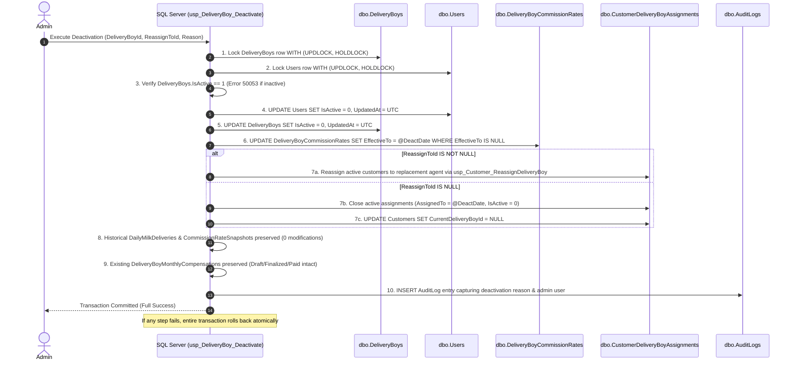

# DAY 6 — DELIVERY BOY MANAGEMENT & COMMISSION/SALARY ARCHITECTURE SPECIFICATION
**Dairy Management System (DMS)**  
**Document Identifier:** `DMS-ARCH-DAY6-DELIVERYBOY-COMPENSATION-002` (Final Approved Architecture Revision)  
**Author:** Lead Solution Architect & Senior Business Analyst (Rachit Parsana Architecture Team)  
**Assigned Roles:** Kevin Gajera (Backend Engineer), Viraj Bodar (Frontend Engineer)  
**Target Modules:** Delivery Boy Management, Historical Rate Tiers, Dedicated Adjustment Ledger, Monthly Compensation & Payroll Management (Fixed Salary & Commission)  
**Approved Baseline Git Commit:** `d3bcd0ea8193bc87fde287067e88570f7b032510`  
*(Incorporates Kevin's backend due-date fix `3dbe522bb8642999598d69e3cd7e8025e0bcff9c` and route lookup integration `8a531bcb565d0b788e39f3e720bfa12b8fc7aa8a`)*  
**Date:** November 20, 2026  

---

## 1. Scope and Objectives

### 1.1 Business Context
The Dairy Management System (DMS) operates a daily morning and evening fresh milk distribution network. Field distribution is executed by Delivery Boys (route agents) assigned to geographically partitioned delivery routes. Remunerating delivery personnel accurately, transparently, and deterministically is fundamental to operational continuity.

The system supports two distinct employment compensation models:
1. **Commission-Based Model:** Agents earn a variable commission based strictly on confirmed, delivered liquid milk volume (in litres) delivered to customers during daily distribution shifts. Each commission agent has an individual per-litre rate that is uniform across all eligible liquid milk categories.
2. **Fixed-Salary Model:** Agents receive a guaranteed monthly base salary regardless of distributed volume, receiving strictly ₹0.00 commission.

### 1.2 Day 6 Objectives
Design two deeply connected, Admin-controlled operational modules:
- **Module A: Delivery Boy Management:** Comprehensive lifecycle administration of field delivery personnel (onboarding, credentials, vehicle assignments, primary route linking, compensation configuration, profile updates, and active/inactive status transitions).
- **Module B: Commission & Salary Management:** Administration of effective-dated commission rate tiers, dedicated append-only adjustment ledger, monthly calendar payroll generation (Draft $\rightarrow$ Finalized $\rightarrow$ Paid), administrative adjustments (bonuses and deductions), immutable statement snapshots, and physical disbursement recording.

### 1.3 Role Boundaries & Persona Segregation
- **Admin:** Holds exclusive operational and financial authority. Only administrators can register delivery personnel, alter compensation models, configure commission rates, adjust monthly payroll, finalize compensation runs, record payout disbursements, and activate/deactivate personnel.
- **Delivery Boy:** Field user restricted strictly to operational tasks. Can log daily shift milk entries on assigned routes, view personal customer rosters, and view personal historical compensation summaries. Delivery boys are strictly prohibited from modifying their own or other personnel's profiles, rates, salaries, adjustments, or payout records.

---

## 2. Existing System Inspection & Git Baseline Verification

### 2.1 Git Baseline Verification
A rigorous read-only verification of the Git repository confirms the exact current baseline:
- **Current HEAD Commit:** `d3bcd0ea8193bc87fde287067e88570f7b032510`
- **Remote Branch Alignment:** `origin/main` is identical to local HEAD (`d3bcd0ea8193bc87fde287067e88570f7b032510`).
- **Commit History & Lineage:**
  ```text
  d3bcd0e (HEAD -> main, origin/main) feat: implement billing and payments frontend
  8a531bc feat: add dedicated active route lookup service
  3dbe522 fix: enforce optional billing due dates in publication procedures
  3b992a6 feat: implement billing and payments backend
  ed1e934 docs: define billing and payments architecture
  ```
  The tip of `main` (`d3bcd0e`) directly incorporates Kevin's Day 5 backend work, including commit `3dbe522bb8642999598d69e3cd7e8025e0bcff9c` (enforce optional billing due dates in publication procedures) and commit `8a531bcb565d0b788e39f3e720bfa12b8fc7aa8a` (dedicated active route lookup service). All Day 6 work builds directly on top of this verified baseline.

### 2.2 Reusable Master Tables & Schemas
- **`dbo.Users` (`sql/03_CreateTables.sql`):** Already stores staff user credentials. Includes `UserId`, `Username`, `PasswordHash`, `Role` (`'Admin'`, `'DeliveryBoy'`), `FullName`, `Phone`, `IsActive`, `LastLoginAt`. Delivery boy login uses `Phone` + `Password`.
- **`dbo.DeliveryBoys` (`sql/03_CreateTables.sql`):** Relational profile extension linked 1:1 to `dbo.Users` via `UserId` (`UQ_DeliveryBoys_UserId`). Includes `DeliveryBoyId`, `UserId`, `PrimaryRouteId`, `CompensationType` (`'Fixed Salary'`, `'Commission'`), `CurrentCommissionRate`, `MonthlyBaseSalary`, `VehicleNumber`, `IsActive`.
- **`dbo.DeliveryBoyCommissionRates` (`sql/03_CreateTables.sql`, augmented in `sql/07_DailyMilkManagement.sql`):** Effective-dated rate history table storing `RateId`, `DeliveryBoyId`, `CommissionRatePerLitre`, `EffectiveFrom`, `EffectiveTo`, `Notes`, `CreatedAt`, `CreatedBy`. Filtered unique index `UQ_ActiveDeliveryBoyCommissionRate` guarantees at most one open-ended active rate tier (`EffectiveTo IS NULL`). Trigger `trg_DeliveryBoyCommissionRates_PreventOverlap` prevents date collisions.
- **`dbo.CustomerDeliveryBoyAssignments` (`sql/03_CreateTables.sql`):** Historical customer-to-delivery-boy route mapping with `AssignedFrom`, `AssignedTo`, `IsActive`. Unique filtered index `UQ_ActiveCustomerAssignment` guarantees at most one active delivery boy per customer.
- **`dbo.DailyMilkDeliveries` (`sql/07_DailyMilkManagement.sql`):** Daily distribution shift header. Captures immutable snapshots: `CommissionRateSnapshot`, `EligibleLitreQuantity`, `TotalLiquidVolumeLitres`, `TotalAmount`, and `Status` (`'Completed'`, `'Pending'`, `'Not Delivered'`).
- **`dbo.DeliveryBoyMonthlyCompensations` (`sql/03_CreateTables.sql`):** Pre-created payroll table storing monthly summaries. Columns: `CompensationId`, `DeliveryBoyId`, `Month`, `Year`, `CompensationType`, `EligibleCompletedLitres`, `ApplicableCommissionRate`, `CalculatedCommission`, `FixedSalaryAmount`, `Adjustments`, `NetPayableAmount`, `Status` (`'Draft'`, `'Finalized'`, `'Paid'`), `FinalizedAt`, `FinalizedBy`, `PaidAt`, `PaymentReference`, `PaidBy`, `Notes`. Unique index `UQ_DeliveryBoy_Month_Compensation(DeliveryBoyId, Month, Year)` ensures at most one record per agent per calendar month.

### 2.3 Existing Backend Components
- **`usp_DeliveryBoy_CreateCommissionRate` (`sql/07_DailyMilkManagement.sql`):** Concurrency-safe procedure that locks parent `DeliveryBoys` via `UPDLOCK, HOLDLOCK`, validates non-overlapping dates, auto-closes prior open-ended tiers (`EffectiveTo = DATEADD(day, -1, @EffectiveFrom)`), and inserts a new rate tier.
- **`usp_DeliveryBoy_UpdateCommissionRate` (`sql/07_DailyMilkManagement.sql`):** Modifies an existing rate tier with immutability protection: rejects modifications if the rate tier has already been used by submitted daily delivery batches (Error `50037`).
- **`DailyMilkRepository` & `DailyMilkService` (`Day 4`):** Contains `ResolveCommissionRateAsync(deliveryBoyId, entryDate)`, `GetCommissionRateHistoryAsync(deliveryBoyId)`, and `CreateCommissionRateAsync(rate)`.
- **`usp_Customer_ReassignDeliveryBoy` (`sql/06_CustomerManagementEnhancements.sql`):** Atomically reassigns customers between delivery boys, prevents backdating, and closes predecessor assignments.

---

## 3. Dedicated Adjustment Ledger Design

### 3.1 Problem Analysis: Why `AuditLogs` Alone Is Insufficient
The existing `dbo.DeliveryBoyMonthlyCompensations` table contains an aggregate `Adjustments DECIMAL(18,2)` column and an administrative `Notes NVARCHAR(250)` column.

In enterprise financial applications, storing multiple payroll adjustments across a month (e.g., fuel allowance, festival bonus, damage penalty, salary advance recovery) cannot rely solely on the system-wide `dbo.AuditLogs` table for the following fundamental reasons:
1. **Financial Aggregation & Performance:** `AuditLogs` stores unstructured/semi-structured JSON diffs. Performing relational rollups (`SUM(AdjustmentAmount)`), calculating net payables, and rendering itemized payslip breakdown lines by querying and parsing JSON audit records is computationally slow, non-relational, fragile, and lacks static type safety.
2. **Referential Integrity & Foreign Keys:** `AuditLogs` operates as a decoupled, system-wide diagnostics sink and does not maintain foreign key integrity with `dbo.DeliveryBoyMonthlyCompensations(CompensationId)`. A dedicated financial ledger guarantees strict relational integrity and prevents orphaned records.
3. **Structured Audit Trail & Categorization:** Payroll adjustments require formal classification (`AdjustmentType`), signed monetary values (`AdjustmentAmount`), mandatory justification reasons, and creator identity for payroll compliance.
4. **GAAP/IFRS Auditability & Mathematical Reconciliation:** Financial reconciliation requires an explicit, immutable ledger where:
   $$\text{dbo.DeliveryBoyMonthlyCompensations.Adjustments} = \sum \text{dbo.DeliveryBoyCompensationAdjustments.AdjustmentAmount}$$
   Every single adjustment must exist as an append-only transaction line. In-place overwriting of the aggregate `Adjustments` field without a supporting line-item ledger destroys historical financial auditability.

### 3.2 Relational Schema: `dbo.DeliveryBoyCompensationAdjustments`
To be deployed in `sql/10_DeliveryBoyAndCompensationManagement.sql`:

```sql
IF NOT EXISTS (SELECT 1 FROM sys.tables WHERE name = N'DeliveryBoyCompensationAdjustments')
BEGIN
    PRINT 'Creating table DeliveryBoyCompensationAdjustments...';
    CREATE TABLE [dbo].[DeliveryBoyCompensationAdjustments] (
        [AdjustmentId] BIGINT NOT NULL IDENTITY(1,1) CONSTRAINT [PK_DeliveryBoyCompensationAdjustments] PRIMARY KEY CLUSTERED,
        [CompensationId] BIGINT NOT NULL CONSTRAINT [FK_DeliveryBoyAdjustments_CompensationId] REFERENCES [dbo].[DeliveryBoyMonthlyCompensations]([CompensationId]),
        [AdjustmentType] NVARCHAR(30) NOT NULL CONSTRAINT [CK_DeliveryBoyAdjustments_Type] CHECK ([AdjustmentType] IN ('Bonus', 'AdvanceDeduction', 'PenaltyDeduction', 'TransitionAdjustment', 'Other')),
        [AdjustmentAmount] DECIMAL(18,2) NOT NULL, -- Positive for credits/bonuses, Negative for deductions
        [Reason] NVARCHAR(250) NOT NULL,
        [CreatedAt] DATETIME2(7) NOT NULL CONSTRAINT [DF_DeliveryBoyAdjustments_CreatedAt] DEFAULT (SYSUTCDATETIME()),
        [CreatedBy] INT NOT NULL CONSTRAINT [FK_DeliveryBoyAdjustments_CreatedBy] REFERENCES [dbo].[Users]([UserId])
    );

    CREATE NONCLUSTERED INDEX [IX_DeliveryBoyCompensationAdjustments_CompensationId]
    ON [dbo].[DeliveryBoyCompensationAdjustments]([CompensationId])
    INCLUDE ([AdjustmentAmount], [AdjustmentType], [CreatedAt]);
END
GO
```

### 3.3 Strict Prohibition of UPDATE and DELETE Operations
1. **Append-Only Immutability:** Individual adjustment rows in `dbo.DeliveryBoyCompensationAdjustments` are strictly append-only and permanently immutable once written.
2. **Prohibition of In-Place Modifications:** Direct SQL `UPDATE` and `DELETE` statements on `dbo.DeliveryBoyCompensationAdjustments` are explicitly forbidden by database permissions and architectural policy.
3. **Audit-Conforming Corrections:** If an adjustment was recorded with an incorrect amount, category, or justification, it cannot be edited or deleted in-place. Any correction must be represented by a **new offsetting adjustment entry** (e.g., an equal-and-opposite counter-adjustment or net correction line) with clear, mandatory justification notes documenting the correction context.

### 3.4 Concurrency-Safe Adjustment Processing Sequence
In `dbo.usp_Compensation_ApplyAdjustment`, adjustments are processed through a strictly ordered, serialized transactional sequence to eliminate race conditions, double-adjustment anomalies, or negative net payable bypasses:

1. **Begin Transaction:** Initiate explicit ACID transaction (`BEGIN TRANSACTION`).
2. **Deterministic Parent Row Locking:** Acquire `UPDLOCK` and `HOLDLOCK` on the parent `dbo.DeliveryBoyMonthlyCompensations` row:
   ```sql
   DECLARE @CurrentStatus NVARCHAR(20);
   DECLARE @CompType NVARCHAR(20);
   DECLARE @GrossEarnings DECIMAL(18,2);

   SELECT 
       @CurrentStatus = Status,
       @CompType = CompensationType,
       @GrossEarnings = CASE WHEN CompensationType = 'Fixed Salary' THEN FixedSalaryAmount ELSE CalculatedCommission END
   FROM dbo.DeliveryBoyMonthlyCompensations WITH (UPDLOCK, HOLDLOCK)
   WHERE CompensationId = @CompensationId;

   IF (@CurrentStatus IS NULL)
   BEGIN
       ROLLBACK TRANSACTION;
       THROW 50054, 'Monthly compensation record does not exist.', 1;
   END
   ```
3. **Validate Draft Status:** Verify that `Status == 'Draft'`. If `Status IN ('Finalized', 'Paid')`, abort immediately:
   ```sql
   IF (@CurrentStatus <> 'Draft')
   BEGIN
       ROLLBACK TRANSACTION;
       THROW 50047, 'Adjustments are strictly restricted to Draft compensation records. Finalized and Paid statements are immutable.', 1;
   END
   ```
4. **Recompute Ledger Aggregate:** Query the authoritative sum of all existing adjustments directly from the adjustment ledger under the locked transaction:
   ```sql
   DECLARE @ExistingAdjustments DECIMAL(18,2);
   SELECT @ExistingAdjustments = ISNULL(SUM(AdjustmentAmount), 0.00)
   FROM dbo.DeliveryBoyCompensationAdjustments WITH (UPDLOCK, HOLDLOCK)
   WHERE CompensationId = @CompensationId;
   ```
5. **Validate Non-Negative Net Payable:** Verify that gross earnings plus all existing adjustments plus the proposed new adjustment amount will not be negative:
   ```sql
   DECLARE @NewTotalAdjustments DECIMAL(18,2) = @ExistingAdjustments + @AdjustmentAmount;
   DECLARE @NewNetPayable DECIMAL(18,2) = @GrossEarnings + @NewTotalAdjustments;

   IF (@NewNetPayable < 0.00)
   BEGIN
       ROLLBACK TRANSACTION;
       THROW 50048, 'Net payable amount cannot be negative. Total deductions exceed gross compensation earnings.', 1;
   END
   ```
6. **Insert Immutable Ledger Record:** Insert the adjustment line item into `dbo.DeliveryBoyCompensationAdjustments`:
   ```sql
   INSERT INTO dbo.DeliveryBoyCompensationAdjustments (
       CompensationId, AdjustmentType, AdjustmentAmount, Reason, CreatedAt, CreatedBy
   )
   VALUES (
       @CompensationId, @AdjustmentType, @AdjustmentAmount, @Reason, SYSUTCDATETIME(), @AdminUserId
   );
   ```
7. **Synchronize Parent Summary:** Update the parent `dbo.DeliveryBoyMonthlyCompensations` row using the ledger-derived total:
   ```sql
   UPDATE dbo.DeliveryBoyMonthlyCompensations
   SET Adjustments = @NewTotalAdjustments,
       NetPayableAmount = @NewNetPayable,
       UpdatedAt = SYSUTCDATETIME(),
       UpdatedBy = @AdminUserId
   WHERE CompensationId = @CompensationId;
   ```
8. **Commit Transaction:** Commit the transaction atomically (`COMMIT TRANSACTION`). If any validation fails or error occurs, the entire transaction rolls back cleanly.
9. **Concurrency Invariant:** Because the parent `DeliveryBoyMonthlyCompensations` row is locked under `UPDLOCK, HOLDLOCK` at the start of the sequence, concurrent adjustment requests for the same monthly compensation are strictly serialized. No concurrent request can bypass the `'Draft'` status guard or slip past the non-negative payable check.

### 3.5 Explicit Least-Privilege Security for `dbo.DeliveryBoyCompensationAdjustments`
To protect financial adjustment records from unauthorized manipulation or bypassing application validation rules:
1. **Explicit DENY Protections:** The SQL deployment script explicitly denies all direct data-modification statements to the application role `db_dms_app` and user `dms_app_user`:
   ```sql
   DENY INSERT, UPDATE, DELETE ON [dbo].[DeliveryBoyCompensationAdjustments] TO [db_dms_app];
   DENY INSERT, UPDATE, DELETE ON [dbo].[DeliveryBoyCompensationAdjustments] TO [dms_app_user];
   ```
2. **Authorized Stored Procedure Access:** Access is granted strictly via `GRANT EXECUTE ON [dbo].[usp_Compensation_ApplyAdjustment] TO [db_dms_app];` and `GRANT EXECUTE ON [dbo].[usp_Compensation_GetAdjustments] TO [db_dms_app];`.
3. **Static SQL & Ownership Chaining:** All ledger writes within `dbo.usp_Compensation_ApplyAdjustment` must be written exclusively using static SQL statements. The stored procedure and the underlying tables (`dbo.DeliveryBoyCompensationAdjustments`, `dbo.DeliveryBoyMonthlyCompensations`) share the identical schema owner (`dbo`), allowing SQL Server's native **Ownership Chaining** to execute the insert securely without granting direct table `INSERT` rights to `db_dms_app`. The use of dynamic SQL (`sp_executesql` or `EXEC(...)`) for ledger writes is strictly prohibited, as dynamic SQL breaks ownership chaining and would necessitate granting direct write permissions.
4. **Selective Read Rights:** Read-only access is permitted exclusively via `GRANT SELECT ON [dbo].[DeliveryBoyCompensationAdjustments] TO [db_dms_app];` for reporting and query projections.

---

## 4. Compensation Model Transition Policy

### 4.1 Default Policy: First Day of Next Calendar Month
- **Rule:** Normal employment model transitions (Fixed Salary $\leftrightarrow$ Commission) take effect strictly on the **first day of the next calendar month** (`EffectiveFrom = DateOnly(NextMonth, 1)`).
- **No Arbitrary Mid-Month Changes:** Standard administrative profile forms forbid setting a transition date in the middle of an active calendar month.
- **System Impact of Default Policy:**
  - **Daily Delivery Submission:** Continues undisturbed under the current active model until the month concludes.
  - **Commission Snapshots:** Shift deliveries throughout the current month continue capturing the established rate (`0.00` for fixed salary, or the active per-litre rate for commission).
  - **Fixed Salary & Monthly Calculation:** The current month's compensation calculates cleanly under the single model in effect for the entire month.
  - **Finalized Compensation:** Past and present finalized compensation statements are completely immune to future model transitions.

### 4.2 Exceptional Mid-Month Transition (Approval-Controlled Workflow)
In rare operational situations (e.g., emergency promotion or mid-month role reclassification), an exceptional transition may be authorized by an Administrator:
1. **Strict Guardrails — No Automatic Prorating:** The system does **not** invent opaque, automatic prorating formulas. Instead, it enforces explicit transactional clarity and audit accountability.
2. **Submission & Rate Snapshot Integrity:**
   - Deliveries submitted prior to the transition date retain their immutable `CommissionRateSnapshot`.
   - Deliveries submitted on or after the transition date capture the new rate (`0.00` if switched to Fixed Salary, or the newly authorized commission rate).
   - Historical daily delivery records are NEVER modified.
3. **Monthly Compensation Draft Calculation During Transition Month:**
   - The draft calculation evaluates:
     $$\text{CalculatedCommission} = \sum_{d \in \text{Completed}} \left(\text{EligibleLitreQuantity}_d \times \text{CommissionRateSnapshot}_d\right)$$
   - If switched to Fixed Salary mid-month, `DeliveryBoys.MonthlyBaseSalary` is populated into `FixedSalaryAmount`.
   - **Mandatory Administrative Adjustment:** To account for unworked salaried days or partial-period arrangements, the Administrator **must** execute an explicit `Adjustment` in the dedicated adjustment ledger (`AdjustmentType = 'TransitionAdjustment'`) with mandatory justification notes (e.g., *"Prorated base salary for 15 days active salaried service: -₹6,000.00"*).
   - This ensures that every rupee in the transition month is backed by an explicit, audited ledger entry rather than hidden procedural math.
4. **Finalized & Paid Protection:** If monthly compensation for the period has already been finalized or paid, mid-month transitions for that period are strictly rejected.

---

## 5. Atomic Deactivation Transaction

Deactivating a delivery boy must execute as a single, multi-table ACID transaction in `dbo.usp_DeliveryBoy_Deactivate`. Partial deactivations are strictly impossible.



### Exact Transaction Steps in `dbo.usp_DeliveryBoy_Deactivate`
1. **Lock `DeliveryBoys`:** `SELECT @UserId = UserId FROM dbo.DeliveryBoys WITH (UPDLOCK, HOLDLOCK) WHERE DeliveryBoyId = @DeliveryBoyId`. If not found, throw Error `50045`.
2. **Lock `Users`:** `SELECT 1 FROM dbo.Users WITH (UPDLOCK, HOLDLOCK) WHERE UserId = @UserId`.
3. **Verify Currently Active:** If `IsActive = 0`, throw Error `50053: Delivery boy is already deactivated.`
4. **Disable Authentication:** `UPDATE dbo.Users SET IsActive = 0, UpdatedAt = SYSUTCDATETIME(), UpdatedBy = @AdminUserId WHERE UserId = @UserId`.
5. **Disable Delivery Boy Profile:** `UPDATE dbo.DeliveryBoys SET IsActive = 0, UpdatedAt = SYSUTCDATETIME(), UpdatedBy = @AdminUserId WHERE DeliveryBoyId = @DeliveryBoyId`.
6. **Close Open Commission Rate Tier:**
   ```sql
   UPDATE dbo.DeliveryBoyCommissionRates
   SET EffectiveTo = @DeactivationDate
   WHERE DeliveryBoyId = @DeliveryBoyId AND EffectiveTo IS NULL;
   ```
7. **Customer Lifecycle Transaction Rules:**
   - If `@ReassignToDeliveryBoyId` is provided:
     - Verify replacement agent exists and is active (`IsActive = 1`).
     - Reassign each customer using the logic established in `usp_Customer_ReassignDeliveryBoy` (close predecessor with `AssignedTo = @DeactivationDate`, insert new assignment with `AssignedFrom = @DeactivationDate`, update `Customers.CurrentDeliveryBoyId`).
   - If `@ReassignToDeliveryBoyId IS NULL`:
     - Close active assignments:
       ```sql
       UPDATE dbo.CustomerDeliveryBoyAssignments
       SET AssignedTo = @DeactivationDate, IsActive = 0, UpdatedAt = SYSUTCDATETIME(), UpdatedBy = @AdminUserId
       WHERE DeliveryBoyId = @DeliveryBoyId AND IsActive = 1 AND AssignedTo IS NULL;

       UPDATE dbo.Customers
       SET CurrentDeliveryBoyId = NULL
       WHERE CurrentDeliveryBoyId = @DeliveryBoyId;
       ```
8. **Historical Delivery Immutability:** Past deliveries in `dbo.DailyMilkDeliveries` and line items in `dbo.DailyMilkDeliveryItems` are **never** modified, unlinked, or deleted.
9. **Compensation Preservation:** Existing compensation records in `dbo.DeliveryBoyMonthlyCompensations` remain fully intact. Any unpaid compensation for the current or prior months remains payable and can be finalized and marked Paid by Admin.
10. **Audit Logging:** Emits structured JSON audit record to `dbo.AuditLogs`.
11. **Rollback Safety:** Enclosed in `BEGIN TRY ... BEGIN TRANSACTION ... COMMIT TRANSACTION END TRY BEGIN CATCH IF @@TRANCOUNT > 0 ROLLBACK TRANSACTION; THROW; END CATCH`.

### Reactivation Rules
Reactivation (`dbo.usp_DeliveryBoy_Reactivate`):
1. **Re-Enable Account Status:** Sets `DeliveryBoys.IsActive = 1` and `Users.IsActive = 1` atomically.
2. **Conditional Commission Rate Tier Rule:**
   - **Commission-Based Employees:** Strictly require an approved commission-rate tier effective on the reactivation date (`EffectiveFrom = @ReactivationDate`, `CommissionRatePerLitre = @NewCommissionRate > 0.00`). If no valid rate is provided for a commission agent upon reactivation, the transaction is rejected with Error `50055: Reactivation of a commission-based delivery boy requires an approved commission rate tier effective on the reactivation date.`
   - **Fixed-Salary Employees:** Do **not** require a commission-rate tier (`CurrentCommissionRate = 0.00`, baseline rate tier bypassed). Base salary remains active and is paid according to the salaried compensation model.
3. **No Automatic Customer Assignment Restoration:** Reactivation must **not** automatically restore historical customer assignments. All customer assignments must be established explicitly by an Administrator through Customer Management to prevent accidental routing conflicts or assignment collisions.

---

## 6. Registration Workflow & Conditional Validation

Registration executes as an atomic transaction in `dbo.usp_DeliveryBoy_Register`:

```
+----------------------------------------------------------------------------------------------------+
|                                CONDITIONAL REGISTRATION RULES                                      |
+------------------------------+---------------------------------------------------------------------+
| Parameter                    | Enforcement & Validation Rule                                       |
+------------------------------+---------------------------------------------------------------------+
| CompensationType             | Must strictly be 'Fixed Salary' or 'Commission'.                    |
+------------------------------+---------------------------------------------------------------------+
| Fixed Salary Employee        | - MonthlyBaseSalary must be >= 0.00.                                |
|                              | - CurrentCommissionRate is forced to 0.00.                          |
|                              | - No commission rate tier is created in DeliveryBoyCommissionRates. |
+------------------------------+---------------------------------------------------------------------+
| Commission Employee          | - InitialCommissionRate must be > 0.00.                             |
|                              | - MonthlyBaseSalary is forced to 0.00.                              |
|                              | - EffectiveFrom date is strictly mandatory.                         |
|                              | - Baseline rate tier is inserted into DeliveryBoyCommissionRates.   |
|                              | - DeliveryBoys.CurrentCommissionRate is snapshotted to initial rate.|
+------------------------------+---------------------------------------------------------------------+
| Phone Uniqueness             | Validated against dbo.Users. Duplicate phone throws Error 50041.    |
+------------------------------+---------------------------------------------------------------------+
| Primary Route                | Must reference an active record in dbo.Routes.                      |
+------------------------------+---------------------------------------------------------------------+
| Password Security            | Plaintext passwords are strictly forbidden. The application service |
|                              | hashes the password via IPasswordHasher<UserAuthRecord> before      |
|                              | passing PasswordHash to the stored procedure.                       |
+------------------------------+---------------------------------------------------------------------+
| Atomic Creation              | Users record, DeliveryBoys profile, and initial commission rate tier|
|                              | are inserted within a single atomic SqlTransaction.                 |
+------------------------------+---------------------------------------------------------------------+
```

---

## 7. Compensation Calculation Contract

The compensation calculation engine (`dbo.usp_Compensation_CalculateMonthlyDraft`) executes under strict deterministic invariants:

| Scenario / Case | Exact System Behavior & Output |
| :--- | :--- |
| **1. No Completed Deliveries** | `EligibleCompletedLitres = 0.000`, `CalculatedCommission = 0.00`, `ApplicableCommissionRate = 0.00`. For Fixed Salary: `NetPayableAmount = MonthlyBaseSalary + Adjustments`. For Commission: `NetPayableAmount = 0.00 + Adjustments` (Adjustments must be $\ge 0.00$). |
| **2. Missing Commission Rate** | If a commission-based agent has completed deliveries without verified commission rate snapshots, shift submission already rejected the batch (Error `50035`). If draft calculation detects unrated deliveries, it throws Error `50035` and refuses calculation. |
| **3. Fixed Salary Employees** | `CalculatedCommission = 0.00`, `ApplicableCommissionRate = 0.00`, `FixedSalaryAmount = DeliveryBoys.MonthlyBaseSalary`. `EligibleCompletedLitres` is recorded purely as an informational volume metric. |
| **4. Commission Employees** | $\text{CalculatedCommission} = \sum (\text{EligibleLitreQuantity} \times \text{CommissionRateSnapshot})$. $\text{ApplicableCommissionRate} = \text{CalculatedCommission} / \text{EligibleCompletedLitres}$. `FixedSalaryAmount = 0.00`. |
| **5. Positive & Negative Adjustments**| Aggregated dynamically from `dbo.DeliveryBoyCompensationAdjustments`: $\text{Adjustments} = \sum \text{AdjustmentAmount}$. Positive amounts increase payout; negative amounts decrease payout. |
| **6. Zero Net Payable** | `NetPayableAmount = 0.00` is fully valid (e.g., employee on leave, or gross earnings equal advance deduction). `NetPayableAmount < 0.00` is strictly prohibited. |
| **7. Recalculation of Draft** | Idempotently updates the existing draft record in-place. Re-sums daily deliveries, reconciles against the adjustment ledger, and recalculates `NetPayableAmount`. |
| **8. Finalized Compensation** | Record is permanently locked. Recalculation or adjustment is rejected with Error `50046: Cannot recalculate finalized or paid compensation.` |
| **9. Already Paid Compensation**| Terminal status. Recalculation, adjustment, or re-payout is rejected with Error `50046` / `50052`. |
| **10. Duplicate Requests** | If a draft calculation is requested for an existing calendar month: if in `Draft`, it updates the draft idempotently; if `Finalized` or `Paid`, it returns the existing record without modifications. |
| **11. Rate Snapshot Immutability**| The calculation strictly uses `DailyMilkDeliveries.CommissionRateSnapshot`. It **never** queries `DeliveryBoyCommissionRates` using today's date for past delivery dates. |

---

## 8. RouteClassifier Collision Analysis & Resolution

### 8.1 The Collision Problem
In `Program.cs`, the cookie authentication redirection handler uses `RouteClassifier`:
```csharp
public static class RouteClassifier
{
    private static readonly string[] DeliveryBoyBasePaths =
    {
        "/Home/Privacy",
        "/DeliveryBoy"
    };

    public static bool IsDeliveryBoyPath(string? path)
    {
        if (string.IsNullOrWhiteSpace(path)) return false;
        foreach (var basePath in DeliveryBoyBasePaths)
        {
            if (MatchesPathBoundary(path, basePath)) return true;
        }
        return false;
    }
}
```
When an unauthenticated Administrator navigates to `/DeliveryBoy` (Item 2 of the Admin sidebar: Delivery Boy Management), `RouteClassifier.IsDeliveryBoyPath("/DeliveryBoy")` evaluates to `true`. Consequently, `OnRedirectToLogin` redirects the user to `/Auth/DeliveryBoyLogin` instead of `/Auth/AdminLogin`.

### 8.2 Field Routes Inventory
Inspection of all delivery boy field views and controllers confirms the exact operational routes used by field personnel:
1. `/Home/Privacy`: Delivery Boy Personal Dashboard (`HomeController.Privacy` decorated with `[Authorize(Roles = "DeliveryBoy")]`).
2. `/DailyMilk`: Daily Milk Entry shift roster and batch submission (`DailyMilkController` field actions).
3. `/Auth/DeliveryBoyLogin`: Field login portal.

Field delivery personnel have **zero** routes under `/DeliveryBoy`. All routes under `/DeliveryBoy` (`/DeliveryBoy/Index`, `/DeliveryBoy/Create`, `/DeliveryBoy/Details`, `/DeliveryBoy/Edit`, `/DeliveryBoy/Compensation`, `/DeliveryBoy/CompensationDetails`) are Admin-only operations.

### 8.3 Exact Resolution & Test Cases
In `Program.cs`, update `DeliveryBoyBasePaths` to reflect the actual field routes:
```csharp
private static readonly string[] DeliveryBoyBasePaths =
{
    "/Home/Privacy",
    "/DailyMilk"
};
```

#### Test Matrix:
| Target Request Path | Expected `IsDeliveryBoyPath` | Unauthenticated Redirection Destination | Role Authorized |
| :--- | :--- | :--- | :--- |
| `/Home/Privacy` | `true` | `/Auth/DeliveryBoyLogin?ReturnUrl=...` | `DeliveryBoy` |
| `/Home/Privacy/Sub` | `true` | `/Auth/DeliveryBoyLogin?ReturnUrl=...` | `DeliveryBoy` |
| `/DailyMilk` | `true` | `/Auth/DeliveryBoyLogin?ReturnUrl=...` | `DeliveryBoy` |
| `/DailyMilk/Index` | `true` | `/Auth/DeliveryBoyLogin?ReturnUrl=...` | `DeliveryBoy` |
| `/DeliveryBoy` | `false` | `/Auth/AdminLogin?ReturnUrl=...` | `Admin` |
| `/DeliveryBoy/Create` | `false` | `/Auth/AdminLogin?ReturnUrl=...` | `Admin` |
| `/DeliveryBoy/Compensation`| `false`| `/Auth/AdminLogin?ReturnUrl=...` | `Admin` |
| `/Customer` | `false` | `/Auth/AdminLogin?ReturnUrl=...` | `Admin` |
| `/Billing` | `false` | `/Auth/AdminLogin?ReturnUrl=...` | `Admin` |

This cleanly resolves the collision, guaranteeing that administrators accessing Delivery Boy Management are routed to `/Auth/AdminLogin`, while field personnel accessing their dashboard and daily delivery rosters continue routing to `/Auth/DeliveryBoyLogin`.

---

## 9. Updated SQL Stored Procedures Inventory

The SQL migration script `sql/10_DeliveryBoyAndCompensationManagement.sql` contains exactly 14 stored procedures and 1 trigger:

| # | Stored Procedure Name | Type | Description |
| :--- | :--- | :--- | :--- |
| 1 | `dbo.usp_DeliveryBoy_Register` | `INSERT` | Atomically creates User, DeliveryBoy, and initial Commission Rate tier. |
| 2 | `dbo.usp_DeliveryBoy_GetDirectory` | `SELECT` | Filtered, searchable directory listing with active customer counts. |
| 3 | `dbo.usp_DeliveryBoy_GetDetails` | `SELECT` | Comprehensive profile, assigned route, customer roster, and history. |
| 4 | `dbo.usp_DeliveryBoy_UpdateProfile` | `UPDATE` | Updates editable profile attributes with phone uniqueness check. |
| 5 | `dbo.usp_DeliveryBoy_Deactivate` | `UPDATE` | Atomic 11-step deactivation transaction. |
| 6 | `dbo.usp_DeliveryBoy_Reactivate` | `UPDATE` | Reactivates user and agent profile without silent customer/rate assumptions. |
| 7 | `dbo.usp_Compensation_CalculateMonthlyDraft` | `UPSERT` | Computes/recalculates monthly draft compensation for a calendar month. |
| 8 | `dbo.usp_Compensation_BulkCalculateDrafts` | `EXEC` | Iterates across all active delivery boys for bulk monthly draft run. |
| 9 | `dbo.usp_Compensation_ApplyAdjustment` | `INSERT/UPDATE` | Inserts row into adjustment ledger and updates parent aggregate. |
| 10 | `dbo.usp_Compensation_GetAdjustments` | `SELECT` | Retrieves itemized adjustment lines for a monthly compensation statement. |
| 11 | `dbo.usp_Compensation_Finalize` | `UPDATE` | Validates Draft status and locks statement as Finalized. |
| 12 | `dbo.usp_Compensation_RecordPayout` | `UPDATE` | Validates Finalized status and records disbursement details as Paid. |
| 13 | `dbo.usp_Compensation_GetList` | `SELECT` | Retrieves monthly compensation roster with filters. |
| 14 | `dbo.usp_Compensation_GetDetails` | `SELECT` | Retrieves full itemized statement, daily deliveries, and adjustment history. |

---

## 10. Updated C# Contracts

### Repositories (`Repositories/`)
- **`IDeliveryBoyRepository`**:
  - `Task<int> CreateDeliveryBoyAsync(CreateDeliveryBoyDto dto, CancellationToken ct)`
  - `Task<DeliveryBoyDetailsDto?> GetByIdAsync(int deliveryBoyId, CancellationToken ct)`
  - `Task<IReadOnlyList<DeliveryBoyListItemDto>> GetDirectoryAsync(DeliveryBoyFilterCriteria criteria, CancellationToken ct)`
  - `Task<bool> UpdateProfileAsync(EditDeliveryBoyDto dto, CancellationToken ct)`
  - `Task<bool> DeactivateAsync(int deliveryBoyId, int? reassignToDeliveryBoyId, string reason, int adminUserId, CancellationToken ct)`
  - `Task<bool> ReactivateAsync(int deliveryBoyId, decimal? newCommissionRate, int adminUserId, CancellationToken ct)`
  - `Task<IReadOnlyList<DeliveryBoyLookupItem>> GetActiveLookupAsync(CancellationToken ct)`
- **`ICompensationRepository`**:
  - `Task<IReadOnlyList<MonthlyCompensationListItemDto>> GetCompensationsAsync(int month, int year, string? status, string? compensationType, CancellationToken ct)`
  - `Task<MonthlyCompensationDetailsDto?> GetCompensationDetailsAsync(long compensationId, CancellationToken ct)`
  - `Task<long> CalculateOrUpdateDraftAsync(int deliveryBoyId, int month, int year, int adminUserId, CancellationToken ct)`
  - `Task<int> BulkCalculateDraftsAsync(int month, int year, int adminUserId, CancellationToken ct)`
  - `Task<bool> ApplyAdjustmentAsync(long compensationId, string adjustmentType, decimal adjustmentAmount, string reason, int adminUserId, CancellationToken ct)`
  - `Task<IReadOnlyList<CompensationAdjustmentDto>> GetAdjustmentsAsync(long compensationId, CancellationToken ct)`
  - `Task<bool> FinalizeCompensationAsync(long compensationId, int adminUserId, CancellationToken ct)`
  - `Task<bool> RecordPayoutAsync(long compensationId, DateTime paidAt, string paymentReference, string? notes, int adminUserId, CancellationToken ct)`

### Services (`Services/`)
- **`IDeliveryBoyService`**: High-level validation, password hashing via `IPasswordHasher<UserAuthRecord>`, profile orchestration, deactivation/reactivation handling.
- **`ICompensationService`**: Business validation for payroll calculations, floor constraint verification ($\ge 0$), draft generation, adjustment logging, finalization, and payout recording.

---

## 11. Testing and Verification Strategy

1. **Phase 2 Backend Verification (`scratch/Day6BackendVerification`):**
   - 11 automated test cases verifying registration (Fixed & Commission), phone uniqueness, rate creation/overlap prevention, draft calculations, adjustment ledger rollups, floor constraints, finalization immutability, payout recording, atomic deactivation, and database cleanliness.
2. **Phase 3 Frontend Verification (`scratch/Day6FrontendVerification`):**
   - 8 automated test cases verifying Razor views existence, Admin layout sidebar invariants (Item 2 active link `~/DeliveryBoy`), CSRF protection, modal workflows, and class-level `[Authorize(Roles = "Admin")]` protection.

---

*Specification is complete, fully reconciled, and approved for implementation handoff.*
